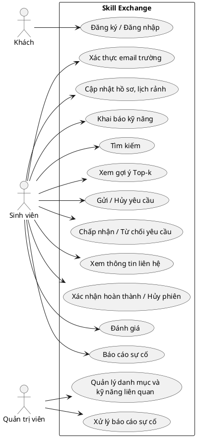
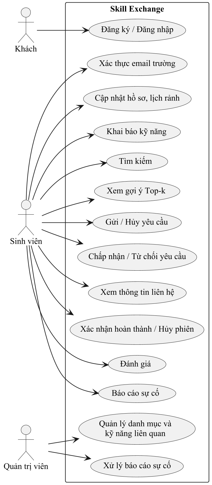

# Nội dung điền vào mẫu báo cáo – Bản đề cương (Tuần 1)

Nguồn: `Phan_tich_yeu_cau_Skill_Exchange_Tuan_1.md`. Mỗi phần dưới đây ứng với một mục trong `Mau_bao_cao_Du_an_Cong_nghe.docx`. Các đoạn đánh dấu **[CẦN BỔ SUNG]** là chỗ spec chưa có thông tin, cần tự điền trước khi nộp. Công thức viết dạng LaTeX, có thể dán vào Word qua Insert → Equation → LaTeX.

**Trang bìa – Tên đề tài:** SKILL EXCHANGE – NỀN TẢNG GHÉP CẶP TRAO ĐỔI KỸ NĂNG GIỮA SINH VIÊN

---

# CHƯƠNG 1. GIỚI THIỆU

## 1.1. Bối cảnh và lý do chọn đề tài

Trong môi trường đại học, mỗi sinh viên thường có thế mạnh riêng ở một số kỹ năng (lập trình, phân tích dữ liệu, thiết kế, ngoại ngữ, âm nhạc, kỹ năng mềm...) và đồng thời có nhu cầu học thêm những kỹ năng khác. Việc học hỏi trực tiếp giữa các sinh viên với nhau có chi phí thấp và linh hoạt, nhưng khó ở khâu tìm được đúng người: người có kỹ năng mình cần, ở trình độ phù hợp, có lịch rảnh trùng và cùng hình thức học (trực tuyến hoặc trực tiếp).

Hiện nay sinh viên chủ yếu tìm người phù hợp một cách thủ công, bằng cách đăng bài hoặc đọc bài đăng trên các nhóm mạng xã hội. Cách làm này có các hạn chế:

- Phải đọc và lọc bài đăng bằng tay, không có cơ chế ghép cặp theo kỹ năng, trình độ hay lịch rảnh.
- Khó tìm được cặp trao đổi hai chiều, tức là hai người cùng có kỹ năng mà người kia muốn học.
- Thông tin liên hệ cá nhân thường phải công khai ngay khi đăng bài.
- Không có thông tin về độ tin cậy của người dạy (đã từng hoàn thành buổi trao đổi nào chưa, được đánh giá ra sao).

Hình thức học này đã được nghiên cứu nhiều dưới tên gọi học tập đồng đẳng (peer learning). Topping [1] tổng quan sự phát triển của học tập đồng đẳng giai đoạn 1981–2006 và chỉ ra rằng lợi ích cho người hướng dẫn nay được nhấn mạnh ngang với lợi ích cho người được hướng dẫn, đồng thời lợi ích xã hội – cảm xúc được quan tâm ngang với lợi ích nhận thức. Điều này đặc biệt phù hợp với trao đổi hai chiều, khi mỗi sinh viên vừa là người dạy vừa là người học. Trong giáo dục đại học, Topping [2] phân loại các hình thức kèm cặp đồng đẳng, tổng quan nhiều nghiên cứu và kết luận rằng hiệu quả của một số hình thức đã được chứng minh.

Đề tài Skill Exchange xây dựng một nền tảng cho phép sinh viên khai báo kỹ năng có thể hướng dẫn, kỹ năng muốn học, lịch rảnh và hình thức học. Từ đó hệ thống tự lọc và xếp hạng các ứng viên phù hợp nhất cho từng người, giúp giảm công sức tìm kiếm và tăng khả năng tìm được cặp trao đổi tốt.

## 1.2. Mục tiêu của đề tài

1. **Xây dựng ứng dụng web** cho phép sinh viên đã xác thực email trường thực hiện trọn luồng: khai báo hồ sơ và kỹ năng → nhận gợi ý ứng viên → gửi và phản hồi yêu cầu trao đổi → theo dõi phiên → xác nhận hoàn thành → đánh giá.
2. **Thiết kế thuật toán gợi ý Top-k hai giai đoạn**: lọc cứng các ứng viên không hợp lệ, sau đó xếp hạng bằng hàm điểm đa tiêu chí $D(u,v)$ (kỹ năng, trình độ, lịch rảnh, hình thức học, uy tín); phân loại riêng gợi ý trao đổi hai chiều (xếp theo $MutualScore$) và mentoring một chiều (xếp theo $D$).
3. **Đánh giá thuật toán bằng thực nghiệm**: so sánh phương án đề xuất P với hai baseline B0, B1 trên dữ liệu giả lập 100 / 500 / 1.000 người dùng, 5 random seed, đo Precision@5, NDCG@5, Recommendation Coverage và thời gian xử lý; phân tích độ nhạy với 4 cấu hình trọng số. Nhãn đánh giá được gán bằng quy tắc độc lập, không dùng hàm điểm của thuật toán.
4. **Đảm bảo phân quyền và quyền riêng tư ở backend**: mọi API nhạy cảm kiểm tra đăng nhập và quyền sở hữu; thông tin liên hệ chỉ hiển thị cho hai bên sau khi yêu cầu được chấp nhận.
5. **Kiểm thử tự động** cho các điều kiện lọc, các thành phần điểm và các quy tắc nghiệp vụ chính (trạng thái phiên, đánh giá).

## 1.3. Phạm vi và đối tượng

**Đối tượng sử dụng:**

- *Sinh viên đã xác thực email trường:* quản lý hồ sơ và kỹ năng, tìm ứng viên, gửi yêu cầu trao đổi.
- *Người nhận yêu cầu:* chấp nhận hoặc từ chối yêu cầu, tham gia phiên và xác nhận hoàn thành.
- *Quản trị viên:* quản lý danh mục kỹ năng, nhóm kỹ năng liên quan và xử lý nội dung cơ bản.

**Nền tảng:** ứng dụng web (frontend và backend tách riêng).

**Trong phạm vi:** các chức năng được chia thành ba mức ưu tiên như Bảng 1.1.

*Bảng 1.1: Phạm vi chức năng theo mức ưu tiên*

| Mức | Chức năng |
| --- | --- |
| Bắt buộc (MVP) | Tài khoản và xác thực email trường; hồ sơ, gồm lịch rảnh và hình thức học; kỹ năng có thể dạy / muốn học kèm trình độ; tìm kiếm; lọc ứng viên và gợi ý Top-k một chiều / hai chiều; công thức tính điểm và giải thích kết quả; gửi yêu cầu trao đổi kèm lịch đề xuất, chấp nhận, từ chối; trạng thái phiên; xác nhận hoàn thành; báo cáo sự cố phiên; đánh giá; phân quyền backend; quản lý danh mục kỹ năng; dữ liệu giả lập, baseline, các chỉ số đánh giá và báo cáo thực nghiệm; unit test cho thuật toán và các quy tắc nghiệp vụ chính. |
| Nên có | Lọc theo hình thức học trên giao diện; thông báo cơ bản trong ứng dụng; lịch sử trao đổi; thống kê đơn giản; khảo sát người dùng. |
| Mở rộng | Chat realtime; báo cáo vi phạm nâng cao; ghép vòng bằng đồ thị; chuỗi nhiều buổi trong một thỏa thuận; dashboard thống kê nâng cao; cơ chế chứng nhận kỹ năng (chứng chỉ / bài kiểm tra) hoặc time-banking. |

Lịch rảnh và hình thức học thuộc MVP vì bước lọc cứng, các điểm thành phần $ScheduleFit$, $ModeFit$ và nhãn đánh giá đều cần hai dữ liệu này. Báo cáo sự cố phiên thuộc MVP vì đây là cách duy nhất để xử lý phiên bị kẹt ở trạng thái chờ xác nhận khi hai bên bất đồng.

**Ngoài phạm vi:** thanh toán; hệ thống khóa học; bài kiểm tra kỹ năng tự động; ghép vòng không phải chức năng bắt buộc trong 9 tuần.

**Giả định và ràng buộc:**

- Dự án cá nhân, thực hiện trong 9 tuần. Không triển khai chức năng mở rộng trước khi hoàn thành thuật toán và thực nghiệm cốt lõi.
- Kỹ năng chỉ được chọn từ danh mục chuẩn hóa do quản trị viên quản lý (không nhập tự do), khởi đầu khoảng 20–30 kỹ năng thuộc các nhóm Lập trình, Dữ liệu, Thiết kế, Ngoại ngữ, Âm nhạc, Kỹ năng mềm.
- Trình độ kỹ năng theo thang 4 bậc (Mới bắt đầu, Cơ bản, Khá, Thành thạo); lịch rảnh gồm 21 khung giờ mỗi tuần (7 ngày × Sáng / Chiều / Tối). Một yêu cầu trao đổi tương ứng với một phiên, tức một buổi gặp.
- Trình độ kỹ năng do người dùng tự khai báo, chưa được xác minh độc lập. Xác thực email trường chỉ chứng minh quyền truy cập email trường, không chứng minh trình độ kỹ năng.
- Việc đánh giá thuật toán dựa trên dữ liệu giả lập; khảo sát 15–20 sinh viên thật chỉ là phần bổ trợ định tính nếu còn thời gian ở tuần 8–9.
- Các trọng số và ngưỡng trong công thức là cấu hình ban đầu để kiểm nghiệm, không phải kết quả đã được chứng minh.

## 1.4. Đóng góp chính / điểm nổi bật của đề tài

1. **Thuật toán gợi ý Top-k hai giai đoạn có kiểm soát:** tách riêng bước lọc cứng (loại ứng viên vi phạm điều kiện bắt buộc về tài khoản, kỹ năng, lịch rảnh, hình thức học) và bước xếp hạng đa tiêu chí. Mọi thành phần điểm đều thuộc $[0,1]$, có quy tắc rõ ràng cho dữ liệu thiếu (giá trị trung tính 0.5) và cho người dùng mới (tránh cold start).
2. **Phân loại trao đổi hai chiều và mentoring một chiều:** cặp hai chiều được xếp hạng bằng trung bình nhân $MutualScore(u,v) = \sqrt{D(u,v) \times D(v,u)}$, phạt nặng các cặp lệch (một bên được lợi nhiều, bên kia ít). Hai nhóm được xếp hạng riêng, không so sánh điểm trực tiếp với nhau.
3. **Thiết kế đánh giá tránh tự chấm điểm:** nhãn đúng (Ground Truth) được gán bằng quy tắc nghiệp vụ độc lập theo thứ tự thác nước, không dùng hàm điểm $D$ hay $MutualScore$. Thực nghiệm tách bạch hai câu hỏi: mở rộng tập ứng viên có tăng độ bao phủ không (B0 so với B1), và hàm xếp hạng đa tiêu chí có cải thiện thứ tự không (B1 so với P trên cùng tập ứng viên).
4. **Quy trình phiên trao đổi chặt chẽ:** máy trạng thái cho yêu cầu và phiên, xác nhận hoàn thành từ hai phía, không tự động hủy khi có bất đồng; thông tin liên hệ chỉ mở sau khi yêu cầu được chấp nhận và quyền được kiểm tra ở backend.

## 1.5. Tiêu chí hoàn thành

Bảng 1.2 liệt kê các tiêu chí để coi đề tài là hoàn thành, mỗi tiêu chí gắn với một mục tiêu ở mục 1.2.

*Bảng 1.2: Tiêu chí hoàn thành theo từng mục tiêu*

| Gắn với mục tiêu | Tiêu chí |
| --- | --- |
| Mục tiêu 1 | Người dùng thực hiện được trọn luồng: đăng ký và xác thực email trường → khai báo kỹ năng → nhận gợi ý → gửi yêu cầu → người nhận chấp nhận → phiên chuyển qua `SCHEDULED` → `IN_PROGRESS` → `WAITING_CONFIRMATION` → `COMPLETED` → mỗi bên đánh giá một lần. Khi hai bên bất đồng, phiên được báo cáo sự cố và quản trị viên chốt sang `COMPLETED` hoặc `CANCELLED`. Quản trị viên thêm / sửa / ẩn được kỹ năng và cấu hình kỹ năng liên quan. |
| Mục tiêu 2 | Không có ứng viên vi phạm điều kiện lọc cứng nào xuất hiện trong Top-k. Mọi thành phần điểm, $D(u,v)$ và $MutualScore$ nằm trong $[0,1]$, không phát sinh lỗi chia cho 0 hoặc NaN. Phân loại đúng ghép hai chiều và một chiều; giao diện giải thích được loại đề xuất. |
| Mục tiêu 3 | Báo cáo được Precision@5, NDCG@5, Coverage và latency của B0, B1, P trên 3 quy mô dữ liệu (100 / 500 / 1.000 người dùng), mỗi quy mô 5 seed, có trung bình và độ lệch chuẩn; có bảng kết quả phân tích độ nhạy cho 4 cấu hình trọng số. Thời gian tạo Top-5 ≤ 2 giây trên 1.000 hồ sơ giả lập. |
| Mục tiêu 4 | Các API nhạy cảm từ chối người không có quyền theo đúng ma trận phân quyền (có test kiểm chứng). Thông tin liên hệ không lộ ra khi yêu cầu còn `PENDING`. |
| Mục tiêu 5 | Có bộ unit test cho các điều kiện lọc cứng, các thành phần điểm, Reputation / CompletionRate, phân loại hai chiều / một chiều, quy tắc trạng thái phiên và quy tắc đánh giá; kết quả code khớp với các ví dụ tính tay ($D = 0.94$, $NDCG@5 \approx 0.964$). |

## 1.6. Cấu trúc báo cáo

- **Chương 1 – Giới thiệu:** bối cảnh, mục tiêu, phạm vi, đóng góp và tiêu chí hoàn thành của đề tài.
- **Chương 2 – Cơ sở lý thuyết và công nghệ:** các khái niệm về hệ gợi ý Top-k và chỉ số đánh giá xếp hạng, công nghệ sử dụng, so sánh với các nền tảng đã có.
- **Chương 3 – Phân tích yêu cầu và bài toán:** phát biểu bài toán gợi ý, yêu cầu chức năng, yêu cầu phi chức năng, đặc tả chức năng chính và quy tắc nghiệp vụ.
- **Chương 4 – Thiết kế giải pháp:** kiến trúc, cơ sở dữ liệu, thuật toán lọc và chấm điểm, API và thiết kế bảo mật.
- **Chương 5 – Cài đặt:** môi trường, tổ chức mã nguồn, cài đặt các chức năng chính và triển khai.
- **Chương 6 – Kiểm thử và đánh giá:** kết quả kiểm thử và kết quả thực nghiệm so sánh thuật toán với baseline.
- **Chương 7 – Kết luận và hướng phát triển:** đối chiếu kết quả với mục tiêu, hạn chế và hướng mở rộng.

---

# CHƯƠNG 2 – MỤC 2.3. Các giải pháp và công trình liên quan

Bảng 2.2 so sánh Skill Exchange với một số nền tảng mạng xã hội, nền tảng trao đổi ngôn ngữ và mô hình ngân hàng thời gian (time-banking) đang có.

*Bảng 2.2: So sánh với các giải pháp đã có*

| Giải pháp | Điểm mạnh | Hạn chế | Nguồn |
| --- | --- | --- | --- |
| Facebook Groups (đăng bài cộng đồng tự do) | Nơi kết nối những người có cùng sở thích [3], miễn phí [4], dễ tiếp cận cộng đồng sinh viên lớn. | Tìm người thủ công qua bài đăng; Facebook chỉ gợi ý nhóm theo sở thích, không tìm thấy tính năng ghép thành viên theo kỹ năng [3]; không lọc theo lịch rảnh; thông tin liên hệ dễ bị lộ khi đăng công khai; không có cơ chế uy tín riêng cho trao đổi kỹ năng. | [3], [4] |
| LinkedIn (mạng xã hội nghề nghiệp) | Hồ sơ có mục kỹ năng (tối đa 100 kỹ năng) [5]; mạng lưới nghề nghiệp lớn nhất thế giới [6]. | Hướng tới kết nối nghề nghiệp [6], không tối ưu cho trao đổi kỹ năng ngang hàng giữa sinh viên trong trường; không có cơ chế ghép cặp để dạy và học lẫn nhau. | [5], [6] |
| Tandem (trao đổi ngoại ngữ ngang hàng) | Có nhắn tin, tin nhắn thoại, gọi thoại / video [7]; tìm bạn theo ngôn ngữ, vị trí, sở thích [7], [8]. | Chỉ dành cho học ngoại ngữ [7], không hướng tới kỹ năng như lập trình, thiết kế, kỹ năng mềm; trong tài liệu chính thức không thấy tính năng đối khớp khung giờ rảnh [7], [8]. | [7], [8] |
| TimeRepublik, Simbi (ngân hàng thời gian) | Trao đổi dịch vụ lấy đơn vị trung gian thay cho tiền: TimeRepublik dùng TimeCoin, mỗi TimeCoin ứng với 15 phút dịch vụ [9]; Simbi, hiện vẫn hoạt động [10], dùng credit nội bộ không quy đổi ra tiền [11]; hỗ trợ nhiều loại kỹ năng. | Trao đổi gián tiếp qua đơn vị trung gian, không tập trung vào ghép tương hỗ trực tiếp (A dạy B và B dạy A); website TimeRepublik vẫn truy cập được nhưng không có dấu hiệu cập nhật sau năm 2020 [9]. | [9]–[11] |
| Đề tài này (Skill Exchange) | Gợi ý Top-k đa tiêu chí (kỹ năng, trình độ, lịch rảnh, hình thức học, uy tín), phân loại riêng trao đổi hai chiều và mentoring một chiều; thông tin liên hệ chỉ mở cho hai bên sau khi yêu cầu được chấp nhận, kiểm tra quyền ở backend; quy trình phiên có xác nhận hoàn thành từ hai phía. | (1) Trình độ là tự khai báo, chưa có sát hạch độc lập nên có thể sai lệch; xác thực email trường không chống được khai khống kỹ năng. (2) Quy mô người dùng ban đầu chỉ trong phạm vi trường nên xác suất tìm được cặp hai chiều trực tiếp thấp hơn các nền tảng toàn cầu. (3) Chất lượng phiên phụ thuộc vào tính tự giác của sinh viên do chưa có chế tài. (4) Thuật toán chỉ được đánh giá trên dữ liệu giả lập; nhãn phản ánh kịch bản mô phỏng, chưa chứng minh mức phù hợp thực tế. | – |

Các nhận định về điểm mạnh của các nền tảng trên được đối chiếu với trang chính thức của từng nền tảng (truy cập ngày 24/10/2026). Nhận định về hạn chế là đánh giá của người thực hiện khi so với nhu cầu của đề tài.

Về mặt học thuật, bài toán gợi ý người cho người, trong đó cả hai phía đều phải đồng ý, được gọi là hệ gợi ý tương hỗ (reciprocal recommender system). Theo tổng quan của Palomares và cộng sự [13], các hệ này thường tính mức tương hợp hai chiều bằng cách kết hợp các điểm đánh giá một chiều giữa hai người dùng. RECON [12], một hệ gợi ý tương hỗ cho hẹn hò trực tuyến, tính điểm một chiều theo cả hai hướng rồi kết hợp bằng trung bình điều hòa. Đề tài dùng cùng ý tưởng nhưng kết hợp bằng trung bình nhân ($MutualScore$, mục 3.1); cả hai cách đều cho điểm thấp khi một chiều tốt còn chiều kia kém, khác với trung bình cộng.

---

# CHƯƠNG 3. PHÂN TÍCH YÊU CẦU VÀ BÀI TOÁN

## 3.1. Phát biểu bài toán

Hệ thống giải bài toán **gợi ý Top-k ứng viên phù hợp cho từng người dùng** (Top-k Recommendation), không phải bài toán ghép cặp toàn cục tối ưu cho cả hệ thống (Global Bipartite Matching / Stable Marriage). Hệ thống vận hành như một sàn kết nối học tập ngang hàng: mỗi người dùng nhận một danh sách ứng viên có độ tương thích cao nhất với mình và tự quyết định gửi lời mời cho ai, thay vì bị hệ thống gán cố định với một người duy nhất. Vì vậy trọng tâm kỹ thuật là hàm lọc cứng và hàm xếp hạng đa tiêu chí, được đo bằng Precision@k và NDCG@k [14].

**Ký hiệu:** $u$ là người đang tìm (người học), $v$ là ứng viên (người dạy); $W_u$ là tập kỹ năng $u$ muốn học, $T_v$ là tập kỹ năng $v$ có thể dạy.

**Đầu vào:**

- Danh mục kỹ năng chuẩn hóa và độ tương đồng giữa hai kỹ năng: $Sim(s,t) = 1.0$ nếu trùng chính xác, $0.5$ nếu cùng nhóm và được quản trị viên đánh dấu liên quan, $0.0$ nếu không liên quan.
- Tập người dùng $U$; với mỗi người: trạng thái tài khoản và xác thực email trường; $T_v$ kèm trình độ tự khai (thang 1–4); $W_u$ kèm mức mục tiêu (thang 1–4, không bắt buộc); tập khung giờ rảnh trong 21 khung/tuần (có thể chưa khai báo); hình thức học `ONLINE` / `OFFLINE` / `ANY` (có thể chưa khai báo); lịch sử đánh giá và lịch sử phiên.
- Người dùng truy vấn $u$ và số lượng gợi ý $k$ (thực nghiệm dùng $k = 5$).

**Đầu ra:** hai danh sách xếp hạng riêng biệt cho $u$, mỗi ứng viên kèm giải thích điểm thành phần:

- Danh sách **trao đổi hai chiều** (ưu tiên hiển thị): các $v$ có $SkillFit(u,v) > 0$ và $SkillFit(v,u) > 0$ (tính cả kỹ năng liên quan), xếp giảm dần theo $MutualScore(u,v) = \sqrt{D(u,v) \times D(v,u)}$.
- Danh sách **mentoring một chiều**: các $v$ có $SkillFit(u,v) > 0$ nhưng $SkillFit(v,u) = 0$, xếp giảm dần theo $D(u,v)$.

**Ràng buộc (lọc cứng – Giai đoạn 1).** Ứng viên $v$ chỉ được xếp hạng khi thỏa mãn toàn bộ:

1. $v \neq u$.
2. Tài khoản $v$ đang hoạt động và đã xác thực email trường.
3. $SkillFit(u,v) > 0$, với $SkillFit(u,v) = \frac{1}{|W_u|} \sum_{s \in W_u} \max_{t \in T_v} Sim(s,t)$.
4. Nếu cả hai đã khai báo lịch rảnh thì phải có ít nhất một khung giờ trùng.
5. Nếu cả hai đã khai báo hình thức học thì không được xung đột hoàn toàn (một bên chỉ `ONLINE`, bên kia chỉ `OFFLINE`).

Dữ liệu **chưa khai báo** không làm ứng viên bị loại; chỉ dữ liệu **đã khai báo nhưng không phù hợp** mới bị loại.

**Hàm xếp hạng (Giai đoạn 2).** Với ứng viên hợp lệ:

$$D(u,v) = 0.55 \cdot SkillFit + 0.20 \cdot LevelFit + 0.15 \cdot ScheduleFit + 0.05 \cdot ModeFit + 0.05 \cdot Reputation(v)$$

Mọi thành phần thuộc $[0,1]$ và tổng trọng số bằng 1 nên $D(u,v) \in [0,1]$. Dữ liệu thiếu nhận giá trị trung tính 0.5; người dùng chưa có lịch sử có $Reputation = 0.5$. Định nghĩa chi tiết từng thành phần trình bày ở mục 4.3.

**Mục tiêu:** sắp xếp sao cho các ứng viên thật sự phù hợp đứng đầu danh sách, đo bằng Precision@5 và NDCG@5 so với nhãn đúng được gán bằng quy tắc độc lập (không dùng $D$ hay $MutualScore$), đồng thời giữ thời gian tạo Top-5 ≤ 2 giây trên 1.000 hồ sơ.

**Câu hỏi đánh giá:**

- **RQ1:** Mở rộng tập ứng viên bằng kỹ năng liên quan (B1) có làm tăng Recommendation Coverage so với chỉ dùng kỹ năng trùng chính xác (B0) không?
- **RQ2:** Trên cùng tập ứng viên, xếp hạng đa tiêu chí (P) có cải thiện Precision@5 và NDCG@5 so với xếp hạng chỉ theo $SkillFit$ (B1) không?
- **RQ3:** Kết quả của P thay đổi thế nào khi thay đổi bộ trọng số (4 cấu hình trong phân tích độ nhạy)?

## 3.2. Yêu cầu chức năng

Bảng 3.1 liệt kê các yêu cầu chức năng theo ba mức ưu tiên, khớp với phạm vi ở Bảng 1.1. Mỗi yêu cầu có một mã để tham chiếu ở phần thiết kế và kiểm thử.

*Bảng 3.1: Danh sách yêu cầu chức năng*

| Mã | Chức năng | Mức ưu tiên | Mô tả ngắn |
| --- | --- | --- | --- |
| FR-01 | Tài khoản và xác thực | Bắt buộc | Đăng ký, đăng nhập, đăng xuất; chỉ tài khoản đã xác thực email trường mới được tham gia gợi ý / ghép cặp. |
| FR-02 | Quản lý hồ sơ, lịch rảnh, hình thức học | Bắt buộc | Cập nhật hồ sơ; khai báo lịch rảnh theo 21 khung giờ trong tuần và hình thức học (`ONLINE` / `OFFLINE` / `ANY`). |
| FR-03 | Khai báo kỹ năng | Bắt buộc | Chọn kỹ năng từ danh mục chuẩn hóa; khai báo trình độ tự đánh giá cho kỹ năng dạy và mức mục tiêu (không bắt buộc) cho kỹ năng muốn học, theo thang 4 bậc. |
| FR-04 | Gợi ý ứng viên Top-k | Bắt buộc | Tạo danh sách ứng viên đủ điều kiện, phân loại trao đổi hai chiều và mentoring một chiều, xếp hạng và giải thích kết quả theo các điểm thành phần. |
| FR-05 | Yêu cầu trao đổi | Bắt buộc | Gửi yêu cầu ghi rõ loại (hai chiều / một chiều), kỹ năng từng chiều và lịch đề xuất (thời điểm, thời lượng, hình thức, địa điểm / link); người nhận chấp nhận hoặc từ chối; người gửi hủy được khi yêu cầu còn chờ. |
| FR-06 | Theo dõi phiên trao đổi | Bắt buộc | Theo dõi trạng thái phiên và xác nhận hoàn thành từ hai phía theo quy tắc trạng thái. |
| FR-07 | Đánh giá | Bắt buộc | Chỉ người tham gia phiên đã hoàn thành mới được đánh giá; mỗi người đánh giá một lần cho mỗi phiên. |
| FR-08 | Quản trị danh mục kỹ năng | Bắt buộc | Quản trị viên thêm, sửa, ẩn kỹ năng và cấu hình các kỹ năng liên quan. |
| FR-09 | Báo cáo sự cố phiên | Bắt buộc | Người tham gia gửi báo cáo sự cố cho phiên; quản trị viên xem xét và chốt phiên sang `COMPLETED` hoặc `CANCELLED` kèm lý do. |
| FR-10 | Tìm kiếm | Bắt buộc | Tìm kiếm người dùng / kỹ năng trong hệ thống. |
| FR-11 | Thực nghiệm đánh giá thuật toán | Bắt buộc | Sinh dữ liệu giả lập có seed cố định, gán nhãn đúng, chạy B0 / B1 / P và xuất Precision@5, NDCG@5, Coverage, latency. |
| FR-12 | Lọc theo hình thức học | Nên có | Bộ lọc trên giao diện để chỉ xem ứng viên Online hoặc Offline. |
| FR-13 | Thông báo trong ứng dụng | Nên có | Thông báo khi có yêu cầu mới hoặc phiên đổi trạng thái. |
| FR-14 | Lịch sử trao đổi | Nên có | Xem lại các yêu cầu và phiên đã tham gia. |
| FR-15 | Thống kê đơn giản | Nên có | Thống kê cơ bản về người dùng, kỹ năng, phiên. |
| FR-16 | Khảo sát người dùng | Nên có | Thu thập phản hồi định tính từ sinh viên thật. |
| FR-17 | Chat realtime | Mở rộng | Nhắn tin thời gian thực giữa hai bên. |
| FR-18 | Báo cáo vi phạm nâng cao | Mở rộng | Quy trình báo cáo và xử lý vi phạm chi tiết hơn. |
| FR-19 | Ghép vòng | Mở rộng | Ghép vòng (A dạy B, B dạy C, C dạy A) bằng đồ thị. |
| FR-20 | Chuỗi nhiều buổi | Mở rộng | Một thỏa thuận trao đổi gồm nhiều buổi gặp. |
| FR-21 | Dashboard thống kê nâng cao | Mở rộng | Biểu đồ và chỉ số thống kê chi tiết. |
| FR-22 | Chứng nhận kỹ năng / time-banking | Mở rộng | Xác minh kỹ năng bằng chứng chỉ / bài kiểm tra hoặc cơ chế tín chỉ thời gian. |

Hình 3.1 thể hiện sơ đồ use case tổng quát của hệ thống với ba tác nhân:

- *Khách:* Đăng ký, Đăng nhập.
- *Sinh viên:* Xác thực email trường, Cập nhật hồ sơ, Khai báo kỹ năng, Khai báo lịch rảnh, Tìm kiếm, Xem gợi ý ứng viên, Gửi yêu cầu, Hủy yêu cầu, Chấp nhận / Từ chối yêu cầu, Xem thông tin liên hệ, Xác nhận hoàn thành phiên, Hủy phiên, Đánh giá, Báo cáo sự cố.
- *Quản trị viên:* Quản lý danh mục kỹ năng, Cấu hình kỹ năng liên quan, Xử lý báo cáo sự cố (chốt phiên).

Mã PlantUML để sinh hình (dán vào https://www.plantuml.com/plantuml):

*Hình 3.1: Sơ đồ use case tổng quát*

## 3.3. Yêu cầu phi chức năng

Bảng 3.2 liệt kê các yêu cầu phi chức năng, mỗi yêu cầu kèm cách kiểm tra để có thể đo hoặc kiểm chứng được.

*Bảng 3.2: Danh sách yêu cầu phi chức năng*

| Mã | Nhóm | Yêu cầu | Cách kiểm tra |
| --- | --- | --- | --- |
| NFR-01 | Bảo mật | Băm mật khẩu; kiểm tra đăng nhập, quyền sở hữu tài nguyên và quyền truy cập ở backend cho mọi API nhạy cảm, theo ma trận phân quyền ở mục 3.5. | Test gọi API bằng tài khoản không có quyền phải bị từ chối; kiểm tra mật khẩu trong CSDL không lưu dạng rõ. |
| NFR-02 | Riêng tư | Email trường chỉ dùng để xác thực danh tính sinh viên; số điện thoại / liên hệ cá nhân không công khai, chỉ hiển thị cho hai bên sau khi yêu cầu được chấp nhận. | Test API hồ sơ / yêu cầu khi đang `PENDING` không trả về thông tin liên hệ; sau `ACCEPTED` mới trả về. |
| NFR-03 | Hiệu năng | Tạo và xếp hạng gợi ý Top-5 ≤ 2 giây trên 1.000 hồ sơ giả lập trong môi trường phát triển. | Đo thời gian trung bình trong thực nghiệm (FR-11), ghi rõ cấu hình máy và cách đo. |
| NFR-04 | Tính đúng | Điểm thành phần và tổng điểm thuộc $[0,1]$; xử lý an toàn dữ liệu thiếu (không chia cho 0, không phát sinh NaN); loại bỏ ứng viên vi phạm điều kiện cứng. | Unit test cho từng điều kiện lọc và từng thành phần điểm, gồm các trường hợp thiếu dữ liệu. |
| NFR-05 | Bảo trì | Tách biệt mô-đun lọc cứng (Filtering) và chấm điểm (Ranking); tập trung cấu hình trọng số tại một chỗ để dễ phân tích độ nhạy. | Đổi bộ trọng số chỉ cần sửa cấu hình, không sửa mã thuật toán; chạy được 4 cấu hình trong thực nghiệm. |
| NFR-06 | Tái lập thực nghiệm | Dữ liệu giả lập sinh theo quy tắc cố định với random seed; chạy lại cùng seed cho cùng kết quả. | Chạy thực nghiệm hai lần với cùng seed, so sánh kết quả. |
| NFR-07 | Khả năng triển khai | Người khác dựng được toàn bộ hệ thống từ mã nguồn theo hướng dẫn ở Phụ lục; CSDL chạy bằng `docker compose up`, cấu hình bí mật lấy từ biến môi trường. | Làm theo Phụ lục trên một máy chưa cài dự án và chạy được luồng đăng ký → gợi ý. |
| NFR-08 | Tương thích nền tảng | Giao diện hoạt động trên phiên bản mới của Chrome, Edge, Firefox và hiển thị được ở màn hình rộng 360 px. | Thử các màn hình chính trên ba trình duyệt và ở chế độ thiết bị di động của trình duyệt. |
| NFR-09 | Khả năng sử dụng | Mỗi gợi ý hiển thị loại đề xuất (hai chiều / một chiều) và lý do phù hợp (kỹ năng khớp, khung giờ trùng, hình thức học). | Kiểm tra màn hình gợi ý với các trường hợp kỹ năng trùng chính xác và kỹ năng liên quan. |

---

# TÀI LIỆU THAM KHẢO

Đánh số theo thứ tự xuất hiện trong báo cáo (kiểu IEEE). DOI của các bài báo đã được đối chiếu với Crossref; các trang web được truy cập ngày 24/10/2026.

[1] K. J. Topping, "Trends in peer learning," *Educational Psychology*, vol. 25, no. 6, pp. 631–645, 2005, doi: 10.1080/01443410500345172.

[2] K. J. Topping, "The effectiveness of peer tutoring in further and higher education: A typology and review of the literature," *Higher Education*, vol. 32, no. 3, pp. 321–345, 1996, doi: 10.1007/BF00138870.

[3] Meta, "Groups," *Facebook Help Center*. [Trực tuyến]. Địa chỉ: https://www.facebook.com/help/1629740080681586 (Truy cập: 24/10/2026).

[4] Meta, "Điều khoản dịch vụ." [Trực tuyến]. Địa chỉ: https://www.facebook.com/terms.php (Truy cập: 24/10/2026).

[5] LinkedIn, "Add and remove skills on your profile," *LinkedIn Help*. [Trực tuyến]. Địa chỉ: https://www.linkedin.com/help/linkedin/answer/a549047 (Truy cập: 24/10/2026).

[6] LinkedIn, "About LinkedIn." [Trực tuyến]. Địa chỉ: https://about.linkedin.com/ (Truy cập: 24/10/2026).

[7] Tandem, "Tandem Language Exchange App." [Trực tuyến]. Địa chỉ: https://www.tandem.net/ (Truy cập: 24/10/2026).

[8] Tandem, "Everything you can do on Tandem (and why it works for language learning)," *Tandem Blog*. [Trực tuyến]. Địa chỉ: https://tandem.net/en/blog/tandem-app-overview (Truy cập: 24/10/2026).

[9] TimeRepublik, "TimeRepublik – Goodbye cash, hello community." [Trực tuyến]. Địa chỉ: https://timerepublik.com/ (Truy cập: 24/10/2026).

[10] Simbi Community Development, "Simbi." [Trực tuyến]. Địa chỉ: https://simbi.com/ (Truy cập: 24/10/2026).

[11] Simbi Community Development, "Frequently asked questions." [Trực tuyến]. Địa chỉ: https://simbi.com/faq (Truy cập: 24/10/2026).

[12] L. Pizzato, T. Rej, T. Chung, I. Koprinska, and J. Kay, "RECON: A reciprocal recommender for online dating," in *Proc. 4th ACM Conf. Recommender Systems (RecSys '10)*, 2010, pp. 207–214, doi: 10.1145/1864708.1864747.

[13] I. Palomares, C. Porcel, L. Pizzato, I. Guy, and E. Herrera-Viedma, "Reciprocal recommender systems: Analysis of state-of-art literature, challenges and opportunities towards social recommendation," *Information Fusion*, vol. 69, pp. 103–127, 2021, doi: 10.1016/j.inffus.2020.12.001.

[14] K. Järvelin and J. Kekäläinen, "Cumulated gain-based evaluation of IR techniques," *ACM Transactions on Information Systems*, vol. 20, no. 4, pp. 422–446, 2002, doi: 10.1145/582415.582418.
