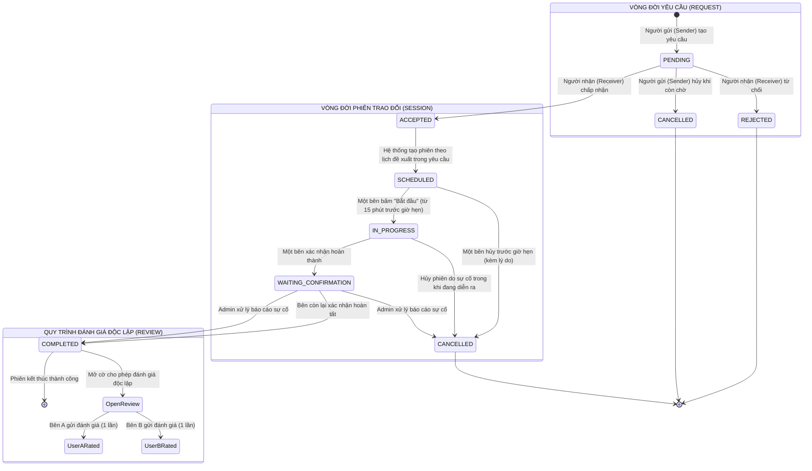

# PHÂN TÍCH YÊU CẦU – TUẦN 1

**SKILL EXCHANGE – NỀN TẢNG GHÉP CẶP TRAO ĐỔI KỸ NĂNG GIỮA SINH VIÊN**

Dự án cá nhân | Thời gian thực hiện: 9 tuần

*Cập nhật 2026-10-24:* đồng bộ với `Skill_Exchange_Proposal_9_Tuan.md`, báo cáo tuần 1–2 và thiết kế tuần 2. Các điểm còn mở được đánh dấu ⚠ và tổng hợp ở mục 5.5.

*Cập nhật 2026-10-29:* sửa theo rà soát (`docs/ra_soat/Bao_cao_ra_soat.md`): admin không tham gia ghép cặp (4.2, 6.3); kỹ năng bị ẩn vẫn dùng trong matching (4.1); mẫu số CompletionRate chỉ gồm phiên đã kết thúc (4.3); bằng điểm theo sai số $10^{-9}$ (4.4); sắp lại nhóm unit test (7.1) và kế hoạch tuần 5–7 (9).

*Cập nhật 2026-11-01:* sửa theo góp ý của giảng viên sau báo cáo tuần 2: nhãn tính trên giá trị thật, thuật toán chỉ thấy giá trị tự khai có nhiễu (5.1, 5.4); thêm mốc ngẫu nhiên, thí nghiệm bỏ từng thành phần và lập luận về lợi thế của P (5.2); lý do chọn mẫu số của ScheduleFit và so sánh với hai công thức khác trong phân tích độ nhạy (4.3, 5.4); đóng điểm mở C5 (5.5).

## 1. Bối cảnh và mục tiêu

Sinh viên có thể sở hữu các kỹ năng khác nhau và có nhu cầu học hỏi lẫn nhau, nhưng thường phải tìm người phù hợp thủ công qua bài đăng hoặc mạng xã hội. Skill Exchange cho phép người dùng khai báo kỹ năng có thể hướng dẫn, kỹ năng muốn học, lịch rảnh và hình thức học; hệ thống tạo danh sách ứng viên và xếp hạng mức độ phù hợp.

Trọng tâm kỹ thuật là thuật toán ghép cặp và đánh giá chất lượng gợi ý. Các chức năng tài khoản, hồ sơ, yêu cầu trao đổi và đánh giá hỗ trợ luồng nghiệp vụ này.

### 1.1. Người dùng

- Sinh viên đã xác thực email trường: quản lý hồ sơ/kỹ năng, tìm ứng viên và gửi yêu cầu.

- Người nhận yêu cầu: chấp nhận/từ chối, tham gia phiên và xác nhận hoàn thành.

- Quản trị viên: quản lý danh mục kỹ năng và kỹ năng liên quan, xử lý báo cáo sự cố, khóa/mở khóa tài khoản.

## 2. Phạm vi dự án

| Mức | Chức năng |
| --- | --- |
| Bắt buộc (MVP) | Tài khoản và xác thực email trường; hồ sơ, gồm lịch rảnh và hình thức học; kỹ năng có thể dạy/muốn học kèm trình độ; tìm kiếm và xem hồ sơ công khai; lọc ứng viên và gợi ý Top-k một chiều/hai chiều; công thức tính điểm và giải thích kết quả; gửi yêu cầu trao đổi kèm lịch đề xuất, chấp nhận, từ chối; trạng thái phiên; xác nhận hoàn thành; báo cáo sự cố phiên; đánh giá; phân quyền backend; quản trị cơ bản (danh mục kỹ năng, khóa/mở khóa tài khoản); dữ liệu giả lập, baseline, các chỉ số đánh giá và báo cáo thực nghiệm; unit test cho thuật toán và các quy tắc nghiệp vụ chính. |
| Nên có | Quên mật khẩu (đặt lại qua email); lọc theo hình thức học trên giao diện; thông báo cơ bản trong ứng dụng; lịch sử trao đổi; thống kê đơn giản; khảo sát người dùng. |
| Mở rộng | Chat realtime; báo cáo vi phạm nâng cao; ghép vòng bằng đồ thị; chuỗi nhiều buổi trong một thỏa thuận; dashboard thống kê nâng cao; cơ chế chứng nhận kỹ năng (chứng chỉ/bài kiểm tra) hoặc time-banking. |

Không cam kết ghép vòng là chức năng bắt buộc trong 9 tuần. Thanh toán, hệ thống khóa học và bài kiểm tra kỹ năng tự động nằm ngoài phạm vi MVP. Không triển khai chức năng mở rộng trước khi hoàn thành thuật toán và thực nghiệm cốt lõi.

Lịch rảnh và hình thức học thuộc MVP vì lọc cứng (4.2), ScheduleFit, ModeFit (4.3) và nhãn Ground Truth (5.1) đều cần hai dữ liệu này. Báo cáo sự cố phiên thuộc MVP vì đây là cách duy nhất để xử lý phiên bị kẹt ở `WAITING_CONFIRMATION` (6.2).

## 3. Yêu cầu chức năng

Mã FR thống nhất với Bảng 3.1 của báo cáo đề cương tuần 1. FR-23 được thêm khi đồng bộ với proposal.

| Mã | Mức | Yêu cầu |
| --- | --- | --- |
| FR-01 | Bắt buộc | Đăng ký bằng email trường, xác thực email, đăng nhập, đăng xuất; chỉ tài khoản đã xác thực email trường mới được matching. |
| FR-02 | Bắt buộc | Cập nhật hồ sơ và thông tin cần thiết; khai báo lịch rảnh theo khung giờ trong tuần và hình thức học (`ONLINE` / `OFFLINE` / `ANY`) theo mục 4.6. |
| FR-03 | Bắt buộc | Chọn kỹ năng từ danh mục chuẩn hóa; khai báo trình độ tự đánh giá cho kỹ năng có thể dạy và mức mục tiêu (không bắt buộc) cho kỹ năng muốn học, theo thang 4 bậc ở mục 4.6. |
| FR-04 | Bắt buộc | Tạo danh sách ứng viên đủ điều kiện, phân loại matching hai chiều và học một chiều, xếp hạng và giải thích kết quả theo các điểm thành phần. |
| FR-05 | Bắt buộc | Gửi yêu cầu ghi rõ loại (hai chiều/một chiều), kỹ năng của từng chiều và lịch đề xuất (mục 6.4); người nhận chấp nhận/từ chối; người gửi hủy khi yêu cầu còn chờ. |
| FR-06 | Bắt buộc | Theo dõi phiên trao đổi và xác nhận hoàn thành theo quy tắc trạng thái. |
| FR-07 | Bắt buộc | Chỉ người tham gia phiên đã hoàn thành mới được đánh giá; mỗi người đánh giá một lần/phiên. |
| FR-08 | Bắt buộc | Quản trị viên thêm/sửa/ẩn kỹ năng, cấu hình kỹ năng liên quan; khóa/mở khóa tài khoản (người đã có lịch sử chỉ bị khóa, không bị xóa). |
| FR-09 | Bắt buộc | Người tham gia gửi báo cáo sự cố cho phiên; quản trị viên xem xét và chốt phiên sang `COMPLETED` hoặc `CANCELLED` kèm lý do (mục 6.2). |
| FR-10 | Bắt buộc | Tìm kiếm người dùng theo kỹ năng hoặc tên; xem hồ sơ công khai (không có thông tin liên hệ, NFR-02). |
| FR-11 | Bắt buộc | Thực nghiệm đánh giá thuật toán: sinh dữ liệu giả lập có seed cố định, gán nhãn, chạy B0 / B1 / P và xuất Precision@5, NDCG@5, Coverage, latency (mục 5). |
| FR-12 | Nên có | Bộ lọc trên giao diện để chỉ xem ứng viên Online hoặc Offline. |
| FR-13 | Nên có | Thông báo trong ứng dụng khi có yêu cầu mới hoặc phiên đổi trạng thái. |
| FR-14 | Nên có | Lịch sử trao đổi: xem lại các yêu cầu và phiên đã tham gia. |
| FR-15 | Nên có | Thống kê cơ bản về người dùng, kỹ năng, phiên. |
| FR-16 | Nên có | Khảo sát người dùng thật để thu phản hồi định tính. |
| FR-17 | Mở rộng | Chat realtime giữa hai bên. |
| FR-18 | Mở rộng | Báo cáo vi phạm nâng cao. |
| FR-19 | Mở rộng | Ghép vòng (A dạy B, B dạy C, C dạy A) bằng đồ thị. |
| FR-20 | Mở rộng | Một thỏa thuận trao đổi gồm nhiều buổi gặp. |
| FR-21 | Mở rộng | Dashboard thống kê nâng cao. |
| FR-22 | Mở rộng | Chứng nhận kỹ năng (chứng chỉ/bài kiểm tra) hoặc time-banking. |
| FR-23 | Nên có | Quên mật khẩu: gửi mã đặt lại qua email trường. |

## 4. Đặc tả thuật toán matching

### 4.0. Định nghĩa bài toán
Hệ thống giải bài toán **Gợi ý Top-k ứng viên phù hợp cho từng người dùng (Top-k Recommendation)**, KHÔNG PHẢI bài toán **Ghép cặp toàn cục tối ưu hệ thống (Global Bipartite Matching / Stable Marriage)**.
- **Bản chất nghiệp vụ:** Hệ thống vận hành như một sàn kết nối / mạng xã hội học thuật P2P. Mỗi người dùng khi truy cập sẽ nhận được danh sách Top-k ứng viên có độ tương thích cao nhất với mình để chủ động gửi lời mời trao đổi.
- **Lý do kỹ thuật:** Vì người dùng có quyền tự do lựa chọn đối tác dựa trên gợi ý (thay vì bị hệ thống ép buộc gán cố định 1-1 với một người duy nhất toàn hệ thống), trọng tâm kỹ thuật là hàm lọc cứng và hàm xếp hạng đa tiêu chí (Ranking Function), đo lường bằng Precision@k và NDCG@k.
- **Tách biệt 2 giai đoạn cốt lõi:**
  1. *Giai đoạn 1 - Lọc ứng viên hợp lệ (Candidate Retrieval & Hard Filtering):* Loại bỏ triệt để các ứng viên vi phạm điều kiện bắt buộc trước khi tính điểm.
  2. *Giai đoạn 2 - Chấm điểm và xếp hạng (Scoring & Ranking):* Áp dụng công thức đa tiêu chí $D(u,v)$ và $MutualScore$ để xếp hạng Top-k trên tập ứng viên hợp lệ.

### 4.1. Chuẩn hóa danh mục kỹ năng

| Quan hệ kỹ năng | Sim(s,t) |
| --- | --- |
| Trùng chính xác | 1.0 |
| Cùng nhóm và được admin đánh dấu liên quan | 0.5 |
| Không liên quan | 0.0 |

Người dùng chỉ chọn kỹ năng từ danh mục chuẩn hóa do admin quản lý (không nhập văn bản tự do). Khởi đầu với khoảng 20–30 kỹ năng thuộc các nhóm như Lập trình, Dữ liệu, Thiết kế, Ngoại ngữ, Âm nhạc và Kỹ năng mềm.

**Kỹ năng bị ẩn:** admin ẩn một kỹ năng nghĩa là ngừng cho chọn mới. Người dùng đã có kỹ năng đó thì vẫn giữ, và kỹ năng đó vẫn được dùng bình thường trong matching ($W_u$, $T_v$, quan hệ liên quan), tìm kiếm và kiểm tra $Sim > 0$ khi tạo yêu cầu.

Gọi $W_u$ là tập kỹ năng $u$ muốn học, $T_v$ là tập kỹ năng $v$ có thể dạy:
$$SkillFit(u,v) = \frac{1}{|W_u|} \sum_{s \in W_u} \max_{t \in T_v} Sim(s,t)$$

### 4.2. Giai đoạn 1: Lọc ứng viên cứng (Candidate Retrieval & Hard Filtering)

Một ứng viên $v$ chỉ được đưa vào danh sách tính điểm cho $u$ khi thỏa mãn **toàn bộ** các điều kiện sau:
1. $v$ không phải là chính $u$ ($v \neq u$).
2. Tài khoản $v$ đang hoạt động, đã xác thực email trường (`status = ACTIVE`) và là sinh viên (`role = STUDENT`). Tài khoản quản trị không tham gia ghép cặp.
3. Có kỹ năng phù hợp: $SkillFit(u,v) > 0$ (có ít nhất 1 kỹ năng trùng khớp hoặc liên quan).
4. **Quy tắc loại trừ cứng về Lịch rảnh (Schedule Filtering):** Nếu CẢ HAI bên đều đã khai báo lịch rảnh nhưng số khung giờ trùng nhau bằng $0$ $\rightarrow$ **Loại $v$ ngay lập tức**. (Nếu một trong hai bên chưa khai báo lịch rảnh, không loại mà gán giá trị trung tính theo công thức).
5. **Quy tắc loại trừ cứng về Hình thức học (Mode Filtering):** Nếu CẢ HAI bên đều đã khai báo hình thức học nhưng xung đột hoàn toàn (ví dụ: một bên chỉ chọn `OFFLINE`, bên kia chỉ chọn `ONLINE`) $\rightarrow$ **Loại $v$ ngay lập tức**. (Nếu một trong hai bên chọn `ANY` hoặc chưa khai báo, không loại mà giữ lại để chấm điểm).

Người dùng $u$ chưa khai báo kỹ năng muốn học ($W_u$ rỗng) thì không có gợi ý; giao diện hướng sang màn hình khai báo kỹ năng. Tương tự, $SkillFit(v,u) = 0$ khi $W_v$ rỗng, nên $v$ chỉ có thể là gợi ý một chiều.

### 4.3. Giai đoạn 2: Công thức chấm điểm thành phần trong [0, 1]

Chỉ những ứng viên vượt qua Giai đoạn 1 mới được tính điểm theo các thành phần:

| Thành phần | Công thức & Cách tính trong đoạn [0, 1] |
| :--- | :--- |
| **SkillFit(u,v)** | Trung bình độ tương đồng tốt nhất cho từng kỹ năng $u$ muốn học theo danh mục của $v$. Thuộc $[0, 1]$. |
| **LevelFit(u,v)** | • $1.0$: Mức tự khai báo của $v$ đạt hoặc vượt mục tiêu của $u$. • $0.5$: Mức của $v$ thấp hơn 1 bậc so với mục tiêu của $u$ (hoặc $u$ không đặt mục tiêu). • $0.0$: Mức của $v$ thấp hơn từ 2 bậc trở lên. **Khi $u$ muốn học nhiều kỹ năng:** với mỗi kỹ năng $s \in W_u$ có $Sim > 0$, chọn kỹ năng $t \in T_v$ có $Sim(s,t)$ cao nhất (bằng nhau thì chọn $t$ có trình độ cao hơn), tính LevelFit cho cặp $(s, t)$, rồi lấy trung bình. Kỹ năng có $Sim = 0$ không được tính (đã phản ánh trong SkillFit). Kỹ năng liên quan ($Sim = 0.5$) vẫn so trình độ bình thường, không giảm thêm. Thang trình độ và ví dụ: mục 4.6. |
| **ScheduleFit(u,v)** | • Nếu một hoặc cả hai bên chưa khai báo: Gán $0.5$ (trung tính). • Nếu cả hai đã khai báo: $\frac{\text{Số khung giờ trùng}}{\min(\text{Số khung giờ của } u, \text{Số khung giờ của } v)}$. (Nếu không trùng thì đã bị loại ở Bước 1). Khung giờ được định nghĩa ở mục 4.6 (21 khung/tuần). *Vì sao chia cho min:* công thức đo tỷ lệ lịch của bên **bận hơn** được bên kia phủ (hệ số overlap). Người rảnh nhiều không bị phạt, vì muốn hẹn được thì chỉ cần lịch của bên bận hơn khớp. Chia cho số khung của hợp hai lịch (Jaccard) sẽ phạt người khai nhiều buổi rảnh và khuyến khích khai ít đi. *Nhược điểm đã biết:* người khai rất ít khung được lợi, ví dụ khai 1 khung và trùng 1 khung thì ScheduleFit = 1.0. Vì vậy phân tích độ nhạy (5.4) so sánh công thức này với Jaccard và với số khung trùng có trần $\min(\text{số khung trùng}, 3)/3$ trước khi giữ hay đổi. |
| **ModeFit(u,v)** | • $1.0$: Cả hai đã khai báo và cùng chọn `ONLINE`, cùng chọn `OFFLINE`, hoặc ít nhất một bên chọn `ANY`. • $0.5$: Một hoặc cả hai bên chưa khai báo hình thức học, **kể cả khi bên kia chọn `ANY`**. (Nếu xung đột hoàn toàn thì đã bị loại ở Bước 1). |
| **Reputation(v)** | • Chưa có bất kỳ lịch sử nào (Người mới): Gán $0.5$ (trung tính, tránh Cold Start). • Khi đã có dữ liệu: $Reputation(v) = 0.7 \times RatingNorm(v) + 0.3 \times CompletionRate(v)$. |

*Quy tắc chuẩn hóa Reputation:*
- **RatingNorm:** $(RatingAverage - 1) / 4$ đối với thang đánh giá 1–5 sao. Nếu chưa có đánh giá nào, $RatingNorm = 0.5$.
- **CompletionRate:**
  $$CompletionRate(v) = \frac{\text{Số phiên đã hoàn thành}}{\text{Số phiên đã bắt đầu và đã kết thúc}}$$
  Mẫu số chỉ gồm các phiên đã bắt đầu **và đã kết thúc**: `COMPLETED`, và `CANCELLED` sau khi đã bắt đầu. Phiên đang diễn ra (`IN_PROGRESS`, `WAITING_CONFIRMATION`) chưa được tính, để người vừa bấm "Bắt đầu" hoặc đang chờ bên kia xác nhận không bị giảm điểm. Phiên bị hủy trước khi bắt đầu không được tính.
- **Quy tắc dữ liệu thiếu:**
  - Chưa có đánh giá: $RatingNorm = 0.5$.
  - Chưa có phiên đủ điều kiện tính tỷ lệ hoàn thành: $CompletionRate = 0.5$.
  - Người dùng hoàn toàn chưa có lịch sử: $Reputation = 0.5$.
- Cần thống nhất cách lưu và truy vấn dữ liệu để không đếm một phiên nhiều lần.

*Giới hạn:* Mức thành thạo và đánh giá uy tín chưa được xác minh độc lập. Xác thực email trường chỉ xác minh quyền truy cập email trường, không chứng minh người dùng có trình độ kỹ năng như khai báo.

### 4.4. Điểm tổng hợp D(u,v)

Với mỗi ứng viên $v$ vượt qua Giai đoạn 1, điểm phù hợp theo hướng $u$ học từ $v$ được tính:

$$D(u,v) = 0.55 \times SkillFit(u,v) + 0.20 \times LevelFit(u,v) + 0.15 \times ScheduleFit(u,v) + 0.05 \times ModeFit(u,v) + 0.05 \times Reputation(v)$$

- Tất cả thành phần thuộc $[0, 1]$. Tổng trọng số bằng 1, do đó $D(u,v) \in [0, 1]$.
- Các trọng số trên là cấu hình ban đầu, cần được kiểm nghiệm bằng thực nghiệm (phân tích độ nhạy ở mục 5.4).
- Điểm chỉ được dùng để xếp hạng các ứng viên hợp lệ. Không có ứng viên vi phạm điều kiện cứng nào xuất hiện trong Top-k.
- Kiểm thử riêng từng điều kiện lọc và từng thành phần điểm.
- Không nhầm lẫn giữa cải thiện thứ tự xếp hạng và tăng số người có ứng viên phù hợp.
- **Bằng điểm:** hai ứng viên bằng điểm thì xếp theo mã người dùng tăng dần, để kết quả ổn định và tái lập được. Quy tắc này áp dụng cho cả P, B0 và B1 (mục 5.2). Điểm là số thực nên "bằng điểm" nghĩa là chênh lệch nhỏ hơn $10^{-9}$; xếp hạng dùng điểm chưa làm tròn, còn API trả điểm đã làm tròn để hiển thị.
- **Số gợi ý k:** thực nghiệm dùng $k = 5$ (mục 5.3); giao diện mặc định hiển thị tối đa 10 ứng viên mỗi nhóm.

### 4.5. Phân loại đề xuất: Ghép hai chiều và Mentoring một chiều

Hệ thống duy trì hai loại đề xuất riêng biệt.

**Ghép trao đổi hai chiều:** cặp $(u, v)$ là hai chiều khi và chỉ khi $SkillFit(u,v) > 0$ và $SkillFit(v,u) > 0$, tức mỗi bên có ít nhất một kỹ năng trùng hoặc liên quan với kỹ năng bên kia muốn học. Đây chính là điều kiện kỹ năng của lọc cứng (4.2, điều 3) áp dụng theo cả hai chiều; các điều kiện còn lại của lọc cứng có tính đối xứng nên không cần kiểm tra lại. Điểm xếp hạng:

$$MutualScore(u,v) = \sqrt{D(u,v) \times D(v,u)}$$

- Không dùng ngưỡng $MutualScore$ để phân loại, vì $D(v,u)$ luôn lớn hơn 0 nhờ các thành phần ngoài SkillFit.
- Cặp chỉ dựa trên kỹ năng liên quan ($Sim = 0.5$) vẫn là hai chiều; điểm $MutualScore$ tự thấp hơn và giao diện ghi rõ "kỹ năng liên quan".
- Nhóm hai chiều được ưu tiên hiển thị.

**Mentoring một chiều:** $SkillFit(u,v) > 0$ nhưng $SkillFit(v,u) = 0$. Xếp hạng theo $D(u,v)$. Quy tắc nghiệp vụ:
- Hiển thị rõ đây là hoạt động hỗ trợ tự nguyện.
- Người nhận có quyền chấp nhận hoặc từ chối.
- Không mặc định người nhận phải cung cấp kỹ năng để đổi lại.
- Không triển khai hệ thống tín chỉ hoặc time-banking trong MVP.
- Không so sánh trực tiếp điểm $MutualScore$ với điểm $D$ của mentoring một chiều; hai nhóm được xếp hạng riêng.

*Tiêu chí hoàn thành:* Phân loại đúng ghép hai chiều và một chiều; giao diện giải thích được loại đề xuất; người dùng không bị ép tham gia mentoring. Ghép vòng chỉ là chức năng mở rộng, không bắt buộc trong 9 tuần.

### 4.6. Quy ước dữ liệu đầu vào: trình độ, khung giờ, hình thức học

**Thang trình độ** (dùng cho LevelFit và FR-03), lưu dạng số nguyên 1–4:

- **1 – Mới bắt đầu:** biết các khái niệm cơ bản.
- **2 – Cơ bản:** tự làm được bài tập đơn giản.
- **3 – Khá:** làm được dự án nhỏ một cách độc lập.
- **4 – Thành thạo:** đã làm dự án thật hoặc từng hướng dẫn người khác.

Kỹ năng có thể dạy bắt buộc có trình độ. Kỹ năng muốn học có mức mục tiêu không bắt buộc; bỏ trống thì LevelFit = 0.5. "Thấp hơn k bậc" nghĩa là mục tiêu của $u$ trừ trình độ của $v$ bằng k.

*Ví dụ LevelFit:* $u$ muốn học Java (mục tiêu 3), SQL (mục tiêu 2) và Figma; $v$ dạy Java ở mức 3 và MySQL ở mức 1 (MySQL liên quan tới SQL). Java đạt mục tiêu → 1.0; MySQL thấp hơn 1 bậc → 0.5; Figma không có kỹ năng tương ứng nên không tính. LevelFit = (1.0 + 0.5) / 2 = 0.75. Ứng viên đã qua lọc cứng luôn có ít nhất một kỹ năng $Sim > 0$ nên không chia cho 0.

**Khung giờ rảnh** (dùng cho lọc cứng, ScheduleFit và nhãn ở 5.1): một khung giờ là một buổi trong tuần, gồm 7 ngày × 3 buổi (Sáng / Chiều / Tối) = 21 khung, lặp lại hằng tuần. Lịch rảnh chỉ dùng để gợi ý; ngày giờ cụ thể của buổi học được chốt trong yêu cầu trao đổi (6.4). Ví dụ: $u$ có 6 khung, $v$ có 3 khung, trùng 2 khung → ScheduleFit = 2/3.

**Hình thức học:** `ONLINE`, `OFFLINE` hoặc `ANY` (cả hai); được phép bỏ trống.

## 5. Thiết kế đánh giá thuật toán

Phương pháp chính là dữ liệu giả lập có nhãn phù hợp "đáp án đúng" (Ground Truth) được xác định trước bằng quy tắc nghiệp vụ độc lập, hoàn toàn không sử dụng hàm điểm tổng $D(u,v)$ hay $MutualScore$ để tạo nhãn nhằm tránh việc tự chấm điểm bằng chính hàm tối ưu.

### 5.1. Quy tắc gán nhãn Ground Truth (Hướng $u$ học từ $v$)

Hệ thống gợi ý Top-k cá nhân hóa theo từng người dùng, vì vậy nhãn được gán riêng biệt cho từng hướng trao đổi ($u$ học từ $v$). Để khắc phục triệt để tình trạng chồng chéo điều kiện, nhãn được áp dụng theo **thứ tự thác nước (Waterfall logic)**:

**Giá trị thật và giá trị tự khai.** Mỗi người dùng giả lập có hai lớp dữ liệu: *giá trị thật* (trình độ thật của từng kỹ năng dạy, lịch rảnh thật) và *giá trị tự khai* (những gì người đó nhập vào hệ thống). Nhãn dưới đây tính trên **giá trị thật**; P, B0, B1 chỉ thấy **giá trị tự khai**, giống ngoài đời, nơi trình độ và lịch rảnh không được xác minh (mục 4.3, *Giới hạn*). Kỹ năng và hình thức học không có nhiễu: người dùng biết rõ mình dạy, học gì và muốn học theo hình thức nào. Cách sinh nhiễu ở mục 5.4.

1. **Bước 1 - Kiểm tra điều kiện loại trừ cứng (Hard Filtering):**
   - Nếu $v = u$, hoặc tài khoản chưa xác thực/bị khóa $\rightarrow$ Loại.
   - Nếu không có bất kỳ kỹ năng nào trùng hoặc liên quan ($Sim = 0$) $\rightarrow$ Loại.
   - Nếu cả hai đã khai báo lịch nhưng không có khung giờ trùng $\rightarrow$ Loại.
   - Nếu cả hai đã khai báo hình thức học nhưng xung đột hoàn toàn (Offline vs Online) $\rightarrow$ Loại.
   *(Các ứng viên vi phạm điều kiện cứng bị loại bỏ hoàn toàn, không đưa vào danh sách xếp hạng).*

2. **Bước 2 - Gán Nhãn 2 (Phù hợp cao - Highly Relevant):**
   - Vượt qua Bước 1;
   - Có ít nhất một kỹ năng trùng chính xác ($Sim = 1.0$);
   - Trùng ít nhất $\ge 2$ khung giờ rảnh trong tuần;
   - Hình thức học tương thích hoàn toàn (⚠ chưa chốt `ANY` + `ONLINE` có tính là "hoàn toàn" không, và trường hợp chưa khai báo lịch/hình thức xử lý thế nào ở nhãn 2; xem mục 5.5);
   - Trình độ tự khai của người dạy đạt hoặc vượt mục tiêu người học ($LevelFit = 1.0$).

3. **Bước 3 - Gán Nhãn 0 (Không phù hợp về chất lượng - Quality Irrelevant):**
   - Vượt qua Bước 1 nhưng không thỏa mãn Nhãn 2;
   - Kỹ năng chỉ thuộc nhóm liên quan ($Sim = 0.5$, không trùng chính xác), ĐỒNG THỜI trình độ tự khai của người dạy thấp hơn mục tiêu của người học từ 2 bậc trở lên ($LevelFit = 0.0$).

4. **Bước 4 - Gán Nhãn 1 (Phù hợp một phần - Partially Relevant):**
   - Tất cả các trường hợp hợp lệ còn lại sau khi đã kiểm tra các bước trên.

*Tiêu chí hoàn thành:* Mỗi cặp ứng viên hợp lệ chỉ nhận duy nhất một nhãn; quy tắc gán nhãn hoàn toàn không phụ thuộc vào điểm tổng của thuật toán.

*Lưu ý khi gán nhãn:*
- Không đưa ứng viên vi phạm điều kiện loại trừ cứng vào danh sách được xếp hạng.
- Phân biệt dữ liệu **chưa khai báo** với dữ liệu **đã khai báo nhưng không phù hợp**: dữ liệu chưa khai báo không làm ứng viên bị loại ở Bước 1.
- Dữ liệu giả lập phải được sinh theo quy tắc cố định, có thể tái tạo bằng random seed.
- Nhãn chỉ phản ánh kịch bản mô phỏng, không chứng minh mức độ phù hợp thực tế của người dùng.

### 5.2. Các phương án so sánh

| Mã | Phương án | Mục tiêu so sánh |
| :--- | :--- | :--- |
| **B0** | Baseline: Chỉ lấy ứng viên có kỹ năng trùng chính xác; xếp hạng theo số kỹ năng trùng. | Mốc cơ sở so sánh đơn giản nhất. |
| **B1** | Mở rộng ứng viên bằng danh mục kỹ năng liên quan; xếp hạng theo $SkillFit$. | Đo tác động của việc mở rộng tập ứng viên tới Coverage. |
| **P** | Cùng tập ứng viên mở rộng như B1 nhưng xếp hạng bằng công thức đa tiêu chí $D(u,v)$ và $MutualScore$. | Đo lường giá trị của công thức xếp hạng đa tiêu chí trên cùng một tập ứng viên. |

- So sánh $B0$ với $B1$ để đánh giá thay đổi về độ bao phủ (Recommendation Coverage) khi mở rộng tập ứng viên.
- So sánh $B1$ với $P$ trên cùng tập ứng viên để đánh giá sự cải thiện về chất lượng xếp hạng (Precision@5, NDCG@5).
- Không khẳng định công thức $P$ làm tăng Coverage nếu tập ứng viên không thay đổi.
- **Mốc ngẫu nhiên (R):** cùng tập ứng viên như B1, xếp ngẫu nhiên (theo seed). Cho biết một con số Precision@5/NDCG@5 là cao hay thấp so với việc không xếp gì. Mốc trên không cần thêm phương án, vì NDCG@5 đã chia cho xếp hạng lý tưởng (bằng 1 khi xếp đúng hoàn toàn).
- **Bỏ từng thành phần (ablation):** chạy P bỏ lần lượt LevelFit, ScheduleFit, ModeFit (trọng số của thành phần bị bỏ chia đều cho các thành phần còn lại) để biết thành phần nào thật sự đóng góp.

**P có "thắng sẵn" theo thiết kế không?** Có một phần: nhãn và P dùng cùng loại thuộc tính (kỹ năng, trình độ, lịch, hình thức), còn B1 chỉ dùng SkillFit. Nếu nhãn tính trên đúng dữ liệu P thấy, P gần như chắc chắn thắng B1. Thiết kế giảm lợi thế này bằng ba cách:
1. Nhãn tính trên giá trị thật, P chỉ thấy giá trị tự khai có nhiễu (5.1, 5.4). P phải xếp đúng dù dữ liệu đầu vào sai lệch.
2. Chạy thêm mức nhiễu bằng 0 làm đối chứng. Khoảng cách giữa kết quả không nhiễu và có nhiễu cho thấy phần thắng nào đến từ thiết kế, phần nào còn lại khi dữ liệu không hoàn hảo.
3. Thu hẹp kết luận của RQ2: thực nghiệm chỉ trả lời "khi trình độ và lịch tự khai có sai lệch, xếp hạng đa tiêu chí có đưa ứng viên phù hợp theo quy tắc nghiệp vụ lên đầu tốt hơn xếp theo kỹ năng không". Thực nghiệm **không** chứng minh mức phù hợp ngoài đời; điều đó ghi vào phần hạn chế và chỉ khảo sát người thật (5.4) mới trả lời được.

### 5.3. Chỉ số đo lường

- **Precision@5:** Số ứng viên có nhãn 1 hoặc 2 trong 5 vị trí đầu chia cho 5. Nếu có ít hơn 5 ứng viên sau bước lọc cứng, các vị trí thiếu được mặc định tính là không có ứng viên phù hợp.
- **NDCG@5:**
  $$DCG@k = \sum_{i=1}^k \frac{2^{rel_i} - 1}{\log_2(i + 1)}, \quad NDCG@k = \frac{DCG@k}{IDCG@k}$$
  Nhãn $rel \in \{0, 1, 2\}$. Nếu $IDCG@5 = 0$ (người dùng không có bất kỳ ứng viên phù hợp nào trong tập dữ liệu), quy ước $NDCG@5 = 0$ và ghi nhận báo cáo số trường hợp này.
- **Recommendation Coverage:** Tỷ lệ người dùng đủ điều kiện có ít nhất một ứng viên hợp lệ sau bước lọc cứng chia cho tổng số người dùng đủ điều kiện tìm kiếm.
- **Thời gian xử lý (Latency):** Thời gian trung bình để tạo và xếp hạng tối đa 5 gợi ý cho một người dùng (tính bằng mili giây). Ghi rõ cấu hình máy kiểm thử và cách đo.

*(Bỏ hoàn toàn chỉ số "Điểm tương thích trung bình" vì chỉ số này được đo bằng chính hàm tối ưu nên không có ý nghĩa chứng minh khoa học).*

### 5.4. Dữ liệu giả lập và phân tích thực nghiệm

- **Quy mô dữ liệu giả lập:** Sinh các bộ dữ liệu với quy mô 100, 500 và 1.000 người dùng; mỗi người có 2–5 kỹ năng dạy, 1–3 kỹ năng muốn học, mức tự khai, lịch rảnh và hình thức học.
- **Sinh giá trị tự khai từ giá trị thật (cho 5.1):** trình độ tự khai = trình độ thật cộng hoặc trừ 1 (giữ trong 1–4) với xác suất $p_{level}$; lịch tự khai bỏ sót mỗi khung thật với xác suất $p_{miss}$ và thêm khung không thật với xác suất $p_{extra}$. Chạy ít nhất hai mức: không nhiễu (đối chứng) và nhiễu mặc định (ví dụ $p_{level} = 0.3$, $p_{miss} = 0.2$, $p_{extra} = 0.05$; con số chốt trước tuần 5). Ứng viên bị lọc cứng trên dữ liệu tự khai loại nhầm thì không xuất hiện trong danh sách của P, B0, B1; đây là hành vi đúng, giống ngoài đời.
- **Tính tái lập (Reproducibility):** Chạy thực nghiệm với 5 random seed cố định; báo cáo kết quả trung bình và độ lệch chuẩn.
- **Phân tích độ nhạy của bộ trọng số (Sensitivity Analysis):** So sánh hiệu năng của 4 cấu hình trọng số:
  1. *Mặc định:* (0.55 Skill, 0.20 Level, 0.15 Schedule, 0.05 Mode, 0.05 Reputation)
  2. *Ưu tiên kỹ năng:* (0.65, 0.15, 0.10, 0.05, 0.05)
  3. *Ưu tiên lịch rảnh:* (0.50, 0.15, 0.25, 0.05, 0.05)
  4. *Ưu tiên uy tín:* (0.45, 0.15, 0.15, 0.05, 0.20)
- **So sánh công thức ScheduleFit** (với bộ trọng số mặc định): chia cho min (mặc định, 4.3), Jaccard (chia cho số khung của hợp hai lịch), và số khung trùng có trần $\min(\text{số khung trùng}, 3)/3$. Báo cáo thêm Precision@5, NDCG@5 riêng cho nhóm người khai ít khung (ví dụ ≤ 3 khung) để thấy họ có được lợi không công bằng không.
- **Khảo sát người dùng thật:** Khảo sát 15–20 sinh viên chỉ là phần bổ trợ định tính nếu còn thời gian ở tuần 8–9; không phải điều kiện bắt buộc để hoàn thành MVP.

### 5.5. Điểm còn mở (quyết định trước tuần 5)

Các điểm dưới đây chưa ảnh hưởng tới tuần 3–4, nhưng phải chốt trước khi chạy thực nghiệm. Mã tham chiếu theo `de_xuat_sua_spec.md`.

| Mã | Câu hỏi cần trả lời |
| --- | --- |
| N6 | P có hai danh sách (hai chiều theo $MutualScore$, một chiều theo $D$), nhãn lại gán theo hướng "$u$ học từ $v$". Chỉ số đo trên danh sách nào, hay trộn hai danh sách thành một Top-5? |
| C4 | IDCG@5 tính trên tập ứng viên nào (của từng phương án, hay tập chung của B1/P)? B0 và B1 có áp dụng lọc lịch rảnh và hình thức học không? |
| C5 | **Đã chốt 2026-11-01:** nhãn tính trên giá trị thật, thuật toán thấy giá trị tự khai có nhiễu; chạy thêm mức không nhiễu, mốc ngẫu nhiên và bỏ từng thành phần; thu hẹp kết luận RQ2 và ghi vào hạn chế (5.1, 5.2, 5.4). |
| T3 | Nhãn 2 "hình thức học tương thích hoàn toàn": `ANY` + `ONLINE` có tính không; bên chưa khai báo xử lý thế nào? |
| T5 | Precision@5 tính cả nhãn 1 nên dễ gần 1.0 với mọi phương án. Có nên chỉ tính nhãn 2, hoặc báo cáo thêm Precision@5 nghiêm ngặt? |
| T6 | Dữ liệu giả lập có nên để một tỷ lệ người dùng chưa khai báo lịch/hình thức học, để đánh giá được nhánh giá trị trung tính 0.5? |

## 6. Quy tắc nghiệp vụ, trạng thái và phân quyền

### 6.1. Sơ đồ trạng thái trực quan (State Diagram)

Hệ thống tách biệt hoàn toàn giữa **Vòng đời Phiên trao đổi (Session)** và **Thực thể Đánh giá (Review/Rating)**:

Yêu cầu và phiên đều có trạng thái tên `CANCELLED` nhưng thuộc hai thực thể khác nhau; sơ đồ dùng hai mã nội bộ `CANCELLED_REQ`, `CANCELLED_SES` chỉ để vẽ.

### 6.2. Đặc tả trạng thái và Xử lý bất đồng

| Thực thể | Trạng thái | Tác nhân | Quy tắc nghiệp vụ & Điều kiện |
| :--- | :--- | :--- | :--- |
| **Yêu cầu (Request)** | `PENDING` | Sender | Yêu cầu ghi rõ loại, kỹ năng từng chiều và lịch đề xuất (mục 6.4). Chờ người nhận phản hồi; Sender có thể hủy. |
| | `ACCEPTED` | Receiver | Chấp nhận yêu cầu, đồng nghĩa đồng ý lịch đề xuất; hệ thống tạo ngay phiên `SCHEDULED` với thời điểm, thời lượng, hình thức, địa điểm/link lấy từ yêu cầu và mở quyền xem liên hệ. |
| | `REJECTED` | Receiver | Từ chối yêu cầu. |
| | `CANCELLED` | Sender | Chỉ hủy được khi còn ở `PENDING`. |
| **Phiên (Session)** | `SCHEDULED` | Hệ thống | Lịch và hình thức lấy từ yêu cầu đã chấp nhận; có thể hủy trước giờ bắt đầu (không bị phạt tỷ lệ hoàn thành). |
| | `IN_PROGRESS` | Bên A hoặc Bên B | Một bên bấm "Bắt đầu", chỉ được bấm từ 15 phút trước giờ hẹn; hệ thống không tự chuyển trạng thái (không có tác vụ chạy định kỳ). |
| | `WAITING_CONFIRMATION` | Bên hoàn thành trước | Một bên đánh dấu hoàn thành; chờ bên còn lại xác nhận. |
| | `COMPLETED` | Bên còn lại hoặc Admin | Cả hai bên cùng xác nhận, hoặc admin chốt qua báo cáo sự cố; phiên chính thức kết thúc thành công. |
| | `CANCELLED` | Bên A hoặc Bên B (từ `SCHEDULED`, `IN_PROGRESS`); Admin (từ `WAITING_CONFIRMATION`) | Bắt buộc có lý do. Nếu hủy sau khi đã `IN_PROGRESS`, phiên bị tính vào mẫu số $CompletionRate$ của **cả hai** bên. |

*Quy tắc bổ sung:*
- Mỗi người chỉ có tối đa một yêu cầu `PENDING` tới cùng một người nhận; gửi trùng bị từ chối.
- Yêu cầu `PENDING` và phiên `IN_PROGRESS` không tự hết hạn trong MVP.
- Người tham gia không được tự hủy phiên đang `WAITING_CONFIRMATION`; chỉ admin chốt được phiên ở trạng thái này.
- `ACCEPTED`, `REJECTED`, `CANCELLED` (yêu cầu) và `COMPLETED`, `CANCELLED` (phiên) là trạng thái cuối. Mọi thao tác khác trên chúng bị từ chối, trừ đánh giá phiên `COMPLETED`.
- *Hạn chế đã biết:* hủy phiên đang diễn ra làm giảm $CompletionRate$ của cả bên bị hủy. Chấp nhận trong MVP để giữ công thức đơn giản; ghi vào phần hạn chế của báo cáo.

*Quy tắc giải quyết bất đồng (Dispute Handling):*
- Nếu một bên bấm hoàn thành nhưng bên kia từ chối xác nhận hoặc không phản hồi: **Không tự động chuyển phiên sang `CANCELLED`**.
- Hệ thống giữ nguyên trạng thái `WAITING_CONFIRMATION` và cho phép người dùng gửi **Báo cáo sự cố (Report)** để Quản trị viên xem xét can thiệp.
- Quản trị viên xem xét báo cáo và chốt phiên sang `COMPLETED` (xác định buổi học đã diễn ra) hoặc `CANCELLED` (buổi học không diễn ra), kèm lý do. Đây là chuyển trạng thái duy nhất do admin thực hiện (FR-09).

### 6.3. Quy tắc Đánh giá và Phân quyền Backend

1. **Quy tắc đánh giá:**
   - Chỉ được đánh giá khi phiên đã đạt trạng thái `COMPLETED`.
   - Mỗi bên đánh giá đối phương hoàn toàn độc lập (không bắt buộc cả hai phải cùng đánh giá mới xong phiên).
   - Mỗi người dùng chỉ được gửi tối đa 1 đánh giá cho 1 phiên.
   - Trạng thái đánh giá được lưu riêng (`has_rated`), không gộp vào trạng thái phiên.

2. **Ma trận phân quyền (Access Control):**

| Hành động | Sender | Receiver | Participant (Cả 2) | Khách / User khác | Admin |
| :--- | :---: | :---: | :---: | :---: | :---: |
| Gửi yêu cầu trao đổi | ✔ | ✖ | ✖ | ✖ | ✖ |
| Chấp nhận / Từ chối yêu cầu | ✖ | ✔ | ✖ | ✖ | ✖ |
| Hủy yêu cầu khi đang PENDING | ✔ | ✖ | ✖ | ✖ | ✖ |
| Xem thông tin liên hệ (SĐT, liên hệ cá nhân) và địa điểm/link | ✖ (Khi Pending) | ✖ (Khi Pending) | ✔ (Từ khi ACCEPTED, kể cả sau khi phiên kết thúc) | ✖ | ✔ (Tra cứu vi phạm) |
| Bắt đầu / hủy phiên | ✔ | ✔ | ✔ | ✖ | ✖ |
| Đánh dấu hoàn thành lần 1 | ✔ | ✔ | ✔ (Bất kỳ ai xong trước) | ✖ | ✖ |
| Xác nhận hoàn thành lần 2 | ✖ (Bên đã bấm) | ✖ (Bên đã bấm) | ✔ (Chỉ bên còn lại) | ✖ | ✖ |
| Đánh giá (phiên `COMPLETED`) | ✔ | ✔ | ✔ (Mỗi người 1 lần) | ✖ | ✖ |
| Gửi báo cáo sự cố phiên | ✔ | ✔ | ✔ | ✖ | – |
| Xử lý báo cáo sự cố (chốt phiên) | ✖ | ✖ | ✖ | ✖ | ✔ |
| Khóa / mở khóa tài khoản | ✖ | ✖ | ✖ | ✖ | ✔ |

Tài khoản bị khóa hoặc chưa xác thực email không xuất hiện trong gợi ý và không gửi được yêu cầu. Tài khoản quản trị không xuất hiện trong gợi ý và tìm kiếm, không gửi và không nhận yêu cầu trao đổi; admin chỉ dùng các chức năng quản trị.

### 6.4. Nội dung yêu cầu trao đổi và tạo phiên

- **Một yêu cầu = một phiên = một buổi gặp.** Muốn học tiếp thì gửi yêu cầu mới; chuỗi nhiều buổi trong một thỏa thuận là chức năng mở rộng.
- **Loại yêu cầu:** `TWO_WAY` (gửi từ nhóm ghép hai chiều) hoặc `ONE_WAY` (mentoring một chiều).
- **Kỹ năng:** kỹ năng người gửi muốn học (bắt buộc) và kỹ năng người nhận muốn học (chỉ có với `TWO_WAY`). Backend kiểm tra mỗi kỹ năng có $Sim > 0$ với danh sách kỹ năng dạy của bên kia.
- **Lịch đề xuất:** thời điểm bắt đầu, thời lượng, hình thức (chỉ `ONLINE` hoặc `OFFLINE`, không dùng `ANY`), địa điểm hoặc link học online. Giao diện gợi ý các khung giờ trùng nhau (4.6) nhưng không bắt buộc chọn trong đó.
- Người nhận chấp nhận nghĩa là đồng ý lịch đề xuất; hệ thống tạo phiên `SCHEDULED` bằng chính các giá trị này. Không hợp lịch thì người nhận từ chối kèm ghi chú, người gửi có thể gửi yêu cầu mới.
- Địa điểm và link học online chỉ hiển thị cho hai bên sau khi yêu cầu được chấp nhận, cùng quy tắc với thông tin liên hệ.
- Một phiên được tính vào $CompletionRate$ của cả hai bên; mỗi bên đánh giá bên kia tối đa một lần (6.3).

## 7. Yêu cầu phi chức năng và kiểm thử

| Mã | Yêu cầu |
| --- | --- |
| NFR-01 Bảo mật | Băm mật khẩu; kiểm tra đăng nhập, quyền sở hữu tài nguyên và quyền truy cập ở backend cho mọi API nhạy cảm, theo ma trận phân quyền ở mục 6.3. |
| NFR-02 Riêng tư | Email trường chỉ dùng để xác thực danh tính sinh viên, không hiển thị trên hồ sơ công khai. Số điện thoại, liên hệ cá nhân (email cá nhân, mạng xã hội) và địa điểm/link buổi học không công khai; chỉ hiển thị cho hai bên từ khi yêu cầu được chấp nhận, và cho admin khi tra cứu vi phạm. |
| NFR-03 Hiệu năng | Mục tiêu ban đầu: tạo và xếp hạng gợi ý Top-5 ≤ 2 giây trên 1.000 hồ sơ giả lập trong môi trường phát triển; ghi cấu hình máy khi đo. |
| NFR-04 Tính đúng | Điểm thành phần và tổng điểm thuộc [0,1]; xử lý an toàn dữ liệu thiếu (không chia cho 0, không phát sinh NaN); loại bỏ ứng viên vi phạm điều kiện cứng. |
| NFR-05 Bảo trì | Tách biệt mô-đun lọc cứng (Filtering) và chấm điểm (Ranking); tập trung cấu hình trọng số để dễ phân tích độ nhạy. |
| NFR-06 Tái lập thực nghiệm | Dữ liệu giả lập sinh theo quy tắc cố định với random seed; chạy lại cùng seed cho cùng kết quả. |
| NFR-07 Khả năng triển khai | Người khác dựng được hệ thống từ mã nguồn theo hướng dẫn; CSDL chạy bằng `docker compose up`, cấu hình bí mật lấy từ biến môi trường. |
| NFR-08 Tương thích nền tảng | Giao diện chạy trên phiên bản mới của Chrome, Edge, Firefox và hiển thị được ở màn hình rộng 360 px. |
| NFR-09 Khả năng sử dụng | Mỗi gợi ý hiển thị loại đề xuất (hai chiều/một chiều) và lý do phù hợp (kỹ năng khớp, khung giờ trùng, hình thức học). |

### 7.1. Danh mục Unit test cốt lõi

Unit test được viết cùng lúc với phần code tương ứng, không chờ đến tuần 8. Nhóm 1–3 hoàn thành ở **tuần 4**, nhóm 4 ở tuần 5, nhóm 5 ở tuần 6–7:

1. **Kiểm thử Lọc ứng viên cứng (Hard Filtering):**
   - Không được tự gợi ý chính mình ($v \neq u$).
   - Tài khoản chưa xác thực email trường hoặc bị khóa $\rightarrow$ Không xuất hiện trong kết quả gợi ý.
   - Tài khoản quản trị (`role = ADMIN`) $\rightarrow$ Không xuất hiện trong kết quả gợi ý.
   - Kỹ năng bị ẩn mà người dùng vẫn giữ $\rightarrow$ Vẫn được tính như kỹ năng bình thường.
   - Cả hai bên đã khai báo lịch nhưng không trùng giờ $\rightarrow$ Bị loại khỏi danh sách xếp hạng.
   - Xung đột hình thức học tuyệt đối (một bên chỉ `OFFLINE`, bên kia chỉ `ONLINE`) $\rightarrow$ Bị loại khỏi danh sách xếp hạng.
   - Một bên chưa khai báo lịch hoặc hình thức học $\rightarrow$ Không bị loại, được gán giá trị trung tính $0.5$.

2. **Kiểm thử Công thức điểm và Độ tin cậy (Scoring & Reputation):**
   - Độ tương đồng kỹ năng: Trùng chính xác ($1.0$) > Cùng nhóm liên quan ($0.5$) > Không liên quan ($0.0$).
   - Tất cả các điểm thành phần ($SkillFit, LevelFit, ScheduleFit, ModeFit, Reputation$) và điểm tổng $D(u,v), MutualScore$ luôn nằm trong đoạn $[0, 1]$.
   - Người dùng mới chưa có rating/lịch sử không bị điểm 0 (gán mặc định $Reputation = 0.5$).
   - Không phát sinh lỗi chia cho 0 hoặc `NaN` khi tính $CompletionRate$ và $RatingNorm$.
   - Tính toán $CompletionRate$: Phiên bị hủy trước khi bắt đầu không bị tính vào mẫu số; phiên bị hủy sau khi bắt đầu bị tính vào mẫu số; phiên đang `IN_PROGRESS` hoặc `WAITING_CONFIRMATION` chưa bị tính.
   - Có unit test cho Reputation với các trường hợp: thiếu dữ liệu, chỉ có một đánh giá, có nhiều phiên.

3. **Kiểm thử Phân loại và Nghiệp vụ:**
   - Chỉ có phù hợp một chiều ($SkillFit(v,u) = 0$) thì không được phân loại vào nhóm Ghép hai chiều.
   - Hai ứng viên bằng điểm (chênh lệch nhỏ hơn $10^{-9}$) được xếp theo mã người dùng tăng dần.

4. **Kiểm thử Gán nhãn và Chỉ số đánh giá:**
   - Mỗi cặp hợp lệ nhận đúng một nhãn theo thứ tự thác nước (5.1); có ca cho từng nhãn 0, 1, 2 và ca bị loại ở Bước 1.
   - Precision@5 và NDCG@5 khớp ví dụ tính tay ở Phụ lục A.3; có ca ít hơn 5 ứng viên và ca $IDCG@5 = 0$.
   - Cùng seed sinh ra cùng bộ dữ liệu (NFR-06).

5. **Kiểm thử Vòng đời phiên, Chuyển trạng thái bị cấm và Quyền truy cập** (các ca bị cấm trả về lỗi, không đổi dữ liệu):
   - Một bên bấm hoàn thành thì phiên chuyển sang `WAITING_CONFIRMATION`, bên kia xác nhận mới chuyển sang `COMPLETED`. Không tự động chuyển `CANCELLED` khi phát sinh bất đồng.
   - Chỉ người tham gia phiên `COMPLETED` mới được gửi đánh giá; mỗi người chỉ được gửi tối đa 1 đánh giá cho 1 phiên.
   - Người đã bấm hoàn thành bấm xác nhận lần hai.
   - Người tham gia hủy phiên đang `WAITING_CONFIRMATION`.
   - Thao tác trên yêu cầu/phiên đã ở trạng thái cuối (trừ đánh giá phiên `COMPLETED`).
   - Bắt đầu phiên sớm hơn 15 phút trước giờ hẹn.
   - Người không phải receiver chấp nhận/từ chối; người không phải sender hủy yêu cầu; người ngoài thao tác trên phiên.
   - Yêu cầu đang `PENDING` không trả về thông tin liên hệ và địa điểm/link; sau `ACCEPTED` mới trả về cho hai bên.
   - Hồ sơ công khai không bao giờ chứa email trường, số điện thoại, liên hệ cá nhân.

## 8. Bảng đối chiếu nền tảng tương tự và phân tích hạn chế

Bảng so sánh Skill Exchange với các nền tảng mạng xã hội, nền tảng trao đổi ngôn ngữ và mô hình time-banking thực tế:

*Ghi chú:* Cột "Điểm mạnh" đã được đối chiếu với trang chính thức của từng nền tảng ngày 24/10/2026; nguồn và ngày truy cập ghi ở danh mục tài liệu tham khảo của báo cáo (`Noi_dung_bao_cao_de_cuong_Tuan_1.md`). Cột "Hạn chế" là nhận định của người thực hiện khi so với nhu cầu của đề tài.

| Nền tảng | Mô hình hoạt động | Điểm mạnh nổi bật | Hạn chế thực tế so với đề tài Skill Exchange |
| :--- | :--- | :--- | :--- |
| **Facebook Groups** | Đăng bài cộng đồng tự do | Dễ tiếp cận cộng đồng sinh viên lớn, đăng bài nhanh chóng, chi phí 0 đồng. | Chủ yếu tìm kiếm thủ công qua bài đăng; không có cơ chế ghép cặp hai chiều theo kỹ năng; không lọc theo lịch rảnh; thông tin cá nhân dễ bị lộ khi đăng công khai; chưa có cơ chế uy tín dành riêng cho trao đổi kỹ năng. |
| **LinkedIn** | Mạng xã hội nghề nghiệp | Hồ sơ có mục kỹ năng (tối đa 100 kỹ năng), mạng lưới nghề nghiệp lớn nhất thế giới. | Phục vụ tuyển dụng và kết nối việc làm, không tối ưu cho mô hình trao đổi kỹ năng ngang hàng (P2P) học tập giữa sinh viên trong trường; kết nối một chiều là chủ yếu. |
| **Tandem** | Nền tảng trao đổi ngoại ngữ P2P | Có sẵn chat, gọi thoại/video, cộng đồng quốc tế đông đảo, bộ lọc ngôn ngữ tốt. | Tập trung vào ngoại ngữ (không hướng tới kỹ năng kỹ thuật như Lập trình, Thiết kế đồ họa, Kỹ năng mềm...); theo tìm hiểu của người thực hiện, chưa có tính năng đối khớp khung giờ học theo thời khóa biểu sinh viên. |
| **TimeRepublik / Simbi** | Ngân hàng thời gian (Time-banking) | Trao đổi dịch vụ qua đơn vị trung gian thay cho tiền: TimeRepublik dùng TimeCoin (1 TimeCoin = 15 phút dịch vụ), Simbi dùng credit nội bộ không quy đổi ra tiền; hỗ trợ đa dạng kỹ năng. | Trao đổi gián tiếp qua đơn vị trung gian, không tập trung vào bài toán ghép tương hỗ 2 chiều trực tiếp (A dạy B và B dạy A); website TimeRepublik không có dấu hiệu cập nhật sau năm 2020. |
| **Skill Exchange (Đề tài)** | Nền tảng ghép cặp trao đổi kỹ năng hai chiều sinh viên | • Thuật toán gợi ý Top-k đa tiêu chí (Kỹ năng, Trình độ, Lịch rảnh, Uy tín). • Bảo vệ thông tin liên hệ: chỉ mở cho các bên tham gia sau khi yêu cầu được chấp nhận; kiểm tra quyền tại backend. • Xác thực email trường giúp xác minh quyền truy cập email trường, không chống khai khống kỹ năng một cách tuyệt đối. • Quy trình phiên chặt chẽ với xác nhận hai bên. | **Hạn chế thực tế của đề tài:** 1. *Chất lượng kỹ năng ban đầu:* Trình độ là tự khai báo, chưa có cơ chế thi sát hạch chuẩn hóa độc lập nên vẫn tiềm ẩn sai lệch. 2. *Quy mô người dùng ban đầu:* Trong phạm vi trường đại học, quy mô dữ liệu ban đầu nhỏ khiến xác suất tìm thấy cặp ghép hai chiều trực tiếp thấp hơn so với các nền tảng toàn cầu. 3. *Phụ thuộc cam kết cá nhân:* Chất lượng phiên trao đổi phụ thuộc phần lớn vào thái độ và tính tự giác của sinh viên do chưa có chế tài xử phạt nặng. |

## 9. Kế hoạch 9 tuần

Kế hoạch này thống nhất với mục 7 của proposal; proposal ghi ở mức khái quát hơn. *Điều chỉnh 2026-10-29* (rà soát R46, giảm tải tuần 7): quản trị danh mục kỹ năng (A01) chuyển lên tuần 5; quyền xem liên hệ làm cùng chi tiết phiên ở tuần 6; FR-09 chia đôi: gửi báo cáo ở tuần 6, admin xử lý ở tuần 7.

| Tuần | Mục tiêu |
| --- | --- |
| 1 | Phân tích yêu cầu, use case, chốt phạm vi, công thức matching, thiết kế đánh giá, quy tắc và phân quyền. |
| 2 | Thiết kế cơ sở dữ liệu, API, sơ đồ trạng thái và prototype giao diện. |
| 3 | Đăng ký, xác thực email trường, đăng nhập (FR-01); hồ sơ gồm lịch rảnh và hình thức học (FR-02); khai báo kỹ năng (FR-03). Danh mục kỹ năng mẫu được nạp sẵn bằng migration để tuần 3–4 có dữ liệu trước khi làm màn hình quản trị. |
| 4 | Hàm matching (lọc cứng, chấm điểm, phân loại hai chiều/một chiều) và **unit test nhóm 1–3** (FR-04); hồ sơ công khai và tìm kiếm (FR-10). |
| 5 | Dữ liệu giả lập có nhãn, baseline B0/B1, đo Precision@5/NDCG@5/Coverage/latency, phân tích độ nhạy (FR-11). Chốt các điểm còn mở ở mục 5.5 trước khi chạy. Quản trị danh mục kỹ năng và quan hệ liên quan (FR-08, màn hình A01). |
| 6 | Yêu cầu trao đổi kèm lịch đề xuất, vòng đời phiên, xác nhận hoàn thành, quyền xem liên hệ và địa điểm/link, gửi báo cáo sự cố (FR-05, FR-06, FR-09 phần người dùng). |
| 7 | Đánh giá sau phiên và Reputation từ dữ liệu thật (FR-07); admin xử lý báo cáo sự cố (FR-09); khóa/mở khóa tài khoản (FR-08). Nếu kịp: lịch sử trao đổi (FR-14). |
| 8 | Tích hợp, kiểm thử phân quyền/bảo mật, sửa lỗi và đo hiệu năng; khảo sát 15–20 sinh viên nếu còn thời gian. |
| 9 | Triển khai demo, kiểm thử cuối, tổng hợp kết quả thực nghiệm, hoàn thiện báo cáo và chuẩn bị bảo vệ. |

## 10. Tiêu chí hoàn thành tuần 1

- Phạm vi MVP được tách khỏi phần nên có và phần mở rộng.

- Công thức điểm có định nghĩa cho từng thành phần trong [0,1], xử lý người mới và matching một chiều/hai chiều.

- Kế hoạch đánh giá có baseline, dữ liệu giả lập, nhãn phù hợp và chỉ số rõ ràng.

- Có kế hoạch phân tích độ nhạy trọng số; phân biệt chất lượng xếp hạng với độ bao phủ ứng viên.

- Có danh mục kỹ năng chuẩn hóa, trạng thái phiên, quy tắc phân quyền, yêu cầu phi chức năng và kế hoạch 9 tuần.

Lưu ý: Trọng số và ngưỡng trong tài liệu là cấu hình ban đầu để kiểm nghiệm, không phải kết quả đã được chứng minh. Các điểm thiết kế thực nghiệm còn mở ở mục 5.5 được chốt trước tuần 5.

## Phụ lục A. Bảng tổng hợp các đại lượng và chỉ số

Phụ lục này tổng hợp lại các định nghĩa đã có ở mục 4 và mục 5 để tra cứu nhanh. Nếu có khác biệt, nội dung ở mục 4 và mục 5 là chuẩn. Các ô đánh dấu ⚠ là chỗ spec **chưa định nghĩa đầy đủ**, xem mục 5.5 và [de_xuat_sua_spec.md](de_xuat_sua_spec.md).

**Ký hiệu:** $u$ là người đang tìm (người học), $v$ là ứng viên (người dạy). $W_u$ là tập kỹ năng $u$ muốn học, $T_v$ là tập kỹ năng $v$ có thể dạy.

### A.1. Đại lượng dùng để chấm điểm và xếp hạng

| Đại lượng | Ý nghĩa | Cách tính | Miền giá trị | Khi thiếu dữ liệu | Mục |
| :--- | :--- | :--- | :---: | :--- | :---: |
| **Sim(s, t)** | Độ giống nhau giữa hai kỹ năng trong danh mục | 1.0 nếu trùng chính xác; 0.5 nếu cùng nhóm và được admin đánh dấu liên quan; 0.0 nếu không liên quan | {0, 0.5, 1} | Không áp dụng (kỹ năng luôn chọn từ danh mục) | 4.1 |
| **SkillFit(u, v)** | $v$ dạy được bao nhiêu phần những gì $u$ muốn học | Với mỗi kỹ năng $s \in W_u$, lấy $\max_{t \in T_v} Sim(s,t)$, rồi lấy trung bình trên $W_u$ | [0, 1] | $W_u$ rỗng: $u$ không nhận gợi ý; $W_v$ rỗng: $SkillFit(v,u) = 0$ | 4.1, 4.2, 4.3 |
| **LevelFit(u, v)** | Trình độ tự khai của $v$ có đáp ứng mục tiêu của $u$ không | Với mỗi cặp kỹ năng $(s, t)$: 1.0 nếu mức của $v$ đạt hoặc vượt mục tiêu; 0.5 nếu thấp hơn 1 bậc; 0.0 nếu thấp hơn từ 2 bậc. Nhiều kỹ năng thì lấy trung bình trên các $s$ có $Sim > 0$ (thang 4 bậc) | [0, 1] | 0.5 nếu $u$ không đặt mục tiêu | 4.3, 4.6 |
| **ScheduleFit(u, v)** | Mức trùng lịch rảnh giữa hai người | $\dfrac{\text{số khung giờ trùng}}{\min(\text{số khung của } u, \text{số khung của } v)}$ | (0, 1] | 0.5 nếu một hoặc cả hai bên chưa khai báo. Nếu cả hai đã khai báo mà không trùng thì bị loại ở lọc cứng. Khung giờ = 1 buổi trong tuần (21 khung) | 4.2, 4.3, 4.6 |
| **ModeFit(u, v)** | Hình thức học (Online/Offline) có hợp nhau không | 1.0 nếu cả hai đã khai báo và cùng hình thức hoặc ít nhất một bên chọn ANY | {0.5, 1} | 0.5 nếu một hoặc cả hai bên chưa khai báo, kể cả khi bên kia chọn ANY. Xung đột hoàn toàn thì bị loại ở lọc cứng | 4.2, 4.3 |
| **RatingNorm(v)** | Điểm đánh giá trung bình của $v$, quy về [0, 1] | $(RatingAverage - 1) / 4$, thang 1–5 sao | [0, 1] | 0.5 nếu chưa có đánh giá | 4.3 |
| **CompletionRate(v)** | Tỷ lệ $v$ đi tới cùng các phiên đã bắt đầu | $\dfrac{\text{số phiên hoàn thành}}{\text{số phiên đã bắt đầu và đã kết thúc}}$. Phiên hủy sau khi bắt đầu tính vào mẫu số; phiên hủy trước khi bắt đầu và phiên đang diễn ra thì không | [0, 1] | 0.5 nếu chưa có phiên đủ điều kiện | 4.3 |
| **Reputation(v)** | Độ tin cậy của $v$ dựa trên lịch sử thật | $0.7 \times RatingNorm + 0.3 \times CompletionRate$ | [0, 1] | 0.5 nếu hoàn toàn chưa có lịch sử (tránh Cold Start) | 4.3 |
| **D(u, v)** | Mức phù hợp khi $u$ học từ $v$ (một chiều) | $0.55 \cdot SkillFit + 0.20 \cdot LevelFit + 0.15 \cdot ScheduleFit + 0.05 \cdot ModeFit + 0.05 \cdot Reputation(v)$ | [0, 1] | Thừa hưởng giá trị trung tính của từng thành phần | 4.4 |
| **MutualScore(u, v)** | Mức phù hợp cho trao đổi hai chiều | $\sqrt{D(u,v) \times D(v,u)}$ (trung bình nhân) | [0, 1] | Chỉ tính cho cặp được phân loại hai chiều | 4.5 |

**Vì sao MutualScore dùng trung bình nhân?** Trung bình nhân phạt nặng các cặp lệch, tức là một bên rất hợp còn bên kia rất kém. Ví dụ $D(u,v) = 0.94$, $D(v,u) = 0.25$: trung bình cộng là 0.595, còn trung bình nhân chỉ là 0.485. Trao đổi hai chiều chỉ bền khi **cả hai** cùng được lợi.

### A.2. Chỉ số đánh giá thuật toán

| Chỉ số | Ý nghĩa | Cách tính | Miền giá trị | Lưu ý | Mục |
| :--- | :--- | :--- | :---: | :--- | :---: |
| **rel** (nhãn Ground Truth) | Đáp án đúng do quy tắc độc lập gán cho từng cặp ($u$ học từ $v$) | Theo thứ tự thác nước: loại cứng → nhãn 2 → nhãn 0 → nhãn 1, tính trên giá trị thật (thuật toán chỉ thấy giá trị tự khai) | {0, 1, 2} | Không dùng $D$ hay $MutualScore$ để gán nhãn. ⚠ Điều kiện "hình thức học tương thích hoàn toàn" của nhãn 2 chưa chốt (T3) | 5.1 |
| **Precision@5** | Trong 5 gợi ý đầu, bao nhiêu phần là phù hợp | Số ứng viên có nhãn 1 hoặc 2 trong top 5, chia cho 5 | [0, 1] | Thiếu ứng viên thì vị trí trống tính là không phù hợp. ⚠ Đo trên danh sách nào (N6); có tính nhãn 1 không (T5) | 5.3 |
| **DCG@5** | Tổng "giá trị" của top 5, ứng viên càng tốt và càng đứng đầu thì đóng góp càng nhiều | $\sum_{i=1}^{5} \dfrac{2^{rel_i} - 1}{\log_2(i+1)}$ | ≥ 0 | Nhãn 2 đóng góp gấp 3 lần nhãn 1 ở cùng vị trí | 5.3 |
| **IDCG@5** | DCG lớn nhất có thể đạt được | DCG của danh sách đã sắp xếp lý tưởng theo nhãn giảm dần | ≥ 0 | ⚠ Chưa nói rõ sắp xếp lý tưởng trên tập ứng viên nào (C4) | 5.3 |
| **NDCG@5** | Thứ tự xếp hạng gần với thứ tự lý tưởng tới mức nào | $DCG@5 / IDCG@5$ | [0, 1] | Nếu $IDCG@5 = 0$ thì quy ước bằng 0 và báo cáo số trường hợp | 5.3 |
| **Coverage** | Bao nhiêu phần người dùng nhận được ít nhất một gợi ý | Số người dùng có ít nhất 1 ứng viên hợp lệ sau lọc cứng, chia cho tổng số người dùng đủ điều kiện | [0, 1] | Dùng để so sánh B0 với B1. P có cùng tập ứng viên với B1 nên không làm thay đổi Coverage | 5.2, 5.3 |
| **Latency** | Tốc độ tạo gợi ý | Thời gian trung bình (ms) để tạo và xếp hạng tối đa 5 gợi ý cho một người dùng | ms | Ghi cấu hình máy và cách đo. Mục tiêu ≤ 2 giây trên 1.000 hồ sơ (NFR-03) | 5.3, 7 |

### A.3. Ví dụ tính tay

**Điểm D(u, v).** $u$ chỉ muốn học Java; $v$ dạy Java với mức đạt mục tiêu của $u$; $u$ có 4 khung giờ, $v$ có 3, trùng 2; cả hai chọn ONLINE; $v$ có điểm đánh giá trung bình 4.2 sao và hoàn thành 4/5 phiên đã bắt đầu.

| Thành phần | Tính | Giá trị |
| :--- | :--- | :---: |
| SkillFit | Java trùng chính xác | 1.0 |
| LevelFit | Đạt mục tiêu | 1.0 |
| ScheduleFit | 2 / min(4, 3) | 0.667 |
| ModeFit | Cùng ONLINE | 1.0 |
| RatingNorm | (4.2 − 1) / 4 | 0.8 |
| CompletionRate | 4 / 5 | 0.8 |
| Reputation | 0.7 × 0.8 + 0.3 × 0.8 | 0.8 |
| **D(u, v)** | 0.55 × 1 + 0.20 × 1 + 0.15 × 0.667 + 0.05 × 1 + 0.05 × 0.8 | **0.94** |

**NDCG@5.** Top 5 do thuật toán trả về có nhãn [2, 0, 1, 0, 0].

- $DCG@5 = \frac{3}{\log_2 2} + 0 + \frac{1}{\log_2 4} + 0 + 0 = 3 + 0.5 = 3.5$
- Thứ tự lý tưởng [2, 1, 0, 0, 0]: $IDCG@5 = 3 + \frac{1}{\log_2 3} \approx 3.631$
- $NDCG@5 = 3.5 / 3.631 \approx 0.964$
- $Precision@5 = 2 / 5 = 0.4$

Các ví dụ này dùng được làm dữ liệu cho unit test ở tuần 4–5: kết quả tính tay phải khớp với kết quả code.
