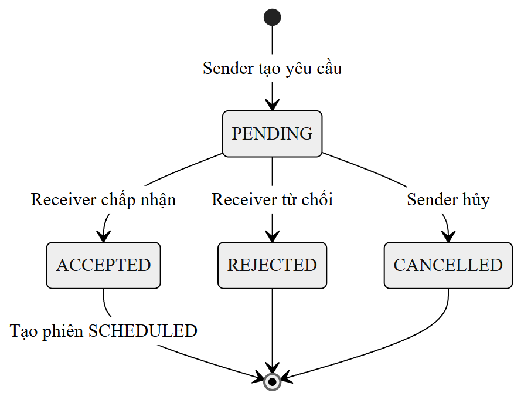
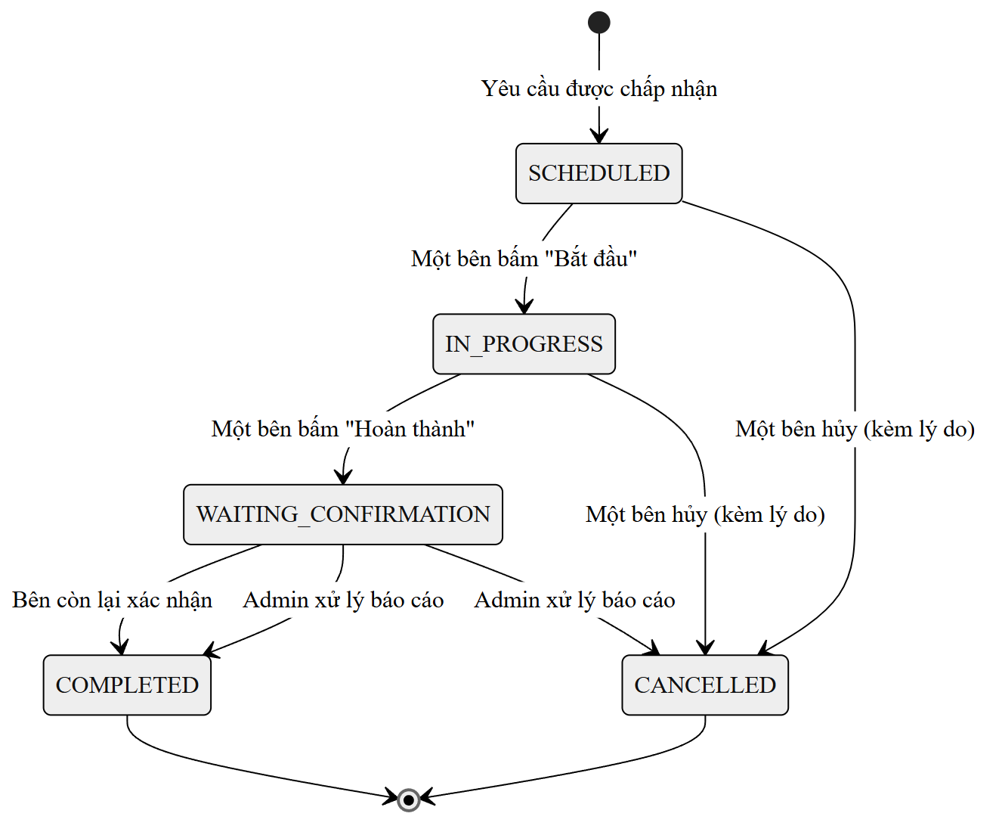
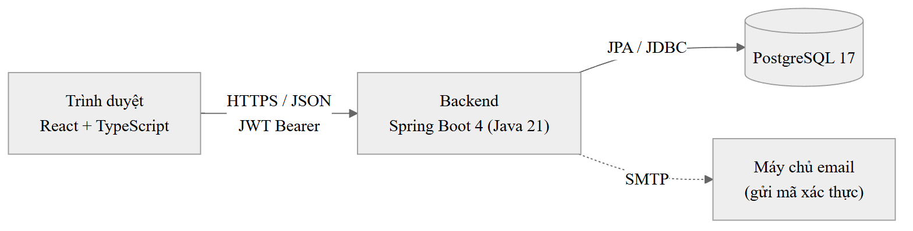
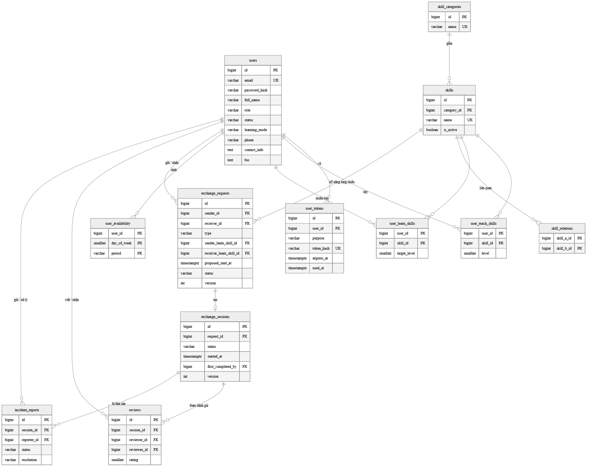
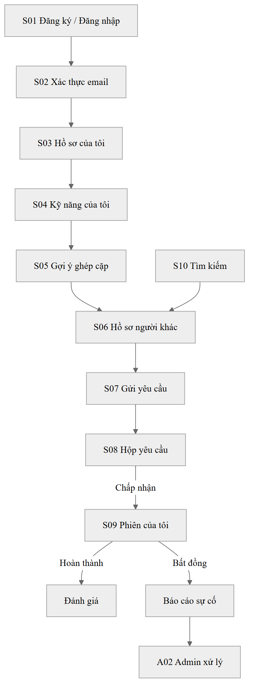
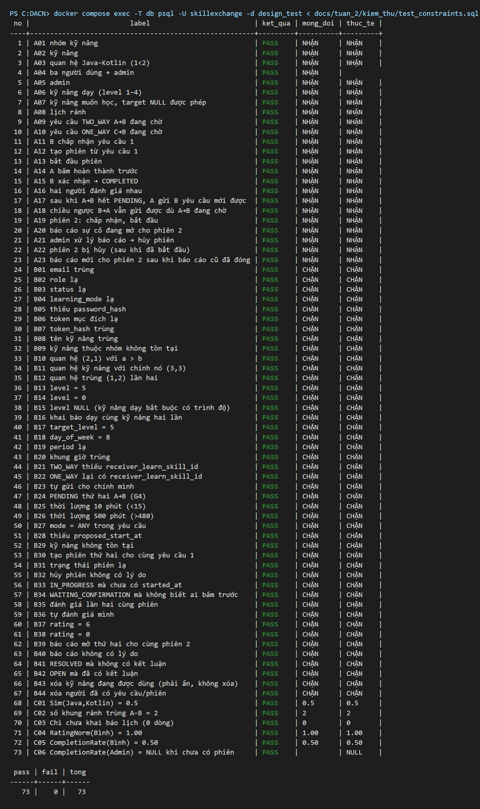

# Nội dung điền vào mẫu báo cáo – Tuần 2 (Thiết kế)

Nguồn: `Tuan_2_Thiet_ke.md` và `kiem_thu/` (kết quả kiểm thử lược đồ). Phiên bản công nghệ đã đối chiếu với `backend/pom.xml`, `frontend/package.json`, `docker-compose.yml`. Các đoạn đánh dấu **[CẦN BỔ SUNG]** là chỗ tài liệu tuần 2 chưa có thông tin. Số hiệu bảng/hình nối tiếp bản đề cương tuần 1 (Bảng 1.1–1.2, 2.2, 3.1–3.2, Hình 3.1); Bảng 2.1 là bảng công nghệ ở mục 2.2.

## Bảng đối chiếu: phần nào của tuần 2 điền vào mục nào của mẫu

| Phần trong `Tuan_2_Thiet_ke.md` | Mục trong mẫu báo cáo | Mức độ |
| --- | --- | --- |
| 2. Kiến trúc tổng quan (bảng công nghệ) | 2.2 Công nghệ sử dụng | Đủ |
| 4.6 (kiểm tra khi tạo yêu cầu), 5.1, 5.2 (bảng chuyển trạng thái) | 3.4 Đặc tả chi tiết các chức năng chính | Đủ để viết 4 chức năng |
| 5. Sơ đồ trạng thái, 4.10 Ma trận phân quyền, 8. Giả định | 3.5 Quy tắc nghiệp vụ | Đủ |
| 2. Kiến trúc tổng quan (sơ đồ, package) | 4.1 Kiến trúc tổng thể | Đủ |
| 3.1–3.4 Cơ sở dữ liệu, ERD | 4.2 Thiết kế cơ sở dữ liệu | Đủ |
| 3.5 Ánh xạ công thức sang dữ liệu, cách chạy matching | 4.3 Thiết kế thuật toán | Đủ – mã giả, độ phức tạp, trường hợp biên viết thêm từ đặc tả |
| 4. Thiết kế API, 6. Prototype giao diện, 7. Truy vết | 4.4 Thiết kế giao diện / API | Đủ |
| 4.1 (JWT, phân quyền), 3.3 (băm mật khẩu, cột riêng tư), 5.1–5.2 (chống thao tác đồng thời) | 4.5 Thiết kế bảo mật | Đủ |
| 2. Kiến trúc (phiên bản), `docker-compose.yml` | 5.1 Môi trường và công cụ phát triển | Đủ |
| 2. Tổ chức mã nguồn theo package | 5.2 Tổ chức mã nguồn | Một phần – thiếu link GitHub |
| 3.6 Kiểm chứng lược đồ, `kiem_thu/` | 6.1 Kế hoạch kiểm thử, 6.2 Kết quả kiểm thử | Đủ cho giai đoạn hiện tại – mới có kiểm thử CSDL |
| Các thuật ngữ dùng trong thiết kế | Danh mục từ viết tắt | Đủ |
| 9. Kế hoạch tuần 3 | – | Không đưa vào báo cáo |

---

# DANH MỤC TỪ VIẾT TẮT

| Từ viết tắt | Tiếng Anh | Tiếng Việt |
| --- | --- | --- |
| API | Application Programming Interface | Giao diện lập trình ứng dụng |
| CSDL | – | Cơ sở dữ liệu |
| ERD | Entity Relationship Diagram | Sơ đồ thực thể – quan hệ |
| FR | Functional Requirement | Yêu cầu chức năng |
| HMAC | Hash-based Message Authentication Code | Mã xác thực thông điệp dựa trên hàm băm |
| HTTP | Hypertext Transfer Protocol | Giao thức truyền siêu văn bản |
| HTTPS | HTTP Secure | Giao thức HTTP có mã hóa |
| JPA | Jakarta Persistence API | Chuẩn ánh xạ đối tượng – quan hệ trong Java |
| JSON | JavaScript Object Notation | Định dạng trao đổi dữ liệu |
| JWT | JSON Web Token | Mã thông báo xác thực dạng JSON |
| MVP | Minimum Viable Product | Sản phẩm khả dụng tối thiểu |
| NDCG | Normalized Discounted Cumulative Gain | Độ lợi tích lũy có chiết khấu, đã chuẩn hóa |
| NFR | Non-Functional Requirement | Yêu cầu phi chức năng |
| REST | Representational State Transfer | Kiểu kiến trúc API dựa trên tài nguyên |
| RFC | Request for Comments | Tài liệu đặc tả tiêu chuẩn Internet |
| SMTP | Simple Mail Transfer Protocol | Giao thức gửi thư điện tử |
| SQL | Structured Query Language | Ngôn ngữ truy vấn có cấu trúc |
| TC | Test Case | Ca kiểm thử |
| UTC | Coordinated Universal Time | Giờ phối hợp quốc tế |

---

# CHƯƠNG 2 – MỤC 2.2. Công nghệ sử dụng

Hệ thống gồm ba thành phần chính: giao diện web, backend và cơ sở dữ liệu. Bảng 2.1 liệt kê công nghệ của từng thành phần và lý do sử dụng trong đề tài.

*Bảng 2.1: Công nghệ sử dụng*

| Thành phần | Công nghệ (phiên bản) | Dùng để làm gì | Lý do chọn |
| --- | --- | --- | --- |
| Giao diện | React 19, TypeScript 6, Vite 8 | Xây dựng giao diện người dùng, gọi REST API | TypeScript kiểm tra kiểu dữ liệu trả về từ API (ví dụ kết quả gợi ý có nhiều trường điểm thành phần), giảm lỗi khi hiển thị; Vite khởi động và build nhanh |
| Backend | Spring Boot 4.1, Java 21 | Xử lý nghiệp vụ, thuật toán matching | Hệ sinh thái có sẵn bảo mật, truy cập dữ liệu, kiểm tra đầu vào và định dạng lỗi chuẩn (Problem Details) |
| Bảo mật | Spring Security, JWT | Xác thực và phân quyền ở backend | Kiểm tra quyền tập trung cho mọi API (NFR-01); JWT không cần lưu phiên trên máy chủ |
| Truy cập dữ liệu | Spring Data JPA | Ánh xạ bảng sang đối tượng Java | Hỗ trợ sẵn khóa lạc quan (`@Version`) dùng để chống thao tác đồng thời trên yêu cầu và phiên |
| Cơ sở dữ liệu | PostgreSQL 17 | Lưu trữ dữ liệu | Hỗ trợ ràng buộc `CHECK` và chỉ mục duy nhất một phần (`UNIQUE ... WHERE`), dùng để đặt quy tắc nghiệp vụ ngay trong CSDL (mục 4.2) |
| Quản lý lược đồ | Flyway | Tạo và nâng cấp lược đồ CSDL theo phiên bản | Lược đồ được quản lý bằng file SQL có đánh số (`V1__init.sql`, ...); Hibernate chỉ kiểm tra khớp, không tự sửa CSDL |
| Môi trường chạy CSDL | Docker Compose | Chạy PostgreSQL trên máy phát triển | Mọi người chạy cùng một phiên bản CSDL bằng một lệnh |

**So sánh với phương án khác:**

- **PostgreSQL thay vì MySQL:** thiết kế dùng chỉ mục duy nhất một phần (`UNIQUE ... WHERE status = 'PENDING'`) để chặn gửi trùng yêu cầu và chặn hai báo cáo sự cố cùng mở cho một phiên. MySQL không hỗ trợ trực tiếp chỉ mục có điều kiện `WHERE`, nên phải dùng cột phụ hoặc chuyển quy tắc này lên tầng ứng dụng.
- **Spring Boot thay vì Node.js / Express:** xác thực, phân quyền, khóa lạc quan, kiểm tra đầu vào và định dạng lỗi đều có sẵn và tích hợp với nhau trong hệ sinh thái Spring; với Express phải tự ghép nhiều thư viện độc lập. Thuật toán matching viết bằng Java có kiểu tĩnh, thuận tiện cho unit test các thành phần điểm.
- **React thay vì Angular:** ứng dụng có khoảng 12 màn hình nên không cần một framework đầy đủ như Angular. React và Vue đều phù hợp quy mô này; đề tài chọn React vì hệ sinh thái thư viện và tài liệu lớn, dùng tốt với TypeScript.

Mã nguồn hiện chưa có thư viện JWT; thư viện cụ thể sẽ được chọn và ghi vào Bảng 2.1 khi làm chức năng đăng nhập ở tuần 3.

---

# CHƯƠNG 3 – MỤC 3.4, 3.5

## 3.4. Đặc tả chi tiết các chức năng chính

Bảng 3.3 đến Bảng 3.6 đặc tả bốn chức năng có nhiều quy tắc nhất: gửi yêu cầu trao đổi, phản hồi yêu cầu, xác nhận hoàn thành phiên và xử lý báo cáo sự cố. Chức năng gợi ý ứng viên (FR-04) được trình bày riêng ở mục 3.1 và 4.3.

*Bảng 3.3: Đặc tả chức năng Gửi yêu cầu trao đổi (FR-05)*

| Mục | Nội dung |
| --- | --- |
| Tác nhân | Sinh viên (người gửi) |
| Tiền điều kiện | Người gửi đã đăng nhập, tài khoản `ACTIVE`; đang xem một ứng viên trong danh sách gợi ý hoặc hồ sơ người khác |
| Luồng chính | 1. Người gửi chọn "Gửi yêu cầu" (màn hình S07). 2. Chọn kỹ năng mình muốn học; nếu là yêu cầu hai chiều thì chọn thêm kỹ năng người nhận muốn học. 3. Chọn thời điểm (giao diện gợi ý các khung rảnh trùng), thời lượng, hình thức `ONLINE` / `OFFLINE`, địa điểm hoặc link và lời nhắn. 4. Hệ thống kiểm tra dữ liệu và lưu yêu cầu ở trạng thái `PENDING`. |
| Luồng ngoại lệ | Người nhận không `ACTIVE` hoặc chính là người gửi → từ chối. Kỹ năng chọn không có $Sim > 0$ với kỹ năng dạy của bên kia → từ chối (400). Thời điểm ở quá khứ → từ chối (400). Đã có một yêu cầu `PENDING` tới cùng người nhận → từ chối (409). |
| Hậu điều kiện | Có một yêu cầu `PENDING`; người nhận thấy yêu cầu trong hộp "Đã nhận". Địa điểm/link và thông tin liên hệ chưa hiển thị cho người nhận. |

*Bảng 3.4: Đặc tả chức năng Phản hồi yêu cầu trao đổi (FR-05)*

| Mục | Nội dung |
| --- | --- |
| Tác nhân | Sinh viên (người nhận); người gửi (với thao tác hủy) |
| Tiền điều kiện | Yêu cầu đang ở trạng thái `PENDING` |
| Luồng chính | 1. Người nhận mở hộp yêu cầu (S08) và chọn "Chấp nhận". 2. Trong cùng một giao dịch, hệ thống chuyển yêu cầu sang `ACCEPTED` và tạo phiên `SCHEDULED` với thời điểm, thời lượng, hình thức, địa điểm/link sao chép từ yêu cầu. |
| Luồng thay thế | Người nhận chọn "Từ chối" kèm ghi chú → yêu cầu chuyển sang `REJECTED`. Người gửi chọn "Hủy" → yêu cầu chuyển sang `CANCELLED`. |
| Luồng ngoại lệ | Yêu cầu không còn `PENDING` → 409. Người gửi hủy đúng lúc người nhận chấp nhận → thao tác đến sau thất bại (409) nhờ khóa lạc quan, không thể có yêu cầu đã hủy mà vẫn sinh phiên. |
| Hậu điều kiện | Khi chấp nhận: có một phiên `SCHEDULED`; hai bên xem được thông tin liên hệ và địa điểm/link của nhau. |

*Bảng 3.5: Đặc tả chức năng Xác nhận hoàn thành phiên (FR-06)*

| Mục | Nội dung |
| --- | --- |
| Tác nhân | Hai người tham gia phiên |
| Tiền điều kiện | Phiên ở trạng thái `IN_PROGRESS` (một bên đã bấm "Bắt đầu", không sớm hơn 15 phút trước giờ hẹn) |
| Luồng chính | 1. Một bên bấm "Hoàn thành" (S09) → phiên chuyển sang `WAITING_CONFIRMATION`, ghi lại người bấm trước. 2. Bên còn lại bấm "Xác nhận hoàn thành" → phiên chuyển sang `COMPLETED`. 3. Hệ thống mở quyền đánh giá cho cả hai bên. |
| Luồng ngoại lệ | Người đã bấm hoàn thành bấm xác nhận lần hai → 409. Hai người cùng bấm một lúc → request thứ hai thất bại (409) nhờ khóa lạc quan; giao diện tải lại trạng thái mới. Bên còn lại không đồng ý → không hủy phiên, chuyển sang luồng báo cáo sự cố (Bảng 3.6). |
| Hậu điều kiện | Phiên `COMPLETED` được tính vào tử số $CompletionRate$ của cả hai bên; mỗi bên được đánh giá bên kia đúng một lần. |

*Bảng 3.6: Đặc tả chức năng Xử lý báo cáo sự cố (FR-09)*

| Mục | Nội dung |
| --- | --- |
| Tác nhân | Người tham gia phiên (gửi báo cáo); quản trị viên (xử lý) |
| Tiền điều kiện | Phiên đang ở `WAITING_CONFIRMATION` và hai bên bất đồng; phiên chưa có báo cáo nào đang mở |
| Luồng chính | 1. Người tham gia bấm "Báo cáo sự cố" và nhập lý do → báo cáo ở trạng thái `OPEN`. 2. Quản trị viên mở hàng đợi báo cáo (A02), xem chi tiết phiên. 3. Quản trị viên chốt phiên sang `COMPLETED` (buổi học đã diễn ra) hoặc `CANCELLED` (không diễn ra) kèm ghi chú. 4. Báo cáo chuyển sang `RESOLVED`. |
| Luồng ngoại lệ | Phiên đã có báo cáo `OPEN` → không tạo thêm (409). Người không tham gia phiên gửi báo cáo → 403. |
| Hậu điều kiện | Phiên không còn bị kẹt ở `WAITING_CONFIRMATION`; kết luận và người xử lý được lưu lại. |

## 3.5. Quy tắc nghiệp vụ

**Vòng đời yêu cầu và phiên.** Yêu cầu và phiên là hai máy trạng thái riêng (Hình 3.2, Hình 3.3); các chuyển trạng thái hợp lệ được liệt kê ở Bảng 3.7 và Bảng 3.8. Đánh giá không phải trạng thái của phiên mà là bản ghi riêng. Một yêu cầu tạo tối đa một phiên, ứng với một buổi gặp.



*Hình 3.2: Sơ đồ trạng thái của yêu cầu trao đổi*

*Bảng 3.7: Các chuyển trạng thái của yêu cầu trao đổi*

| Từ | Sang | Ai thực hiện | Điều kiện / tác động phụ |
| --- | --- | --- | --- |
| – | `PENDING` | Người gửi | Qua các kiểm tra ở Bảng 3.3 |
| `PENDING` | `ACCEPTED` | Người nhận | Tạo phiên `SCHEDULED` trong cùng giao dịch; mở quyền xem liên hệ |
| `PENDING` | `REJECTED` | Người nhận | Lưu ghi chú từ chối |
| `PENDING` | `CANCELLED` | Người gửi | – |

`ACCEPTED`, `REJECTED`, `CANCELLED` là trạng thái cuối; mọi thao tác khác bị từ chối (409).



*Hình 3.3: Sơ đồ trạng thái của phiên trao đổi*

*Bảng 3.8: Các chuyển trạng thái của phiên trao đổi*

| Từ | Sang | Ai thực hiện | Điều kiện / tác động phụ |
| --- | --- | --- | --- |
| `SCHEDULED` | `IN_PROGRESS` | Người tham gia | Chỉ từ 15 phút trước giờ hẹn; ghi thời điểm bắt đầu |
| `SCHEDULED` | `CANCELLED` | Người tham gia | Bắt buộc có lý do; phiên chưa bắt đầu nên **không** tính vào $CompletionRate$ |
| `IN_PROGRESS` | `WAITING_CONFIRMATION` | Người tham gia | Ghi người bấm hoàn thành trước |
| `IN_PROGRESS` | `CANCELLED` | Người tham gia | Bắt buộc có lý do; **có** tính vào mẫu số $CompletionRate$ |
| `WAITING_CONFIRMATION` | `COMPLETED` | Bên còn lại | Người xác nhận phải khác người bấm trước; mở quyền đánh giá |
| `WAITING_CONFIRMATION` | `COMPLETED` / `CANCELLED` | Quản trị viên | Chỉ khi có báo cáo sự cố đang mở; báo cáo chuyển sang `RESOLVED` |

**Các thao tác bị cấm** (trả về 409, mỗi thao tác cần một unit test):

- Người đã bấm hoàn thành bấm xác nhận lần hai.
- Người tham gia tự hủy phiên đang `WAITING_CONFIRMATION`; chỉ quản trị viên chốt được phiên ở trạng thái này.
- Mọi thao tác trên phiên `COMPLETED` hoặc `CANCELLED`, trừ đánh giá phiên `COMPLETED`.
- Bắt đầu phiên sớm hơn 15 phút trước giờ hẹn.

**Quy tắc đánh giá:** chỉ người tham gia phiên `COMPLETED` mới được đánh giá; mỗi người đánh giá bên kia tối đa một lần cho mỗi phiên; không được tự đánh giá mình; điểm từ 1 đến 5 sao.

**Phân quyền.** Bảng 3.9 tóm tắt ai được làm gì. Mọi quyền đều được kiểm tra ở backend; giao diện chỉ ẩn nút để dễ dùng.

*Bảng 3.9: Ma trận phân quyền*

| Hành động | Người gửi | Người nhận | Người khác | Quản trị viên |
| --- | --- | --- | --- | --- |
| Tạo yêu cầu | ✔ | – | – | ✖ |
| Chấp nhận / từ chối yêu cầu | ✖ | ✔ | ✖ | ✖ |
| Hủy yêu cầu `PENDING` | ✔ | ✖ | ✖ | ✖ |
| Xem liên hệ, địa điểm/link | ✔ sau `ACCEPTED` | ✔ sau `ACCEPTED` | ✖ | ✔ |
| Bắt đầu / hoàn thành / hủy phiên | ✔ | ✔ | ✖ | ✖ |
| Đánh giá | ✔ | ✔ | ✖ | ✖ |
| Báo cáo sự cố | ✔ | ✔ | ✖ | – |
| Xử lý báo cáo sự cố | ✖ | ✖ | ✖ | ✔ |

**Giả định đang áp dụng.** Một số điểm đặc tả chưa quy định; thiết kế tạm chọn phương án đơn giản nhất (Bảng 3.10) và có thể đổi lại mà không phải sửa cấu trúc lớn.

*Bảng 3.10: Các giả định thiết kế*

| Mã | Giả định |
| --- | --- |
| G1 | Phiên chuyển sang `IN_PROGRESS` khi một bên bấm "Bắt đầu", chỉ được bấm từ 15 phút trước giờ hẹn; không dùng tác vụ chạy định kỳ. |
| G2 | Yêu cầu `PENDING` và phiên `IN_PROGRESS` chưa có thời hạn tự hết hạn trong MVP. |
| G3 | Khi một bên hủy phiên đang diễn ra, phiên được tính vào mẫu số $CompletionRate$ của cả hai bên. |
| G4 | Mỗi người chỉ có một yêu cầu `PENDING` tới cùng một người nhận. |
| G5 | JWT có hạn 24 giờ, chưa dùng refresh token. |
| G6 | Email trường được nhận diện bằng đuôi tên miền cấu hình sẵn. |
| G7 | Quản trị viên khóa / mở khóa được tài khoản; người dùng đã có lịch sử chỉ bị khóa, không bị xóa. |

---

# CHƯƠNG 4. THIẾT KẾ GIẢI PHÁP

## 4.1. Kiến trúc tổng thể

Hệ thống theo kiến trúc ba tầng (Hình 4.1): trình duyệt chạy ứng dụng React gọi REST API của backend qua HTTPS, dữ liệu trao đổi dạng JSON và mỗi request kèm JWT; backend Spring Boot xử lý nghiệp vụ, phân quyền và thuật toán matching, lưu dữ liệu vào PostgreSQL qua JPA; backend gửi mã xác thực email qua máy chủ SMTP. Bảng 4.1 tóm tắt vai trò của từng thành phần.



*Hình 4.1: Kiến trúc tổng thể của hệ thống*

*Bảng 4.1: Vai trò các thành phần*

| Thành phần | Công nghệ | Vai trò |
| --- | --- | --- |
| Frontend | React, TypeScript, Vite | Giao diện người dùng, gọi REST API |
| Backend | Spring Boot, Spring Security, Spring Data JPA | Nghiệp vụ, phân quyền, thuật toán matching |
| Cơ sở dữ liệu | PostgreSQL 17, Flyway | Lưu dữ liệu; Flyway quản lý phiên bản lược đồ |
| Xác thực | JWT (access token) | Mỗi request gửi token trong header `Authorization` |
| Máy chủ email | SMTP | Gửi mã xác thực email |

Mã nguồn backend được tổ chức theo tính năng (package-by-feature, Bảng 4.2): mỗi package chứa đủ controller, service và repository của một tính năng. Cách này giữ mô-đun lọc cứng và chấm điểm tách khỏi phần còn lại (NFR-05), và module thực nghiệm `evaluation` chạy độc lập, không ghi vào bảng nghiệp vụ.

*Bảng 4.2: Các package của backend*

| Package | Trách nhiệm |
| --- | --- |
| `auth` | Đăng ký, xác thực email, đăng nhập, JWT |
| `user` | Hồ sơ, lịch rảnh, hình thức học, kỹ năng của người dùng |
| `skill` | Danh mục kỹ năng, nhóm, quan hệ liên quan |
| `matching` | Lọc cứng, chấm điểm, phân loại hai chiều / một chiều |
| `exchange` | Yêu cầu trao đổi và phiên |
| `review` | Đánh giá, tính Reputation |
| `admin` | Quản trị danh mục, xử lý báo cáo sự cố |
| `evaluation` | Sinh dữ liệu giả lập, baseline, tính chỉ số (chạy offline) |
| `common` | Xử lý lỗi, cấu hình chung |

## 4.2. Thiết kế cơ sở dữ liệu

Hình 4.2 là sơ đồ thực thể – quan hệ gồm 11 bảng. Bảng 4.3 tóm tắt vai trò từng bảng.



*Hình 4.2: Sơ đồ thực thể – quan hệ*

*Bảng 4.3: Các bảng trong cơ sở dữ liệu*

| Bảng | Nội dung | Khóa và ràng buộc chính |
| --- | --- | --- |
| `users` | Tài khoản và hồ sơ | `email` UNIQUE; `role`, `status`, `learning_mode` giới hạn bằng CHECK |
| `user_tokens` | Mã xác thực email / quên mật khẩu | Chỉ lưu bản băm `token_hash` (UNIQUE); có hạn dùng và thời điểm đã dùng |
| `skill_categories` | Nhóm kỹ năng | `name` UNIQUE |
| `skills` | Kỹ năng | `name` UNIQUE; `is_active = false` là kỹ năng bị ẩn |
| `skill_relations` | Cặp kỹ năng liên quan | PK (`skill_a_id`, `skill_b_id`), CHECK `skill_a_id < skill_b_id` để mỗi cặp chỉ lưu một dòng |
| `user_teach_skills` | Kỹ năng có thể dạy ($T_v$) | PK (`user_id`, `skill_id`); `level` bắt buộc, 1–4 |
| `user_learn_skills` | Kỹ năng muốn học ($W_u$) | PK (`user_id`, `skill_id`); `target_level` không bắt buộc, 1–4 |
| `user_availability` | Lịch rảnh | PK (`user_id`, `day_of_week`, `period`); tối đa 21 dòng mỗi người |
| `exchange_requests` | Yêu cầu trao đổi | CHECK người gửi khác người nhận; CHECK nhất quán loại yêu cầu; mỗi cặp chỉ một yêu cầu `PENDING` |
| `exchange_sessions` | Phiên trao đổi | `request_id` UNIQUE (một yêu cầu một phiên); CHECK nhất quán trạng thái (Bảng 4.6) |
| `reviews` | Đánh giá | UNIQUE (`session_id`, `reviewer_id`); `rating` 1–5; không tự đánh giá |
| `incident_reports` | Báo cáo sự cố | Mỗi phiên tối đa một báo cáo `OPEN`; CHECK nhất quán trạng thái với kết luận |

**Quy ước thiết kế:**

- Khóa chính kiểu `BIGINT` tự tăng; thời gian kiểu `TIMESTAMPTZ`, lưu theo UTC.
- Giá trị liệt kê (vai trò, trạng thái, hình thức học...) lưu bằng `VARCHAR` kèm ràng buộc `CHECK` thay vì kiểu enum riêng của PostgreSQL. Lý do: thêm giá trị mới chỉ cần sửa `CHECK` trong một migration, và JPA ánh xạ trực tiếp bằng tên hằng.
- **"Chưa khai báo" được biểu diễn bằng việc không có dữ liệu:** người dùng không có dòng nào trong `user_availability` là chưa khai báo lịch rảnh; `learning_mode` bằng NULL là chưa khai báo hình thức học. Nhờ vậy phân biệt được *chưa khai báo* với *đã khai báo nhưng không phù hợp*, đúng yêu cầu của bước lọc cứng.
- **Quy tắc nhất quán đặt ngay trong CSDL** bằng `CHECK`, không chỉ ở tầng service. Kể cả khi mã nguồn có lỗi, dữ liệu sai cũng không ghi được.
- **Quy tắc xóa:** kỹ năng, lịch rảnh và mã xác thực của người dùng bị xóa theo người dùng. Yêu cầu, phiên, đánh giá và báo cáo là lịch sử nên không được xóa; người dùng đã có lịch sử chỉ bị khóa. Kỹ năng đang được dùng chỉ được ẩn.
- Lược đồ do Flyway tạo; Hibernate chỉ kiểm tra khớp (`ddl-auto: validate`).

Bảng 4.4 và Bảng 4.5 mô tả chi tiết hai bảng có nhiều quy tắc nhất.

*Bảng 4.4: Bảng `exchange_requests` – yêu cầu trao đổi*

| Cột | Kiểu | Ràng buộc | Ý nghĩa |
| --- | --- | --- | --- |
| `sender_id`, `receiver_id` | BIGINT | FK → users, NOT NULL, khác nhau | Người gửi, người nhận |
| `type` | VARCHAR(10) | NOT NULL, ∈ {`TWO_WAY`, `ONE_WAY`} | Loại yêu cầu |
| `sender_learn_skill_id` | BIGINT | FK → skills, NOT NULL | Kỹ năng người gửi muốn học |
| `receiver_learn_skill_id` | BIGINT | FK → skills, NULL | Kỹ năng người nhận muốn học (chỉ có ở `TWO_WAY`) |
| `proposed_start_at` | TIMESTAMPTZ | NOT NULL | Thời điểm đề xuất |
| `duration_minutes` | SMALLINT | NOT NULL, 15–480 | Thời lượng |
| `mode` | VARCHAR(10) | NOT NULL, ∈ {`ONLINE`, `OFFLINE`} | Không có `ANY` vì buổi học phải chốt một hình thức |
| `location_or_link` | VARCHAR(500) | NULL | Riêng tư tới khi được chấp nhận |
| `status` | VARCHAR(20) | NOT NULL, mặc định `PENDING` | `PENDING`, `ACCEPTED`, `REJECTED`, `CANCELLED` |
| `version` | INTEGER | NOT NULL, mặc định 0 | Khóa lạc quan |

Ràng buộc nhất quán loại yêu cầu: `CHECK ((type = 'TWO_WAY') = (receiver_learn_skill_id IS NOT NULL))`. Chống gửi trùng bằng chỉ mục duy nhất một phần `UNIQUE (sender_id, receiver_id) WHERE status = 'PENDING'`.

*Bảng 4.5: Bảng `exchange_sessions` – phiên trao đổi*

| Cột | Kiểu | Ràng buộc | Ý nghĩa |
| --- | --- | --- | --- |
| `request_id` | BIGINT | FK → exchange_requests, NOT NULL, UNIQUE | Yêu cầu gốc; hai người tham gia lấy từ yêu cầu này |
| `start_at`, `duration_minutes`, `mode`, `location_or_link` | | Như bảng yêu cầu | Sao chép từ yêu cầu lúc chấp nhận |
| `status` | VARCHAR(25) | NOT NULL, mặc định `SCHEDULED` | `SCHEDULED`, `IN_PROGRESS`, `WAITING_CONFIRMATION`, `COMPLETED`, `CANCELLED` |
| `started_at` | TIMESTAMPTZ | NULL | Khác NULL nghĩa là phiên đã bắt đầu |
| `first_completed_by` | BIGINT | FK → users, NULL | Người bấm hoàn thành trước |
| `completed_at` | TIMESTAMPTZ | NULL | |
| `cancelled_by`, `cancel_reason`, `cancelled_at` | | NULL | Người hủy, lý do, thời điểm |
| `version` | INTEGER | NOT NULL, mặc định 0 | Khóa lạc quan |

Cột `started_at` giải quyết quy tắc $CompletionRate$: phiên `CANCELLED` có `started_at` khác NULL là phiên bị hủy sau khi bắt đầu, nên được tính vào mẫu số. Bảng 4.6 liệt kê các ràng buộc nhất quán trạng thái.

*Bảng 4.6: Ràng buộc nhất quán trạng thái phiên*

| Nếu `status` là | Thì bắt buộc có |
| --- | --- |
| `IN_PROGRESS`, `WAITING_CONFIRMATION`, `COMPLETED` | `started_at` |
| `WAITING_CONFIRMATION` | `first_completed_by` |
| `COMPLETED` | `completed_at` |
| `CANCELLED` | `cancel_reason` và `cancelled_at` |

Các ràng buộc này chỉ kiểm tra dữ liệu của một trạng thái có đủ hay không. Thứ tự chuyển trạng thái và việc người thao tác có phải người tham gia hay không do tầng service kiểm tra (Bảng 3.8).

Với bảng `incident_reports`, ràng buộc nhất quán được viết thành hai điều kiện riêng: `RESOLVED` thì phải có đủ kết luận, người xử lý và thời điểm xử lý; `OPEN` thì cả ba cột này phải trống. Cách gộp thành một điều kiện `(status = 'RESOLVED') = (đủ ba cột)` đã được kiểm thử chứng minh là sai (mục 6.2, ca B42).

Bảng 4.7 liệt kê các chỉ mục được tạo thêm để phục vụ những truy vấn chính.

*Bảng 4.7: Chỉ mục phục vụ truy vấn chính*

| Chỉ mục | Phục vụ |
| --- | --- |
| `user_teach_skills (skill_id)` | Tìm người dạy một kỹ năng (lọc ứng viên, tìm kiếm) |
| `user_learn_skills (skill_id)` | Tìm người muốn học một kỹ năng (chiều ngược lại của ghép hai chiều) |
| `exchange_requests (receiver_id, status)`, `(sender_id, status)` | Hộp yêu cầu đến / đi |
| `exchange_sessions (status)` | Danh sách phiên theo trạng thái |
| `reviews (reviewee_id)` | Tính RatingNorm |
| `incident_reports (status)` | Hàng đợi báo cáo của quản trị viên |

**Dữ liệu khởi tạo:** danh mục 20–30 kỹ năng, các nhóm và quan hệ liên quan được nạp sẵn bằng migration Flyway (`V2__seed_skills.sql`), để có dữ liệu trước khi làm màn hình quản trị.

## 4.3. Thiết kế thuật toán / xử lý cốt lõi

**Các thành phần điểm.** Điểm tổng $D(u,v)$ và $MutualScore(u,v)$ được định nghĩa ở mục 3.1. Bảng 4.8 trình bày cách tính từng thành phần; mọi thành phần đều thuộc đoạn $[0,1]$. Độ tương đồng giữa hai kỹ năng $Sim(s,t)$ bằng 1.0 nếu trùng chính xác, 0.5 nếu cùng nhóm và được quản trị viên đánh dấu liên quan, 0 nếu không liên quan. Ký hiệu $A_u$ là tập khung giờ rảnh của $u$ trong 21 khung mỗi tuần.

*Bảng 4.8: Cách tính các thành phần điểm*

| Thành phần | Cách tính | Khi thiếu dữ liệu |
| --- | --- | --- |
| $SkillFit(u,v)$ | $\frac{1}{\lvert W_u\rvert}\sum_{s \in W_u} \max_{t \in T_v} Sim(s,t)$ | $W_u$ rỗng: $u$ không nhận gợi ý |
| $LevelFit(u,v)$ | Với mỗi $s \in W_u$ có $Sim > 0$, chọn $t \in T_v$ có $Sim(s,t)$ lớn nhất (bằng nhau thì chọn $t$ có trình độ cao hơn). Cặp $(s,t)$ được 1.0 nếu trình độ của $v$ đạt hoặc vượt mục tiêu của $u$, 0.5 nếu thấp hơn 1 bậc, 0 nếu thấp hơn từ 2 bậc. $LevelFit$ là trung bình trên các cặp. | $u$ không đặt mục tiêu cho $s$: cặp đó được 0.5 |
| $ScheduleFit(u,v)$ | $\frac{\lvert A_u \cap A_v\rvert}{\min(\lvert A_u\rvert, \lvert A_v\rvert)}$ | Một hoặc cả hai bên chưa khai báo: 0.5 |
| $ModeFit(u,v)$ | 1.0 nếu hai bên cùng hình thức hoặc ít nhất một bên chọn `ANY` | Một hoặc cả hai bên chưa khai báo: 0.5 (kể cả khi bên kia chọn `ANY`) |
| $RatingNorm(v)$ | $(RatingAverage - 1) / 4$ với thang 1–5 sao | Chưa có đánh giá: 0.5 |
| $CompletionRate(v)$ | Số phiên đã hoàn thành chia cho số phiên đã bắt đầu; phiên bị hủy sau khi bắt đầu vẫn tính vào mẫu số | Chưa có phiên nào đã bắt đầu: 0.5 |
| $Reputation(v)$ | $0.7 \cdot RatingNorm(v) + 0.3 \cdot CompletionRate(v)$ | Người dùng mới: 0.5 |

Trường hợp xung đột hình thức học hoàn toàn (một bên chỉ `ONLINE`, bên kia chỉ `OFFLINE`) và hai lịch rảnh đã khai báo nhưng không trùng nhau đều đã bị loại ở bước lọc cứng, nên không xuất hiện trong bảng trên.

**Ví dụ tính tay.** $u$ chỉ muốn học Java; $v$ dạy Java ở trình độ đạt mục tiêu của $u$; $u$ có 4 khung rảnh, $v$ có 3, trùng 2; cả hai chọn `ONLINE`; $v$ có điểm đánh giá trung bình 4.2 sao và hoàn thành 4 trên 5 phiên đã bắt đầu. Bảng 4.9 cho kết quả $D(u,v) = 0.94$. Ví dụ này được dùng làm dữ liệu cho unit test: kết quả của mã nguồn phải khớp với kết quả tính tay.

*Bảng 4.9: Ví dụ tính tay điểm D(u, v)*

| Thành phần | Tính | Giá trị |
| --- | --- | --- |
| $SkillFit$ | Java trùng chính xác | 1.0 |
| $LevelFit$ | Trình độ đạt mục tiêu | 1.0 |
| $ScheduleFit$ | $2 / \min(4, 3)$ | 0.667 |
| $ModeFit$ | Cùng `ONLINE` | 1.0 |
| $RatingNorm$ | $(4.2 - 1) / 4$ | 0.8 |
| $CompletionRate$ | $4 / 5$ | 0.8 |
| $Reputation$ | $0.7 \cdot 0.8 + 0.3 \cdot 0.8$ | 0.8 |
| $D(u,v)$ | $0.55 \cdot 1 + 0.20 \cdot 1 + 0.15 \cdot 0.667 + 0.05 \cdot 1 + 0.05 \cdot 0.8$ | 0.94 |

**Ánh xạ sang dữ liệu.** Bảng 4.10 cho biết mỗi đại lượng trên được tính từ dữ liệu nào.

*Bảng 4.10: Ánh xạ công thức matching sang dữ liệu*

| Đại lượng | Lấy từ | Ghi chú |
| --- | --- | --- |
| $Sim(s,t)$ | `skills`, `skill_relations` | 1.0 nếu $s = t$; 0.5 nếu có dòng trong `skill_relations`; còn lại 0 |
| $SkillFit(u,v)$ | `user_learn_skills` của $u$, `user_teach_skills` của $v$ | |
| $LevelFit(u,v)$ | `target_level` của $u$, `level` của $v$ | Trung bình trên các kỹ năng có $Sim > 0$ |
| $ScheduleFit(u,v)$ | `user_availability` | Số khung trùng là số cặp (`day_of_week`, `period`) chung; không có dòng = chưa khai báo → 0.5 |
| $ModeFit(u,v)$ | `users.learning_mode` | NULL = chưa khai báo |
| $RatingNorm(v)$ | Trung bình `reviews.rating` với `reviewee_id = v` | Chưa có đánh giá → 0.5 |
| $CompletionRate(v)$ | `exchange_sessions` mà $v$ tham gia | Tử số: phiên `COMPLETED`; mẫu số: phiên có `started_at` khác NULL. Chưa có phiên nào đã bắt đầu thì truy vấn trả về NULL, service đổi thành 0.5 |

**Cách chạy matching:** với quy mô mục tiêu 1.000 hồ sơ (NFR-03), backend nạp kỹ năng, lịch rảnh và dữ liệu Reputation của các người dùng `ACTIVE` vào bộ nhớ bằng vài truy vấn gộp, sau đó lọc và chấm điểm bằng Java. Cách này tránh truy vấn lặp cho từng ứng viên. Reputation được tính trực tiếp từ dữ liệu, chưa cần bảng lưu đệm. Dữ liệu giả lập cho thực nghiệm được sinh và đánh giá trong bộ nhớ bởi module `evaluation`, không ghi vào các bảng nghiệp vụ.

**Mã giả.** Hình 4.3 trình bày thuật toán tạo gợi ý cho người dùng $u$. Bước lọc cứng và bước chấm điểm được tách riêng đúng như mục 3.1; các điều kiện lịch rảnh và hình thức học có tính đối xứng nên chỉ cần kiểm tra một lần cho cả hai chiều.

```
Thuật toán GOI_Y(u, k)
Vào : người dùng u, số gợi ý k
Ra  : danh sách hai chiều L2, danh sách một chiều L1

 1  C  <- các người dùng ACTIVE khác u   (đã nạp sẵn kỹ năng, lịch, hình thức, Reputation)
 2  L2 <- rỗng ; L1 <- rỗng
 3  với mỗi v trong C:
 4      nếu SkillFit(u, v) = 0: bỏ qua v                       // lọc cứng: kỹ năng
 5      nếu Lich(u) ≠ rỗng và Lich(v) ≠ rỗng
            và Lich(u) ∩ Lich(v) = rỗng: bỏ qua v             // lọc cứng: lịch rảnh
 6      nếu {Mode(u), Mode(v)} = {ONLINE, OFFLINE}: bỏ qua v   // lọc cứng: hình thức
 7      d <- D(u, v)
 8      nếu SkillFit(v, u) > 0:
 9          thêm (v, sqrt(d * D(v, u))) vào L2                 // ghép hai chiều
10      ngược lại:
11          thêm (v, d) vào L1                                 // mentoring một chiều
12  trả về k phần tử điểm cao nhất của L2 và của L1
```

*Hình 4.3: Mã giả thuật toán tạo gợi ý*

**Độ phức tạp.** Gọi $N$ là số người dùng, $s$ là số kỹ năng tối đa mỗi người khai báo (dữ liệu giả lập: tối đa 5 kỹ năng dạy, 3 kỹ năng muốn học). Nếu tập cặp kỹ năng liên quan được nạp vào bảng băm thì $Sim(s,t)$ tra trong $O(1)$; lịch rảnh 21 khung biểu diễn bằng một mặt nạ 21 bit nên phép giao lịch cũng là $O(1)$. Mỗi ứng viên tốn $O(s^2)$ để tính $SkillFit$ theo hai chiều, nên một lần gợi ý tốn $O(N s^2)$ cho bước lọc và chấm điểm, cộng $O(N \log k)$ để chọn $k$ phần tử lớn nhất bằng hàng đợi ưu tiên. Với $N = 1000$ và $s \le 5$, số phép tra $Sim$ cỡ vài chục nghìn, phù hợp mục tiêu ≤ 2 giây (NFR-03).

**Trường hợp biên:**

- $u$ chưa khai báo kỹ năng muốn học ($W_u$ rỗng): không có gợi ý; giao diện hướng người dùng sang màn hình khai báo kỹ năng (S04). Tương tự, $SkillFit(v,u)$ được coi bằng 0 khi $W_v$ rỗng, nên $v$ chỉ có thể là gợi ý một chiều.
- Một bên chưa khai báo lịch rảnh hoặc hình thức học: không bị loại, thành phần tương ứng nhận 0.5. Khi cả hai đã khai báo lịch thì mẫu số $\min(|A_u|, |A_v|)$ luôn lớn hơn 0.
- Người chưa có đánh giá hoặc chưa có phiên nào đã bắt đầu: $RatingNorm$, $CompletionRate$ nhận 0.5, không chia cho 0.
- Hai ứng viên bằng điểm: sắp theo mã người dùng tăng dần để kết quả ổn định và tái lập được giữa các lần chạy.

## 4.4. Thiết kế giao diện / API

**Quy ước API.** API theo kiểu REST, dữ liệu JSON, tiền tố `/api`. Sau khi đăng nhập, client gửi `Authorization: Bearer <JWT>` trong mọi request cần đăng nhập. Các hành động đổi trạng thái dùng endpoint riêng (ví dụ `POST /requests/{id}/accept`) thay vì cho client gửi trạng thái mới, vì mỗi chuyển trạng thái có điều kiện và người được phép riêng. Lỗi trả về theo chuẩn Problem Details (RFC 9457) với các mã HTTP ở Bảng 4.11.

*Bảng 4.11: Quy ước mã trạng thái HTTP*

| Mã HTTP | Khi nào |
| --- | --- |
| 200 / 201 / 204 | Thành công / đã tạo mới / thành công không có nội dung |
| 400 | Dữ liệu không hợp lệ (thiếu trường, sai miền giá trị) |
| 401 | Chưa đăng nhập hoặc token hết hạn |
| 403 | Đã đăng nhập nhưng không có quyền (sai vai trò, không phải người tham gia, tài khoản chưa xác thực) |
| 404 | Không tìm thấy tài nguyên |
| 409 | Xung đột trạng thái: chuyển trạng thái không hợp lệ, đánh giá lần hai, gửi trùng yêu cầu |

Bảng 4.12 liệt kê các API chính. Ký hiệu quyền: *Public* – không cần đăng nhập; *User* – đã đăng nhập; *Active* – tài khoản đã xác thực; *Participant* – người tham gia yêu cầu / phiên; *Admin* – quản trị viên.

*Bảng 4.12: Danh sách API chính*

| Phương thức | Đường dẫn | Quyền | Chức năng | Yêu cầu |
| --- | --- | --- | --- | --- |
| POST | `/api/auth/register` | Public | Đăng ký bằng email trường, gửi mã xác thực | FR-01 |
| POST | `/api/auth/verify-email` | Public | Xác thực email, tài khoản chuyển sang `ACTIVE` | FR-01 |
| POST | `/api/auth/resend-verification` | Public | Gửi lại mã xác thực | FR-01 |
| POST | `/api/auth/login` | Public | Đăng nhập, trả về access token | FR-01 |
| GET, PUT | `/api/me` | User | Xem / cập nhật hồ sơ của mình (kể cả liên hệ riêng tư) | FR-02 |
| PUT | `/api/me/availability` | User | Thay toàn bộ lịch rảnh; danh sách rỗng = chưa khai báo | FR-02 |
| PUT | `/api/me/teach-skills`, `/api/me/learn-skills` | User | Thay danh sách kỹ năng dạy / muốn học | FR-03 |
| GET | `/api/users/{id}` | Active | Hồ sơ công khai, không có thông tin liên hệ | FR-02 |
| GET | `/api/users/{id}/reviews` | Active | Các đánh giá người đó nhận được | FR-07 |
| GET | `/api/users/search` | Active | Tìm người dùng theo kỹ năng hoặc tên | FR-10 |
| GET | `/api/skill-categories`, `/api/skills` | User | Danh mục kỹ năng cho ô chọn | FR-03 |
| GET | `/api/matches?type=TWO_WAY` | Active | Gợi ý ghép hai chiều, xếp theo $MutualScore$ | FR-04 |
| GET | `/api/matches?type=ONE_WAY` | Active | Gợi ý mentoring một chiều, xếp theo $D(u,v)$ | FR-04 |
| POST | `/api/requests` | Active | Tạo yêu cầu trao đổi | FR-05 |
| GET | `/api/requests`, `/api/requests/{id}` | Active / Participant | Hộp yêu cầu đi / đến, chi tiết yêu cầu | FR-05 |
| POST | `/api/requests/{id}/accept`, `/reject`, `/cancel` | Receiver / Sender | Chấp nhận, từ chối, hủy yêu cầu | FR-05 |
| GET | `/api/sessions`, `/api/sessions/{id}` | Participant, Admin | Danh sách phiên; chi tiết phiên kèm liên hệ và địa điểm/link | FR-06, NFR-02 |
| POST | `/api/sessions/{id}/start`, `/complete`, `/cancel` | Participant | Bắt đầu, hoàn thành / xác nhận, hủy phiên | FR-06 |
| POST | `/api/sessions/{id}/reviews` | Participant | Đánh giá bên kia | FR-07 |
| POST | `/api/sessions/{id}/reports` | Participant | Gửi báo cáo sự cố | FR-09 |
| POST, PUT, DELETE | `/api/admin/skill-categories`, `/api/admin/skills`, `/api/admin/skill-relations` | Admin | Quản trị nhóm, kỹ năng và quan hệ liên quan | FR-08 |
| GET, POST | `/api/admin/reports`, `/api/admin/reports/{id}/resolve` | Admin | Hàng đợi báo cáo; chốt phiên sang hoàn thành hoặc hủy | FR-09 |
| PUT | `/api/admin/users/{id}/status` | Admin | Khóa / mở khóa tài khoản | G7 |

Mỗi kết quả gợi ý trả về điểm tổng, các điểm thành phần theo từng chiều, các cặp kỹ năng khớp (trùng hay liên quan) và các khung giờ trùng, để giao diện giải thích lý do phù hợp. Hình 4.4 là một phần tử trong kết quả của `GET /api/matches?type=TWO_WAY`. Chiều $u$ học từ $v$ (`forward`) chính là ví dụ ở Bảng 4.9 với $D = 0.94$; chiều ngược lại (`backward`) có $D = 0.65$ vì kỹ năng $u$ dạy chỉ là kỹ năng liên quan; điểm xếp hạng $MutualScore = \sqrt{0.94 \times 0.65} \approx 0.78$. Với gợi ý `ONE_WAY` thì không có `backward`, `theyLearn`, và `score` bằng $D(u,v)$.

```
{
  "userId": 17,
  "fullName": "Trần B",
  "type": "TWO_WAY",
  "score": 0.78,
  "forward": {
    "d": 0.94, "skillFit": 1.0, "levelFit": 1.0,
    "scheduleFit": 0.667, "modeFit": 1.0, "reputation": 0.8
  },
  "backward": {
    "d": 0.65, "skillFit": 0.5, "levelFit": 1.0,
    "scheduleFit": 0.667, "modeFit": 1.0, "reputation": 0.5
  },
  "youLearn": [
    { "want": "Java", "teach": "Java", "relation": "EXACT", "theirLevel": 3 }
  ],
  "theyLearn": [
    { "want": "IELTS Writing", "teach": "Tiếng Anh",
      "relation": "RELATED", "yourLevel": 3 }
  ],
  "commonSlots": [
    { "dayOfWeek": 2, "period": "EVENING" },
    { "dayOfWeek": 5, "period": "EVENING" }
  ]
}
```

*Hình 4.4: Ví dụ một kết quả gợi ý ghép hai chiều trả về từ API*

Hình 4.5 là nội dung gửi lên khi tạo một yêu cầu trao đổi hai chiều. Lịch đề xuất (thời điểm, thời lượng, hình thức, địa điểm hoặc link) nằm ngay trong yêu cầu; khi người nhận chấp nhận, hệ thống tạo phiên bằng chính các giá trị này.

```
POST /api/requests
{
  "receiverId": 17,
  "type": "TWO_WAY",
  "senderLearnSkillId": 3,
  "receiverLearnSkillId": 21,
  "proposedStartAt": "2026-11-04T19:00:00+07:00",
  "durationMinutes": 90,
  "mode": "ONLINE",
  "locationOrLink": "https://meet.google.com/abc-defg-hij",
  "message": "Mình học Java tối thứ Ba được không?"
}
```

*Hình 4.5: Ví dụ nội dung yêu cầu tạo yêu cầu trao đổi hai chiều*

Khi tạo yêu cầu, backend kiểm tra: người nhận đang `ACTIVE` và khác người gửi; kỹ năng mỗi chiều có $Sim > 0$ với kỹ năng dạy của bên kia; thời điểm ở tương lai; chưa có yêu cầu `PENDING` nào tới cùng người nhận.

**Giao diện.** Hệ thống có 12 màn hình (Bảng 4.13). Hình 4.6 là luồng điều hướng; người dùng mới được dẫn qua hồ sơ và kỹ năng trước, vì chưa có kỹ năng thì không có gợi ý.

*Bảng 4.13: Danh sách màn hình*

| Mã | Màn hình | Nội dung chính |
| --- | --- | --- |
| S01 | Đăng ký / Đăng nhập | Form email trường, mật khẩu |
| S02 | Xác thực email | Nhập mã hoặc mở liên kết; gửi lại mã |
| S03 | Hồ sơ của tôi | Thông tin cá nhân, liên hệ riêng tư, hình thức học, lưới lịch rảnh 7 × 3 |
| S04 | Kỹ năng của tôi | Kỹ năng dạy (trình độ 1–4) và kỹ năng muốn học (mục tiêu tùy chọn) |
| S05 | Gợi ý ghép cặp | Hai tab "Trao đổi hai chiều" và "Tìm người hướng dẫn"; thẻ ứng viên có điểm và lý do |
| S06 | Hồ sơ người khác | Thông tin công khai, kỹ năng, đánh giá; nút "Gửi yêu cầu" |
| S07 | Gửi yêu cầu | Kỹ năng từng chiều, thời điểm (gợi ý khung trùng), thời lượng, hình thức, địa điểm/link |
| S08 | Hộp yêu cầu | Tab Đã nhận / Đã gửi; nút Chấp nhận, Từ chối, Hủy |
| S09 | Phiên của tôi, chi tiết phiên | Trạng thái, liên hệ bên kia, nút Bắt đầu / Hoàn thành / Hủy / Báo cáo / Đánh giá |
| S10 | Tìm kiếm | Tìm theo kỹ năng hoặc tên |
| A01 | Quản trị danh mục kỹ năng | Thêm / sửa / ẩn kỹ năng; quản lý quan hệ liên quan |
| A02 | Xử lý báo cáo sự cố | Hàng đợi báo cáo; chốt Hoàn thành / Hủy kèm ghi chú |



*Hình 4.6: Luồng điều hướng giữa các màn hình*

Hình 4.7 đến Hình 4.9 là bản phác thảo ba màn hình chính. Nút trên màn hình chi tiết phiên hiện ra tùy theo trạng thái phiên và vai trò người xem, đúng Bảng 3.8.

```
+------------------------------------------------------------------+
| Skill Exchange    Gợi ý | Yêu cầu (2) | Phiên | Tìm kiếm  [Avatar]|
+------------------------------------------------------------------+
| [ Trao đổi hai chiều (8) ]  [ Tìm người hướng dẫn (15) ]           |
|                                                                  |
| +--------------------------------------------------------------+ |
| | Trần B                           Mức phù hợp: 78%   ★ 4.2    | |
| | Bạn học: Java (trùng, trình độ 3)                            | |
| | Bạn dạy: Tiếng Anh → IELTS Writing (kỹ năng liên quan)       | |
| | Lịch trùng: Tối T3, Tối T6     Hình thức: Online             | |
| | [Xem chi tiết điểm]                [Xem hồ sơ] [Gửi yêu cầu] | |
| +--------------------------------------------------------------+ |
| +--------------------------------------------------------------+ |
| | Lê C                             Mức phù hợp: 74%   Mới      | |
| | ...                                                          | |
+------------------------------------------------------------------+
```

*Hình 4.7: Wireframe màn hình Gợi ý ghép cặp (S05)*

```
+------------------------------------------------------------------+
| Gửi yêu cầu trao đổi tới Trần B                  Loại: Hai chiều |
|------------------------------------------------------------------|
| Bạn muốn học:      [ Java                         v ]            |
| Bạn sẽ dạy:        [ Tiếng Anh                    v ]            |
| Thời điểm:         [ 04/11/2026 ] [ 19:00 ]                      |
|                    Gợi ý khung trùng: (Tối T3) (Tối T6)          |
| Thời lượng:        [ 90 ] phút                                   |
| Hình thức:         (o) Online   ( ) Offline                      |
| Link / địa điểm:   [ https://meet.google.com/...   ]             |
|                    Chỉ hiển thị cho Trần B sau khi chấp nhận     |
| Lời nhắn:          [                                ]            |
|                                         [Hủy]  [Gửi yêu cầu]     |
+------------------------------------------------------------------+
```

*Hình 4.8: Wireframe màn hình Gửi yêu cầu (S07)*

```
+------------------------------------------------------------------+
| Phiên #12  Java <-> Tiếng Anh         Trạng thái: CHỜ XÁC NHẬN   |
|------------------------------------------------------------------|
| Thời gian: 19:00 04/11/2026 (90 phút)    Hình thức: Online       |
| Link: https://meet.google.com/abc-defg-hij                       |
| Liên hệ Trần B: 09xx xxx xxx · zalo: ...                         |
|------------------------------------------------------------------|
| Trần B đã bấm Hoàn thành. Bạn xác nhận buổi học đã diễn ra?      |
|               [Xác nhận hoàn thành]   [Báo cáo sự cố]            |
+------------------------------------------------------------------+
```

*Hình 4.9: Wireframe màn hình Chi tiết phiên (S09)*

**Truy vết yêu cầu.** Bảng 4.14 cho biết mỗi yêu cầu ở Chương 3 được hiện thực bởi bảng dữ liệu, API và màn hình nào.

*Bảng 4.14: Truy vết yêu cầu – thiết kế*

| Yêu cầu | Bảng dữ liệu | API | Màn hình |
| --- | --- | --- | --- |
| FR-01 Tài khoản, xác thực email | `users`, `user_tokens` | `/auth/*` | S01, S02 |
| FR-02 Hồ sơ, lịch rảnh, hình thức học | `users`, `user_availability` | `/me`, `/me/availability` | S03 |
| FR-03 Kỹ năng và trình độ | `user_teach_skills`, `user_learn_skills` | `/me/teach-skills`, `/me/learn-skills` | S04 |
| FR-04 Gợi ý, phân loại, xếp hạng | Các bảng trên, `reviews`, `exchange_sessions` | `/matches` | S05 |
| FR-05 Yêu cầu trao đổi | `exchange_requests` | `/requests*` | S06, S07, S08 |
| FR-06 Phiên và xác nhận hoàn thành | `exchange_sessions` | `/sessions*` | S09 |
| FR-07 Đánh giá | `reviews` | `/sessions/{id}/reviews` | S09 |
| FR-08 Quản trị danh mục | `skills`, `skill_categories`, `skill_relations` | `/admin/skill*` | A01 |
| FR-09 Báo cáo sự cố | `incident_reports` | `/sessions/{id}/reports`, `/admin/reports*` | S09, A02 |
| FR-10 Tìm kiếm | `users`, `user_teach_skills` | `/users/search` | S10 |
| NFR-01 Bảo mật | `password_hash`, `user_tokens.token_hash` | JWT, kiểm tra quyền mọi API | – |
| NFR-02 Riêng tư | `phone`, `contact_info`, `location_or_link` | Chỉ trả về trong `/me`, `/sessions/{id}` | S09 |

## 4.5. Thiết kế bảo mật

- **Xác thực:** đăng ký bằng email trường (nhận diện bằng đuôi tên miền cấu hình sẵn); tài khoản chỉ chuyển sang `ACTIVE` sau khi xác thực email. Đăng nhập trả về JWT có hạn 24 giờ; client gửi token trong header `Authorization`, đăng xuất bằng cách xóa token phía client.
- **Lưu trữ bí mật trong CSDL:** mật khẩu được băm bằng BCrypt; mã xác thực email chỉ lưu bản băm, có hạn dùng và không dùng lại được sau khi đã dùng.
- **Phân quyền ở backend:** mỗi API kiểm tra lần lượt (1) đã đăng nhập, (2) vai trò, (3) quyền sở hữu tài nguyên, ví dụ người gọi có phải người tham gia phiên không (Bảng 3.9). Giao diện ẩn nút chỉ để dễ dùng, không thay cho kiểm tra ở backend.
- **Bảo vệ thông tin riêng tư (NFR-02):** số điện thoại, liên hệ cá nhân và địa điểm/link buổi học chỉ được trả về qua `/api/me` (của chính mình) và `/api/sessions/{id}` (sau khi yêu cầu được chấp nhận). Hồ sơ công khai `/api/users/{id}` không chứa các trường này.
- **Kiểm tra dữ liệu đầu vào:** backend kiểm tra dữ liệu và trả về 400 khi sai; các ràng buộc `CHECK`, `UNIQUE`, khóa ngoại trong CSDL là lớp chặn thứ hai.
- **Chống thao tác đồng thời:** bảng yêu cầu và phiên có cột `version` (khóa lạc quan). Hai thao tác xung đột cùng lúc thì thao tác đến sau thất bại (409) thay vì ghi đè.

- **Quản lý khóa bí mật:** mật khẩu CSDL, khóa ký JWT và tài khoản SMTP không được ghi trong mã nguồn. Khi phát triển, các giá trị này nằm trong file `.env` ở thư mục gốc; file này có trong `.gitignore` nên không được đưa lên Git. File `.env.example` liệt kê tên các biến cần cấu hình kèm giá trị mẫu. Backend đọc `.env` qua `spring.config.import` trong `application.yml`; khi triển khai, các giá trị được truyền bằng biến môi trường. Khóa ký JWT là chuỗi ngẫu nhiên dài tối thiểu 256 bit, đủ cho thuật toán ký HMAC-SHA256.

---

# CHƯƠNG 5 – MỤC 5.1, 5.2

## 5.1. Môi trường và công cụ phát triển

Bảng 5.1 liệt kê ngôn ngữ, framework và công cụ dùng để phát triển hệ thống; các phiên bản lấy từ file cấu hình của dự án.

*Bảng 5.1: Môi trường phát triển*

| Hạng mục | Công cụ / phiên bản |
| --- | --- |
| Ngôn ngữ backend | Java 21 |
| Framework backend | Spring Boot 4.1.1 (Spring Security, Spring Data JPA, Validation, Web MVC), quản lý bằng Maven |
| Cơ sở dữ liệu | PostgreSQL 17 chạy bằng Docker Compose; Flyway quản lý lược đồ |
| Frontend | React 19, TypeScript 6, Vite 8, oxlint |
| Quản lý mã nguồn | Git |
| Công cụ phát triển | IntelliJ IDEA, Docker Desktop |
| Hệ điều hành phát triển | Windows 11 |

Môi trường triển khai được trình bày ở mục 5.4.

## 5.2. Tổ chức mã nguồn

Mã nguồn: **[CẦN BỔ SUNG – link GitHub đầy đủ]**

Dự án gồm hai thư mục chính: `backend/` (Spring Boot) và `frontend/` (React). Backend tổ chức theo tính năng như Bảng 4.2; lược đồ CSDL nằm ở `backend/src/main/resources/db/migration/`. File `docker-compose.yml` ở thư mục gốc chạy PostgreSQL cho môi trường phát triển.

---

# CHƯƠNG 6 – MỤC 6.1, 6.2

## 6.1. Kế hoạch kiểm thử

Kiểm thử được làm cùng lúc với từng phần, không dồn về cuối:

- **Kiểm thử lược đồ CSDL (tuần 2, đã làm):** chạy `V1__init.sql` trên một CSDL PostgreSQL 17 tạm, sau đó chạy 73 câu lệnh kiểm thử, mỗi câu tự ghi đạt / không đạt. Gồm ba nhóm: dữ liệu hợp lệ phải được nhận (23 ca), dữ liệu sai phải bị chặn (44 ca) và truy vấn tính các đại lượng của công thức phải ra đúng giá trị tính tay (6 ca).
- **Kiểm thử ở tầng service (tuần 3–6):** CSDL chỉ kiểm được dữ liệu trong một dòng hoặc một bảng. Các quy tắc sau phải kiểm bằng unit test: người thao tác phải là người tham gia phiên; thứ tự chuyển trạng thái (ví dụ không đi thẳng `SCHEDULED` → `COMPLETED`) và các thao tác bị cấm ở mục 3.5; hai kỹ năng liên quan phải cùng nhóm; chỉ tài khoản `ACTIVE` mới gửi được yêu cầu.

- **Thuật toán (tuần 4–5):** unit test cho từng điều kiện lọc cứng và từng thành phần điểm, dùng các ví dụ tính tay làm dữ liệu kiểm thử.
- **Phân quyền và tích hợp (tuần 8):** gọi API bằng các tài khoản có vai trò khác nhau để kiểm tra ma trận phân quyền (Bảng 3.9).

**Công cụ:** backend dùng JUnit Jupiter cùng bộ Spring Boot Test đã khai báo trong `pom.xml` (kiểm thử tầng dữ liệu với JPA, kiểm thử API bằng MockMvc, kiểm thử phân quyền với Spring Security Test); CSDL kiểm thử bằng script SQL chạy qua `psql`; giao diện kiểm thử thủ công theo luồng ở Hình 4.6.

## 6.2. Kết quả kiểm thử

Kiểm thử lược đồ CSDL đạt **73/73 ca** (chạy ngày 24/10/2026 trên PostgreSQL 17). Bảng 6.1 trích một số ca tiêu biểu; danh sách đầy đủ ở `docs/tuan_2/kiem_thu/ket_qua.txt`.

*Bảng 6.1: Một số ca kiểm thử lược đồ tiêu biểu*

| Mã TC | Yêu cầu | Mô tả / đầu vào | Kết quả mong đợi | Kết quả |
| --- | --- | --- | --- | --- |
| A15 | FR-06 | Bên còn lại xác nhận, phiên chuyển sang `COMPLETED` | Được nhận | Đạt |
| A21 | FR-09 | Quản trị viên xử lý báo cáo, hủy phiên | Được nhận | Đạt |
| B21 | FR-05 | Yêu cầu `TWO_WAY` thiếu kỹ năng chiều ngược lại | Bị chặn | Đạt |
| B24 | FR-05 | Gửi yêu cầu `PENDING` thứ hai tới cùng người nhận | Bị chặn | Đạt |
| B32 | FR-06 | Hủy phiên không có lý do | Bị chặn | Đạt |
| B35 | FR-07 | Đánh giá lần hai cho cùng một phiên | Bị chặn | Đạt |
| B42 | FR-09 | Báo cáo đang `OPEN` nhưng đã có kết luận | Bị chặn | Đạt (sau khi sửa) |
| B44 | – | Xóa người dùng đã có yêu cầu / phiên | Bị chặn | Đạt |
| C01 | FR-04 | $Sim$(Java, Kotlin) với hai kỹ năng liên quan | 0.5 | Đạt |
| C06 | FR-04 | $CompletionRate$ của người chưa có phiên nào | NULL (service đổi thành 0.5) | Đạt |

Lần chạy đầu có một ca không đạt (B42): báo cáo sự cố đang `OPEN` vẫn ghi được kết luận. Nguyên nhân là ràng buộc viết dạng `(status = 'RESOLVED') = (đủ 3 cột)`: khi chỉ điền một trong ba cột thì hai vế cùng sai nên vẫn "bằng nhau". Ràng buộc đã được tách thành hai điều kiện riêng (mục 4.2). Đây là lỗi khó thấy khi chỉ đọc thiết kế bằng mắt.

Hình 6.1 là kết quả chạy lại bộ kiểm thử ngày 24/10/2026 trên một CSDL tạm, vẫn đạt 73/73 ca.



*Hình 6.1: Kết quả chạy kiểm thử lược đồ CSDL (trích, bỏ cột thông báo lỗi chi tiết)*
