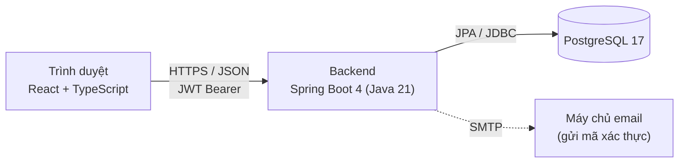
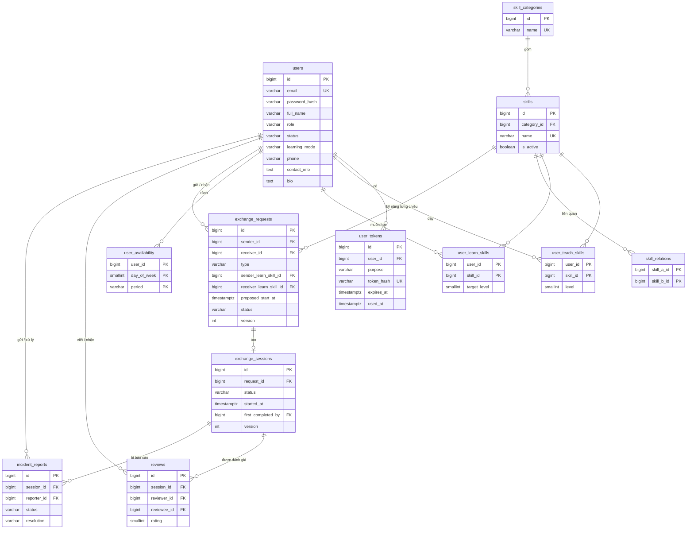
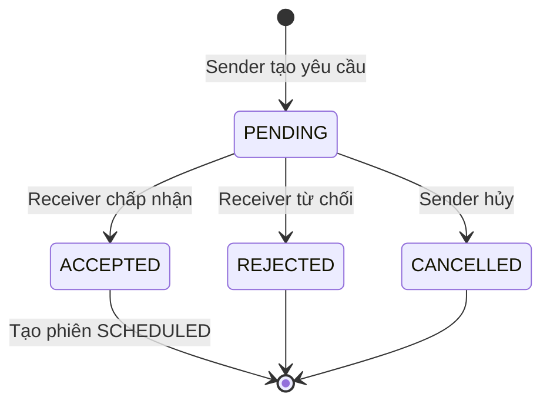
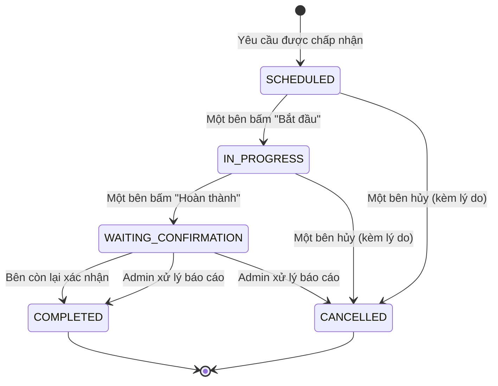
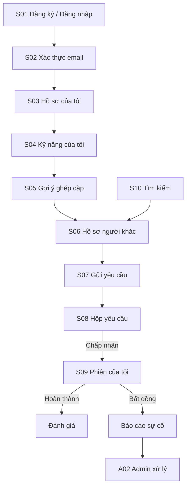

# THIẾT KẾ HỆ THỐNG – TUẦN 2

# SKILL EXCHANGE – NỀN TẢNG GHÉP CẶP TRAO ĐỔI KỸ NĂNG GIỮA SINH VIÊN

Dự án cá nhân | Thời gian thực hiện: 9 tuần

## 1. Mục tiêu và cơ sở thiết kế

Tuần 2 chuyển đặc tả yêu cầu của tuần 1 thành thiết kế kỹ thuật đủ chi tiết để bắt đầu lập trình từ tuần 3. Tài liệu gồm bốn phần:

1. Thiết kế cơ sở dữ liệu (mục 3).
2. Thiết kế API (mục 4).
3. Sơ đồ trạng thái của yêu cầu và phiên trao đổi (mục 5).
4. Prototype giao diện (mục 6).

**Cơ sở thiết kế:** tài liệu *Phân tích yêu cầu – Tuần 1*, bao gồm các quyết định đã chốt:

| Quyết định | Nội dung |
| --- | --- |
| Thang trình độ | 4 bậc: 1 Mới bắt đầu, 2 Cơ bản, 3 Khá, 4 Thành thạo. Mục tiêu học không bắt buộc |
| Khung giờ rảnh | 21 khung/tuần = 7 ngày × 3 buổi (Sáng / Chiều / Tối), lặp lại hằng tuần |
| Ghép hai chiều | $SkillFit(u,v) > 0$ và $SkillFit(v,u) > 0$ |
| LevelFit nhiều kỹ năng | Trung bình trên các kỹ năng có $Sim > 0$ |
| Yêu cầu và phiên | Một yêu cầu = một phiên = một buổi gặp. Yêu cầu ghi rõ loại, kỹ năng từng chiều và lịch đề xuất |
| Báo cáo sự cố | Thuộc MVP; admin chốt phiên sang `COMPLETED` hoặc `CANCELLED` |

Các điểm spec chưa quyết định nhưng cần cho thiết kế được ghi là **giả định** và tổng hợp ở mục 8.

## 2. Kiến trúc tổng quan



| Thành phần | Công nghệ | Vai trò |
| --- | --- | --- |
| Frontend | React, TypeScript, Vite | Giao diện người dùng, gọi REST API |
| Backend | Spring Boot 4, Spring Security, Spring Data JPA | Nghiệp vụ, phân quyền, thuật toán matching |
| Cơ sở dữ liệu | PostgreSQL 17, Flyway | Lưu dữ liệu; Flyway quản lý phiên bản lược đồ |
| Xác thực | JWT (access token) | Mỗi request gửi token trong header `Authorization` |

**Tổ chức mã nguồn backend theo tính năng (package-by-feature):**

| Package | Trách nhiệm |
| --- | --- |
| `auth` | Đăng ký, xác thực email, đăng nhập, JWT |
| `user` | Hồ sơ, lịch rảnh, hình thức học, kỹ năng của người dùng |
| `skill` | Danh mục kỹ năng, nhóm, quan hệ liên quan |
| `matching` | Lọc cứng, chấm điểm, phân loại hai chiều/một chiều |
| `exchange` | Yêu cầu trao đổi và phiên |
| `review` | Đánh giá, tính Reputation |
| `admin` | Quản trị danh mục, xử lý báo cáo sự cố |
| `evaluation` | Sinh dữ liệu giả lập, baseline, tính chỉ số (chạy offline) |
| `common` | Xử lý lỗi, cấu hình chung |

## 3. Thiết kế cơ sở dữ liệu

### 3.1. Quy ước chung

- Khóa chính: `BIGINT GENERATED ALWAYS AS IDENTITY`.
- Thời gian: `TIMESTAMPTZ` (có múi giờ), lưu theo UTC.
- Giá trị liệt kê (enum) lưu dạng `VARCHAR` kèm ràng buộc `CHECK`, thay vì kiểu enum riêng của PostgreSQL. Lý do: thêm giá trị mới chỉ cần sửa `CHECK` trong một migration, và JPA ánh xạ trực tiếp bằng `@Enumerated(EnumType.STRING)`.
- **"Chưa khai báo" được biểu diễn bằng việc không có dữ liệu:** người dùng không có dòng nào trong `user_availability` là chưa khai báo lịch rảnh; `learning_mode = NULL` là chưa khai báo hình thức học. Nhờ đó phân biệt được *chưa khai báo* với *đã khai báo nhưng không phù hợp*, đúng yêu cầu của lọc cứng.
- Cột liệt kê, cột trạng thái và cột số bắt buộc đều `NOT NULL`. Cột `status` có giá trị mặc định là trạng thái khởi đầu (`PENDING`, `SCHEDULED`, `OPEN`...). Cột `created_at` mặc định là thời điểm chèn.
- **Quy tắc xóa dữ liệu:**
  - Kỹ năng, lịch rảnh và mã xác thực của người dùng bị xóa theo khi xóa người dùng (`ON DELETE CASCADE`).
  - Yêu cầu, phiên, đánh giá và báo cáo là lịch sử nên **không được xóa** (mặc định `RESTRICT`). Người dùng đã có lịch sử thì chỉ khóa tài khoản (G7), không xóa.
  - Kỹ năng đang được dùng cũng không xóa được, chỉ ẩn bằng `is_active = false`.
- **Quy tắc nhất quán được đặt ngay trong database** bằng `CHECK`, không chỉ ở tầng service. Ví dụ: phiên `CANCELLED` bắt buộc có lý do hủy. Như vậy kể cả khi code có lỗi, dữ liệu sai cũng không ghi được.
- Lược đồ do Flyway tạo (`V1__init.sql`, ...). Hibernate chỉ kiểm tra khớp (`ddl-auto: validate`).

### 3.2. Sơ đồ thực thể – quan hệ (ERD)



### 3.3. Mô tả chi tiết các bảng

#### `users` – tài khoản và hồ sơ

| Cột | Kiểu | Ràng buộc | Ý nghĩa |
| --- | --- | --- | --- |
| `id` | BIGINT | PK | |
| `email` | VARCHAR(255) | NOT NULL, UNIQUE | Email trường, dùng để đăng nhập |
| `password_hash` | VARCHAR(100) | NOT NULL | Mật khẩu đã băm bằng BCrypt (NFR-01) |
| `full_name` | VARCHAR(100) | NOT NULL | |
| `role` | VARCHAR(20) | NOT NULL, CHECK ∈ {`STUDENT`, `ADMIN`} | |
| `status` | VARCHAR(30) | NOT NULL, CHECK ∈ {`PENDING_VERIFICATION`, `ACTIVE`, `LOCKED`} | Chỉ `ACTIVE` mới được matching (FR-01, lọc cứng điều 2) |
| `email_verified_at` | TIMESTAMPTZ | NULL | Thời điểm xác thực email |
| `learning_mode` | VARCHAR(10) | NULL, CHECK ∈ {`ONLINE`, `OFFLINE`, `ANY`} | NULL = chưa khai báo |
| `bio` | TEXT | NULL | Giới thiệu công khai |
| `phone` | VARCHAR(20) | NULL | **Riêng tư**, chỉ lộ sau khi yêu cầu được chấp nhận (NFR-02) |
| `contact_info` | TEXT | NULL | **Riêng tư**: Zalo, Facebook, email cá nhân... |
| `created_at`, `updated_at` | TIMESTAMPTZ | NOT NULL | |

#### `user_tokens` – mã xác thực email

| Cột | Kiểu | Ràng buộc | Ý nghĩa |
| --- | --- | --- | --- |
| `id` | BIGINT | PK | |
| `user_id` | BIGINT | FK → users, NOT NULL | |
| `purpose` | VARCHAR(30) | NOT NULL, CHECK ∈ {`VERIFY_EMAIL`, `RESET_PASSWORD`} | Dùng chung cho xác thực email và quên mật khẩu |
| `token_hash` | VARCHAR(100) | NOT NULL, UNIQUE | Chỉ lưu bản băm của mã, không lưu mã gốc |
| `expires_at` | TIMESTAMPTZ | NOT NULL | |
| `used_at` | TIMESTAMPTZ | NULL | Đã dùng thì không dùng lại được |
| `created_at` | TIMESTAMPTZ | NOT NULL | |

#### `skill_categories`, `skills`, `skill_relations` – danh mục kỹ năng (mục 4.1 spec)

| Bảng | Cột chính | Ràng buộc |
| --- | --- | --- |
| `skill_categories` | `id`, `name` | `name` UNIQUE |
| `skills` | `id`, `category_id`, `name`, `is_active` | `name` UNIQUE; `is_active = false` là kỹ năng bị ẩn (FR-08) |
| `skill_relations` | `skill_a_id`, `skill_b_id` | PK (`skill_a_id`, `skill_b_id`); CHECK `skill_a_id < skill_b_id` |

- Mỗi cặp kỹ năng liên quan chỉ lưu **một dòng**. CHECK `a < b` ngăn lưu trùng (Java, Kotlin) và (Kotlin, Java).
- Điều kiện "cùng nhóm" được kiểm tra ở tầng service khi admin tạo quan hệ.
- Từ ba bảng này tính được $Sim(s,t)$: bằng 1.0 nếu $s = t$, bằng 0.5 nếu có dòng trong `skill_relations`, còn lại bằng 0.
- Kỹ năng bị ẩn không hiện trong danh sách chọn mới, nhưng vẫn giữ trong dữ liệu cũ để không làm hỏng yêu cầu và phiên đã có.

#### `user_teach_skills`, `user_learn_skills` – kỹ năng của người dùng (FR-03)

| Bảng | Cột | Ràng buộc |
| --- | --- | --- |
| `user_teach_skills` | `user_id`, `skill_id`, `level` | PK (`user_id`, `skill_id`); `level` NOT NULL, CHECK 1–4 |
| `user_learn_skills` | `user_id`, `skill_id`, `target_level` | PK (`user_id`, `skill_id`); `target_level` NULL, CHECK 1–4 |

Tập $T_v$ là các dòng của $v$ trong `user_teach_skills`; tập $W_u$ là các dòng của $u$ trong `user_learn_skills`.

#### `user_availability` – lịch rảnh (mục 4.6 spec)

| Cột | Kiểu | Ràng buộc |
| --- | --- | --- |
| `user_id` | BIGINT | FK → users |
| `day_of_week` | SMALLINT | CHECK 1–7 (1 = Thứ Hai, 7 = Chủ Nhật) |
| `period` | VARCHAR(10) | CHECK ∈ {`MORNING`, `AFTERNOON`, `EVENING`} |

Khóa chính gồm cả ba cột. Mỗi người có tối đa 21 dòng. Số khung trùng của hai người là số cặp (`day_of_week`, `period`) chung.

#### `exchange_requests` – yêu cầu trao đổi (FR-05, mục 6.4 spec)

| Cột | Kiểu | Ràng buộc | Ý nghĩa |
| --- | --- | --- | --- |
| `id` | BIGINT | PK | |
| `sender_id`, `receiver_id` | BIGINT | FK → users, NOT NULL, CHECK `sender_id <> receiver_id` | |
| `type` | VARCHAR(10) | NOT NULL, CHECK ∈ {`TWO_WAY`, `ONE_WAY`} | |
| `sender_learn_skill_id` | BIGINT | FK → skills, NOT NULL | Kỹ năng người gửi muốn học |
| `receiver_learn_skill_id` | BIGINT | FK → skills, NULL | Kỹ năng người nhận muốn học |
| `proposed_start_at` | TIMESTAMPTZ | NOT NULL | Thời điểm đề xuất |
| `duration_minutes` | SMALLINT | NOT NULL, CHECK 15–480 | |
| `mode` | VARCHAR(10) | NOT NULL, CHECK ∈ {`ONLINE`, `OFFLINE`} | Không có `ANY`: buổi học phải chốt một hình thức |
| `location_or_link` | VARCHAR(500) | NULL | Riêng tư tới khi được chấp nhận |
| `message` | TEXT | NULL | Lời nhắn của người gửi |
| `status` | VARCHAR(20) | NOT NULL, mặc định `PENDING`, CHECK ∈ {`PENDING`, `ACCEPTED`, `REJECTED`, `CANCELLED`} | |
| `response_note` | TEXT | NULL | Ghi chú khi từ chối |
| `created_at` | TIMESTAMPTZ | NOT NULL | |
| `responded_at` | TIMESTAMPTZ | NULL | Thời điểm chấp nhận/từ chối |
| `version` | INTEGER | NOT NULL, mặc định 0 | Khóa lạc quan, chống người gửi hủy đúng lúc người nhận chấp nhận (mục 5.1) |

- **Ràng buộc nhất quán loại yêu cầu:** `CHECK ((type = 'TWO_WAY') = (receiver_learn_skill_id IS NOT NULL))`. Yêu cầu hai chiều bắt buộc có kỹ năng chiều ngược lại; yêu cầu một chiều thì không được có.
- **Chống gửi trùng (giả định G4):** chỉ mục duy nhất một phần `UNIQUE (sender_id, receiver_id) WHERE status = 'PENDING'`, nghĩa là mỗi người chỉ có một yêu cầu đang chờ với cùng một người nhận.

#### `exchange_sessions` – phiên trao đổi (FR-06)

| Cột | Kiểu | Ràng buộc | Ý nghĩa |
| --- | --- | --- | --- |
| `id` | BIGINT | PK | |
| `request_id` | BIGINT | FK → exchange_requests, NOT NULL, UNIQUE | Một yêu cầu tạo tối đa một phiên |
| `start_at`, `duration_minutes`, `mode` | | NOT NULL, cùng ràng buộc như bảng yêu cầu | Sao chép từ yêu cầu lúc chấp nhận |
| `location_or_link` | VARCHAR(500) | NULL | Sao chép từ yêu cầu |
| `status` | VARCHAR(25) | NOT NULL, mặc định `SCHEDULED`, CHECK ∈ {`SCHEDULED`, `IN_PROGRESS`, `WAITING_CONFIRMATION`, `COMPLETED`, `CANCELLED`} | |
| `started_at` | TIMESTAMPTZ | NULL | **Khác NULL nghĩa là phiên đã bắt đầu** |
| `first_completed_by` | BIGINT | FK → users, NULL | Người bấm hoàn thành trước |
| `completed_at` | TIMESTAMPTZ | NULL | |
| `cancelled_by` | BIGINT | FK → users, NULL | |
| `cancel_reason` | TEXT | NULL | Bắt buộc khi hủy |
| `cancelled_at` | TIMESTAMPTZ | NULL | |
| `version` | INTEGER | NOT NULL, mặc định 0 | Khóa lạc quan (optimistic locking), chống hai người cùng bấm một lúc |
| `created_at` | TIMESTAMPTZ | NOT NULL | Thời điểm tạo phiên (= lúc chấp nhận yêu cầu) |

- Hai người tham gia phiên là `sender_id` và `receiver_id` của yêu cầu gốc.
- Cột `started_at` giải quyết quy tắc CompletionRate: phiên `CANCELLED` có `started_at` khác NULL là *hủy sau khi bắt đầu*, nên được tính vào mẫu số.
- **Ràng buộc nhất quán trạng thái** (`CHECK`):

  | Nếu `status` là | Thì bắt buộc có |
  | --- | --- |
  | `IN_PROGRESS`, `WAITING_CONFIRMATION`, `COMPLETED` | `started_at` |
  | `WAITING_CONFIRMATION` | `first_completed_by` |
  | `COMPLETED` | `completed_at` |
  | `CANCELLED` | `cancel_reason` và `cancelled_at` |

  Các ràng buộc này chỉ kiểm tra dữ liệu của **một trạng thái** có đủ hay không. Thứ tự chuyển trạng thái (ví dụ không được đi thẳng `SCHEDULED` → `COMPLETED`) và việc người thao tác có phải người tham gia hay không vẫn do tầng service kiểm tra (mục 5).

#### `reviews` – đánh giá (FR-07)

| Cột | Kiểu | Ràng buộc |
| --- | --- | --- |
| `id` | BIGINT | PK |
| `session_id` | BIGINT | FK → exchange_sessions, NOT NULL |
| `reviewer_id`, `reviewee_id` | BIGINT | FK → users, NOT NULL, CHECK `reviewer_id <> reviewee_id` |
| `rating` | SMALLINT | NOT NULL, CHECK 1–5 |
| `comment` | TEXT | NULL |
| `created_at` | TIMESTAMPTZ | NOT NULL |

`UNIQUE (session_id, reviewer_id)` bảo đảm mỗi người chỉ đánh giá một lần mỗi phiên. Trạng thái "đã đánh giá" (`has_rated`) suy ra từ việc có dòng hay không, tách biệt khỏi trạng thái phiên đúng như spec 6.3 yêu cầu.

#### `incident_reports` – báo cáo sự cố (FR-09)

| Cột | Kiểu | Ràng buộc | Ý nghĩa |
| --- | --- | --- | --- |
| `id` | BIGINT | PK | |
| `session_id` | BIGINT | FK → exchange_sessions, NOT NULL | |
| `reporter_id` | BIGINT | FK → users, NOT NULL | |
| `reason` | TEXT | NOT NULL | |
| `status` | VARCHAR(10) | NOT NULL, mặc định `OPEN`, CHECK ∈ {`OPEN`, `RESOLVED`} | |
| `resolution` | VARCHAR(20) | NULL, CHECK ∈ {`SESSION_COMPLETED`, `SESSION_CANCELLED`} | Admin chốt phiên theo hướng nào |
| `admin_note` | TEXT | NULL | Lý do quyết định |
| `resolved_by` | BIGINT | FK → users, NULL | |
| `created_at` | TIMESTAMPTZ | NOT NULL | |
| `resolved_at` | TIMESTAMPTZ | NULL | |

- Mỗi phiên có tối đa một báo cáo đang mở: `UNIQUE (session_id) WHERE status = 'OPEN'`.
- **Ràng buộc nhất quán** (`CHECK`), viết thành hai điều kiện riêng:
  - `RESOLVED` ⇒ có đủ `resolution`, `resolved_by`, `resolved_at`.
  - `OPEN` ⇒ cả ba cột trên đều NULL.

  Không gộp thành một điều kiện dạng `(status = 'RESOLVED') = (đủ ba cột)`. Kiểm thử cho thấy cách gộp này để lọt trường hợp báo cáo `OPEN` có `resolution` nhưng thiếu hai cột còn lại (mục 3.6, ca B42).

### 3.4. Chỉ mục phục vụ truy vấn chính

| Chỉ mục | Phục vụ |
| --- | --- |
| `user_teach_skills (skill_id)` | Tìm người dạy một kỹ năng (lọc ứng viên, tìm kiếm) |
| `user_learn_skills (skill_id)` | Tìm người muốn học một kỹ năng (chiều ngược lại của ghép hai chiều) |
| `exchange_requests (receiver_id, status)`, `(sender_id, status)` | Hộp thư yêu cầu đến/đi |
| `exchange_sessions (status)` | Danh sách phiên theo trạng thái |
| `reviews (reviewee_id)` | Tính RatingNorm |
| `incident_reports (status)` | Hàng đợi báo cáo của admin |

### 3.5. Ánh xạ công thức matching sang dữ liệu

| Đại lượng | Lấy từ | Ghi chú |
| --- | --- | --- |
| $Sim(s,t)$ | `skills`, `skill_relations` | |
| $SkillFit(u,v)$ | `user_learn_skills` của $u$, `user_teach_skills` của $v$ | |
| $LevelFit(u,v)$ | `target_level` của $u$, `level` của $v$ | Trung bình trên các kỹ năng có $Sim > 0$ |
| $ScheduleFit(u,v)$ | `user_availability` | Không có dòng = chưa khai báo → 0.5 |
| $ModeFit(u,v)$ | `users.learning_mode` | NULL = chưa khai báo |
| $RatingNorm(v)$ | `AVG(reviews.rating)` với `reviewee_id = v` | Chưa có đánh giá → 0.5 |
| $CompletionRate(v)$ | `exchange_sessions` mà $v$ tham gia | Tử số: `status = COMPLETED`. Mẫu số: `started_at IS NOT NULL`. Chưa có phiên nào đã bắt đầu thì truy vấn trả về NULL; service đổi thành **0.5** theo spec mục 4.3 |

**Cách chạy matching:** với quy mô mục tiêu 1.000 hồ sơ (NFR-03), backend nạp kỹ năng, lịch rảnh và Reputation của các người dùng `ACTIVE` vào bộ nhớ bằng vài truy vấn gộp, sau đó lọc và chấm điểm bằng Java. Cách này tránh truy vấn lặp cho từng ứng viên. Reputation tính trực tiếp từ dữ liệu, chưa cần bảng lưu đệm.

**Dữ liệu giả lập cho thực nghiệm** (tuần 5) được sinh và đánh giá trong bộ nhớ bởi module `evaluation`, không ghi vào các bảng nghiệp vụ.

**Dữ liệu khởi tạo:** danh mục 20–30 kỹ năng, các nhóm và quan hệ liên quan được nạp sẵn bằng migration Flyway (`V2__seed_skills.sql`), để tuần 3–4 có dữ liệu trước khi làm màn hình quản trị.

### 3.6. Kiểm chứng lược đồ

Lược đồ trên đã được viết thành `V1__init.sql` và chạy thử trên PostgreSQL 17 (database tạm, không phải database của ứng dụng). Có 73 ca kiểm thử:

| Nhóm | Số ca | Mong đợi |
| --- | --- | --- |
| A. Dữ liệu hợp lệ: đi trọn kịch bản gửi yêu cầu → chấp nhận → bắt đầu → hoàn thành → đánh giá, và một phiên bị báo cáo sự cố rồi admin hủy | 23 | Được nhận |
| B. Dữ liệu sai: mỗi ràng buộc ít nhất một câu vi phạm (giá trị ngoài miền, trùng lặp, thiếu cột bắt buộc, sai nhất quán loại yêu cầu, gửi trùng `PENDING`, xóa dữ liệu đang được dùng...) | 44 | Bị chặn |
| C. Truy vấn công thức: $Sim$, số khung rảnh trùng, $RatingNorm$, $CompletionRate$ (kể cả mẫu số bằng 0) | 6 | Đúng giá trị tính tay |

**Kết quả: 73/73 đạt.** Lần chạy đầu có một ca không đạt (B42), giúp phát hiện lỗi ràng buộc của bảng `incident_reports` đã nêu ở mục 3.3. Kịch bản và kết quả chi tiết nằm trong thư mục `kiem_thu/`.

## 4. Thiết kế API

### 4.1. Quy ước chung

- Kiểu REST, dữ liệu JSON, tiền tố `/api`.
- **Xác thực:** sau khi đăng nhập, client gửi `Authorization: Bearer <JWT>` trong mọi request cần đăng nhập. Token có hạn dùng (giả định G5: 24 giờ). Đăng xuất phía client bằng cách xóa token.
- **Phân quyền ở backend (NFR-01):** mỗi API kiểm tra (1) đã đăng nhập, (2) vai trò, (3) quyền sở hữu tài nguyên, ví dụ người gọi có phải người tham gia phiên không.
- **Hành động đổi trạng thái dùng endpoint riêng** (`POST /requests/{id}/accept`), không dùng `PATCH status`. Mỗi chuyển trạng thái có điều kiện và người được phép riêng, nên endpoint riêng giúp kiểm tra quyền rõ ràng và không cho client tự đặt trạng thái tùy ý.
- **Định dạng lỗi** theo chuẩn Problem Details (RFC 9457), được Spring hỗ trợ sẵn:

```json
{
  "type": "about:blank",
  "title": "Conflict",
  "status": 409,
  "detail": "Chỉ hủy được yêu cầu đang ở trạng thái PENDING",
  "instance": "/api/requests/42/cancel"
}
```

| Mã HTTP | Khi nào |
| --- | --- |
| 200 / 201 / 204 | Thành công / đã tạo mới / thành công không có nội dung |
| 400 | Dữ liệu không hợp lệ (thiếu trường, sai miền giá trị) |
| 401 | Chưa đăng nhập hoặc token hết hạn |
| 403 | Đã đăng nhập nhưng không có quyền (sai vai trò, không phải người tham gia, tài khoản chưa xác thực) |
| 404 | Không tìm thấy tài nguyên |
| 409 | Xung đột trạng thái: chuyển trạng thái không hợp lệ, đánh giá lần hai, gửi trùng yêu cầu |

**Ký hiệu quyền** trong các bảng dưới: *Public* = không cần đăng nhập; *User* = đã đăng nhập; *Active* = tài khoản `ACTIVE`; *Participant* = người tham gia phiên/yêu cầu; *Admin* = quản trị viên.

### 4.2. Xác thực – `auth`

| Phương thức | Đường dẫn | Quyền | Mô tả | FR |
| --- | --- | --- | --- | --- |
| POST | `/api/auth/register` | Public | Đăng ký bằng email trường (giả định G6: kiểm tra đuôi tên miền), gửi mã xác thực | FR-01 |
| POST | `/api/auth/verify-email` | Public | Gửi `token` để xác thực; tài khoản chuyển sang `ACTIVE` | FR-01 |
| POST | `/api/auth/resend-verification` | Public | Gửi lại mã xác thực | FR-01 |
| POST | `/api/auth/login` | Public | Trả về `accessToken` | FR-01 |

### 4.3. Hồ sơ và kỹ năng của tôi – `user`

| Phương thức | Đường dẫn | Quyền | Mô tả | FR |
| --- | --- | --- | --- | --- |
| GET | `/api/me` | User | Xem hồ sơ của mình, kể cả thông tin liên hệ | FR-02 |
| PUT | `/api/me` | User | Cập nhật họ tên, giới thiệu, hình thức học, điện thoại, liên hệ | FR-02 |
| PUT | `/api/me/availability` | User | Thay toàn bộ lịch rảnh bằng danh sách `{dayOfWeek, period}`; danh sách rỗng = chưa khai báo | FR-02 |
| PUT | `/api/me/teach-skills` | User | Thay danh sách kỹ năng dạy `{skillId, level}` | FR-03 |
| PUT | `/api/me/learn-skills` | User | Thay danh sách kỹ năng muốn học `{skillId, targetLevel?}` | FR-03 |
| GET | `/api/users/{id}` | Active | Hồ sơ công khai, **không** có thông tin liên hệ | FR-02 |
| GET | `/api/users/{id}/reviews` | Active | Các đánh giá người đó nhận được | FR-07 |
| GET | `/api/users/search?skillId=&q=` | Active | Tìm kiếm người dùng theo kỹ năng hoặc tên | MVP (mục 2) |

Lịch rảnh và danh sách kỹ năng dùng `PUT` thay cả danh sách, vì giao diện là một biểu mẫu chỉnh sửa toàn bộ. Cách này đơn giản hơn thêm/xóa từng dòng.

### 4.4. Danh mục kỹ năng – `skill`

| Phương thức | Đường dẫn | Quyền | Mô tả |
| --- | --- | --- | --- |
| GET | `/api/skill-categories` | User | Danh sách nhóm kỹ năng |
| GET | `/api/skills?categoryId=&q=` | User | Kỹ năng đang hoạt động, dùng cho ô chọn kỹ năng |

### 4.5. Gợi ý ứng viên – `matching`

| Phương thức | Đường dẫn | Quyền | Mô tả | FR |
| --- | --- | --- | --- | --- |
| GET | `/api/matches?type=TWO_WAY&limit=10` | Active | Danh sách ghép hai chiều, xếp theo MutualScore | FR-04 |
| GET | `/api/matches?type=ONE_WAY&limit=10` | Active | Danh sách mentoring một chiều, xếp theo $D(u,v)$ | FR-04 |

Mỗi kết quả trả về điểm, các thành phần điểm và lý do phù hợp để giao diện giải thích (mục 2 spec: "giải thích kết quả"):

```json
{
  "userId": 17,
  "fullName": "Trần B",
  "type": "TWO_WAY",
  "score": 0.78,
  "forward":  { "d": 0.94, "skillFit": 1.0, "levelFit": 1.0, "scheduleFit": 0.667, "modeFit": 1.0, "reputation": 0.8 },
  "backward": { "d": 0.65, "skillFit": 0.5, "levelFit": 1.0, "scheduleFit": 0.667, "modeFit": 1.0, "reputation": 0.5 },
  "youLearn":  [{ "want": "Java", "teach": "Java", "relation": "EXACT", "theirLevel": 3 }],
  "theyLearn": [{ "want": "IELTS Writing", "teach": "Tiếng Anh", "relation": "RELATED", "yourLevel": 3 }],
  "commonSlots": [{ "dayOfWeek": 2, "period": "EVENING" }, { "dayOfWeek": 5, "period": "EVENING" }]
}
```

Với `ONE_WAY` thì không có `backward` và `theyLearn`, còn `score` bằng $D(u,v)$.

### 4.6. Yêu cầu trao đổi – `exchange`

| Phương thức | Đường dẫn | Quyền | Mô tả | FR |
| --- | --- | --- | --- | --- |
| POST | `/api/requests` | Active | Tạo yêu cầu (mục 6.4 spec) | FR-05 |
| GET | `/api/requests?box=sent\|received&status=` | Active | Hộp thư yêu cầu đi/đến | FR-05 |
| GET | `/api/requests/{id}` | Participant | Chi tiết yêu cầu | FR-05 |
| POST | `/api/requests/{id}/accept` | Receiver | Chấp nhận: yêu cầu → `ACCEPTED`, tạo phiên `SCHEDULED` | FR-05 |
| POST | `/api/requests/{id}/reject` | Receiver | Từ chối, kèm `note` tùy chọn | FR-05 |
| POST | `/api/requests/{id}/cancel` | Sender | Hủy khi còn `PENDING` | FR-05 |

Ví dụ tạo yêu cầu hai chiều:

```json
POST /api/requests
{
  "receiverId": 17,
  "type": "TWO_WAY",
  "senderLearnSkillId": 3,
  "receiverLearnSkillId": 21,
  "proposedStartAt": "2026-11-04T19:00:00+07:00",
  "durationMinutes": 90,
  "mode": "ONLINE",
  "locationOrLink": "https://meet.google.com/abc-defg-hij",
  "message": "Mình học Java tối thứ Ba được không?"
}
```

Backend kiểm tra khi tạo yêu cầu:

1. Người nhận đang `ACTIVE` và khác người gửi.
2. `senderLearnSkillId` có $Sim > 0$ với một kỹ năng dạy của người nhận. Nếu là `TWO_WAY` thì `receiverLearnSkillId` cũng phải có $Sim > 0$ với một kỹ năng dạy của người gửi.
3. `proposedStartAt` ở tương lai.
4. Chưa có yêu cầu `PENDING` nào giữa hai người theo cùng chiều (giả định G4).

### 4.7. Phiên trao đổi – `exchange`

| Phương thức | Đường dẫn | Quyền | Mô tả | FR |
| --- | --- | --- | --- | --- |
| GET | `/api/sessions?status=` | Active | Các phiên của tôi | FR-06 |
| GET | `/api/sessions/{id}` | Participant, Admin | Chi tiết phiên, **kèm thông tin liên hệ và địa điểm/link** của bên kia | FR-06, NFR-02 |
| POST | `/api/sessions/{id}/start` | Participant | `SCHEDULED` → `IN_PROGRESS` (giả định G1) | FR-06 |
| POST | `/api/sessions/{id}/complete` | Participant | Lần 1: → `WAITING_CONFIRMATION`. Lần 2 (bên còn lại): → `COMPLETED` | FR-06 |
| POST | `/api/sessions/{id}/cancel` | Participant | Hủy kèm `reason` bắt buộc; chỉ từ `SCHEDULED` hoặc `IN_PROGRESS` | FR-06 |

### 4.8. Đánh giá và báo cáo sự cố – `review`, `admin`

| Phương thức | Đường dẫn | Quyền | Mô tả | FR |
| --- | --- | --- | --- | --- |
| POST | `/api/sessions/{id}/reviews` | Participant | Đánh giá `{rating, comment}`; chỉ khi phiên `COMPLETED`, mỗi người một lần | FR-07 |
| POST | `/api/sessions/{id}/reports` | Participant | Gửi báo cáo sự cố `{reason}` | FR-09 |

### 4.9. Quản trị – `admin`

| Phương thức | Đường dẫn | Quyền | Mô tả | FR |
| --- | --- | --- | --- | --- |
| POST | `/api/admin/skill-categories` | Admin | Thêm nhóm kỹ năng | FR-08 |
| POST | `/api/admin/skills` | Admin | Thêm kỹ năng | FR-08 |
| PUT | `/api/admin/skills/{id}` | Admin | Sửa tên, nhóm, ẩn/hiện (`isActive`) | FR-08 |
| POST | `/api/admin/skill-relations` | Admin | Đánh dấu hai kỹ năng cùng nhóm là liên quan | FR-08 |
| DELETE | `/api/admin/skill-relations/{aId}/{bId}` | Admin | Bỏ quan hệ liên quan | FR-08 |
| GET | `/api/admin/reports?status=OPEN` | Admin | Hàng đợi báo cáo sự cố | FR-09 |
| POST | `/api/admin/reports/{id}/resolve` | Admin | `{resolution: SESSION_COMPLETED \| SESSION_CANCELLED, note}`; chốt phiên tương ứng | FR-09 |
| PUT | `/api/admin/users/{id}/status` | Admin | Khóa/mở khóa tài khoản (`ACTIVE` ↔ `LOCKED`) | Giả định G7 |

### 4.10. Ma trận phân quyền rút gọn

| Hành động | Sender | Receiver | Người khác | Admin |
| --- | :---: | :---: | :---: | :---: |
| Tạo yêu cầu | ✔ | – | – | ✖ |
| Chấp nhận / từ chối | ✖ | ✔ | ✖ | ✖ |
| Hủy yêu cầu `PENDING` | ✔ | ✖ | ✖ | ✖ |
| Xem liên hệ, địa điểm/link | ✔ sau `ACCEPTED` | ✔ sau `ACCEPTED` | ✖ | ✔ |
| Bắt đầu / hoàn thành / hủy phiên | ✔ | ✔ | ✖ | ✖ |
| Đánh giá | ✔ | ✔ | ✖ | ✖ |
| Báo cáo sự cố | ✔ | ✔ | ✖ | – |
| Xử lý báo cáo | ✖ | ✖ | ✖ | ✔ |

## 5. Sơ đồ trạng thái

Yêu cầu và phiên được thiết kế thành **hai máy trạng thái riêng**, ứng với hai bảng `exchange_requests` và `exchange_sessions`. Đánh giá không phải là trạng thái của phiên mà là bản ghi riêng trong bảng `reviews`.

### 5.1. Yêu cầu trao đổi



| Từ | Sang | Ai | API | Điều kiện / tác động phụ |
| --- | --- | --- | --- | --- |
| – | `PENDING` | Sender | `POST /requests` | Các kiểm tra ở mục 4.6 |
| `PENDING` | `ACCEPTED` | Receiver | `POST /requests/{id}/accept` | Tạo phiên `SCHEDULED` trong **cùng giao dịch** (transaction); mở quyền xem liên hệ |
| `PENDING` | `REJECTED` | Receiver | `POST /requests/{id}/reject` | Lưu `response_note` |
| `PENDING` | `CANCELLED` | Sender | `POST /requests/{id}/cancel` | |

`ACCEPTED`, `REJECTED` và `CANCELLED` là trạng thái cuối. Mọi thao tác khác trả về **409**.

**Chống thao tác đồng thời:** người gửi bấm "Hủy" đúng lúc người nhận bấm "Chấp nhận". Cột `version` của `exchange_requests` làm thao tác đến sau thất bại (409), nên không xảy ra trường hợp yêu cầu đã hủy mà vẫn sinh ra phiên.

### 5.2. Phiên trao đổi



| Từ | Sang | Ai | API | Điều kiện / tác động phụ |
| --- | --- | --- | --- | --- |
| `SCHEDULED` | `IN_PROGRESS` | Participant | `POST /sessions/{id}/start` | Chỉ từ 15 phút trước `start_at` (giả định G1); ghi `started_at` |
| `SCHEDULED` | `CANCELLED` | Participant | `POST /sessions/{id}/cancel` | Lý do bắt buộc; `started_at` vẫn NULL nên **không** tính vào CompletionRate |
| `IN_PROGRESS` | `WAITING_CONFIRMATION` | Participant | `POST /sessions/{id}/complete` | Ghi `first_completed_by` |
| `IN_PROGRESS` | `CANCELLED` | Participant | `POST /sessions/{id}/cancel` | Lý do bắt buộc; **có** tính vào mẫu số CompletionRate |
| `WAITING_CONFIRMATION` | `COMPLETED` | Bên còn lại | `POST /sessions/{id}/complete` | Người gọi phải khác `first_completed_by`; mở quyền đánh giá |
| `WAITING_CONFIRMATION` | `COMPLETED` / `CANCELLED` | Admin | `POST /admin/reports/{id}/resolve` | Chỉ khi có báo cáo `OPEN`; báo cáo chuyển sang `RESOLVED` |

**Các chuyển trạng thái bị cấm** (trả về 409, cần có unit test):

- Người đã bấm hoàn thành bấm xác nhận lần hai.
- Hủy phiên đang `WAITING_CONFIRMATION` (spec 6.2: không tự động hoặc tùy tiện hủy khi có bất đồng; chỉ admin chốt).
- Mọi thao tác trên phiên `COMPLETED` hoặc `CANCELLED`, ngoại trừ đánh giá phiên `COMPLETED`.
- Bắt đầu phiên quá sớm so với `start_at`.

**Chống thao tác đồng thời:** nếu hai người cùng bấm "Hoàn thành" một lúc, cột `version` (optimistic locking) làm request thứ hai thất bại thay vì ghi đè. Client tải lại và nhận trạng thái mới.

## 6. Prototype giao diện

### 6.1. Danh sách màn hình

| Mã | Màn hình | Nội dung chính | API sử dụng |
| --- | --- | --- | --- |
| S01 | Đăng ký / Đăng nhập | Form email trường, mật khẩu | `/auth/*` |
| S02 | Xác thực email | Nhập mã hoặc mở liên kết; gửi lại mã | `/auth/verify-email`, `/auth/resend-verification` |
| S03 | Hồ sơ của tôi | Thông tin cá nhân, liên hệ riêng tư, hình thức học, lưới lịch rảnh 7×3 | `/me`, `/me/availability` |
| S04 | Kỹ năng của tôi | Hai danh sách: kỹ năng dạy (có trình độ 1–4) và kỹ năng muốn học (mục tiêu tùy chọn) | `/skills`, `/me/teach-skills`, `/me/learn-skills` |
| S05 | Gợi ý ghép cặp | Hai tab "Trao đổi hai chiều" và "Tìm người hướng dẫn"; thẻ ứng viên có điểm và lý do | `/matches` |
| S06 | Hồ sơ người khác | Thông tin công khai, kỹ năng, đánh giá; nút "Gửi yêu cầu" | `/users/{id}`, `/users/{id}/reviews` |
| S07 | Gửi yêu cầu | Chọn kỹ năng từng chiều, thời điểm (gợi ý khung trùng), thời lượng, hình thức, địa điểm/link | `POST /requests` |
| S08 | Hộp yêu cầu | Tab Đã nhận / Đã gửi; nút Chấp nhận, Từ chối, Hủy | `/requests` |
| S09 | Phiên của tôi và chi tiết phiên | Trạng thái, liên hệ bên kia, nút Bắt đầu / Hoàn thành / Hủy / Báo cáo / Đánh giá | `/sessions`, `/sessions/{id}/*` |
| S10 | Tìm kiếm | Tìm theo kỹ năng hoặc tên | `/users/search` |
| A01 | Quản trị danh mục kỹ năng | Bảng kỹ năng theo nhóm; thêm/sửa/ẩn; quản lý quan hệ liên quan | `/admin/skills*` |
| A02 | Xử lý báo cáo sự cố | Hàng đợi báo cáo; xem phiên; chốt Hoàn thành / Hủy kèm ghi chú | `/admin/reports*` |

### 6.2. Luồng điều hướng



Người dùng mới được dẫn qua S03 → S04 vì chưa có kỹ năng thì không có gợi ý.

### 6.3. Bản phác thảo (wireframe) các màn hình chính

**S05 – Gợi ý ghép cặp**

```
+------------------------------------------------------------------+
| Skill Exchange    Gợi ý | Yêu cầu (2) | Phiên | Tìm kiếm  [Avatar]|
+------------------------------------------------------------------+
| [ Trao đổi hai chiều (8) ]  [ Tìm người hướng dẫn (15) ]           |
|                                                                  |
| +--------------------------------------------------------------+ |
| | Trần B                           Mức phù hợp: 78%   ★ 4.2    | |
| | Bạn học: Java (trùng, trình độ 3)                            | |
| | Bạn dạy: Tiếng Anh → IELTS Writing (kỹ năng liên quan)       | |
| | Lịch trùng: Tối T3, Tối T6     Hình thức: Online             | |
| | [Xem chi tiết điểm]                [Xem hồ sơ] [Gửi yêu cầu] | |
| +--------------------------------------------------------------+ |
| +--------------------------------------------------------------+ |
| | Lê C                             Mức phù hợp: 74%   Mới      | |
| | ...                                                          | |
+------------------------------------------------------------------+
```

**S07 – Gửi yêu cầu**

```
+------------------------------------------------------------------+
| Gửi yêu cầu trao đổi tới Trần B                  Loại: Hai chiều |
|------------------------------------------------------------------|
| Bạn muốn học:      [ Java                         v ]            |
| Bạn sẽ dạy:        [ Tiếng Anh                    v ]            |
| Thời điểm:         [ 04/11/2026 ] [ 19:00 ]                      |
|                    Gợi ý khung trùng: (Tối T3) (Tối T6)          |
| Thời lượng:        [ 90 ] phút                                   |
| Hình thức:         (o) Online   ( ) Offline                      |
| Link / địa điểm:   [ https://meet.google.com/...   ]             |
|                    Chỉ hiển thị cho Trần B sau khi chấp nhận     |
| Lời nhắn:          [                                ]            |
|                                         [Hủy]  [Gửi yêu cầu]     |
+------------------------------------------------------------------+
```

**S09 – Chi tiết phiên**

```
+------------------------------------------------------------------+
| Phiên #12  Java <-> Tiếng Anh         Trạng thái: CHỜ XÁC NHẬN   |
|------------------------------------------------------------------|
| Thời gian: 19:00 04/11/2026 (90 phút)    Hình thức: Online       |
| Link: https://meet.google.com/abc-defg-hij                       |
| Liên hệ Trần B: 09xx xxx xxx · zalo: ...                         |
|------------------------------------------------------------------|
| Trần B đã bấm Hoàn thành. Bạn xác nhận buổi học đã diễn ra?      |
|               [Xác nhận hoàn thành]   [Báo cáo sự cố]            |
+------------------------------------------------------------------+
```

Các nút hiện ra tùy theo trạng thái phiên và vai trò của người xem, đúng bảng chuyển trạng thái ở mục 5.2. Giao diện chỉ ẩn nút để dễ dùng; quyền vẫn được kiểm tra lại ở backend.

## 7. Bảng truy vết yêu cầu

| Yêu cầu | Bảng dữ liệu | API | Màn hình |
| --- | --- | --- | --- |
| FR-01 Tài khoản, xác thực email | `users`, `user_tokens` | `/auth/*` | S01, S02 |
| FR-02 Hồ sơ, lịch rảnh, hình thức học | `users`, `user_availability` | `/me`, `/me/availability` | S03 |
| FR-03 Kỹ năng và trình độ | `user_teach_skills`, `user_learn_skills` | `/me/teach-skills`, `/me/learn-skills` | S04 |
| FR-04 Gợi ý, phân loại, xếp hạng | Đọc các bảng trên, `reviews`, `exchange_sessions` | `/matches` | S05 |
| FR-05 Yêu cầu trao đổi | `exchange_requests` | `/requests*` | S06, S07, S08 |
| FR-06 Phiên và xác nhận hoàn thành | `exchange_sessions` | `/sessions*` | S09 |
| FR-07 Đánh giá | `reviews` | `/sessions/{id}/reviews` | S09 |
| FR-08 Quản trị danh mục | `skills`, `skill_categories`, `skill_relations` | `/admin/skill*` | A01 |
| FR-09 Báo cáo sự cố | `incident_reports` | `/sessions/{id}/reports`, `/admin/reports*` | S09, A02 |
| NFR-01 Bảo mật | `password_hash`, `user_tokens.token_hash` | JWT, kiểm tra quyền mọi API | – |
| NFR-02 Riêng tư | `phone`, `contact_info`, `location_or_link` | Chỉ trả về trong `/me`, `/sessions/{id}` | S09 |

## 8. Giả định thiết kế cần xác nhận

Spec tuần 1 chưa quy định các điểm dưới đây. Thiết kế tạm chọn phương án đơn giản nhất và có thể đổi lại mà không phải sửa cấu trúc lớn.

| Mã | Giả định | Liên quan |
| --- | --- | --- |
| G1 | Phiên chuyển sang `IN_PROGRESS` khi một bên bấm "Bắt đầu", chỉ được bấm từ 15 phút trước giờ hẹn. Không dùng tác vụ chạy định kỳ | Spec T7 |
| G2 | Yêu cầu `PENDING` và phiên `IN_PROGRESS` chưa có thời hạn tự hết hạn trong MVP | Spec T7 |
| G3 | Khi một bên hủy phiên đang diễn ra, phiên tính vào mẫu số CompletionRate của **cả hai** bên, đúng theo spec hiện tại | Spec T8 |
| G4 | Mỗi người chỉ có một yêu cầu `PENDING` tới cùng một người nhận | Spec L4 |
| G5 | JWT có hạn 24 giờ, chưa dùng refresh token | – |
| G6 | Email trường được nhận diện bằng đuôi tên miền cấu hình sẵn (ví dụ `@<tên-trường>.edu.vn`) | FR-01 |
| G7 | Có API khóa/mở khóa tài khoản cho admin, vì lọc cứng và nhãn 5.1 có nhắc tới "tài khoản bị khóa" | Spec T9 |

## 9. Kế hoạch tuần 3

- `V1__init.sql` đã có và đã kiểm thử (mục 3.6). Viết thêm `V2__seed_skills.sql` cho danh mục kỹ năng.
- Làm luồng đăng ký, xác thực email, đăng nhập JWT (mục 4.2).
- Làm API hồ sơ, lịch rảnh, kỹ năng (mục 4.3) và màn hình S01–S04.
