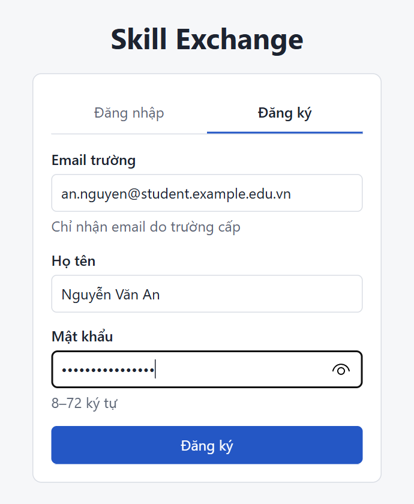
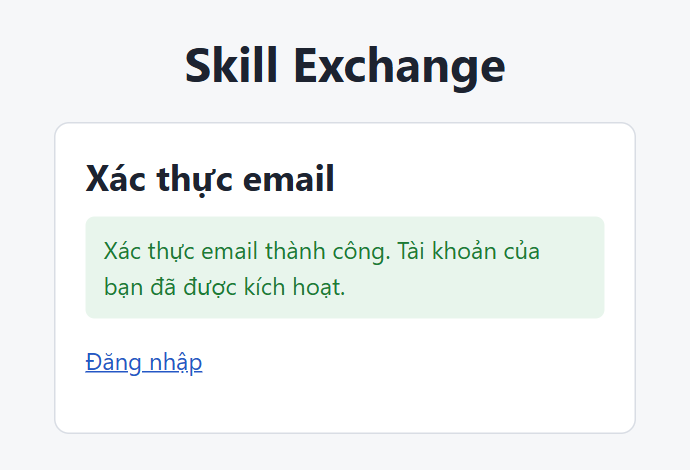
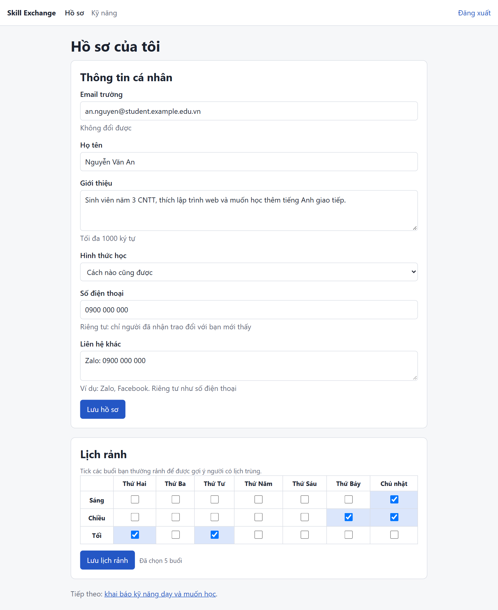
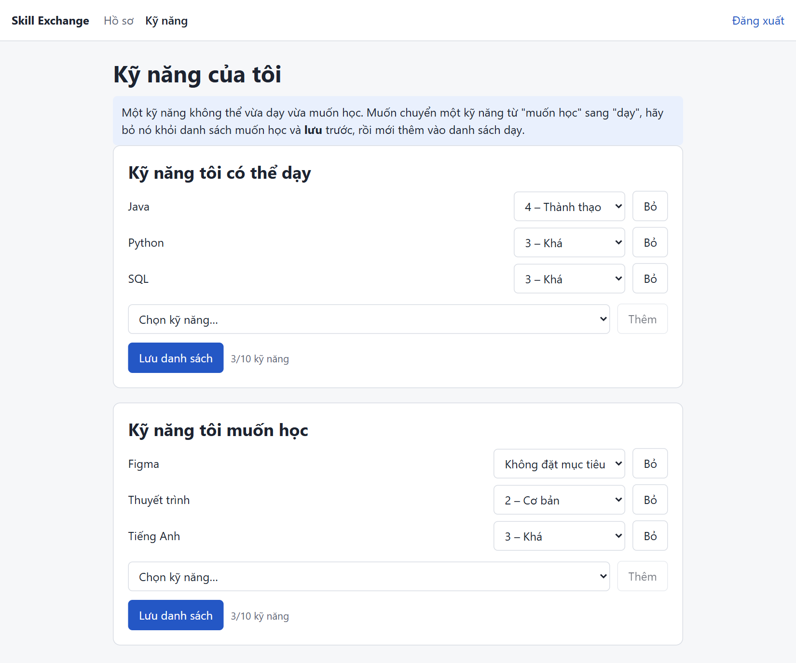
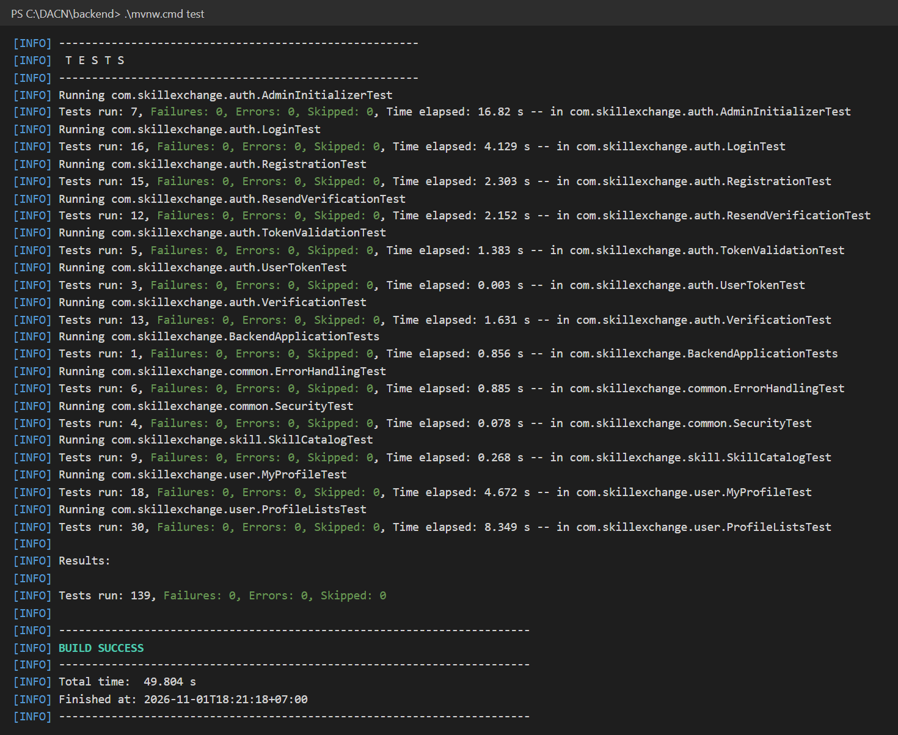

# Nội dung điền vào mẫu báo cáo – Tuần 3 (Tài khoản, hồ sơ, kỹ năng)

Nguồn: `git log` tuần 3, `Quyet_dinh_tuan_3.md`, `ke_hoach_tuan_3.md`, `kiem_thu/README.md`. Phiên bản lấy từ `backend/pom.xml`, `frontend/package.json`, `docker-compose.yml`. Chỗ chưa có dữ liệu ghi **[CẦN BỔ SUNG]**. Số bảng/hình nối tiếp báo cáo tuần 2 (Bảng 5.1, Bảng 6.1, Hình 6.1).

## Bảng đối chiếu: phần nào của tuần 3 điền vào mục nào của mẫu

| Phần của tuần 3 | Mục trong mẫu | Ghi chú |
| --- | --- | --- |
| Thư viện mới (oauth2 resource server, mail, react-router, Mailpit) | 5.1 Môi trường và công cụ | Bổ sung vào Bảng 5.1 |
| Package `auth`, `user`, `skill`, `common`; thư mục frontend | 5.2 Tổ chức mã nguồn | Thay đoạn tuần 2, có link GitHub |
| Đăng ký, xác thực email, JWT, hồ sơ, kỹ năng, S01–S04 | 5.3 Cài đặt các chức năng chính | Mục mới |
| Biến môi trường `.env` | 5.4 Triển khai | Mới có môi trường dev, chưa deploy |
| `kiem_thu/README.md` | 6.1, 6.2 | Thêm kiểm thử tích hợp backend |
| D8, D2, giới hạn kiểm thử | 7.2 Hạn chế | Ghi dần, viết lại ở bản cuối kỳ |
| Lệnh chạy | Phụ lục | Bản nháp |
| Góp ý của giảng viên sau báo cáo tuần 2 (`docs/y_u_c_u_ch_nh_s_a_b_o_c_o.md`) | 2.1, 3.1 (RQ2, RQ3), 4.3, 4.5, 5.2, 7.2 | Xem phần "Sửa theo góp ý" ngay dưới |

## Sửa theo góp ý của giảng viên

| Góp ý | Sửa ở đâu |
| --- | --- |
| 1. Quy tắc gán nhãn, P có "thắng sẵn" không | 4.3: Bảng 4.11 quy tắc thác nước, giá trị thật / tự khai, lập luận và cách giảm lợi thế; 3.1: thu hẹp RQ2; 7.2: hạn chế. Spec tuần 1 mục 5.1, 5.2, 5.4, 5.5 (C5) đã sửa ngược |
| 2. Mẫu số ScheduleFit | 4.3: lý do chọn min, nhược điểm; 3.1: RQ3 thêm so sánh 3 công thức; spec 4.3, 5.4 |
| 3. Link GitHub, link commit từng tuần | 5.2: link repo, Bảng 5.3 |
| 4. Khóa tài khoản khi token còn hạn | 4.5: thêm mục kiểm trạng thái mỗi request (D13, TC69) |
| 5. Mục 2.1, chữ hướng dẫn | 2.1 viết mới; xóa chữ hướng dẫn ở đầu Chương 2, 2.1, đầu Chương 6, 5.3, 5.4, 7.2, Phụ lục. Giữ ở các mục chưa viết (Tóm tắt, Danh mục hình, 6.3, 6.4, 7.1, 7.3, 7.4) |

Bảng mới 4.11 nằm ở mục 4.3 nên các bảng 4.11–4.14 cũ của báo cáo tuần 2 đổi số thành 4.12–4.15.

---

# CHƯƠNG 2 – MỤC 2.1. Các khái niệm và kiến thức nền tảng

**Gợi ý Top-k.** Với mỗi người dùng, hệ thống chấm điểm các ứng viên rồi trả về k ứng viên có điểm cao nhất (thực nghiệm dùng k = 5, giao diện hiển thị tối đa 10). Đây không phải bài toán ghép cặp toàn cục 1–1: mỗi người tự chọn trong danh sách của mình, và một ứng viên có thể xuất hiện trong danh sách của nhiều người. Vì vậy chất lượng được đo theo từng người dùng rồi lấy trung bình.

**Hệ gợi ý tương hỗ.** Trong hệ gợi ý thông thường, đối tượng được gợi ý (phim, sản phẩm) không có nhu cầu riêng. Trong hệ gợi ý tương hỗ, đối tượng được gợi ý cũng là người dùng, nên gợi ý chỉ có ích khi cả hai bên cùng phù hợp với nhau [12], [13]. Cách làm phổ biến là tính mức phù hợp theo từng hướng rồi kết hợp hai giá trị; RECON dùng trung bình điều hòa của hai điểm một chiều [12]. Đề tài tính $D(u,v)$ và $D(v,u)$ rồi kết hợp bằng trung bình nhân $MutualScore = \sqrt{D(u,v) \times D(v,u)}$: giống trung bình điều hòa, cách này phạt cặp lệch (một bên rất phù hợp, bên kia không) nặng hơn trung bình cộng.

**Precision@k.** Tỷ lệ ứng viên phù hợp trong k vị trí đầu danh sách: Precision@k = (số ứng viên phù hợp trong top k) / k. Chỉ số này dễ hiểu nhưng không quan tâm thứ tự bên trong top k, và chỉ phân biệt phù hợp / không phù hợp.

**NDCG@k.** Chỉ số xếp hạng dùng nhãn nhiều mức [14]. Ứng viên ở vị trí $i$ có nhãn $rel_i \in \{0, 1, 2\}$ đóng góp $(2^{rel_i} - 1) / \log_2(i + 1)$ vào DCG@k, nên ứng viên càng phù hợp và đứng càng cao thì đóng góp càng nhiều. NDCG@k = DCG@k / IDCG@k, trong đó IDCG@k là DCG của cách xếp lý tưởng; nhờ vậy NDCG@k thuộc [0, 1] và so sánh được giữa các người dùng.

# CHƯƠNG 3 – MỤC 3.1 (sửa RQ2, RQ3)

- **RQ2:** Khi trình độ và lịch rảnh tự khai có sai lệch so với thực tế, xếp hạng đa tiêu chí (P) có đưa ứng viên phù hợp theo quy tắc nghiệp vụ lên đầu tốt hơn xếp hạng chỉ theo $SkillFit$ (B1) không, đo bằng Precision@5 và NDCG@5 trên cùng tập ứng viên?
- **RQ3:** Kết quả của P thay đổi thế nào khi thay đổi bộ trọng số (4 cấu hình) và công thức $ScheduleFit$ (3 phương án) trong phân tích độ nhạy?

# CHƯƠNG 4 – MỤC 4.3 (thêm vào cuối) và 4.5

**Lý do chọn mẫu số của ScheduleFit.** $ScheduleFit$ chia số khung trùng cho $\min(|A_u|, |A_v|)$, tức đo tỷ lệ lịch của bên bận hơn được bên kia phủ (hệ số overlap). Muốn hẹn được buổi học thì chỉ cần lịch của bên bận hơn khớp, nên người khai nhiều buổi rảnh không bị phạt. Phương án chia cho số khung của hợp hai lịch (Jaccard) sẽ phạt người rảnh nhiều và khuyến khích khai ít đi. Nhược điểm của cách chọn này là người khai rất ít khung được lợi: khai 1 khung và trùng 1 khung thì $ScheduleFit = 1.0$. Vì vậy phân tích độ nhạy ở tuần 5 so sánh ba công thức: chia cho min, Jaccard, và số khung trùng có trần $\min(|A_u \cap A_v|, 3)/3$; đồng thời báo cáo riêng kết quả của nhóm người khai ít khung (≤ 3 khung).

**Quy tắc gán nhãn cho thực nghiệm.** Thực nghiệm (FR-11) cần "đáp án đúng" cho từng cặp $u$ học từ $v$. Nhãn được gán bằng quy tắc nghiệp vụ theo thứ tự thác nước ở Bảng 4.11: xét lần lượt từng bước, cặp dừng ở bước đầu tiên thỏa điều kiện, nên mỗi cặp nhận đúng một nhãn. Quy tắc không dùng điểm $D$ hay $MutualScore$.

*Bảng 4.11: Quy tắc gán nhãn theo thứ tự thác nước*

| Bước | Điều kiện | Kết quả |
| --- | --- | --- |
| 1 | $v$ là chính $u$, hoặc tài khoản chưa xác thực / bị khóa; hoặc không có kỹ năng trùng hay liên quan ($Sim = 0$); hoặc cả hai đã khai báo lịch nhưng không trùng khung nào; hoặc hình thức học xung đột hoàn toàn | Loại, không xếp hạng |
| 2 | Có ít nhất một kỹ năng trùng chính xác ($Sim = 1.0$), trùng ít nhất 2 khung rảnh, hình thức học tương thích, và trình độ người dạy đạt mục tiêu người học ($LevelFit = 1.0$) | Nhãn 2 – phù hợp cao |
| 3 | Chỉ có kỹ năng liên quan ($Sim = 0.5$) và trình độ người dạy thấp hơn mục tiêu từ 2 bậc trở lên ($LevelFit = 0$) | Nhãn 0 – không phù hợp |
| 4 | Mọi cặp hợp lệ còn lại | Nhãn 1 – phù hợp một phần |

**Giá trị thật và giá trị tự khai.** Mỗi người dùng giả lập có hai lớp dữ liệu: giá trị thật (trình độ thật, lịch rảnh thật) và giá trị tự khai. Nhãn ở Bảng 4.11 tính trên giá trị thật, còn P, B0, B1 chỉ thấy giá trị tự khai, được sinh bằng cách thêm nhiễu: trình độ lệch ±1 bậc với xác suất $p_{level}$, lịch bỏ sót khung thật với xác suất $p_{miss}$ và thêm khung không thật với xác suất $p_{extra}$ (giá trị cụ thể chốt trước tuần 5).

**P có "thắng sẵn" theo thiết kế không?** Có một phần. Nhãn và P dùng cùng loại thuộc tính, còn B1 chỉ dùng $SkillFit$; nếu nhãn tính trên đúng dữ liệu P thấy thì P gần như chắc chắn thắng B1. Thiết kế thực nghiệm giảm lợi thế này như sau:

- **Nhãn trên giá trị thật, thuật toán trên giá trị tự khai có nhiễu:** P phải xếp đúng dù dữ liệu đầu vào sai lệch.
- **Chạy thêm mức không nhiễu làm đối chứng:** khoảng cách giữa hai mức cho thấy phần thắng nào chỉ do thiết kế.
- **Thêm mốc so sánh:** mốc ngẫu nhiên R và thí nghiệm bỏ lần lượt LevelFit, ScheduleFit, ModeFit.
- **Thu hẹp kết luận:** RQ2 chỉ khẳng định khả năng xếp đúng theo quy tắc nghiệp vụ khi dữ liệu tự khai sai lệch; giới hạn ghi ở 7.2.

**Mục 4.5 – thêm sau mục "Xác thực":**

- **Tài khoản bị khóa không dùng tiếp được token cũ:** JWT có hạn 24 giờ và không có refresh token, nên chỉ kiểm chữ ký là chưa đủ. Sau khi kiểm chữ ký và hạn của token, một bộ lọc (`AccountStatusFilter`) đọc lại trạng thái tài khoản trong CSDL ở mỗi request: tài khoản bị khóa nhận 403 ngay ở request kế tiếp, tài khoản không còn tồn tại nhận 401. Chi phí là một truy vấn theo khóa chính mỗi request. Kiểm thử TC69 khẳng định hành vi này (mục 6.2). Hạn chế còn lại: chưa thu hồi được từng token riêng lẻ, đăng xuất chỉ xóa token phía trình duyệt.

---

# CHƯƠNG 5 – MỤC 5.1 đến 5.4

## 5.1. Môi trường và công cụ phát triển

Bổ sung vào Bảng 5.1 các dòng sau:

| Hạng mục | Công cụ / phiên bản |
| --- | --- |
| Xác thực | Spring Security 7, `spring-boot-starter-security-oauth2-resource-server` (ký và kiểm tra JWT HS256) |
| Gửi thư | `spring-boot-starter-mail`; khi phát triển dùng Mailpit v1.31.6 (Docker) để bắt thư, không gửi ra ngoài |
| Điều hướng frontend | React Router 8.5 |
| Kiểm thử | JUnit 5, Spring Boot Test, MockMvc, Spring Security Test; CSDL kiểm thử riêng `skillexchange_test` |

## 5.2. Tổ chức mã nguồn

Mã nguồn: https://github.com/world-ender1/skill-exchange

*Bảng 5.2: Tổ chức mã nguồn sau tuần 3*

| Thư mục / package | Vai trò |
| --- | --- |
| `backend/.../auth` | Đăng ký, xác thực email, gửi lại link, đăng nhập, tạo admin đầu tiên, bộ lọc trạng thái tài khoản |
| `backend/.../user` | Hồ sơ của tôi, lịch rảnh, kỹ năng dạy / muốn học |
| `backend/.../skill` | Danh mục kỹ năng (chỉ đọc) |
| `backend/.../common` | Cấu hình bảo mật, xử lý lỗi Problem Details, bean `Clock` |
| `backend/src/main/resources/db/migration` | `V1__init.sql` (lược đồ), `V2__seed_skills.sql` (6 nhóm, 26 kỹ năng, 9 cặp liên quan) |
| `frontend/src/api`, `auth`, `components`, `pages` | Gọi API, lưu vé, thành phần dùng chung, 4 màn hình S01–S04 |

Mỗi package backend chia tầng Controller → Service → Repository → Entity; Controller chỉ nhận và trả DTO.

Bảng 5.3 ghi link các commit của từng tuần để đối chiếu báo cáo với mã nguồn.

*Bảng 5.3: Commit theo tuần*

| Tuần | Nội dung chính | Link |
| --- | --- | --- |
| 1 | Phân tích yêu cầu, đặc tả thuật toán | https://github.com/world-ender1/skill-exchange/commit/cba39fc |
| 2 | Thiết kế CSDL, API, kiểm thử lược đồ | https://github.com/world-ender1/skill-exchange/compare/cba39fc...b66349b |
| 3 | Đăng ký, xác thực email, đăng nhập JWT, hồ sơ, kỹ năng, giao diện S01–S04 | https://github.com/world-ender1/skill-exchange/compare/b66349b...ab89627 |

## 5.3. Cài đặt các chức năng chính

**Đăng ký và xác thực email (FR-01).** Email được chuẩn hóa (bỏ khoảng trắng, chữ thường) rồi so khớp chính xác với danh sách đuôi email trường trong cấu hình. Mật khẩu băm BCrypt. Tài khoản mới ở trạng thái `PENDING_VERIFICATION`; hệ thống sinh mã ngẫu nhiên 32 byte, **chỉ lưu bản băm SHA-256** trong `user_tokens`, và gửi link `/verify-email?token=...` sau khi transaction commit (để không gửi thư cho tài khoản bị rollback). Link hạn 24 giờ, dùng một lần; gửi lại cách nhau ít nhất 60 giây và luôn trả cùng một kết quả để không lộ email nào đã đăng ký.

**Đăng nhập và phân quyền (FR-01, NFR-01).** Đăng nhập đúng trả JWT HS256 hạn 24 giờ chứa `sub` (id) và `role`. Mỗi request, sau khi kiểm chữ ký và hạn của vé, một bộ lọc đọc lại trạng thái tài khoản trong DB: tài khoản bị xóa trả 401, bị khóa trả 403 **ngay**, không phải chờ vé hết hạn. Mọi lỗi, kể cả 401/403 từ Spring Security, trả dạng Problem Details (RFC 9457).

**Thời gian kiểm thử được.** Mọi mốc thời gian (hạn link, giới hạn 60 giây, `iat`/`exp` của JWT) lấy từ một bean `Clock` dùng chung. Khi test, đồng hồ giả được tua tới để kiểm hạn 24 giờ mà không phải chờ.

**Hồ sơ, lịch rảnh, kỹ năng (FR-02, FR-03).** `GET/PUT /api/me` sửa họ tên, giới thiệu, hình thức học, liên hệ riêng tư; không sửa được email, vai trò, trạng thái. Lịch rảnh (7 ngày × 3 buổi) và hai danh sách kỹ năng dùng `PUT` thay cả danh sách: trong một transaction xóa danh sách cũ rồi chèn mới. Một kỹ năng không được vừa dạy vừa muốn học; trùng lặp trong cùng request trả 400 kèm vị trí phần tử lỗi (`[i].skillId`). Người dùng chỉ thao tác được dữ liệu của chính mình vì id luôn lấy từ vé, không nhận từ request.

**Giao diện S01–S04.** React gọi API qua proxy của Vite (không cần CORS), lưu vé trong `localStorage`, tự gắn `Authorization` và về trang đăng nhập khi nhận 401. Lỗi từng ô hiện ngay dưới ô nhập, lấy từ `errors[]` của Problem Details.

Hình 5.1–5.4 là giao diện bốn màn hình đã làm, chụp khi chạy thật với một tài khoản demo (họ tên, email, số điện thoại đều là dữ liệu giả).



*Hình 5.1: Màn hình S01 – Đăng ký bằng email trường*



*Hình 5.2: Màn hình S02 – Xác thực email thành công khi bấm link trong thư*



*Hình 5.3: Màn hình S03 – Hồ sơ của tôi và lịch rảnh (sau khi tải lại trang)*



*Hình 5.4: Màn hình S04 – Kỹ năng có thể dạy và muốn học*

## 5.4. Triển khai

Hiện chạy trên máy phát triển; triển khai cloud ở tuần 9. Bảng 5.4 liệt kê biến môi trường bắt buộc (file `.env` ở thư mục gốc, mẫu `.env.example`, không ghi giá trị thật vào báo cáo):

*Bảng 5.4: Biến môi trường*

| Biến | Ý nghĩa |
| --- | --- |
| `POSTGRES_DB`, `POSTGRES_USER`, `POSTGRES_PASSWORD`, `POSTGRES_PORT` | Kết nối PostgreSQL |
| `JWT_SECRET` | Khóa ký JWT, tối thiểu 32 byte |
| `MAIL_HOST`, `MAIL_PORT`, `MAIL_USERNAME`, `MAIL_PASSWORD` | Máy chủ gửi thư (dev: Mailpit) |
| `FRONTEND_URL` | Địa chỉ frontend dùng trong link xác thực |
| `ADMIN_EMAIL`, `ADMIN_PASSWORD` | Tài khoản quản trị tạo lúc khởi động lần đầu; thiếu hoặc sai thì ứng dụng dừng |

---

# CHƯƠNG 6 – MỤC 6.1, 6.2

## 6.1. Kế hoạch kiểm thử (bổ sung)

- **Kiểm thử tích hợp backend (tuần 3, đã làm):** 93 ca viết trước từ tài liệu (`docs/tuan_3/kiem_thu/ca_kiem_thu.md`), chia ba nhóm: hợp lệ phải được nhận (40), sai phải bị chặn (35), bảo mật và phân quyền (18). Test gọi API thật trên CSDL kiểm thử riêng; thư và đồng hồ được giả lập. Code viết theo TDD: test chạy đỏ trước, rồi mới code.
- **Kiểm tra chất lượng bộ test:** cố ý làm hỏng 6 quy tắc quan trọng, xác nhận test đỏ.
- **Giao diện:** kiểm thủ công 3 ca (TC04, TC31, TC74).

## 6.2. Kết quả kiểm thử (bổ sung)

Backend đạt **139/139 test** (ngày 01/11/2026); 88/88 ca tự động tuần 3 đều có test, 3 ca thủ công, 2 ca thuộc tuần 4. Kiểm thử lược đồ tuần 2 chạy lại vẫn đạt 73/73.

*Bảng 6.2: Một số ca kiểm thử tiêu biểu tuần 3*

| Mã TC | Yêu cầu | Mô tả / đầu vào | Kết quả mong đợi | Kết quả |
| --- | --- | --- | --- | --- |
| TC32 | FR-01 | Đăng ký bằng email Gmail | 400, lỗi ở trường `email` | Đạt |
| TC05 | FR-01 | Bấm link xác thực trong thư | 204, tài khoản `ACTIVE` | Đạt |
| TC60 | NFR-01 | Kiểm mật khẩu lưu trong DB | Là bản băm BCrypt, không phải mật khẩu gốc | Đạt |
| TC64 | D14 | Gọi API bằng vé đã hết hạn | 401 Problem Details | Đạt |
| TC69 | D13 | Tài khoản bị khóa sau khi đã đăng nhập | 403 ngay ở request kế tiếp | Đạt |
| TC67 | NFR-01 | A sửa danh sách kỹ năng | Chỉ dữ liệu của A thay đổi | Đạt |
| TC31 | FR-01–03 | Trọn luồng S01 → S04 trên trình duyệt, tải lại trang | Vẫn đăng nhập, dữ liệu còn | **[CẦN BỔ SUNG]** |

*Bảng 6.3: Làm hỏng code để kiểm tra bộ test*

| Quy tắc bị làm hỏng | Test bắt được |
| --- | --- |
| Nhận mọi đuôi email | TC32, TC33 |
| Lưu mật khẩu không băm | TC60, TC77, TC85 |
| Bỏ chặn tài khoản bị khóa | TC69 |
| Link xác thực dùng lại được | Lần đầu **không** test nào đỏ; đã thêm unit test `UserTokenTest` |
| Bỏ kiểm hạn JWT | TC64 |
| `/api/me` luôn dùng một id cố định | TC67 |

Phát hiện đáng chú ý: điều kiện "link chưa dùng" không kiểm được qua API vì sau lần bấm đầu tài khoản đã `ACTIVE` và bị chặn ở lớp thứ hai. Test tích hợp vẫn xanh dù điều kiện bị xóa, nên đã bổ sung unit test cho riêng điều kiện này, vì nó sẽ cần cho chức năng đặt lại mật khẩu.

Hình 6.2 là kết quả chạy toàn bộ kiểm thử backend ngày 01/11/2026: 13 lớp test, 139 test đều đạt.



*Hình 6.2: Kết quả chạy kiểm thử backend (trích phần kết quả của lệnh `mvnw test`)*

---

# CHƯƠNG 7 – MỤC 7.2. Hạn chế (ghi dần)

- Đăng ký lại email chưa xác thực ghi đè mật khẩu (D8): ai đăng ký sau cùng trước khi link được bấm thì mật khẩu của người đó có hiệu lực. Chưa có quên mật khẩu (D2, FR-23 "Nên có") nên chủ email không tự đặt lại được.
- JWT chưa có refresh token và chưa thu hồi được; đăng xuất chỉ xóa vé ở trình duyệt. Tài khoản bị khóa vẫn bị chặn ngay nhờ kiểm trạng thái mỗi request.
- Vé lưu trong `localStorage` nên có rủi ro nếu trang bị XSS.
- Frontend chưa có test tự động.
- Thực nghiệm dùng dữ liệu giả lập và nhãn từ quy tắc nghiệp vụ: kết quả chỉ cho biết P xếp đúng theo quy tắc khi dữ liệu tự khai có sai lệch, không chứng minh mức phù hợp ngoài đời. Khảo sát người dùng thật (nếu kịp ở tuần 8) mới trả lời được câu hỏi này.

---

# PHỤ LỤC – Hướng dẫn chạy (bản nháp)

```powershell
# Yêu cầu: Java 21, Node.js 24 (bản dùng khi phát triển), Docker Desktop
copy .env.example .env          # điền giá trị theo Bảng 5.4
docker compose up -d            # PostgreSQL + Mailpit (http://localhost:8025)
cd backend; .\mvnw.cmd spring-boot:run      # http://localhost:8080
cd frontend; npm install; npm run dev       # http://localhost:5173
```
