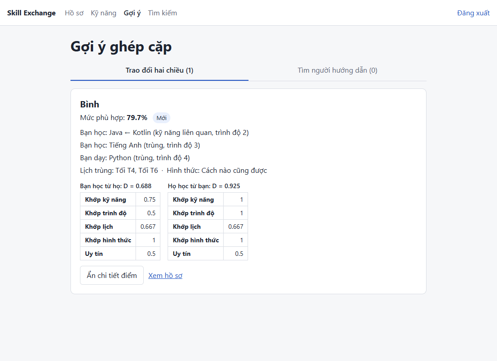
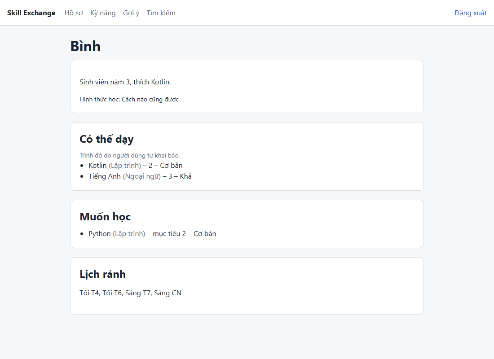
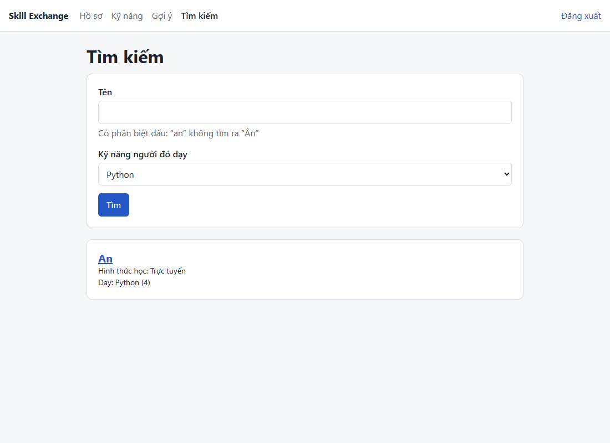

# Nội dung điền vào mẫu báo cáo – Tuần 4 (Matching, hồ sơ công khai, tìm kiếm)

Nguồn: `git log` tuần 4, `Quyet_dinh_tuan_4.md`, `ke_hoach_tuan_4.md`, `kiem_thu/README.md`, spec tuần 1 (mục 4, phụ lục A.3), thiết kế tuần 2 (mục 3.5, 4.3, 4.5). Số liệu kiểm thử lấy từ lần chạy ngày 08/11/2026. Chỗ chưa có dữ liệu ghi **[CẦN BỔ SUNG]**. Số bảng/hình nối tiếp bản báo cáo sau tuần 3 (`Update báo cáo tuần 3.docx`).

## Bảng đối chiếu: phần nào của tuần 4 điền vào mục nào của mẫu

| Phần của tuần 4 | Mục trong mẫu | Ghi chú |
| --- | --- | --- |
| Quy tắc đã chốt ở đợt rà soát 29/10 nhưng báo cáo chưa có: mẫu số CompletionRate, admin không tham gia ghép cặp, kỹ năng bị ẩn vẫn dùng, bằng điểm theo sai số $10^{-9}$; Reputation nạp dữ liệu thô (D43); cách chọn kỹ năng dạy (D46) | 4.3 | Sửa Bảng 4.8, Bảng 4.10, đoạn "Cách chạy matching", Hình 4.3, "Trường hợp biên" |
| Quyền *Active* = sinh viên đã xác thực (D44); response thật của `/api/matches` | 4.4 | Sửa chú thích Bảng 4.13; thay Hình 4.4 |
| Kiểm quyền ở bộ lọc, 404 chung, DTO công khai riêng, escape `LIKE` | 4.5 | Thêm 4 ý |
| Không thêm thư viện | 5.1 | Một câu, không đổi Bảng 5.1 |
| Package `matching`, phần công khai của `user`, màn hình S05, S06, S10 | 5.2 | Thay Bảng 5.2; thêm dòng tuần 4 vào Bảng 5.3 |
| Lõi matching, API, hồ sơ công khai, tìm kiếm, giao diện | 5.3 | Mục mới: Hình 5.5–5.8, Bảng 5.4 (tính tay so với hệ thống) |
| `kiem_thu/README.md` | 6.1, 6.2 | Bảng 6.4, Bảng 6.5, Hình 6.3 |
| D32, D48, D51, NFR-03 chưa đo | 7.2 Hạn chế | Ghi dần |
| Bài học trong tuần | 7.4 | Ghi dần |
| Lệnh chạy test | Phụ lục | Bổ sung |

Bảng mới 5.4 nằm ở mục 5.3 nên bảng biến môi trường (Bảng 5.4 cũ, mục 5.4) đổi số thành **Bảng 5.5**.

## Sửa theo góp ý của giảng viên (sau báo cáo tuần 3)

[CẦN BỔ SUNG: ghi các góp ý cho báo cáo tuần 3 và chỗ đã sửa, như phần này ở `Noi_dung_bao_cao_Tuan_3.md`. Nếu không có góp ý thì xóa mục này.]

---

# CHƯƠNG 4 – sửa mục 4.3, 4.4, 4.5

Các quy tắc dưới đây đã chốt ở đợt rà soát ngày 29/10 (spec tuần 1 mục 4, thiết kế tuần 2 mục 3.5) hoặc trong tuần 4, và code tuần 4 làm theo, nhưng bản báo cáo sau tuần 3 vẫn ghi theo bản cũ.

## 4.3 – Bảng 4.8, dòng CompletionRate

Thay "Số phiên đã hoàn thành chia cho số phiên đã bắt đầu; phiên bị hủy sau khi bắt đầu vẫn tính vào mẫu số" bằng:

> Số phiên đã hoàn thành chia cho số phiên **đã bắt đầu và đã kết thúc** (hoàn thành, hoặc bị hủy sau khi bắt đầu). Phiên đang diễn ra hoặc đang chờ xác nhận chưa tính, vì chưa biết kết quả.

## 4.3 – Bảng 4.10, hai dòng Reputation

| Thành phần | Lấy từ | Ghi chú |
| --- | --- | --- |
| $RatingNorm(v)$ | Các điểm `reviews.rating` có `reviewee_id = v`, nạp dạng thô; lớp `ReputationCalculator` lấy trung bình | Chưa có đánh giá → 0.5 |
| $CompletionRate(v)$ | `exchange_sessions` JOIN `exchange_requests`, lấy phiên có $v$ là người gửi hoặc người nhận (mỗi phiên một lần) | Tử số: phiên `COMPLETED`. Mẫu số: phiên có `started_at` khác NULL và trạng thái `COMPLETED` hoặc `CANCELLED`. Truy vấn chỉ nạp trạng thái và cờ "đã bắt đầu" của từng phiên; `ReputationCalculator` lọc mẫu số và đổi trường hợp mẫu số bằng 0 thành 0.5 |

## 4.3 – đoạn "Cách chạy matching"

> **Cách chạy matching.** Với quy mô mục tiêu 1.000 hồ sơ (NFR-03), backend nạp kỹ năng, lịch rảnh, hình thức học và dữ liệu thô để tính Reputation (điểm đánh giá nhận được, trạng thái các phiên đã tham gia) của mọi sinh viên `ACTIVE` vào bộ nhớ bằng 8 truy vấn gộp, rồi lọc và chấm điểm bằng Java. Số truy vấn không phụ thuộc số người dùng. Phần lọc, chấm điểm và xếp hạng là một lõi Java thuần, không gọi CSDL, để kiểm thử đơn vị không cần CSDL và để thực nghiệm ở tuần 5 gọi đúng lõi này (mục 5.3).

## 4.3 – Hình 4.3, dòng 1 của mã giả

```
 1  C  <- các sinh viên ACTIVE khác u (vai trò STUDENT; admin không tham gia ghép cặp)
```

## 4.3 – "Trường hợp biên"

Sửa hai ý:

- "Người chưa có đánh giá hoặc chưa có phiên nào **đã bắt đầu và đã kết thúc**: RatingNorm, CompletionRate nhận 0.5, không chia cho 0."
- "Hai ứng viên bằng điểm (chênh lệch dưới $10^{-9}$, để bỏ qua sai số của phép tính số thực): sắp theo mã người dùng tăng dần để kết quả ổn định và tái lập được giữa các lần chạy."

Thêm hai ý:

- **Kỹ năng bị admin ẩn vẫn dùng trong matching.** Ẩn kỹ năng nghĩa là ngừng cho chọn mới; người đã khai kỹ năng đó vẫn được gợi ý như cũ.
- **Nhiều kỹ năng dạy cùng khớp một kỹ năng muốn học.** LevelFit chọn kỹ năng có $Sim$ cao nhất, bằng nhau thì chọn trình độ cao hơn, bằng nữa thì chọn mã kỹ năng nhỏ hơn. Lời giải thích trên giao diện dùng đúng kỹ năng đã chọn này, nên lý do hiển thị luôn khớp với điểm.

## 4.4 – Bảng 4.13, chú thích quyền

Thay "Active – tài khoản đã xác thực" bằng:

> Active – sinh viên có tài khoản đã xác thực (trạng thái `ACTIVE`, vai trò `STUDENT`); quản trị viên không dùng các API này.

## 4.4 – Hình 4.4

Thay ví dụ cũ bằng response thật của `GET /api/matches?type=TWO_WAY` khi An (dữ liệu demo) xem gợi ý Bình. Ví dụ cũ thiếu các trường `learningMode`, `ratingAverage`, `reviewCount`, `hasPendingRequest`, và `score = 0.78` chưa đúng quy tắc làm tròn đã chốt ($\sqrt{0.94 \times 0.65} = 0.7817 \to 0.782$). Các số dưới đây khớp TC149 và test D46; `userId` thay bằng id thật khi chụp response [CẦN BỔ SUNG].

```json
{
  "userId": …,
  "fullName": "Bình",
  "type": "TWO_WAY",
  "score": 0.797,
  "forward": {
    "d": 0.688, "skillFit": 0.75, "levelFit": 0.5,
    "scheduleFit": 0.667, "modeFit": 1.0, "reputation": 0.5
  },
  "backward": {
    "d": 0.925, "skillFit": 1.0, "levelFit": 1.0,
    "scheduleFit": 0.667, "modeFit": 1.0, "reputation": 0.5
  },
  "learningMode": "ANY",
  "ratingAverage": null,
  "reviewCount": 0,
  "hasPendingRequest": false,
  "youLearn": [
    { "want": "Java", "teach": "Kotlin", "relation": "RELATED", "theirLevel": 2 },
    { "want": "Tiếng Anh", "teach": "Tiếng Anh", "relation": "EXACT", "theirLevel": 3 }
  ],
  "theyLearn": [
    { "want": "Python", "teach": "Python", "relation": "EXACT", "yourLevel": 4 }
  ],
  "commonSlots": [
    { "dayOfWeek": 3, "period": "EVENING" },
    { "dayOfWeek": 5, "period": "EVENING" }
  ]
}
```

Câu dẫn trước hình thêm: "Mọi số thực làm tròn 3 chữ số (làm tròn nửa lên); xếp hạng vẫn dùng điểm chưa làm tròn. Với gợi ý một chiều, response không có hai trường `backward` và `theyLearn`."

## 4.5 – thêm vào mục "Thiết kế bảo mật"

- **Quyền *Active* kiểm ở bộ lọc.** Bộ lọc `AccountStatusFilter` (vốn đã đọc trạng thái tài khoản ở mỗi request) gắn thêm quyền `ACTIVE_STUDENT` khi tài khoản `ACTIVE` và vai trò `STUDENT`; cấu hình bảo mật đòi quyền này cho `/api/matches/**` và `/api/users/**`. Luật chạy trước controller, nên admin hay tài khoản chưa xác thực nhận 403 kể cả khi gửi tham số sai (403 đứng trước 400). Admin không xuất hiện trong gợi ý và kết quả tìm kiếm.
- **Không dò được trạng thái tài khoản người khác.** `/api/users/{id}` trả cùng một lỗi 404 "Không tìm thấy người dùng" cho id không tồn tại, tài khoản chưa xác thực, tài khoản bị khóa và tài khoản admin.
- **Hồ sơ công khai dùng lớp dữ liệu trả về riêng.** Hồ sơ công khai và kết quả tìm kiếm không dùng chung lớp với `/api/me`, nên thêm trường riêng tư vào `/api/me` không thể làm lộ trường đó ở đây (NFR-02). Kết quả gợi ý cũng không có email, số điện thoại, liên hệ.
- **Tìm theo tên an toàn với ký tự đặc biệt.** Tìm kiếm dùng `ILIKE` với chuỗi đã escape `\`, `%`, `_`, nên gõ `%` không trả về toàn bộ người dùng (D37).

---

# CHƯƠNG 5 – MỤC 5.1 đến 5.3

## 5.1. Môi trường và công cụ phát triển

Tuần 4 không thêm thư viện. Truy vấn nạp dữ liệu matching dùng `JdbcTemplate` (có sẵn trong Spring Data JPA); unit test dùng thêm `@ParameterizedTest` của JUnit 5 và AssertJ (có sẵn trong `spring-boot-starter-test`). Không đổi Bảng 5.1.

## 5.2. Tổ chức mã nguồn

*Bảng 5.2: Tổ chức mã nguồn sau tuần 4*

| Thư mục / package | Vai trò |
| --- | --- |
| `backend/.../auth` | Đăng ký, xác thực email, gửi lại link, đăng nhập, tạo admin đầu tiên, bộ lọc trạng thái tài khoản và quyền *Active* |
| `backend/.../user` | Hồ sơ của tôi, lịch rảnh, kỹ năng dạy / muốn học; hồ sơ công khai và tìm kiếm người dùng |
| `backend/.../skill` | Danh mục kỹ năng (chỉ đọc) |
| `backend/.../matching` | **Lõi** Java thuần: lọc cứng, các thành phần điểm, Reputation, phân loại, xếp hạng. **Vỏ** nối với Spring: nạp dữ liệu (`MatchingDataRepository`), `MatchingService`, `MatchingController` |
| `backend/.../common` | Cấu hình bảo mật, xử lý lỗi Problem Details, bean `Clock`, escape chuỗi tìm kiếm |
| `backend/src/main/resources/db/migration` | `V1__init.sql` (lược đồ), `V2__seed_skills.sql` (6 nhóm, 26 kỹ năng, 9 cặp liên quan); tuần 4 không thêm migration |
| `frontend/src/api`, `auth`, `components`, `pages` | Gọi API, lưu vé, thành phần dùng chung, 7 màn hình S01–S06, S10 |

*Bảng 5.3: Commit theo tuần* – thêm dòng:

| Tuần | Nội dung chính | Link |
| --- | --- | --- |
| 4 | Lõi matching và unit test, API gợi ý, hồ sơ công khai, tìm kiếm, giao diện S05, S06, S10 | https://github.com/world-ender1/skill-exchange/compare/7ff6730...64f13e5 |

Dòng tuần 3 đang kết thúc ở `ab89627`, nhưng các commit ảnh, README và báo cáo `.docx` của tuần 3 nằm sau đó (tới `7ff6730`). Nên đổi điểm cuối dòng tuần 3 thành `7ff6730` để hai khoảng nối liền.

## 5.3. Cài đặt các chức năng chính (bổ sung)

**Lõi matching tách khỏi CSDL (FR-04).** Package `matching` chia hai phần (Hình 5.5). Lõi gồm các lớp Java thuần: `HardFilter` (5 điều kiện lọc cứng), `ScoreCalculator` (các thành phần điểm và $D$), `ReputationCalculator`, `RankingComparator` (xếp hạng) và `MatchingEngine` ghép các bước trên. Lõi nhận hồ sơ đã dựng sẵn trong bộ nhớ, không gọi CSDL và không dùng Spring. Vỏ gồm `MatchingService` và `MatchingDataRepository`: nạp dữ liệu, dựng hồ sơ, gọi lõi, rồi đổi kết quả sang JSON. Tách như vậy vì hai lý do. Thứ nhất, 104 unit test của lõi chạy dưới 1 giây mà không cần CSDL, nên chạy lại được sau mỗi lần sửa code. Thứ hai, ở tuần 5 module thực nghiệm dựng hồ sơ giả lập trong bộ nhớ và gọi đúng lõi này, nên kết quả thực nghiệm đo đúng thuật toán đang chạy trong hệ thống (NFR-05).

```
                   ┌──────────────── VỎ (Spring, có CSDL) ───────────────┐
GET /api/matches → │ MatchingController → MatchingService                 │
                   │     nạp dữ liệu thô (8 truy vấn gộp, JdbcTemplate)    │
                   │     dựng hồ sơ MatchProfile, đổi kết quả sang JSON    │
                   └──────────────────────────┬───────────────────────────┘
                                              ▼
                   ┌──────────────── LÕI (Java thuần) ────────────────────┐
                   │ MatchingEngine                                        │
                   │   ├─ HardFilter            loại ứng viên vi phạm      │
                   │   ├─ ScoreCalculator       SkillFit, LevelFit, ...    │
                   │   ├─ ReputationCalculator                             │
                   │   └─ RankingComparator     xếp hạng                   │
                   └───────────────────────────────────────────────────────┘
                                              ▲
            Tuần 5: module evaluation dựng hồ sơ giả lập, gọi đúng lõi này
```

*Hình 5.5: Lõi matching và lớp vỏ nối với Spring*

**Một lần gọi `GET /api/matches`.** Bộ lọc bảo mật kiểm quyền *Active* trước (mục 4.5). `MatchingService` nạp dữ liệu của mọi sinh viên `ACTIVE` bằng 8 truy vấn gộp, tính Reputation cho từng người, dựng hồ sơ, rồi gọi lõi: lọc cứng, tính $D$ hai chiều, phân loại hai chiều / một chiều, xếp hạng. Cuối cùng service làm tròn các số 3 chữ số và thêm `ratingAverage`, `reviewCount`, `hasPendingRequest`. Kể cả câu đọc tài khoản ở bộ lọc, mỗi request chạy 9 câu SQL, không đổi khi số ứng viên tăng từ 20 lên 40 (TC157), tức là không có truy vấn lặp theo từng ứng viên.

**Một số chi tiết cài đặt.**

- Bộ trọng số nằm ở một chỗ (`MatchingWeights`, mặc định 0.55, 0.20, 0.15, 0.05, 0.05). Hàm khởi tạo kiểm từng trọng số nằm trong [0, 1] và tổng bằng 1 (sai số $10^{-9}$), để thực nghiệm độ nhạy ở tuần 5 truyền bộ trọng số khác mà không làm $D$ ra ngoài [0, 1].
- Xếp hạng dùng điểm chưa làm tròn; chỉ khi trả JSON mới làm tròn 3 chữ số (làm tròn nửa lên). Hai điểm chênh nhau dưới $10^{-9}$ coi là bằng và xếp theo mã người dùng tăng dần; cả hai nhóm dùng chung một bộ so sánh.
- Danh sách "bạn học / họ học" trên giao diện dùng cùng hàm chọn kỹ năng với LevelFit, nên lý do hiển thị luôn khớp với điểm.

**Kiểm chứng bằng ví dụ tính tay.** Bảng 5.4 so điểm tính tay của cặp An–Bình (dữ liệu demo) với kết quả API. An muốn học Java (mục tiêu 3) và Tiếng Anh (không đặt mục tiêu), dạy Python (4), rảnh tối T2, T4, T6, học trực tuyến. Bình muốn học Python (mục tiêu 2), dạy Kotlin (2) và Tiếng Anh (3), rảnh tối T4, T6, sáng T7, sáng CN, học cách nào cũng được. Kotlin và Java là cặp kỹ năng liên quan ($Sim = 0.5$). Cả hai chưa có lịch sử nên Reputation = 0.5.

*Bảng 5.4: Điểm tính tay và kết quả hệ thống cho cặp An–Bình*

| Thành phần | An học từ Bình: tính tay | API | Bình học từ An: tính tay | API |
| --- | --- | :---: | --- | :---: |
| SkillFit | Java ← Kotlin 0.5, Tiếng Anh ← Tiếng Anh 1.0; trung bình 0.75 | 0.75 | Python ← Python 1.0 | 1.0 |
| LevelFit | Kotlin mức 2 thấp hơn mục tiêu 3 một bậc → 0.5; Tiếng Anh không đặt mục tiêu → 0.5; trung bình 0.5 | 0.5 | Python mức 4 đạt mục tiêu 2 → 1.0 | 1.0 |
| ScheduleFit | Trùng tối T4, tối T6: 2 / min(3, 4) | 0.667 | Như chiều kia | 0.667 |
| ModeFit | Trực tuyến và "cách nào cũng được" → 1.0 | 1.0 | 1.0 | 1.0 |
| Reputation | Chưa có lịch sử → 0.5 | 0.5 | 0.5 | 0.5 |
| $D$ | 0.55 × 0.75 + 0.20 × 0.5 + 0.15 × 2/3 + 0.05 × 1 + 0.05 × 0.5 = 0.6875 | 0.688 | 0.55 + 0.20 + 0.15 × 2/3 + 0.05 + 0.05 × 0.5 = 0.925 | 0.925 |
| MutualScore | $\sqrt{0.6875 \times 0.925} = 0.79746$ | **0.797** | | |

API làm tròn 0.6875 thành 0.688 (làm tròn nửa lên); giao diện hiển thị mức phù hợp 79.7% (Hình 5.6). Ví dụ $D = 0.94$ ở Bảng 4.9 cũng được kiểm bằng unit test (TC135): code tính ra `0.9400000000000001`, khớp khi so với dung sai $10^{-9}$.

**Hồ sơ công khai và tìm kiếm (FR-10).** `GET /api/users/{id}` trả họ tên, giới thiệu, hình thức học, kỹ năng dạy (kèm ghi chú trình độ do người dùng tự khai báo), kỹ năng muốn học và lịch rảnh; không có email, số điện thoại, liên hệ. `GET /api/users/search` tìm theo tên (không phân biệt hoa thường, có phân biệt dấu) và/hoặc theo kỹ năng người đó dạy. Kết quả chỉ gồm sinh viên `ACTIVE`, bỏ chính người gọi, xếp theo họ tên rồi mã người dùng, tối đa 20 người. Chuỗi tìm được cắt khoảng trắng hai đầu và dài tối đa 100 ký tự sau khi cắt. Kỹ năng dạy của 20 người trong kết quả được nạp bằng một truy vấn, không truy vấn lặp theo từng người.

**Giao diện S05, S06, S10.** S05 có hai tab "Trao đổi hai chiều" và "Tìm người hướng dẫn", mỗi tab ghi số kết quả. Mỗi thẻ hiện mức phù hợp (điểm × 100, giữ 1 chữ số thập phân), nhãn "Mới" khi chưa có đánh giá, các dòng kỹ năng học/dạy (trùng hay liên quan, kèm trình độ), lịch trùng và hình thức học. Nút "Xem chi tiết điểm" mở bảng 5 thành phần của từng chiều. Giao diện chỉ hiển thị điểm và lý do do API trả về, không tự tính lại (NFR-09). Nút "Gửi yêu cầu" chưa có, sẽ thêm ở tuần 6. Người chưa khai kỹ năng muốn học thấy lời nhắc kèm liên kết sang S04. S06 hiện hồ sơ công khai, S10 có ô tên và ô chọn kỹ năng.

Hình 5.6–5.8 chụp khi chạy thật với tài khoản demo.



*Hình 5.6: Màn hình S05 – Gợi ý ghép cặp, mở chi tiết điểm của Bình (khớp Bảng 5.4)*



*Hình 5.7: Màn hình S06 – Hồ sơ công khai, không có thông tin liên hệ*



*Hình 5.8: Màn hình S10 – Tìm người dạy Python*

---

# CHƯƠNG 6 – MỤC 6.1, 6.2

## 6.1. Kế hoạch kiểm thử (bổ sung)

- **Kiểm thử tuần 4 (đã làm):** 87 ca viết trước từ tài liệu (`docs/tuan_4/kiem_thu/ca_kiem_thu.md`): 44 ca unit, 36 ca tích hợp, 7 ca thủ công, chia 6 nhóm (lõi tính điểm; lọc cứng, phân loại, xếp hạng; API gợi ý; hồ sơ công khai và tìm kiếm; phân quyền và riêng tư; giao diện).
- **Unit test lõi matching:** chạy trên lõi Java thuần, không cần CSDL. Số thực so bằng dung sai $10^{-9}$; số mong đợi viết bằng biểu thức từ ví dụ tính tay, không chép số đã làm tròn. Code viết theo TDD: test chạy đỏ trước, rồi mới code.
- **Kiểm thử thuộc tính:** TC141 chạy matching cho 50 hồ sơ sinh ngẫu nhiên (seed cố định, có cả tài khoản chưa xác thực, admin, hồ sơ thiếu dữ liệu), kiểm mọi điểm thuộc [0, 1], không có `NaN`, không ứng viên nào vi phạm lọc cứng và không bỏ sót ứng viên hợp lệ.
- **Kiểm tra chất lượng bộ test:** cố ý làm hỏng code 47 lần, xác nhận có test đỏ.
- **Đối chiếu code với tài liệu:** review độc lập từng quyết định triển khai (D31–D38, D43–D50) với code.
- **Thủ công:** đếm câu SQL (TC157) và 6 ca giao diện trên trình duyệt, kể cả màn hình rộng 360 px.

## 6.2. Kết quả kiểm thử (bổ sung)

Backend đạt **288/288 test** (ngày 08/11/2026), gồm 139 test của tuần 3; tuần 4 thêm 149 test (107 unit, 42 tích hợp). 80/80 ca tự động tuần 4 đều có test; 7 ca thủ công đạt. Kiểm thử lược đồ tuần 2 chạy lại vẫn đạt 73/73.

*Bảng 6.4: Một số ca kiểm thử tiêu biểu tuần 4*

| Mã TC | Yêu cầu | Mô tả / đầu vào | Kết quả mong đợi | Kết quả |
| --- | --- | --- | --- | --- |
| TC135 | Spec A.3 | Ví dụ ở Bảng 4.9 | $D = 0.94$ (so với dung sai $10^{-9}$) | Đạt |
| TC134 | FR-04 | Cặp An–Bình | $D$ hai chiều 0.6875 và 0.925, điểm $\sqrt{0.6875 \times 0.925}$ | Đạt |
| TC110 | Spec 4.6 | Muốn học Java (3), SQL (2), Figma; người dạy có Java (3), MySQL (1) | LevelFit = 0.75; Figma không vào mẫu số | Đạt |
| TC123 | Spec 4.3, D43 | Đánh giá 5 và 4; sáu phiên ở các trạng thái khác nhau | Mẫu số CompletionRate = 2, Reputation = 0.7625 | Đạt |
| TC141 | Spec 4.4, NFR-04 | 50 hồ sơ ngẫu nhiên | Mọi điểm thuộc [0, 1], không vi phạm lọc cứng | Đạt |
| TC149 | TK 4.5 | An gọi `/api/matches` | Bình có `score` 0.797 và đủ điểm thành phần | Đạt |
| TC153 | Spec 4.1 | Kỹ năng Kotlin bị ẩn | Bình vẫn được gợi ý, điểm không đổi | Đạt |
| TC160 | TK 4.3 | `/api/users/{id}` với id không tồn tại, chưa xác thực, bị khóa, admin | Cùng một lỗi 404 | Đạt |
| TC166 | D37 | Tìm `q=%`, `q=_`, `q=\` | Không câu nào trả về toàn bộ người dùng | Đạt |
| TC174 | D44 | Admin gọi API sinh viên với tham số sai | 403, không phải 400 | Đạt |
| TC179 | NFR-09 | An mở S05 trên trình duyệt | Bình 79.7%, chi tiết điểm khớp tính tay | Đạt |

*Bảng 6.5: Làm hỏng code để kiểm tra bộ test (trích 10 trong 47 lần; bảng đủ ở `docs/tuan_4/kiem_thu/README.md`)*

| Làm hỏng | Test bắt được |
| --- | --- |
| LevelFit chia cả kỹ năng không ai dạy | TC110 (ra 0.5 thay vì 0.75) |
| CompletionRate tính cả phiên đang diễn ra (quy tắc cũ) | TC123 (ra 0.7125 thay vì 0.7625), TC124 |
| ScheduleFit chia cho max thay vì min | TC116, TC117 |
| MutualScore dùng trung bình cộng | TC134, TC140 |
| Đổi trọng số mặc định, tổng vẫn bằng 1 | TC126, TC134, TC135 |
| Bằng điểm thì xếp mã người dùng giảm dần | TC138, test D36 |
| Lọc cứng quên điều kiện hình thức học | TC141 |
| Truy vấn phiên chỉ lấy theo người gửi | TC155 (Reputation 1.0 thay vì 0.85) |
| Bỏ luật quyền *Active* | TC75, TC173, TC174, test D44 |
| Tìm kiếm không escape ký tự đặc biệt | TC166 |

Hai phát hiện đáng chú ý:

- **Hai lớp kiểm quyền che nhau.** Lần đầu bỏ luật quyền *Active* (khi mới có API gợi ý), TC75 và TC173 vẫn xanh, vì service gợi ý cũng trả 403 khi người gọi không phải sinh viên `ACTIVE`. Chỉ ca gọi với tham số sai bắt được (thiếu luật thì ra 400 thay vì 403). Sau khi thêm API hồ sơ công khai và tìm kiếm, chạy lại thì cả hai ca đã đỏ. Bảng làm hỏng code vì vậy phải chạy lại mỗi khi bộ test thay đổi.
- **Trọng số `NaN` lọt qua phần kiểm trọng số.** Mọi phép so sánh với `NaN` đều cho kết quả sai, nên điều kiện "nhỏ hơn 0 hoặc lớn hơn 1" không chặn được nó, và khi đó điểm $D$ cũng thành `NaN` mà không báo lỗi. Lượt đối chiếu code với quyết định phát hiện lỗi này; đã thêm test (đặt `NaN` ở từng trọng số), thấy đỏ, rồi sửa điều kiện thành "phải nằm trong [0, 1]".

[CẦN BỔ SUNG: chụp màn hình kết quả `.\mvnw.cmd test` (dòng `Tests run: 288, Failures: 0, Errors: 0, Skipped: 0` và `BUILD SUCCESS`) như Hình 6.2, lưu vào `docs/hinh/h6_3_test_tuan_4.png`.]

*Hình 6.3: Kết quả chạy kiểm thử backend ngày 08/11/2026 (27 lớp test, 288 test đều đạt)*

---

# CHƯƠNG 7 – MỤC 7.2 Hạn chế, 7.4 Bài học (ghi dần)

## 7.2 – thêm

- Reputation đọc dữ liệu thật nhưng bảng đánh giá và phiên chưa có dữ liệu tới tuần 6–7, nên hiện mọi người có Reputation 0.5 và tiêu chí này chưa tạo khác biệt trong xếp hạng. Công thức đã kiểm bằng unit test và test tích hợp với dữ liệu chèn trực tiếp.
- So "bằng điểm" theo sai số $10^{-9}$ không có tính bắc cầu; về lý thuyết thao tác sắp xếp có thể báo lỗi khi ba điểm trở lên cách nhau dưới $10^{-9}$. Giữ vì đúng câu chữ spec và rất hiếm gặp với điểm thật (D48).
- Lõi matching xếp tên kỹ năng theo mã Unicode, có thể khác thứ tự của CSDL với tên có dấu hoặc bắt đầu bằng chữ thường (D51). 26 kỹ năng hiện có không bị ảnh hưởng.
- Chưa đo yêu cầu gợi ý ≤ 2 giây với 1.000 hồ sơ (NFR-03); đo ở tuần 5 cùng thực nghiệm.
- Tìm kiếm theo tên phân biệt dấu ("an" không tìm ra "Ân"); tìm không dấu chưa làm.

## 7.4 – Bài học kinh nghiệm (ghi dần)

- Với thuật toán, "test xanh" chưa đủ: chỉ khi cố ý làm hỏng code và thấy test đỏ mới biết bộ test bảo vệ được công thức. Bảng làm hỏng code cũng phải chạy lại khi bộ test thay đổi.
- Số mong đợi trong test nên viết bằng biểu thức lấy từ ví dụ tính tay, không chép số đã làm tròn: làm tròn tay đã sai ở chữ số thứ năm.
- Chi tiết chốt trong lúc code phải ghi ngược vào tài liệu quyết định ngay; nếu không, tài liệu và code lệch dần mà test vẫn xanh.

---

# PHỤ LỤC – bổ sung lệnh chạy kiểm thử

```powershell
# Toàn bộ test backend (cần Docker và CSDL skillexchange_test, tạo một lần):
docker compose exec db createdb -U skillexchange skillexchange_test
cd backend; .\mvnw.cmd test

# Chỉ test lõi matching (không cần CSDL, khoảng 20 giây):
.\mvnw.cmd -q -o test "-Dtest=com.skillexchange.matching.*Test,!MatchesApiTest"
```
