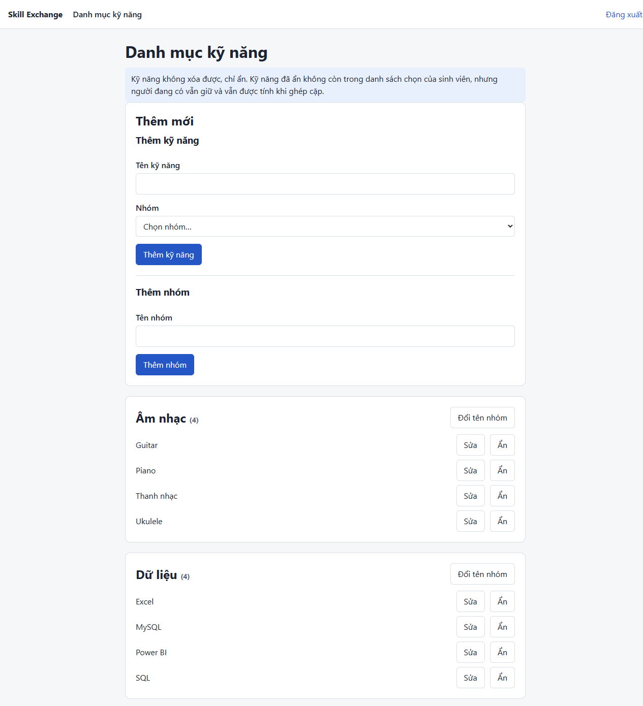
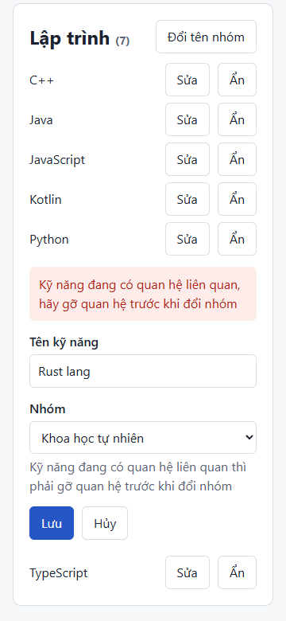
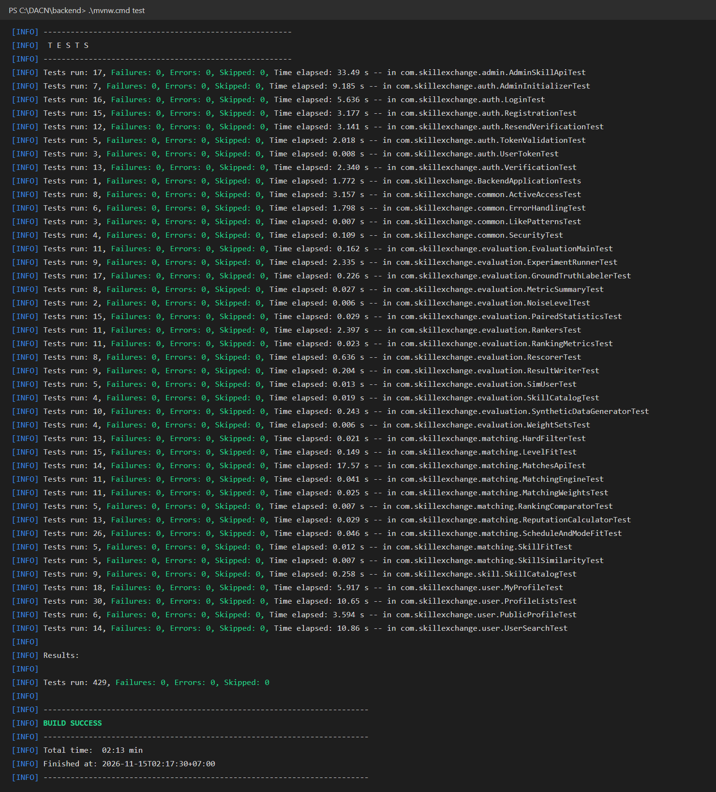

# Nội dung điền vào mẫu báo cáo – Tuần 5 (Thực nghiệm thuật toán, quản trị danh mục kỹ năng)

Nguồn: `git log` tuần 5, `Quyet_dinh_tuan_5.md` (D52–D77), `ke_hoach_tuan_5.md`, `kiem_thu/README.md`, spec tuần 1 (mục 5, phụ lục A.3), thiết kế tuần 2 (mục 4.9, 6.2), `docs/ket_qua.md`. Mọi số thực nghiệm lấy từ `docs/ket_qua.md` (lượt chạy ngày 14/11/2026, commit `3a01bfc`, tag `v1.0-thuc-nghiem`). Số liệu kiểm thử lấy từ lần chạy ngày 15/11/2026 ở commit `ab2430e`. Số bảng/hình nối tiếp bản báo cáo sau tuần 4 (`Update báo cáo tuần 4.docx`).

## Bảng đối chiếu: phần nào của tuần 5 điền vào mục nào của mẫu

| Phần của tuần 5 | Mục trong mẫu | Ghi chú |
| --- | --- | --- |
| Quy mô, seed, phương án thực nghiệm đã chốt (spec 5.4, D69, D70) | 1.2, 1.5 | Sửa ý thứ ba của 1.2 và dòng mục tiêu 3 của Bảng 1.2 |
| Bootstrap, kiểm định Wilcoxon | 2.1 | Thêm 2 khái niệm; tài liệu tham khảo [15]–[17] |
| Quy tắc nhãn đã chốt (D53–D55) | 4.3 | Thay Bảng 4.11; sửa đoạn "Giá trị thật và giá trị tự khai", thêm câu trỏ tới kết quả |
| API, giao diện A01, điều hướng theo vai trò (D73, D76) | 4.4 | Sửa dòng quản trị của Bảng 4.13, dòng A01 của Bảng 4.14, dòng FR-08 của Bảng 4.15; thêm đoạn sau Hình 4.6 |
| Quyền và kiểm tra dữ liệu của API quản trị (D73, D74) | 4.5 | Thêm 2 ý |
| Không thêm thư viện | 5.1 | Một câu, không đổi Bảng 5.1 |
| Package `evaluation`, `admin`, trang A01, thư mục kết quả | 5.2 | Thay Bảng 5.2; thêm dòng tuần 5 vào Bảng 5.3 |
| Module thực nghiệm, API và giao diện A01 | 5.3 | Hình 5.9–5.11 |
| `kiem_thu/README.md` | 6.1, 6.2 | Bảng 6.6, 6.7, Hình 6.4 |
| `docs/ket_qua.md` | 6.3 | Viết lần đầu: thiết lập, kết quả, trả lời RQ1–RQ3, NFR-03, NFR-06; Bảng 6.8–6.15 |
| Phân tích kết quả và độ tin cậy | 6.4 | Viết lần đầu |
| Điều chỉnh so với báo cáo trước (D77) | Báo cáo tuần 5 (`Bao_cao_tuan_5.md`, mục 4) | Báo cáo chính sửa thẳng ở các mục trên |
| Hạn chế mới; NFR-03 đã đo | 7.2 | Thay 1 ý, thêm 7 ý |
| Hướng phát triển từ kết quả thực nghiệm | 7.3 | Ghi dần |
| Bài học trong tuần | 7.4 | Ghi dần |
| Lệnh chạy thực nghiệm | Phụ lục | Bổ sung |

Không có bảng nào ở Chương 4, 5 đổi số: bảng mới của tuần 5 đều nằm ở Chương 6 (Bảng 6.6–6.15), hình mới nằm cuối mục 5.3 (Hình 5.9–5.11) và mục 6.2 (Hình 6.4).

---

# CHƯƠNG 1 – sửa mục 1.2, 1.5

Thiết kế thực nghiệm đã chốt ngày 11/11 (spec tuần 1 mục 5.4, quyết định tuần 5 D69, D70) khác vài chỗ so với câu chữ đang có ở Chương 1.

## 1.2 – ý thứ ba

> Đánh giá thuật toán bằng thực nghiệm: so sánh phương án đề xuất P với hai baseline B0, B1 và mốc xếp ngẫu nhiên R trên dữ liệu giả lập 50 / 100 / 500 / 1.000 người dùng, đo Precision@5, NDCG@5, Recommendation Coverage và thời gian xử lý; dùng 2 seed để chọn cấu hình và 3 seed khác để báo cáo; phân tích độ nhạy với 4 cấu hình trọng số và 3 công thức ScheduleFit, và bỏ lần lượt từng thành phần điểm. Nhãn đánh giá được gán bằng quy tắc độc lập, không dùng hàm điểm của thuật toán; nhãn tính trên giá trị thật, thuật toán chỉ thấy giá trị tự khai có nhiễu.

## 1.5 – Bảng 1.2, dòng "Mục tiêu 3"

> Báo cáo được Precision@5, NDCG@5, Coverage và latency của B0, B1, P và mốc ngẫu nhiên R trên 4 quy mô dữ liệu (50 / 100 / 500 / 1.000 người dùng), mỗi quy mô 3 seed báo cáo, có trung bình và độ lệch chuẩn; 2 seed khác (N = 500) chỉ dùng để chọn cấu hình. Có bảng kết quả phân tích độ nhạy cho 4 cấu hình trọng số và 3 công thức ScheduleFit; có kết quả ở mức không nhiễu và có nhiễu, và thí nghiệm bỏ từng thành phần kèm khoảng tin cậy và p-value. Thời gian tạo Top-5 ≤ 2 giây trên 1.000 hồ sơ giả lập.

---

# CHƯƠNG 2 – MỤC 2.1, thêm hai khái niệm

Thêm sau đoạn NDCG@k:

**Khoảng tin cậy bootstrap.** Khi chỉ có một mẫu dữ liệu, bootstrap ước lượng độ dao động của một thống kê bằng cách lấy mẫu lại có hoàn lại từ chính mẫu đó nhiều lần [15]. Khi so hai phương án trên cùng một nhóm người dùng, mỗi lần lấy mẫu lại chọn ngẫu nhiên $n$ người (có hoàn lại) rồi tính hiệu trung bình của chỉ số giữa hai phương án; khoảng tin cậy 95% là phân vị 2.5% và 97.5% của các hiệu trung bình này. Khoảng không chứa 0 cho thấy hiệu khó có thể chỉ do dao động lấy mẫu.

**Kiểm định Wilcoxon theo cặp.** Kiểm định phi tham số cho dữ liệu ghép cặp [16]: xếp hạng giá trị tuyệt đối của hiệu từng cặp, rồi so tổng hạng của các hiệu dương với giá trị kỳ vọng khi hai phương án như nhau. Kiểm định không giả định hiệu có phân phối chuẩn. Điều này phù hợp với NDCG@5 và Precision@5 của từng người, vốn bị chặn trong [0, 1] và có nhiều giá trị bằng nhau.

Thêm vào Tài liệu tham khảo:

- [15] B. Efron and R. J. Tibshirani, *An Introduction to the Bootstrap*. New York, NY, USA: Chapman & Hall, 1993.
- [16] F. Wilcoxon, "Individual comparisons by ranking methods," *Biometrics Bulletin*, vol. 1, no. 6, pp. 80–83, 1945, doi: 10.2307/3001968.
- [17] M. Abramowitz and I. A. Stegun, Eds., *Handbook of Mathematical Functions with Formulas, Graphs, and Mathematical Tables*. Washington, DC, USA: National Bureau of Standards, 1964.

---

# CHƯƠNG 4 – sửa mục 4.3, 4.4, 4.5

## 4.3 – Bảng 4.11, thay toàn bộ

Câu dẫn trước bảng giữ nguyên. Bảng mới (quy tắc chốt ngày 11/11, spec tuần 1 mục 5.1, D53–D55):

*Bảng 4.11: Quy tắc gán nhãn theo thứ tự thác nước*

| Bước | Điều kiện (tính trên giá trị thật) | Kết quả |
| --- | --- | --- |
| 1 | $v$ là chính $u$, hoặc tài khoản chưa xác thực / bị khóa; hoặc không có kỹ năng trùng hay liên quan ($Sim = 0$); hoặc cả hai đã khai báo lịch nhưng lịch thật không trùng khung nào; hoặc cả hai đã khai báo hình thức học và xung đột hoàn toàn (ONLINE với OFFLINE) | Loại: không có nhãn, không vào tập lý tưởng |
| 2 | Có ít nhất một kỹ năng $s \in W_u$ mà $v$ dạy đúng kỹ năng đó ($Sim = 1.0$) với trình độ thật đạt hoặc vượt mục tiêu của $u$ cho $s$ (mục tiêu bỏ trống không tính là đạt); cả hai đã khai lịch và lịch thật trùng ít nhất 2 khung; hình thức học tương thích hoàn toàn, tức điều kiện $ModeFit = 1.0$: cả hai đã khai báo và cùng hình thức, hoặc ít nhất một bên chọn ANY | Nhãn 2 – phù hợp cao |
| 3 | Không có kỹ năng trùng chính xác, và **mọi** cặp $(s, t)$ liên quan ($Sim = 0.5$) đều có trình độ thật của $t$ thấp hơn mục tiêu của $s$ từ 2 bậc trở lên (mục tiêu bỏ trống không tính là thấp hơn) | Nhãn 0 – không phù hợp |
| 4 | Mọi cặp hợp lệ còn lại | Nhãn 1 – phù hợp một phần |

Thêm ngay sau bảng:

> Nhãn xét từng cặp kỹ năng, không dùng LevelFit hay thành phần điểm nào. Nhãn 2 chỉ cần một kỹ năng đạt mục tiêu: nếu đòi mọi kỹ năng khớp đều đạt (LevelFit = 1.0) thì người dạy Java (đạt mục tiêu) cộng MySQL (thiếu 1 bậc so với mục tiêu SQL) chỉ được nhãn 1, thấp hơn người chỉ dạy Java, dù dạy được nhiều hơn. Thuật toán lọc trên dữ liệu tự khai, nên có thể đưa vào danh sách một ứng viên trượt Bước 1 thật (ví dụ nhiễu thêm khung không thật khiến hai lịch tự khai trùng nhau); ứng viên đó nhận $rel = 0$. Ngược lại, ứng viên tốt bị lọc nhầm vì nhiễu không có trong danh sách nhưng vẫn nằm trong tập lý tưởng dùng tính IDCG@5, nên vẫn làm giảm NDCG@5.

## 4.3 – đoạn "Giá trị thật và giá trị tự khai"

Thay "(giá trị cụ thể chốt trước tuần 5)" bằng "(ba mức nhiễu ở Bảng 6.8)", và thêm câu sau câu đó:

> Kỹ năng, mục tiêu, hình thức học và việc có khai lịch, hình thức hay không đều không có nhiễu: người chưa khai thì phần đó để trống ở cả hai lớp.

## 4.3 – thêm câu trỏ tới kết quả

- Cuối đoạn "Lý do chọn mẫu số của ScheduleFit": "Kết quả so sánh ba công thức và nhóm người khai ít khung ở mục 6.3 (Bảng 6.9, Bảng 6.14)."
- Cuối đoạn "Độ phức tạp": "Thời gian đo thực tế ở mục 6.3 (Bảng 6.15)."
- Cuối phần "P có 'thắng sẵn' theo thiết kế không?": "Mục 6.4 dùng kết quả ở các mức nhiễu để ước lượng phần lợi thế này."

## 4.4 – Bảng 4.13, dòng quản trị danh mục

Thay dòng `POST, PUT, DELETE | /api/admin/skill-categories, /api/admin/skills, /api/admin/skill-relations` bằng:

| Phương thức | Đường dẫn | Quyền | Chức năng | Yêu cầu |
| --- | --- | --- | --- | --- |
| GET, POST, PUT, DELETE | `/api/admin/skills`, `/api/admin/skill-categories`, `/api/admin/skill-relations` | Admin | Xem mọi kỹ năng (kể cả đã ẩn); thêm, sửa tên / nhóm, ẩn / hiện kỹ năng; thêm, đổi tên nhóm; xem, thêm, xóa cặp liên quan | FR-08 |

Thêm sau Bảng 4.13:

> Nhóm API quản trị danh mục kỹ năng gồm 8 API: `GET /api/admin/skills` (mọi kỹ năng, kể cả đã ẩn); `POST /api/admin/skills`; `PUT /api/admin/skills/{id}` (gửi đủ tên, nhóm, trạng thái ẩn / hiện); `POST /api/admin/skill-categories`; `PUT /api/admin/skill-categories/{id}`; `GET /api/admin/skill-relations`; `POST /api/admin/skill-relations` (hai mã theo thứ tự bất kỳ); `DELETE /api/admin/skill-relations/{aId}/{bId}`. Không có API xóa kỹ năng hay nhóm. Danh sách nhóm dùng lại `GET /api/skill-categories`.

## 4.4 – Bảng 4.14, dòng A01

| Mã | Màn hình | Nội dung chính |
| --- | --- | --- |
| A01 | Quản trị danh mục kỹ năng | Kỹ năng xếp theo nhóm, đánh dấu kỹ năng đã ẩn; thêm, sửa tên / nhóm, ẩn / hiện kỹ năng; thêm, đổi tên nhóm; danh sách cặp liên quan, thêm, xóa cặp |

## 4.4 – thêm sau Hình 4.6 (không vẽ lại hình)

> **Điều hướng theo vai trò.** Sau khi đăng nhập, giao diện đọc vai trò từ `/api/me`: quản trị viên vào thẳng A01, sinh viên vào S03 như cũ. Menu của quản trị viên chỉ có "Danh mục kỹ năng" (A02 thêm ở tuần 7). Sinh viên mở đường dẫn quản trị thì bị chuyển về S03; quản trị viên mở trang dành cho sinh viên (S03–S06, S10) thì bị chuyển về A01. Việc chuyển trang chỉ giúp dễ dùng; quyền vẫn kiểm ở backend (mục 4.5).

## 4.4 – Bảng 4.15, dòng FR-08

| Yêu cầu | Bảng dữ liệu | API | Màn hình |
| --- | --- | --- | --- |
| FR-08 Quản trị danh mục | skills, skill_categories, skill_relations | /admin/skill\*, /skill-categories | A01 |

## 4.5 – thêm vào mục "Thiết kế bảo mật"

- **API quản trị chỉ dành cho admin.** Luật `hasRole("ADMIN")` cho `/api/admin/**` chạy ở bộ lọc bảo mật, trước controller: sinh viên nhận 403, chưa đăng nhập nhận 401, admin bị khóa nhận 403 ngay ở request kế tiếp nhờ bộ lọc trạng thái tài khoản. Giao diện chuyển trang theo vai trò chỉ để dễ dùng.
- **Danh mục kỹ năng luôn nhất quán.** Tên kỹ năng và tên nhóm được cắt khoảng trắng hai đầu, không được rỗng, tối đa 100 ký tự. Trùng tên với kỹ năng (nhóm) khác, so không phân biệt hoa thường, trả 409. Hai kỹ năng liên quan phải cùng nhóm (400). Kỹ năng đang có quan hệ không đổi nhóm được (409), để không sinh ra cặp liên quan khác nhóm. Thứ tự kiểm: 400 dữ liệu sai, rồi 404 không tìm thấy, rồi 409. Hai request cùng lúc vi phạm ràng buộc `UNIQUE` của CSDL cũng nhận 409, không phải 500.

---

# CHƯƠNG 5 – MỤC 5.1 đến 5.3

## 5.1. Môi trường và công cụ phát triển

Tuần 5 không thêm thư viện. Module thực nghiệm chỉ dùng thư viện chuẩn của Java: số ngẫu nhiên lấy từ `java.util.Random` theo seed; hàm phân phối chuẩn $\Phi$ (cho p-value của kiểm định Wilcoxon) tính bằng xấp xỉ hàm `erf` theo công thức 7.1.26 của [17], sai số dưới $1.5 \times 10^{-7}$. Không đổi Bảng 5.1.

## 5.2. Tổ chức mã nguồn

*Bảng 5.2: Tổ chức mã nguồn sau tuần 5*

| Thư mục / package | Vai trò |
| --- | --- |
| `backend/.../auth` | Đăng ký, xác thực email, gửi lại link, đăng nhập, tạo admin đầu tiên, bộ lọc trạng thái tài khoản và quyền *Active* |
| `backend/.../user` | Hồ sơ của tôi, lịch rảnh, kỹ năng dạy / muốn học; hồ sơ công khai và tìm kiếm người dùng |
| `backend/.../skill` | Danh mục kỹ năng cho sinh viên chọn (chỉ đọc, không gồm kỹ năng đã ẩn); Entity kỹ năng, nhóm |
| `backend/.../admin` | **Mới:** API quản trị danh mục kỹ năng: nhóm, kỹ năng, cặp liên quan (A01) |
| `backend/.../matching` | **Lõi** Java thuần: lọc cứng, các thành phần điểm, Reputation, phân loại, xếp hạng. **Vỏ** nối với Spring: nạp dữ liệu, `MatchingService`, `MatchingController`. Tuần 5 không đổi |
| `backend/.../evaluation` | **Mới:** module thực nghiệm Java thuần, chạy ngoài Spring, không dùng CSDL: sinh dữ liệu giả lập, gán nhãn, các phương án B0, B1, R, P, chỉ số, kiểm định, ghi kết quả |
| `backend/.../common` | Cấu hình bảo mật, xử lý lỗi Problem Details, bean `Clock`, escape chuỗi tìm kiếm |
| `backend/src/main/resources/db/migration` | `V1__init.sql` (lược đồ), `V2__seed_skills.sql` (6 nhóm, 26 kỹ năng, 9 cặp liên quan); tuần 4–5 không thêm migration |
| `frontend/src/api`, `auth`, `components`, `pages` | Gọi API, lưu vé, chặn trang theo vai trò, thành phần dùng chung, 8 màn hình S01–S06, S10, A01 |
| `thuc_nghiem/ket_qua/` | **Mới:** kết quả thô của từng lượt chạy thực nghiệm, mỗi lượt một thư mục có ngày, không sửa, không ghi đè |
| `docs/ket_qua.md` | **Mới:** nguồn duy nhất của mọi số thực nghiệm trong báo cáo; mỗi bảng ghi file nguồn, commit và ngày chạy |

*Bảng 5.3: Commit theo tuần* – thêm dòng:

| Tuần | Nội dung chính | Link |
| --- | --- | --- |
| 5 | Module thực nghiệm (dữ liệu giả lập, nhãn, B0, B1, R, P, chỉ số, kiểm định) và kết quả thực nghiệm; API và giao diện quản trị danh mục kỹ năng A01 | https://github.com/world-ender1/skill-exchange/compare/3afe4a8...618c6e7 |

Dòng tuần 4 đang kết thúc ở `64f13e5`, nhưng các commit báo cáo tuần 4 (điền hash, `.docx`) nằm sau đó, tới `3afe4a8`. Nên đổi điểm cuối dòng tuần 4 thành `3afe4a8` để hai khoảng nối liền.

Thêm một câu sau Bảng 5.3:

> Phiên bản code dùng để chạy thực nghiệm được gắn tag `v1.0-thuc-nghiem`: https://github.com/world-ender1/skill-exchange/tree/v1.0-thuc-nghiem

## 5.3. Cài đặt các chức năng chính (bổ sung)

**Module thực nghiệm (FR-11).** Package `evaluation` là Java thuần như lõi matching: không dùng Spring, không đọc hay ghi CSDL, chạy bằng lệnh `java` ngoài ứng dụng web (Phụ lục). Hình 5.9 là luồng chạy của một bộ dữ liệu.

```
seed, N, mức nhiễu
   │
   ▼
SyntheticDataGenerator
   │  mỗi người: giá trị thật (trình độ, lịch) + giá trị tự khai có nhiễu
   │
   ├── giá trị thật ──────► GroundTruthLabeler ──► nhãn 0/1/2 của từng cặp,
   │                                               tập lý tưởng của từng người
   │
   └── giá trị tự khai ───► Rankers ──► danh sách của B0, B1, R, P và các biến thể
                              │
                              ├─ MatchingEngine (lõi tuần 4, không sửa)
                              └─ Rescorer (tính lại ScheduleFit: Jaccard, tran3)

nhãn + danh sách ──► RankingMetrics, MetricSummary   Precision@5, NDCG@5, Coverage
                 ──► PairedStatistics                bootstrap, Wilcoxon
                 ──► ResultWriter                    thuc_nghiem/ket_qua/<ngày>_<tên>/
                                                     README.md, metrics.csv, per_user.csv,
                                                     kiem_dinh.csv, log.txt
```

*Hình 5.9: Luồng chạy của module thực nghiệm*

- **Đo đúng thuật toán của hệ thống, không sửa lõi.** Mọi phương án đều gọi lõi matching của tuần 4. B1 là lõi với bộ trọng số (1, 0, 0, 0, 0), nên $D = SkillFit$ và tập ứng viên trùng với P. B0 như B1 nhưng không nạp cặp kỹ năng liên quan nào, nên chỉ còn ứng viên trùng chính xác. R lấy tập ứng viên của B1 rồi xáo ngẫu nhiên theo seed. Hai công thức ScheduleFit mới được tính lại từ các thành phần điểm do lõi trả về (`Rescorer`); có test xác nhận nếu tính lại bằng chính công thức chia cho min thì điểm ra bằng điểm của lõi (sai số $10^{-9}$). Mã nguồn lõi không đổi trong tuần 5 (`git diff` rỗng), nên số đo là số của đúng thuật toán đang chạy trong hệ thống (NFR-05).
- **Tái lập theo seed (NFR-06).** Bộ sinh dùng ba luồng số ngẫu nhiên riêng: dữ liệu thật dùng `Random(seed)`, nhiễu dùng `Random(seed + 1 000 000)`, mốc R dùng `Random(seed + 2 000 000 + mã người dùng)`. Nhờ vậy cùng seed thì dữ liệu thật giống hệt nhau ở mọi mức nhiễu, và kết quả giữa các mức so được với nhau. Bộ sinh chỉ rút số ngẫu nhiên khi duyệt `List`, không duyệt `Set`: thứ tự duyệt của `Set.copyOf` đổi giữa các lần khởi động JVM, nên cùng seed có thể ra dữ liệu khác. Danh mục 26 kỹ năng chép từ `V2__seed_skills.sql` thành hằng số; test đọc lại chính file V2 để bản chép không lệch.
- **Nhãn độc lập với thuật toán.** `GroundTruthLabeler` chỉ đọc giá trị thật và không gọi hàm điểm nào của lõi.
- **Chạy hai giai đoạn, không chọn sau khi xem kết quả.** Giai đoạn chọn cấu hình chạy seed 1–2; cấu hình chọn được ghi vào tài liệu quyết định và commit **trước** khi chạy giai đoạn báo cáo (seed 3–5). Giai đoạn báo cáo dừng nếu thư mục `backend/` có thay đổi chưa commit, để mọi con số truy được về một commit. Mỗi lượt chạy ghi vào một thư mục mới có ngày; thư mục đã tồn tại thì chương trình dừng, không ghi đè. `README.md` của lượt chạy ghi lệnh, seed, commit, CPU, RAM, phiên bản Java và thời gian chạy (giai đoạn báo cáo: 50.2 giây). Trong lúc phát triển, một hook chặn mọi thao tác sửa, xóa thư mục kết quả.

**Quản trị danh mục kỹ năng (FR-08, A01).** Package `admin` gồm `AdminSkillController`, `AdminSkillService`, `SkillRelationRepository` và các DTO. Kiểm trùng tên không phân biệt hoa thường làm ở service, nên không cần thêm migration. Cặp liên quan lưu đúng một dòng với mã nhỏ trước (ràng buộc `CHECK (skill_a_id < skill_b_id)` của `V1__init.sql`); API nhận hai mã theo thứ tự bất kỳ và tự đổi về thứ tự này, kể cả khi xóa.

**Giao diện A01.** Trang tải cùng lúc danh sách nhóm, kỹ năng và cặp liên quan. Sau mỗi thao tác thành công, trang tải lại cả danh mục thay vì tự chèn vào danh sách, vì thứ tự tên do CSDL quyết định. Lỗi hiện đúng thông báo của backend, ví dụ "Hai kỹ năng phải cùng nhóm"; giao diện không kiểm lặp các quy tắc ở mục 4.5. Ô chọn kỹ năng khi thêm cặp có cả kỹ năng đã ẩn (ghi "(đã ẩn)"), vì quan hệ với kỹ năng đã ẩn vẫn tạo được. Hình 5.10, 5.11 chụp khi chạy thật.



*Hình 5.10: Màn hình A01 – Quản trị danh mục kỹ năng (trích phần đầu trang)*



*Hình 5.11: A01 trên màn hình rộng 360 px – đổi nhóm của kỹ năng đang có quan hệ liên quan bị từ chối*

---

# CHƯƠNG 6 – MỤC 6.1 đến 6.4

## 6.1. Kế hoạch kiểm thử (bổ sung)

- **Kiểm thử tuần 5 (đã làm):** 64 ca viết trước từ tài liệu (`docs/tuan_5/kiem_thu/ca_kiem_thu.md`): 47 ca unit, 12 ca tích hợp, 5 ca thủ công; riêng TC247 có cả test tự động và phần chạy thật. Chia 8 nhóm: sinh dữ liệu; gán nhãn; chỉ số; kiểm định; các phương án; chạy và lưu kết quả; API danh mục kỹ năng; giao diện A01.
- **Unit test thực nghiệm:** JUnit thuần, không cần CSDL. Ví dụ tính tay ở phụ lục A.3 của spec dùng làm dữ liệu test; số mong đợi viết bằng biểu thức, ví dụ $z$ của kiểm định Wilcoxon viết `2.5 / Math.sqrt(13.75)`. Bộ gán nhãn, chỉ số và kiểm định viết theo TDD: test chạy đỏ đúng lý do, đọc lại từng số mong đợi, rồi mới code.
- **Kiểm thử thuộc tính:** TC223 gán nhãn 40 000 cặp sinh ngẫu nhiên và so kết quả Bước 1 với một bản cài đặt viết riêng trong test.
- **Tái lập:** TC201 sinh hai lần cùng seed, so từng người; chạy test sinh dữ liệu ở hai lần khởi động JVM riêng và so dấu vân tay của bộ dữ liệu; chạy lại cả giai đoạn báo cáo.
- **Kiểm tra chất lượng bộ test:** cố ý làm hỏng code 13 lần, xác nhận có test đỏ.
- **Đối chiếu số trong báo cáo với dữ liệu thô:** một script tính lại mọi ô trong 7 bảng của `docs/ket_qua.md` từ `metrics.csv` và `kiem_dinh.csv`.
- **Đối chiếu code với tài liệu:** ba lượt review độc lập, đối chiếu code với từng quyết định D52–D77.
- **Thủ công:** TC247–TC249 (dừng khi mã nguồn có thay đổi chưa commit, hook bảo vệ kết quả, latency); TC262–TC264 kiểm A01 trên trình duyệt Chrome điều khiển tự động, kể cả màn hình rộng 360 px.

## 6.2. Kết quả kiểm thử (bổ sung)

Backend đạt **429/429 test** (chạy lại ngày 15/11/2026 ở commit `ab2430e`), gồm 288 test của tuần 3–4; tuần 5 thêm 141 test (124 unit, 17 tích hợp). 59/59 ca tự động của tuần 5 đều có test; 6 ca có phần thủ công đều đạt. Lõi matching không đổi so với cuối tuần 4; module `evaluation` không import Spring.

*Bảng 6.6: Một số ca kiểm thử tiêu biểu tuần 5*

| Mã TC | Yêu cầu | Mô tả / đầu vào | Kết quả mong đợi | Kết quả |
| --- | --- | --- | --- | --- |
| TC201 | NFR-06 | Sinh dữ liệu hai lần với N = 100, seed 1, nhiễu mặc định | Hai bộ giống hệt nhau từng người; seed 2 cho bộ khác | Đạt |
| TC203 | Spec 5.4 | Danh mục kỹ năng của module thực nghiệm | Khớp `V2__seed_skills.sql`: 6 nhóm, 26 kỹ năng, 9 cặp | Đạt |
| TC212 | Spec 5.1, A.3 | Người học muốn học Java (mục tiêu 3), SQL (mục tiêu 2); ứng viên dạy Java (3), MySQL (1) | Nhãn 2: một kỹ năng đạt là đủ | Đạt |
| TC216 | Spec 5.1 | Ứng viên tự khai Java mức 3, trình độ thật mức 2 | Nhãn 1: nhãn dùng trình độ thật | Đạt |
| TC223 | Spec 5.1, 7.1 | N = 200, gán nhãn mọi cặp | Mỗi cặp đúng một kết quả; tập bị loại khớp bản cài đặt độc lập | Đạt |
| TC226 | Spec 5.3 | Danh sách có nhãn [1, 1]; tập lý tưởng {2, 1, 1} | IDCG@5 tính trên tập lý tưởng, không trên danh sách | Đạt |
| TC231 | Spec 5.4 | Wilcoxon với hiệu [0.1, 0.2, 0.3, 0.4, −0.5] | $W^+ = 10$, $z = 2.5 / \sqrt{13.75} \approx 0.6742$ | Đạt |
| TC242 | Spec 5.4 | Tính lại điểm bằng công thức chia cho min, N = 200 | Bằng điểm của lõi (sai số $10^{-9}$) | Đạt |
| TC243 | Spec 5.4 | Ứng viên $a$ khai 1 khung, trùng 1; $b$ khai 6 khung, trùng 4 | Chia cho min: $a$ trước $b$; Jaccard và tran3: $b$ trước $a$ | Đạt |
| TC244 | D72 | Chạy vào thư mục kết quả đã tồn tại | Dừng, không sửa file nào | Đạt |
| TC247 | D71 | Sửa tạm một file trong `backend/` rồi chạy giai đoạn báo cáo | Dừng, không tạo thư mục kết quả | Đạt |
| TC250 | FR-08, Bảng 3.9 | 8 API quản trị, gọi bằng sinh viên, không có token, admin bị khóa | 403, 401, 403 | Đạt |
| TC254 | FR-08 | Thêm kỹ năng "java" khi đã có "Java" | 409 | Đạt |
| TC257 | FR-08 | Đổi nhóm của Java (đang liên quan Kotlin); đổi nhóm của Python (không có quan hệ) | 409; 200 | Đạt |
| TC263 | TK 6.2 | Sinh viên gõ `/admin/skills`; admin gõ `/matches` | Về S03; về A01 | Đạt |

*Bảng 6.7: Làm hỏng code để kiểm tra bộ test (13 lần; bảng đủ ở `docs/tuan_5/kiem_thu/README.md`)*

| Làm hỏng | Test bắt được |
| --- | --- |
| Nhãn 2 đòi mọi kỹ năng khớp (trùng hoặc liên quan) đạt mục tiêu | TC212, test D54 |
| Nhãn 2 đòi mọi kỹ năng **trùng chính xác** đạt mục tiêu | Lần đầu không test nào đỏ; sau khi thêm test: test D54 |
| Nhãn 2 chỉ xét kỹ năng trùng chính xác gặp đầu tiên | Test D54 (vế b) |
| Gán nhãn đọc trình độ tự khai thay vì trình độ thật | TC216, TC222 |
| DCG chia cho $\log_2(i)$ thay vì $\log_2(i+1)$ | 11 test, gồm TC224–TC229 |
| IDCG tính trên danh sách thay vì tập lý tưởng | TC226 |
| Wilcoxon bỏ phần hiệu chỉnh phương sai khi có hạng bằng nhau | TC232, 2 test D62 |
| Tính lại điểm theo công thức ScheduleFit khác nhưng không xếp lại | TC243 |
| So trùng tên kỹ năng có phân biệt hoa thường | TC254, TC256 |
| Bỏ luật "đổi nhóm khi còn quan hệ thì 409" | TC257 |
| Xóa cặp liên quan chỉ nhận đúng thứ tự mã đã lưu | TC260, TC250 |
| Danh sách quản trị bỏ kỹ năng đã ẩn | TC251, TC255 |
| Bỏ `DELETE` khỏi kiểu phương thức của hàm gọi API (frontend) | Frontend chưa có test; trình biên dịch TypeScript báo lỗi |

Ba phát hiện đáng chú ý:

- **Lỗ hổng ở nhãn 2.** Quy tắc ghi "có ít nhất một kỹ năng trùng chính xác đạt mục tiêu". TC212 kiểm quy tắc này bằng một kỹ năng trùng chính xác đạt mục tiêu cộng một kỹ năng **liên quan** không đạt, nhưng không test nào có hai kỹ năng **trùng chính xác**, một đạt một không. Vì vậy bản sai "mọi kỹ năng trùng chính xác phải đạt" qua được cả 16 test của bộ gán nhãn. Đã thêm một test cho đúng trường hợp này; test đỏ với cả ba bản sai ở Bảng 6.7 và xanh với code hiện tại (không phải sửa code).
- **Số trong báo cáo khớp dữ liệu thô.** Script tính lại 476/476 ô của 7 bảng trong `docs/ket_qua.md` (trung bình, độ lệch chuẩn mẫu, làm tròn) từ `metrics.csv` và `kiem_dinh.csv` đều khớp. Một lượt đối chứng cố ý sửa một số trong bản sao thì script bắt đúng ô đó. Chạy lại giai đoạn báo cáo trong một JVM khác cho `metrics.csv`, `per_user.csv`, `kiem_dinh.csv` giống hệt, trừ 8 dòng latency.
- **Review độc lập tìm ra lệch ở trường hợp biên, không ở đường chạy chính.** Code khớp quyết định ở mọi đường chạy chính và số liệu thực nghiệm không đổi. Các chỗ lệch: hook bảo vệ kết quả cho lọt 7 lệnh ghi (đã bịt); câu ghi chú latency trong `README.md` do chương trình sinh viết "B0, B1, R gần P", sai với B0 (đã sửa câu cho các lượt chạy sau; lượt chạy đã có giữ nguyên, `docs/ket_qua.md` ghi chú lại); vài câu trong tài liệu quyết định chưa theo kịp code (đã sửa).

Hình 6.4 là kết quả chạy toàn bộ kiểm thử backend ngày 15/11/2026: 42 lớp test, 429 test đều đạt. Ảnh vẽ lại từ log của lần chạy đó, giữ nguyên chữ, chỉ trích dòng kết quả của từng lớp và phần tổng kết.



*Hình 6.4: Kết quả chạy kiểm thử backend tuần 5 (trích phần kết quả của lệnh `mvnw test`)*

## 6.3. Đánh giá giải pháp

Thay chữ hướng dẫn bằng nội dung dưới đây.

Mục này trả lời ba câu hỏi nghiên cứu ở mục 3.1 và kiểm hai yêu cầu NFR-03, NFR-06 bằng thực nghiệm trên dữ liệu giả lập. Mọi số lấy từ `docs/ket_qua.md`. Kết quả thô nằm ở `thuc_nghiem/ket_qua/2026-11-14_chon-cau-hinh/` (seed 1–2) và `thuc_nghiem/ket_qua/2026-11-14_bao-cao/` (seed 3–5); code ở tag `v1.0-thuc-nghiem` (commit `3a01bfc`).

**Thiết lập.** Bảng 6.8 tóm tắt thiết lập; chi tiết ở spec tuần 1 mục 5 và quyết định tuần 5 (D53–D72).

*Bảng 6.8: Thiết lập thực nghiệm*

| Mục | Thiết lập |
| --- | --- |
| Dữ liệu | Người dùng giả lập theo bảng tham số ở spec 5.4. Danh mục như CSDL: 6 nhóm, 26 kỹ năng, 9 cặp liên quan. Mỗi người dạy 2–5 kỹ năng, chọn theo phân bố Zipf (vài kỹ năng rất nhiều người dạy), trình độ thật 1–4; muốn học 1–3 kỹ năng khác, mỗi kỹ năng muốn học bỏ trống mục tiêu với xác suất 0.3. 85% có khai lịch (3–9 khung thật), 85% có khai hình thức học. Mọi người có Reputation = 0.5 vì chưa có lịch sử |
| Nhiễu | Giá trị tự khai sinh từ giá trị thật: trình độ lệch ±1 bậc với xác suất $p_{level}$; mỗi khung thật bị bỏ sót với xác suất $p_{miss}$; mỗi khung không thật được thêm với xác suất $p_{extra}$. Ba mức ($p_{level}$, $p_{miss}$, $p_{extra}$): không nhiễu (0, 0, 0), mặc định (0.3, 0.2, 0.05), cao (0.5, 0.4, 0.1) |
| Quy mô | N = 50 (kịch bản thưa), 100, 500, 1.000 người dùng |
| Seed | Seed 1–2 (N = 500) chỉ dùng để chọn cấu hình. Seed 3–5 dùng để báo cáo. Cấu hình đã chọn được ghi và commit trước khi chạy seed 3–5 |
| Phương án | B0: chỉ ứng viên trùng chính xác, xếp theo số kỹ năng trùng. B1: thêm ứng viên có kỹ năng liên quan, xếp theo SkillFit. R: tập ứng viên của B1, xếp ngẫu nhiên. P: đúng danh sách lõi trả về (nhóm hai chiều rồi nhóm một chiều), lấy 5 đầu. Bỏ từng thành phần: P bỏ LevelFit, ScheduleFit hoặc ModeFit, trọng số bị bỏ chia đều cho 4 thành phần còn lại. Độ nhạy: 4 bộ trọng số, 3 công thức ScheduleFit. Mọi phương án dùng chung bước lọc lịch và hình thức học trên dữ liệu tự khai |
| Chỉ số | Precision@5 (đếm nhãn 1 và 2) và Precision@5 nghiêm ngặt (chỉ đếm nhãn 2). NDCG@5 hai bản: (1) mọi người dùng; (2) bỏ người có tập lý tưởng chỉ một mức nhãn. Coverage, tỷ lệ người có ít nhất 5 ứng viên, tỷ lệ người có ít nhất một ứng viên nhãn 2 trong danh sách. Latency |
| Thống kê | Trung bình ± độ lệch chuẩn mẫu trên 3 seed báo cáo. Kiểm định theo cặp người dùng (N = 500, nhiễu mặc định, gộp seed 3–5): khoảng tin cậy 95% bằng bootstrap 2000 lần, p-value bằng Wilcoxon; 8 phép so sánh, không hiệu chỉnh đa so sánh |
| Máy | CPU Intel64 Family 6 Model 154, RAM 15.7 GB, Java 21.0.12.1; chạy đơn luồng |

Phân tích dựa vào Precision@5 nghiêm ngặt và NDCG@5 bản (2), vì hai lý do. Precision@5 đếm cả nhãn 1, mà nhãn 1 là "mọi trường hợp hợp lệ còn lại", nên chỉ số này gần 1 với mọi phương án, kể cả xếp ngẫu nhiên (Bảng 6.10). Người có tập lý tưởng chỉ một mức nhãn (ví dụ mọi ứng viên đều nhãn 1) thì thứ tự nào cũng là lý tưởng, NDCG@5 luôn bằng 1 và kéo mọi phương án lại gần nhau; ở N = 500 trung bình có 136.3 người như vậy mỗi seed.

**Chọn cấu hình (seed 1–2).** Bảng 6.9 cho NDCG@5 bản (2) của các cấu hình ở giai đoạn chọn. Bộ trọng số "ưu tiên lịch" và công thức ScheduleFit có trần 3 khung (`tran3`) cao nhất trong nhóm của mình nên được chọn. Riêng seed 1 thì bộ "ưu tiên uy tín" nhỉnh hơn "ưu tiên lịch"; tiêu chí là trung bình hai seed nên vẫn chọn "ưu tiên lịch". Cấu hình đã chọn chạy thành hai phương án riêng ở giai đoạn báo cáo (`P_w_lich`, `P_sf_tran3`). Trọng số và công thức mặc định của hệ thống không đổi; có đổi hay không là một quyết định riêng (D69).

*Bảng 6.9: Chọn cấu hình theo NDCG@5 bản (2) (N = 500, nhiễu mặc định, seed 1–2)*

| Phương án | Cấu hình | Seed 1 | Seed 2 | Trung bình |
| --- | --- | --- | --- | --- |
| P | Bộ mặc định (0.55, 0.20, 0.15, 0.05, 0.05), chia cho min | 0.601900 | 0.583375 | 0.592638 |
| `P_w_ky_nang` | Ưu tiên kỹ năng (0.65, 0.15, 0.10, 0.05, 0.05) | 0.589575 | 0.570963 | 0.580269 |
| `P_w_lich` | Ưu tiên lịch (0.50, 0.15, 0.25, 0.05, 0.05) | 0.602840 | 0.589234 | **0.596037** |
| `P_w_uy_tin` | Ưu tiên uy tín (0.45, 0.15, 0.15, 0.05, 0.20) | 0.603026 | 0.586477 | 0.594751 |
| `P_sf_jaccard` | Bộ mặc định, Jaccard | 0.586831 | 0.566406 | 0.576618 |
| `P_sf_tran3` | Bộ mặc định, $\min(\text{số khung trùng}, 3) / 3$ | 0.618714 | 0.600202 | **0.609458** |

**Kết quả chính (N = 500, nhiễu mặc định, seed 3–5).** Bảng 6.10 cho kết quả của mọi phương án. Ở quy mô này, cả 9 phương án đều có Coverage = 1, mọi người có ít nhất 5 ứng viên, và 0.6147 ± 0.0153 số người có ít nhất một ứng viên nhãn 2 trong danh sách. Bảng 6.11 là kết quả kiểm định theo cặp.

*Bảng 6.10: Kết quả chính (N = 500, nhiễu mặc định; trung bình ± độ lệch chuẩn trên seed 3–5)*

| Phương án | Precision@5 | Precision@5 nghiêm ngặt | NDCG@5 bản (1) | NDCG@5 bản (2) |
| --- | --- | --- | --- | --- |
| R | 0.9152 ± 0.0139 | 0.0817 ± 0.0044 | 0.6115 ± 0.0190 | 0.4776 ± 0.0221 |
| B0 | 0.9548 ± 0.0115 | 0.1539 ± 0.0030 | 0.6872 ± 0.0138 | 0.5815 ± 0.0144 |
| B1 | 0.9552 ± 0.0110 | 0.1581 ± 0.0026 | 0.6901 ± 0.0130 | 0.5858 ± 0.0154 |
| P | 0.9649 ± 0.0132 | 0.1627 ± 0.0022 | 0.7025 ± 0.0156 | 0.6010 ± 0.0186 |
| P bỏ LevelFit | 0.9551 ± 0.0128 | 0.1489 ± 0.0070 | 0.6867 ± 0.0175 | 0.5780 ± 0.0220 |
| P bỏ ScheduleFit | 0.9535 ± 0.0122 | 0.1647 ± 0.0052 | 0.6957 ± 0.0155 | 0.5937 ± 0.0188 |
| P bỏ ModeFit | 0.9649 ± 0.0126 | 0.1573 ± 0.0012 | 0.6980 ± 0.0144 | 0.5949 ± 0.0169 |
| `P_w_lich` | 0.9691 ± 0.0118 | 0.1637 ± 0.0028 | 0.7059 ± 0.0138 | 0.6042 ± 0.0169 |
| `P_sf_tran3` | 0.9679 ± 0.0111 | 0.1825 ± 0.0018 | 0.7191 ± 0.0145 | 0.6228 ± 0.0172 |

*Bảng 6.11: Kiểm định theo cặp (N = 500, nhiễu mặc định, gộp seed 3–5, 1091 người thuộc bản (2); hiệu = P trừ phương án còn lại)*

| So sánh | Chỉ số | Hiệu trung bình | KTC 95% (bootstrap) | Số cặp khác nhau | $z$ | $p$ |
| --- | --- | --- | --- | --- | --- | --- |
| P − B1 | NDCG@5 | 0.0152 | [0.0038, 0.0261] | 860 | 2.53 | 0.0113 |
| P − B1 | Precision@5 nghiêm ngặt | 0.0062 | [−0.0077, 0.0196] | 592 | 0.68 | 0.4992 |
| P − P bỏ LevelFit | NDCG@5 | 0.0230 | [0.0180, 0.0282] | 644 | 8.93 | < 0.0001 |
| P − P bỏ LevelFit | Precision@5 nghiêm ngặt | 0.0189 | [0.0119, 0.0255] | 285 | 5.30 | < 0.0001 |
| P − P bỏ ScheduleFit | NDCG@5 | 0.0073 | [0.0034, 0.0111] | 577 | 3.99 | < 0.0001 |
| P − P bỏ ScheduleFit | Precision@5 nghiêm ngặt | −0.0027 | [−0.0088, 0.0031] | 226 | −0.97 | 0.3335 |
| P − P bỏ ModeFit | NDCG@5 | 0.0062 | [0.0045, 0.0079] | 226 | 7.02 | < 0.0001 |
| P − P bỏ ModeFit | Precision@5 nghiêm ngặt | 0.0073 | [0.0046, 0.0101] | 58 | 5.25 | < 0.0001 |

"Số cặp khác nhau" là số người có hiệu khác 0, tức số cặp kiểm định Wilcoxon thực sự dùng.

**RQ1 – Mở rộng tập ứng viên có tăng độ bao phủ không?** Bảng 6.12 so B0 với B1 theo quy mô (R và P có cùng tập ứng viên với B1 nên cùng độ bao phủ). Coverage gần như luôn bằng 1: chỉ ở N = 50, B0 mới thấp hơn một chút (0.9867 so với 0.9933). Khác biệt rõ hơn ở tỷ lệ người có ít nhất 5 ứng viên: ở N = 50, B1 đạt 0.8333 còn B0 chỉ 0.6400; ở N = 100 là 0.9567 so với 0.8900; từ N = 500 cả hai bằng 1. **Trả lời:** mở rộng bằng kỹ năng liên quan chỉ tăng độ bao phủ khi dữ liệu thưa; với 500 người trở lên, tập ứng viên của B0 đã đủ. Các số này là trung bình 3 seed, chưa có kiểm định.

*Bảng 6.12: Kết quả theo quy mô (nhiễu mặc định; trung bình ± độ lệch chuẩn trên seed 3–5)*

| Chỉ số | N | B0 | B1 | R | P |
| --- | --- | --- | --- | --- | --- |
| Coverage | 50 | 0.9867 ± 0.0231 | 0.9933 ± 0.0115 | 0.9933 ± 0.0115 | 0.9933 ± 0.0115 |
| Coverage | 100; 500; 1.000 | 1.0000 ± 0.0000 | 1.0000 ± 0.0000 | 1.0000 ± 0.0000 | 1.0000 ± 0.0000 |
| Tỷ lệ có ≥ 5 ứng viên | 50 | 0.6400 ± 0.1510 | 0.8333 ± 0.1007 | 0.8333 ± 0.1007 | 0.8333 ± 0.1007 |
| Tỷ lệ có ≥ 5 ứng viên | 100 | 0.8900 ± 0.0458 | 0.9567 ± 0.0493 | 0.9567 ± 0.0493 | 0.9567 ± 0.0493 |
| Tỷ lệ có ≥ 5 ứng viên | 500; 1.000 | 1.0000 ± 0.0000 | 1.0000 ± 0.0000 | 1.0000 ± 0.0000 | 1.0000 ± 0.0000 |
| Precision@5 nghiêm ngặt | 50 | 0.1333 ± 0.0543 | 0.1280 ± 0.0560 | 0.0973 ± 0.0370 | 0.1147 ± 0.0671 |
| Precision@5 nghiêm ngặt | 100 | 0.1453 ± 0.0090 | 0.1413 ± 0.0129 | 0.0833 ± 0.0140 | 0.1293 ± 0.0287 |
| Precision@5 nghiêm ngặt | 500 | 0.1539 ± 0.0030 | 0.1581 ± 0.0026 | 0.0817 ± 0.0044 | 0.1627 ± 0.0022 |
| Precision@5 nghiêm ngặt | 1.000 | 0.1613 ± 0.0249 | 0.1634 ± 0.0193 | 0.0902 ± 0.0071 | 0.1713 ± 0.0092 |
| NDCG@5 bản (2) | 50 | 0.7449 ± 0.0372 | 0.7737 ± 0.0550 | 0.6717 ± 0.0333 | 0.7403 ± 0.0440 |
| NDCG@5 bản (2) | 100 | 0.7067 ± 0.0182 | 0.7124 ± 0.0218 | 0.5967 ± 0.0111 | 0.6902 ± 0.0295 |
| NDCG@5 bản (2) | 500 | 0.5815 ± 0.0144 | 0.5858 ± 0.0154 | 0.4776 ± 0.0221 | 0.6010 ± 0.0186 |
| NDCG@5 bản (2) | 1.000 | 0.5655 ± 0.0212 | 0.5680 ± 0.0185 | 0.4665 ± 0.0132 | 0.5873 ± 0.0154 |

Số người bị loại khỏi bản (2) của NDCG@5 theo N = 50, 100, 500, 1.000: 19.3, 32.0, 136.3, 277.7 người mỗi seed (giống nhau ở mọi phương án). Tỷ lệ người có ít nhất một ứng viên nhãn 2: 0.4467, 0.5133, 0.6147, 0.6190.

**RQ2 – Mỗi tiêu chí ngoài kỹ năng đóng góp bao nhiêu, và còn lại bao nhiêu khi dữ liệu sai lệch?**

- *So với chỉ xếp theo kỹ năng.* Ở nhiễu mặc định, P hơn B1 trên NDCG@5: hiệu 0.0152, khoảng tin cậy [0.0038, 0.0261], p = 0.0113. Trên Precision@5 nghiêm ngặt thì không có khác biệt có ý nghĩa (khoảng tin cậy [−0.0077, 0.0196] chứa 0, p = 0.4992). Phần hơn này nhỏ so với khoảng cách giữa B1 và xếp ngẫu nhiên R (NDCG@5 0.5858 so với 0.4776).
- *Từng tiêu chí* (bỏ ra khỏi P, Bảng 6.11). LevelFit đóng góp nhiều nhất và có ý nghĩa ở cả hai chỉ số (NDCG@5 0.0230, Precision@5 nghiêm ngặt 0.0189, đều p < 0.0001). ModeFit đóng góp ít nhưng nhất quán ở cả hai chỉ số (0.0062 và 0.0073, p < 0.0001). ScheduleFit có ý nghĩa trên NDCG@5 (0.0073) nhưng không có trên Precision@5 nghiêm ngặt (−0.0027, khoảng tin cậy chứa 0).
- *Theo mức nhiễu* (Bảng 6.13). P hơn B1 nhiều nhất khi không nhiễu (NDCG@5 0.6389 so với 0.6075), ít hơn ở nhiễu mặc định (0.6010 so với 0.5858), và gần bằng nhau ở nhiễu cao (0.5669 so với 0.5610). Khi bỏ LevelFit, NDCG@5 thấp hơn P ở cả ba mức. Khi bỏ ScheduleFit, phần chênh với P thu hẹp dần khi nhiễu tăng (0.6231 so với 0.6389 khi không nhiễu; 0.5639 so với 0.5669 ở nhiễu cao). Trên Precision@5 nghiêm ngặt, bỏ ScheduleFit chỉ thấp hơn P khi không nhiễu. Kiểm định chỉ làm ở nhiễu mặc định; ở hai mức còn lại đây là xu hướng của trung bình 3 seed.

**Trả lời:** trên dữ liệu giả lập này, LevelFit đóng góp rõ nhất và vẫn còn tác dụng khi trình độ tự khai sai lệch; ModeFit đóng góp ít nhưng ổn định; ScheduleFit chỉ giúp thứ tự (NDCG@5) và phần đóng góp giảm khi lịch tự khai có nhiễu. Cả ba cộng lại làm P hơn B1 một khoảng nhỏ, và khoảng này giảm khi nhiễu tăng.

*Bảng 6.13: Kết quả theo mức nhiễu (N = 500; trung bình ± độ lệch chuẩn trên seed 3–5)*

| Chỉ số | Mức nhiễu | B1 | P | P bỏ LevelFit | P bỏ ScheduleFit | P bỏ ModeFit |
| --- | --- | --- | --- | --- | --- | --- |
| Precision@5 nghiêm ngặt | Không | 0.1601 ± 0.0018 | 0.1863 ± 0.0057 | 0.1668 ± 0.0092 | 0.1720 ± 0.0091 | 0.1803 ± 0.0050 |
| Precision@5 nghiêm ngặt | Mặc định | 0.1581 ± 0.0026 | 0.1627 ± 0.0022 | 0.1489 ± 0.0070 | 0.1647 ± 0.0052 | 0.1573 ± 0.0012 |
| Precision@5 nghiêm ngặt | Cao | 0.1453 ± 0.0074 | 0.1455 ± 0.0028 | 0.1309 ± 0.0108 | 0.1464 ± 0.0058 | 0.1377 ± 0.0040 |
| NDCG@5 bản (2) | Không | 0.6075 ± 0.0091 | 0.6389 ± 0.0158 | 0.6119 ± 0.0183 | 0.6231 ± 0.0185 | 0.6320 ± 0.0128 |
| NDCG@5 bản (2) | Mặc định | 0.5858 ± 0.0154 | 0.6010 ± 0.0186 | 0.5780 ± 0.0220 | 0.5937 ± 0.0188 | 0.5949 ± 0.0169 |
| NDCG@5 bản (2) | Cao | 0.5610 ± 0.0205 | 0.5669 ± 0.0164 | 0.5435 ± 0.0186 | 0.5639 ± 0.0165 | 0.5582 ± 0.0143 |

**RQ3 – Kết quả thay đổi thế nào theo bộ trọng số và công thức ScheduleFit?**

- *Bộ trọng số.* Ở giai đoạn chọn, 4 bộ chỉ chênh nhau trong khoảng 0.580269–0.596037 (Bảng 6.9); bộ "ưu tiên kỹ năng" thấp nhất. Ở seed báo cáo, `P_w_lich` gần như bằng P (NDCG@5 0.6042 so với 0.6010; Precision@5 nghiêm ngặt 0.1637 so với 0.1627).
- *Công thức ScheduleFit.* `tran3` cao nhất ở cả hai giai đoạn: ở seed báo cáo, NDCG@5 0.6228 so với 0.6010 của P, Precision@5 nghiêm ngặt 0.1825 so với 0.1627. Jaccard thấp nhất ở giai đoạn chọn (0.576618). Hai phương án đã chọn không nằm trong 8 phép kiểm định, nên các hiệu này chưa có khoảng tin cậy.
- *Nhóm khai ít khung* (Bảng 6.14). Đây là câu hỏi của góp ý sau báo cáo tuần 2. Với công thức chia cho min, ứng viên khai 1–3 khung chiếm 0.1128 số vị trí trong top 5, trong khi họ chỉ chiếm 0.0972 số vị trí trong danh sách ứng viên: họ được đẩy lên nhiều hơn tỷ lệ của mình. Jaccard (0.0859) và `tran3` (0.0743) đảo ngược điều này. Khi chính người học khai 1–3 khung, chất lượng danh sách của họ gần như không đổi giữa ba công thức (NDCG@5 bản (2): 0.5176, 0.4936, 0.5128), chênh nhỏ hơn độ lệch chuẩn giữa các seed.

**Trả lời:** kết quả ít nhạy với bộ trọng số, nhạy hơn với công thức ScheduleFit. Công thức chia cho min có làm người khai ít khung được lợi khi họ là ứng viên; công thức có trần 3 khung bỏ được lợi thế này và có NDCG@5 cao nhất, nhưng chưa được kiểm định.

*Bảng 6.14: Nhóm khai ít khung (người có lịch tự khai 1–3 khung; N = 500, nhiễu mặc định; trung bình ± độ lệch chuẩn trên seed 3–5)*

| Chỉ số | Chia cho min (P) | Jaccard | `tran3` |
| --- | --- | --- | --- |
| Precision@5 nghiêm ngặt, người học khai ít khung | 0.1303 ± 0.0213 | 0.1102 ± 0.0209 | 0.1243 ± 0.0187 |
| NDCG@5 bản (2), người học khai ít khung | 0.5176 ± 0.0321 | 0.4936 ± 0.0337 | 0.5128 ± 0.0315 |
| Tỷ lệ vị trí trong top 5 do ứng viên khai ít khung chiếm | 0.1128 ± 0.0213 | 0.0859 ± 0.0289 | 0.0743 ± 0.0221 |
| Tỷ lệ vị trí trong danh sách do ứng viên khai ít khung chiếm | 0.0972 ± 0.0050 | 0.0972 ± 0.0050 | 0.0972 ± 0.0050 |
| Số người học trong nhóm | 66.0 ± 1.0 | 66.0 ± 1.0 | 66.0 ± 1.0 |
| Số người học trong nhóm thuộc bản (2) của NDCG@5 | 54.0 ± 2.0 | 54.0 ± 2.0 | 54.0 ± 2.0 |

**NFR-03 – Thời gian tạo gợi ý.** Đo trong bộ nhớ với N = 1.000, seed 3, nhiễu mặc định, đơn luồng, sau một lượt làm nóng; mỗi lần đo là thời gian tạo danh sách cho một người (lọc, chấm điểm, xếp hạng), không gồm gán nhãn và tính chỉ số. P mất trung bình 1.258 ms, p95 là 2.799 ms (Bảng 6.15), xa dưới giới hạn 2 giây. B0 nhanh hơn các phương án khác vì có ít ứng viên hơn. Số này chưa gồm truy vấn CSDL và mạng; thời gian end-to-end của `GET /api/matches` với 1.000 hồ sơ trong CSDL đo ở tuần 8.

*Bảng 6.15: Thời gian tạo danh sách gợi ý cho một người (N = 1.000, seed 3, 1.000 lần đo mỗi phương án)*

| Phương án | Trung bình (ms) | p95 (ms) |
| --- | --- | --- |
| B0 | 0.671 | 1.466 |
| B1 | 1.486 | 3.381 |
| R | 1.543 | 3.531 |
| P | 1.258 | 2.799 |

**NFR-06 – Tái lập.** Chạy lại giai đoạn báo cáo (seed 3–5, cấu hình đã chọn) trong một JVM khác cho `metrics.csv`, `per_user.csv`, `kiem_dinh.csv` giống hệt lượt chính thức, trừ 8 dòng latency (thời gian đo được thì luôn dao động).

## 6.4. Thảo luận

Thay chữ hướng dẫn bằng nội dung dưới đây.

**Phần lớn chất lượng xếp hạng đến từ kỹ năng.** Xếp theo SkillFit (B1) đã cách xa xếp ngẫu nhiên; các tiêu chí khác chỉ thêm một phần nhỏ. Điều này khớp với cả hàm điểm (SkillFit chiếm trọng số 0.55) lẫn quy tắc nhãn (nhãn 2 đòi kỹ năng trùng chính xác). Từ N = 500, B0 và B1 cho kết quả gần như nhau, vì cả hai đều xếp theo kỹ năng và tập ứng viên của B0 đã đủ lớn.

**Một phần lợi thế của P đến từ thiết kế.** Nhãn và P dùng cùng loại thuộc tính (mục 4.3). Khi không nhiễu, P thấy đúng giá trị mà nhãn dùng, nên khoảng cách giữa P và B1 lúc này là phần lợi thế có sẵn do thiết kế. Khoảng cách giảm khi nhiễu tăng và gần như mất ở nhiễu cao. Ở nhiễu mặc định, P vẫn hơn B1 trên NDCG@5, nhưng hiệu nhỏ (0.0152) và chỉ có ý nghĩa nếu không hiệu chỉnh đa so sánh: với 8 phép so sánh, ngưỡng Bonferroni là 0.05 / 8 ≈ 0.0063, mà p = 0.0113. Các hiệu của phần bỏ từng thành phần có p < 0.0001 thì vẫn qua ngưỡng này. Vì vậy kết luận "P xếp hạng tốt hơn chỉ theo kỹ năng" chỉ nên hiểu là: trên dữ liệu giả lập, với nhiễu mức mặc định, P tốt hơn một chút về thứ tự, không tốt hơn về số ứng viên phù hợp cao trong top 5.

**Vì sao LevelFit bền với nhiễu còn ScheduleFit thì không.** Một cách giải thích, chưa kiểm riêng: nhiễu trình độ chỉ lệch ±1 bậc, nên trình độ tự khai vẫn mang nhiều thông tin về trình độ thật. Nhiễu lịch vừa bỏ sót khung thật vừa thêm khung giả, nên số khung trùng tự khai lệch nhiều hơn so với số khung trùng thật mà nhãn đếm. ModeFit không có nhiễu (spec 5.1) nên đóng góp ổn định. Cần lưu ý cách bỏ từng thành phần chia đều trọng số cho các thành phần còn lại (D66): bỏ LevelFit cũng làm ModeFit tăng từ 0.05 lên 0.10, nên mỗi hiệu ở Bảng 6.11 lẫn hai thay đổi.

**Ở quy mô nhỏ, P không hơn B1.** Ở N = 50 và 100, trung bình NDCG@5 và Precision@5 nghiêm ngặt của P đều thấp hơn B1 (Bảng 6.12). Hai quy mô này chưa có kiểm định và độ lệch chuẩn giữa các seed lớn. Một khả năng là cấu trúc hai nhóm của P (D56): P luôn đặt nhóm hai chiều trước, nên khi ít ứng viên, một ứng viên một chiều nhãn 2 có thể bị đẩy ra khỏi top 5 bởi các cặp hai chiều nhãn thấp hơn. Giả thuyết này chưa được kiểm tra; sẽ xem lại bằng `per_user.csv` khi tổng hợp thực nghiệm ở tuần 9.

**Công thức ScheduleFit và người khai ít khung.** Kết quả xác nhận nhược điểm đã nêu ở mục 4.3: chia cho min đưa ứng viên khai ít khung lên top 5 nhiều hơn tỷ lệ của họ. `tran3` có NDCG@5 cao nhất, nhưng một phần có thể do thiết kế nhãn: nhãn 2 đòi lịch thật trùng ít nhất 2 khung, mà `tran3` cũng đếm số khung trùng (tới 3). Công thức chia cho min thì cho điểm tối đa cả khi hai lịch tự khai chỉ trùng 1 khung (nếu một bên chỉ khai 1 khung), trong khi nhãn 2 cần ít nhất 2 khung trùng. Vì vậy chưa nên đổi công thức mặc định chỉ dựa trên kết quả này (D69).

**Bộ trọng số.** Bốn bộ chênh nhau ít. Thứ tự của chúng ở giai đoạn chọn trùng với thứ tự tỷ trọng ScheduleFit so với SkillFit (ưu tiên kỹ năng 0.10 / 0.65, mặc định 0.15 / 0.55, ưu tiên uy tín 0.15 / 0.45, ưu tiên lịch 0.25 / 0.50), nhưng chỉ có 2 seed và ở seed 1 thì hai bộ cao nhất đổi chỗ cho nhau, nên đây chỉ là quan sát. Bộ "ưu tiên uy tín" không đo được vai trò của uy tín: mọi người giả lập có Reputation = 0.5, nên bộ này chỉ làm giảm tỷ trọng của các thành phần khác (D67).

**Độ tin cậy của kết quả.**

- Nhãn do chính người thiết kế thuật toán đặt ra và dữ liệu là giả lập (phân bố kỹ năng, tỷ lệ khai lịch, mức nhiễu đều là giả định). Kết quả cho biết thuật toán hoạt động thế nào trong kịch bản mô phỏng, không chứng minh mức phù hợp ngoài đời.
- Chỉ có 3 seed báo cáo; độ lệch chuẩn giữa các seed thường lớn hơn chênh lệch giữa các phương án. Chỉ các so sánh ở Bảng 6.11 có kiểm định; các bảng khác là trung bình ± độ lệch chuẩn.
- Kiểm định gộp người dùng của 3 seed và coi từng người là một quan sát độc lập. Người dùng trong cùng một bộ dữ liệu dùng chung tập ứng viên nên không hoàn toàn độc lập; khoảng tin cậy thực tế có thể rộng hơn.
- Nhãn chỉ xét hướng người học học từ ứng viên, nên không thưởng cho tính hai chiều (D56). So sánh P với B1 vì vậy có thể bất lợi cho P; so sánh giữa các biến thể của P thì không bị ảnh hưởng.
- Latency đo trong bộ nhớ, một seed, một máy.

---

# CHƯƠNG 7 – MỤC 7.2, 7.3, 7.4 (ghi dần)

## 7.2 – Hạn chế

Thay ý "Chưa đo yêu cầu gợi ý ≤ 2 giây với 1.000 hồ sơ (NFR-03); đo ở tuần 5 cùng thực nghiệm." bằng:

- NFR-03 mới đo trong bộ nhớ (lõi matching, N = 1.000: trung bình 1.258 ms, p95 2.799 ms; một seed, một máy). Thời gian end-to-end của `GET /api/matches` với 1.000 hồ sơ trong CSDL đo ở tuần 8.

Thêm:

- Thực nghiệm chỉ có 3 seed báo cáo. Chỉ các so sánh ở N = 500, nhiễu mặc định có kiểm định; 8 phép so sánh không hiệu chỉnh đa so sánh. Cấu hình đã chọn (`P_w_lich`, `P_sf_tran3`) chưa được kiểm định.
- Nhãn chỉ xét hướng người học học từ ứng viên nên không đánh giá được lợi ích của ghép hai chiều; danh sách của P (nhóm hai chiều trước) có thể bị bất lợi khi so với B1 (D56).
- Thí nghiệm bỏ từng thành phần chia đều trọng số cho các thành phần còn lại, nên hiệu đo được lẫn hai thay đổi (D66).
- Reputation không đánh giá được trên dữ liệu giả lập (mọi người bằng 0.5); cấu hình "Ưu tiên uy tín" chỉ đo việc giảm tỷ trọng các thành phần khác (D67).
- Ở N = 50 và 100, P không hơn B1; nguyên nhân chưa được kiểm tra.
- Giai đoạn báo cáo chỉ kiểm thay đổi chưa commit trong mã nguồn `backend/`, không kiểm các lớp đã biên dịch (thư mục `target/` nằm ngoài Git). Lệnh chạy luôn biên dịch lại trước, nhưng chương trình không tự kiểm điều này.
- Quản trị danh mục kỹ năng chưa chặn hai tình huống đồng thời: thêm "Rust" và "rust" cùng lúc có thể cùng thành công (ràng buộc `UNIQUE` của CSDL phân biệt hoa thường); đổi nhóm một kỹ năng và thêm quan hệ cho nó cùng lúc có thể tạo cặp liên quan khác nhóm. Chấp nhận vì hệ thống chỉ có một quản trị viên; xem lại ở tuần 8.

## 7.3 – Hướng phát triển (ghi dần)

Thay chữ hướng dẫn bằng:

- Kiểm định riêng công thức ScheduleFit có trần 3 khung so với công thức hiện tại, kèm một bản nhãn không đếm khung trùng, rồi mới quyết định có đổi công thức mặc định hay không.
- Thêm nguồn nhãn độc lập: cho sinh viên thật chấm top 5 gợi ý (khảo sát ở tuần 8 nếu kịp), để kiểm quy tắc nhãn hiện do người thiết kế đặt ra.
- Nhãn cho cặp trao đổi hai chiều, để đánh giá được MutualScore và cách xếp nhóm hai chiều trước nhóm một chiều.

## 7.4 – Bài học kinh nghiệm (ghi dần), thêm

- Lượt làm hỏng code tìm ra lỗ hổng mà "test xanh" không cho thấy: bộ gán nhãn có 16 test vẫn để lọt một bản sai. Script làm hỏng code cũng cần một lượt đối chứng không sửa gì (phải ra 0 test đỏ); lần đầu thiếu bước này, script đọc nhầm báo cáo test cũ và báo "không test nào đỏ" cho mọi lần làm hỏng.
- Muốn phân tích độ nhạy không biến thành chọn cấu hình cho khớp nhãn thì phải chốt và commit cấu hình trên seed riêng **trước** khi chạy seed báo cáo.
- Các câu khẳng định tuyệt đối trong tài liệu ("luôn", "chỉ", "mọi") là chỗ dễ sai nhất: review độc lập tìm ra lệch giữa tài liệu và code ở đúng loại câu này.
- Một file nguồn duy nhất cho mọi con số (`docs/ket_qua.md`) cộng với script tính lại từng ô từ dữ liệu thô giúp tránh chép sai số khi viết báo cáo.

---

# PHỤ LỤC – bổ sung lệnh chạy thực nghiệm

```powershell
# Chỉ test thực nghiệm (không cần CSDL, vài giây):
cd backend; .\mvnw.cmd -q -o test "-Dtest=com.skillexchange.evaluation.*Test"

# Chạy thực nghiệm (từ backend/; giai đoạn báo cáo cần backend/ không có thay đổi chưa commit).
# Mỗi lượt tạo thư mục thuc_nghiem/ket_qua/<ngày>_<tên>/; thư mục đã có thì chương trình dừng.
.\mvnw.cmd -q compile
java -cp target/classes com.skillexchange.evaluation.EvaluationMain --giai-doan chon --ten chon-cau-hinh
java -cp target/classes com.skillexchange.evaluation.EvaluationMain --giai-doan bao-cao --ten bao-cao --trong-so lich --schedule tran3
```
