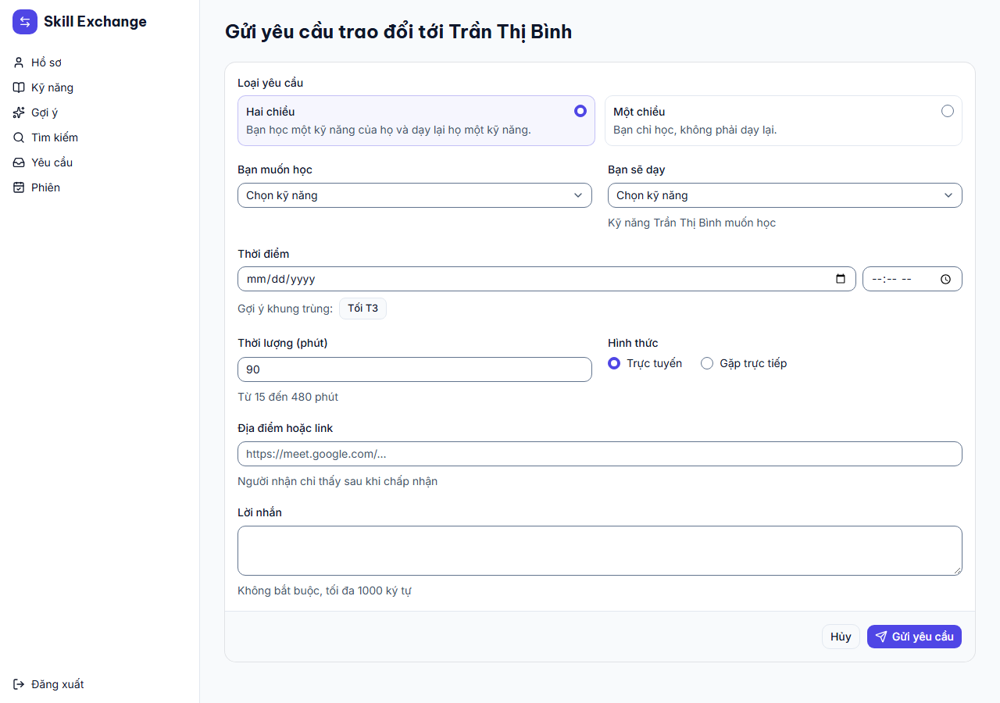
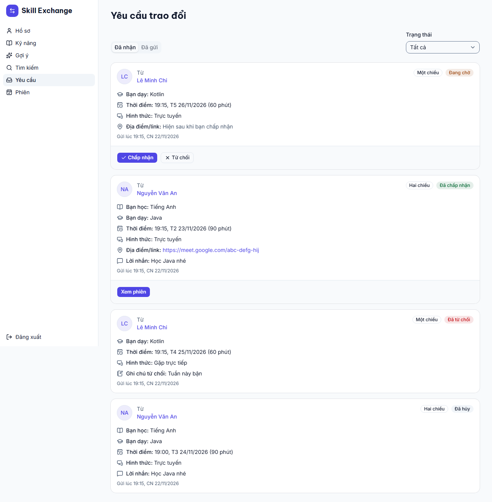
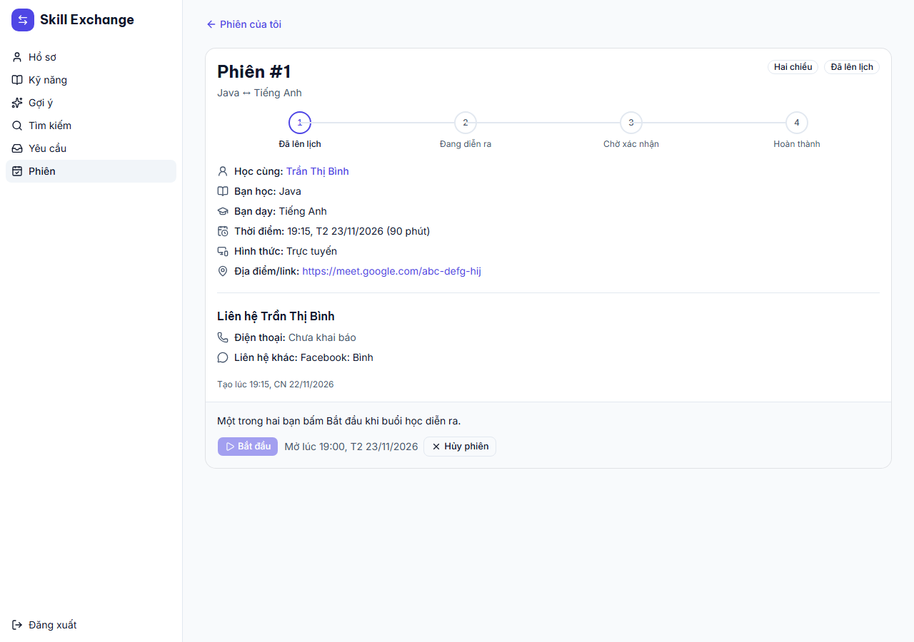
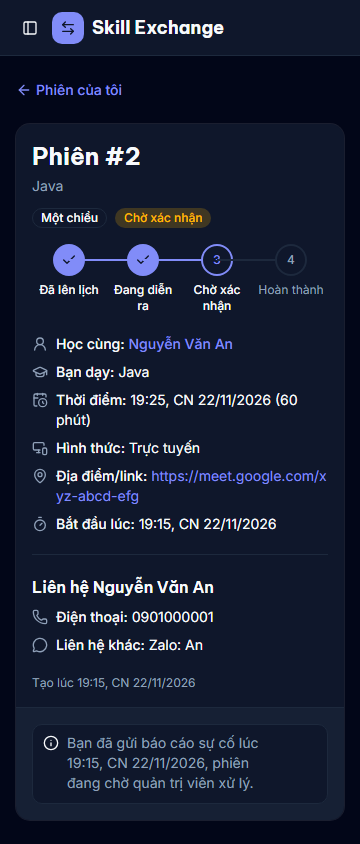
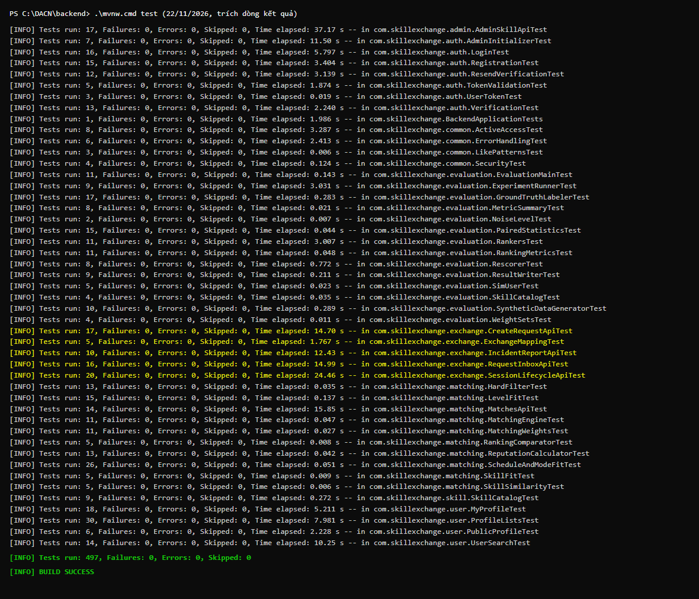

# Nội dung điền vào mẫu báo cáo – Tuần 6 (Giao diện mới, yêu cầu trao đổi, phiên, báo cáo sự cố)

Nguồn: `git log` tuần 6, `Quyet_dinh_tuan_6.md` (D78–D96, bảng 2.1–2.3), `ke_hoach_tuan_6.md`, `kiem_thu/README.md`, spec tuần 1 (mục 6.2–6.4, 7, đã sửa ngược ở bước 0 của tuần 6), thiết kế tuần 2 (mục 4.6–4.8, 5.1–5.2, 6.3). Số liệu kiểm thử lấy từ lần chạy ngày 22/11/2026 ở commit `3539e90` (backend không đổi từ `427d313`). Số bảng/hình nối tiếp bản báo cáo sau tuần 5 (`Update báo cáo tuần 5.docx`).

## Bảng đối chiếu: phần nào của tuần 6 điền vào mục nào của mẫu

| Phần của tuần 6 | Mục trong mẫu | Ghi chú |
| --- | --- | --- |
| Thư viện giao diện mới (D78) | 2.2 | Sửa dòng "Giao diện" của Bảng 2.1 |
| Quy tắc đợt 4 đã chốt (R33, R34, R36, R37, Q1; D89–D96) | 3.4, 3.5 | Sửa Bảng 3.3–3.6, 3.8, 3.9, 3.10 và danh sách thao tác bị cấm |
| API yêu cầu, phiên, báo cáo (D89–D94) | 4.4 | Sửa các dòng của Bảng 4.13; thay đoạn sau Hình 4.5 |
| Màn hình S07–S09 (D95), giao diện mới (D78–D85) | 4.4 | Sửa dòng S07–S09 của Bảng 4.14, dòng FR-05, FR-06, FR-09 của Bảng 4.15; thêm đoạn sau Hình 4.9 |
| Quyền, dữ liệu riêng tư, thao tác đồng thời (D87, D91, D92, D94) | 4.5 | Sửa 3 ý, thêm 2 ý |
| Thư viện giao diện | 5.1 | Sửa dòng "Frontend" của Bảng 5.1 |
| Package `exchange`, màn hình mới | 5.2 | Thay Bảng 5.2; thêm dòng tuần 6 vào Bảng 5.3 |
| Yêu cầu, phiên, báo cáo; giao diện mới; S07–S09 | 5.3 | Hình 5.12–5.15; ghi chú về Hình 5.1–5.11 |
| `kiem_thu/README.md` | 6.1, 6.2 | Bảng 6.8, 6.9 mới, Hình 6.5; **dời số 8 bảng của mục 6.3** |
| Điều chỉnh so với báo cáo trước | Báo cáo tuần 6 (`Bao_cao_tuan_6.md`, mục 4) | Báo cáo chính sửa thẳng ở các mục trên |
| Hạn chế mới; Reputation đã có dữ liệu phiên | 7.2 | Thay 1 ý, thêm 5 ý |
| Bài học trong tuần | 7.4 | Thêm 3 ý |

**Đổi số bảng ở Chương 6.** Hai bảng mới của tuần 6 nằm cuối mục 6.2, trước mục 6.3, nên 8 bảng của mục 6.3 dời số: 6.8 → 6.10, 6.9 → 6.11, 6.10 → 6.12, 6.11 → 6.13, 6.12 → 6.14, 6.13 → 6.15, 6.14 → 6.16, 6.15 → 6.17. Phải sửa cả chỗ nhắc tới các bảng này: mục 4.3 (cuối đoạn "Độ phức tạp" nhắc Bảng 6.15; cuối đoạn "Lý do chọn mẫu số của ScheduleFit" nhắc Bảng 6.9, 6.14; đoạn "Giá trị thật và giá trị tự khai" nhắc Bảng 6.8), mục 6.3 (câu dẫn và chú thích của từng bảng; Bảng 6.11 còn được nhắc ở đoạn trước Bảng 6.13, Bảng 6.9 ở đoạn trước Bảng 6.14) và mục 6.4 (nhắc Bảng 6.11 hai lần, Bảng 6.12 một lần). Hình không đổi số: Hình 6.5 mới nằm sau Hình 6.4, mục 6.3 không có hình.

---

# CHƯƠNG 2 – MỤC 2.2, dòng "Giao diện" của Bảng 2.1

| Thành phần | Công nghệ (phiên bản) | Dùng để làm gì | Lý do chọn |
| --- | --- | --- | --- |
| Giao diện | React 19, TypeScript 6, Vite 8; Tailwind CSS 4, shadcn/ui (trên Radix UI) | Xây dựng giao diện người dùng, gọi REST API | TypeScript kiểm tra kiểu dữ liệu trả về từ API (ví dụ kết quả gợi ý có nhiều trường điểm thành phần), giảm lỗi khi hiển thị; Vite khởi động và build nhanh. Từ tuần 6, các component giao diện (thẻ, nút, hộp thoại, tab, menu) lấy từ shadcn/ui; màu, font và chế độ tối khai báo một lần bằng biến CSS của Tailwind |

---

# CHƯƠNG 3 – sửa mục 3.4, 3.5

Các quy tắc chốt ở bước 0 của tuần 6 (rà soát đợt 4: R33, R34, R36, R37 và câu hỏi Q1) đã sửa ngược vào spec tuần 1 mục 6.2–6.4. Báo cáo chính sửa tương ứng như sau.

## 3.4 – Bảng 3.3, dòng "Luồng ngoại lệ" và "Hậu điều kiện"

| Mục | Nội dung |
| --- | --- |
| Luồng ngoại lệ | Backend kiểm theo thứ tự, gặp lỗi đầu tiên thì dừng: (1) thiếu hoặc sai trường (400, lỗi theo từng ô); (2) loại yêu cầu và kỹ năng người nhận không khớp nhau (400); (3) thời điểm không ở tương lai (400); (4) gửi cho chính mình (400); (5) người nhận không tồn tại, chưa xác thực, bị khóa hoặc là quản trị viên: cùng một lỗi 404, để không dò được trạng thái tài khoản người khác; (6) kỹ năng không thuộc danh sách muốn học của bên học (400); (7) bên dạy không dạy kỹ năng đó hay kỹ năng liên quan, tức $Sim = 0$ (400); (8) đã có một yêu cầu `PENDING` cùng chiều tới người này (409). Chiều ngược lại vẫn gửi được |
| Hậu điều kiện | Có một yêu cầu `PENDING`; người nhận thấy yêu cầu trong hộp "Đã nhận". Người nhận chưa thấy địa điểm/link; người gửi xem lại được nội dung do chính mình nhập. Không bên nào thấy số điện thoại, liên hệ của bên kia |

## 3.4 – Bảng 3.4, dòng "Luồng ngoại lệ" và "Hậu điều kiện"

| Mục | Nội dung |
| --- | --- |
| Luồng ngoại lệ | Người gọi không tham gia yêu cầu → 403; sai vai trò (người gửi bấm chấp nhận, người nhận bấm hủy) → 403. Yêu cầu không còn `PENDING` → 409. Chấp nhận khi đã tới thời điểm đề xuất → 409 (phiên sinh ra sẽ có giờ hẹn ở quá khứ); từ chối và hủy thì vẫn được. Chấp nhận khi người gửi không còn hoạt động (bị khóa) → 409. Người gửi hủy đúng lúc người nhận chấp nhận → thao tác đến sau thất bại (409) nhờ khóa lạc quan, không thể có yêu cầu đã hủy mà vẫn sinh phiên |
| Hậu điều kiện | Khi chấp nhận: có một phiên `SCHEDULED`; người nhận thấy địa điểm/link; số điện thoại, liên hệ của bên kia hiện ở chi tiết phiên cho cả hai người |

## 3.4 – Bảng 3.5, dòng "Luồng ngoại lệ"

> Người đã bấm hoàn thành bấm xác nhận lần hai → 409. Phiên đang có báo cáo sự cố chưa xử lý → xác nhận hoàn thành bị từ chối (409), chỉ quản trị viên chốt được. Hai người cùng bấm một lúc → request thứ hai thất bại (409) nhờ khóa lạc quan; giao diện tải lại trạng thái mới. Bên còn lại không đồng ý → không xác nhận, gửi báo cáo sự cố (Bảng 3.6).

## 3.4 – Bảng 3.6, dòng "Luồng ngoại lệ"

> Phiên không ở `WAITING_CONFIRMATION` → 409. Phiên đã có báo cáo `OPEN` → không tạo thêm (409), kể cả khi hai báo cáo gửi đúng một lúc. Người không tham gia phiên gửi báo cáo → 403. Lý do để trống → 400.

## 3.5 – Bảng 3.8, cột "Điều kiện / tác động phụ" của hai dòng

| Từ | Sang | Ai thực hiện | Điều kiện / tác động phụ |
| --- | --- | --- | --- |
| `SCHEDULED` | `IN_PROGRESS` | Người tham gia | Từ 15 phút trước giờ hẹn trở đi, không có giới hạn trên (bắt đầu muộn vẫn được); ghi thời điểm bắt đầu |
| `SCHEDULED` | `CANCELLED` | Người tham gia | Bắt buộc có lý do; hủy được ở mọi thời điểm, kể cả sau giờ hẹn; phiên chưa bắt đầu nên không tính vào $CompletionRate$ |

## 3.5 – danh sách "Các thao tác bị cấm", thêm hai ý

- Chấp nhận yêu cầu khi đã tới thời điểm đề xuất.
- Gửi báo cáo khi phiên không ở `WAITING_CONFIRMATION` hoặc đã có báo cáo đang mở; xác nhận hoàn thành khi phiên có báo cáo đang mở.

## 3.5 – Bảng 3.9, thay dòng "Xem liên hệ, địa điểm/link" bằng hai dòng

| Hành động | Người gửi | Người nhận | Người khác | Quản trị viên |
| --- | --- | --- | --- | --- |
| Xem số điện thoại, liên hệ của bên kia | ✔ sau ACCEPTED | ✔ sau ACCEPTED | ✖ | ✔ (tra cứu vi phạm, tuần 7) |
| Xem địa điểm/link | ✔ luôn (do chính mình nhập) | ✔ sau ACCEPTED | ✖ | ✔ (tra cứu vi phạm, tuần 7) |

Dòng "Báo cáo sự cố" thêm ghi chú: "khi phiên chờ xác nhận hoàn thành".

## 3.5 – Bảng 3.10, sửa G2 và thêm G8

| Mã | Giả định |
| --- | --- |
| G2 | Yêu cầu `PENDING`, phiên `SCHEDULED` và phiên `IN_PROGRESS` không tự hết hạn trong MVP. Yêu cầu đã tới thời điểm đề xuất thì không chấp nhận được nữa nhưng vẫn hủy, từ chối được |
| G8 | Không chặn một người có hai yêu cầu hay hai phiên chồng giờ nhau; không kiểm hình thức của yêu cầu với hình thức học của người nhận (người nhận thấy và từ chối được) |

---

# CHƯƠNG 4 – sửa mục 4.4, 4.5

## 4.4 – Bảng 4.13, thay bốn dòng của yêu cầu, phiên, báo cáo

| Phương thức | Đường dẫn | Quyền | Chức năng | Yêu cầu |
| --- | --- | --- | --- | --- |
| GET | `/api/requests?box=sent\|received&status=`, `/api/requests/{id}` | Active / Participant | Hộp yêu cầu đi / đến (lọc theo trạng thái), chi tiết yêu cầu; không bao giờ trả số điện thoại, liên hệ | FR-05, NFR-02 |
| GET | `/api/sessions?status=`, `/api/sessions/{id}` | Participant | Danh sách phiên (không có liên hệ, địa điểm/link); chi tiết phiên kèm liên hệ bên kia và địa điểm/link | FR-06, NFR-02 |
| POST | `/api/sessions/{id}/start`, `/complete`, `/cancel` | Participant | Bắt đầu, hoàn thành / xác nhận, hủy phiên; trả chi tiết phiên mới | FR-06 |
| POST | `/api/sessions/{id}/reports` | Participant | Gửi báo cáo sự cố khi phiên đang chờ xác nhận hoàn thành | FR-09 |

Thêm sau Bảng 4.13:

> Quản trị viên gọi `/api/requests/**`, `/api/sessions/**` nhận 403 như các API dành cho sinh viên; quản trị viên xem phiên khi xử lý báo cáo sự cố (A02, tuần 7). Mọi lỗi trả về dạng Problem Details, câu `detail` của từng tình huống liệt kê ở bảng 2.1 của quyết định tuần 6.

## 4.4 – thay câu ngay sau Hình 4.5

> Khi tạo yêu cầu, backend kiểm theo đúng thứ tự ở Bảng 3.3 (luồng ngoại lệ) và dừng ở lỗi đầu tiên. Thứ tự này được ghim bằng test: ví dụ yêu cầu vừa gửi cho người không tồn tại vừa thiếu thời lượng nhận lỗi 400 của thời lượng, không nhận 404.

## 4.4 – Bảng 4.14, thay ba dòng S07–S09

| Mã | Màn hình | Nội dung chính |
| --- | --- | --- |
| S07 | Gửi yêu cầu (`/users/:id/request`) | Mở từ nút "Gửi yêu cầu" ở S05 (chọn sẵn loại theo tab) và S06; loại hai chiều / một chiều; kỹ năng từng chiều lấy từ danh sách muốn học của mỗi bên; ngày, giờ kèm chip khung rảnh trùng; thời lượng, hình thức, địa điểm/link (ghi "Người nhận chỉ thấy sau khi chấp nhận"), lời nhắn |
| S08 | Hộp yêu cầu (`/requests`) | Tab Đã nhận / Đã gửi, lọc theo trạng thái; nút Chấp nhận, Từ chối (nhập ghi chú), Hủy yêu cầu; yêu cầu đã chấp nhận có nút "Xem phiên" |
| S09 | Phiên của tôi (`/sessions`), chi tiết phiên (`/sessions/:id`) | Danh sách lọc theo trạng thái; chi tiết có thanh tiến trình, liên hệ bên kia, địa điểm/link; nút Bắt đầu (khóa tới 15 phút trước giờ hẹn) / Hoàn thành / Xác nhận / Hủy / Báo cáo sự cố theo trạng thái; nút Đánh giá thêm ở tuần 7 |

## 4.4 – Bảng 4.15, thay ba dòng

| Yêu cầu | Bảng dữ liệu | API | Màn hình |
| --- | --- | --- | --- |
| FR-05 Yêu cầu trao đổi | exchange_requests | /requests\* | S05, S06, S07, S08 |
| FR-06 Phiên và xác nhận hoàn thành | exchange_sessions | /sessions\* | S09 |
| FR-09 Báo cáo sự cố | incident_reports | /sessions/{id}/reports (tuần 6), /admin/reports\* (tuần 7) | S09, A02 |

## 4.4 – thêm sau Hình 4.9 (wireframe chi tiết phiên)

> **Hệ thống giao diện (từ tuần 6).** Giao diện dùng Tailwind CSS và bộ component shadcn/ui, sinh vào mã nguồn dự án chứ không cài như một gói (D78, D83). Màu xám lấy theo bảng `slate`; màu chính là chàm (`#4F46E5`, chế độ tối `#818CF8`); màu trạng thái: xanh lá cho hoàn thành, hổ phách cho đang chờ, đỏ cho lỗi. Mọi cặp chữ/nền đạt tương phản tối thiểu 4.5:1, viền ô nhập 3:1 (WCAG AA), kể cả chữ màu trên nền nhạt cùng màu của nhãn trạng thái (D79). Tiêu đề dùng font Be Vietnam Pro, nội dung dùng Inter; cả hai đóng gói cùng ứng dụng, không tải từ Google Fonts (D80). Từ 768 px menu là thanh bên, hẹp hơn thì thành thanh trên cùng có nút mở menu (D81). Chế độ tối theo cài đặt của hệ điều hành, không có nút chuyển (D82). Lưới lịch rảnh xoay thành 7 hàng ngày × 3 cột buổi dưới 640 px để không cuộn ngang (D84). Thông báo hiện ngay trong thẻ vừa thao tác, không dùng thông báo nổi (D85).

## 4.5 – sửa ba ý, thêm hai ý

Sửa ý "Quyền Active kiểm ở bộ lọc", thay "cho `/api/matches/**` và `/api/users/**`" bằng:

> cho `/api/matches/**`, `/api/users/**`, `/api/requests/**` và `/api/sessions/**`.

Thay ý "Bảo vệ thông tin riêng tư (NFR-02)":

> **Bảo vệ thông tin riêng tư (NFR-02):** số điện thoại và liên hệ cá nhân chỉ được trả về qua `/api/me` (của chính mình) và chi tiết phiên (`GET /api/sessions/{id}`, cùng response của `start`, `complete`, `cancel`) cho hai người tham gia. Địa điểm/link: người gửi luôn xem lại được nội dung do chính mình nhập; người nhận chỉ thấy khi yêu cầu đã được chấp nhận; danh sách phiên không có trường này. API yêu cầu không bao giờ trả số điện thoại, liên hệ. Luật "ai thấy địa điểm/link" nằm ở một hàm ánh xạ duy nhất, dùng chung cho tạo yêu cầu, hộp yêu cầu và chi tiết yêu cầu. Hồ sơ công khai `/api/users/{id}` không chứa các trường này.

Thay ý "Chống thao tác đồng thời":

> **Chống thao tác đồng thời:** bảng yêu cầu và phiên có cột `version` (khóa lạc quan). Hai thao tác xung đột cùng lúc (người gửi hủy đúng lúc người nhận chấp nhận, hai người cùng bấm hoàn thành) thì thao tác đến sau thất bại (409) thay vì ghi đè. Gửi báo cáo sự cố cũng tăng `version` của phiên dù không đổi cột nào của phiên: ở mức cô lập READ COMMITTED của PostgreSQL, lệnh xác nhận hoàn thành chạy chồng không thấy báo cáo chưa commit, nên chỉ kiểm "có báo cáo mở không" là chưa đủ; nhờ tăng `version`, một trong hai lệnh thua khóa lạc quan và không bao giờ có phiên đã hoàn thành mà báo cáo vẫn mở. Hai yêu cầu `PENDING` cùng chiều hay hai báo cáo mở gửi đúng một lúc bị chỉ mục unique một phần của CSDL chặn, trả 409 chứ không phải 500.

Thêm hai ý:

- **Thứ tự kiểm lỗi cố định.** Mọi API yêu cầu và phiên kiểm theo cùng một thứ tự: chưa đăng nhập 401 → không có quyền *Active* 403 (ở bộ lọc) → dữ liệu sai 400 → không tìm thấy 404 → không tham gia 403 → sai vai trò 403 → sai trạng thái 409. Thứ tự này được ghim bằng test, để cùng một request luôn nhận cùng một lỗi.
- **Thao tác trên phiên không phụ thuộc trạng thái tài khoản bên kia.** Bên kia bị khóa thì mình vẫn bắt đầu, hoàn thành, hủy được phiên; chỉ chấp nhận yêu cầu mới đòi người gửi còn hoạt động.

---

# CHƯƠNG 5 – MỤC 5.1 đến 5.3

## 5.1. Môi trường và công cụ phát triển

Bảng 5.1, thay dòng "Frontend":

| Hạng mục | Công cụ / phiên bản |
| --- | --- |
| Frontend | React 19, TypeScript 6, Vite 8, React Router 8.5, oxlint; giao diện: Tailwind CSS 4.3, shadcn/ui 4.23 (component trên Radix UI 1.8), icon lucide-react; font Be Vietnam Pro và Inter đóng gói qua `@fontsource` |

Thêm sau đoạn tuần 5:

> Tuần 6 thêm Tailwind CSS (plugin `@tailwindcss/vite`), shadcn/ui, lucide-react, cmdk (ô chọn kỹ năng có tìm kiếm) và hai gói font. Component shadcn/ui được CLI `shadcn` sinh vào `frontend/src/components/ui/`, nên là mã nguồn của dự án. Backend không thêm thư viện.

## 5.2. Tổ chức mã nguồn

*Bảng 5.2: Tổ chức mã nguồn sau tuần 6*

| Thư mục / package | Vai trò |
| --- | --- |
| `backend/.../auth` | Đăng ký, xác thực email, gửi lại link, đăng nhập, tạo admin đầu tiên, bộ lọc trạng thái tài khoản và quyền *Active* |
| `backend/.../user` | Hồ sơ của tôi, lịch rảnh, kỹ năng dạy / muốn học; hồ sơ công khai và tìm kiếm người dùng |
| `backend/.../skill` | Danh mục kỹ năng cho sinh viên chọn (chỉ đọc, không gồm kỹ năng đã ẩn); Entity kỹ năng, nhóm |
| `backend/.../exchange` | **Mới:** yêu cầu trao đổi, phiên, báo cáo sự cố phía người dùng: Entity, Repository, hai service chứa luật trạng thái, hai controller, DTO |
| `backend/.../admin` | API quản trị danh mục kỹ năng (A01); xử lý báo cáo sự cố (A02) thêm ở tuần 7 |
| `backend/.../matching` | **Lõi** Java thuần: lọc cứng, các thành phần điểm, Reputation, phân loại, xếp hạng. **Vỏ** nối với Spring. Tuần 5–6 không đổi |
| `backend/.../evaluation` | Module thực nghiệm Java thuần, chạy ngoài Spring. Tuần 6 không đổi |
| `backend/.../common` | Cấu hình bảo mật, xử lý lỗi Problem Details (thêm: lỗi khóa lạc quan → 409), bean `Clock`, escape chuỗi tìm kiếm |
| `backend/src/main/resources/db/migration` | `V1__init.sql` (lược đồ), `V2__seed_skills.sql`; tuần 4–6 không thêm migration |
| `frontend/src/components/ui` | **Mới:** component shadcn/ui do CLI sinh (nút, thẻ, hộp thoại, tab, menu...); chỉ sửa tay ba chỗ đã ghi trong kế hoạch tuần 6 |
| `frontend/src/api`, `auth`, `components`, `pages` | Gọi API, lưu vé, chặn trang theo vai trò, thành phần dùng chung, 11 màn hình S01–S10, A01 |
| `frontend/src/requestTime.ts`, `sessionView.ts`, `format.ts` | **Mới:** luật hiển thị viết thành hàm thuần, không phụ thuộc React: ngày giờ của chip khung trùng (S07), nút nào hiện và mốc mở nút "Bắt đầu" (S09), cách ghi ngày giờ |
| `thuc_nghiem/ket_qua/`, `docs/ket_qua.md` | Kết quả thực nghiệm (tuần 5), không đổi |

*Bảng 5.3: Commit theo tuần* – thêm dòng:

| Tuần | Nội dung chính | Link |
| --- | --- | --- |
| 6 | Giao diện Tailwind CSS + shadcn/ui; API và màn hình yêu cầu trao đổi, phiên, báo cáo sự cố (S07–S09) | https://github.com/world-ender1/skill-exchange/compare/baa1831...COMMIT_BAO_CAO |

## 5.3. Cài đặt các chức năng chính (bổ sung)

**Yêu cầu trao đổi và phiên (FR-05, FR-06).** Package `exchange` gồm ba Entity (`ExchangeRequest`, `ExchangeSession`, `IncidentReport`), hai service (`ExchangeRequestService`, `ExchangeSessionService`), hai controller và các DTO. Hình 3.2, 3.3 là hai máy trạng thái; mỗi thao tác đổi trạng thái kiểm người gọi, vai trò, trạng thái và thời điểm ở service theo bảng trạng thái × hành động của quyết định tuần 6, rồi mới gọi phương thức đổi trạng thái của Entity. Các điểm đáng chú ý:

- **Chấp nhận và tạo phiên trong một transaction.** `accept` đổi yêu cầu sang `ACCEPTED`, ghi xuống CSDL ngay để lỗi khóa lạc quan (nếu có) nổ ra trước, rồi tạo phiên chép thời điểm, thời lượng, hình thức, địa điểm từ yêu cầu. Lệnh tạo phiên lỗi thì cả lệnh đổi trạng thái yêu cầu cũng bị hoàn tác; có test chứng minh (chèn trước một phiên trùng `request_id` để lệnh tạo phiên chắc chắn lỗi).
- **Mốc thời gian lấy từ một bean `Clock`.** Mọi mốc mới (`created_at`, `responded_at`, `started_at`, `completed_at`, `cancelled_at`) lấy từ `Clock` chứ không từ giờ máy, nên test giả được giờ để kiểm luật 15 phút (đúng 15 phút trước giờ hẹn thì được, sớm hơn 1 giây thì không) và luật "đã tới thời điểm đề xuất".
- **Danh sách không N+1.** Hộp yêu cầu và danh sách phiên đọc bằng một câu JPQL kéo sẵn tên hai người và tên kỹ năng (kể cả kỹ năng đã ẩn); khóa ngoại trong Entity là mã số, không có quan hệ tải chậm nào để lỡ đọc ngoài transaction.
- **Khóa lạc quan có test tranh chấp chắc chắn.** Test chạy song song 20 lần không bảo đảm lần nào cũng tranh chấp thật. Vì vậy có thêm test dùng một kết nối JDBC riêng sửa dòng nhưng chưa commit (giữ khóa), đợi tới khi `pg_stat_activity` cho thấy lệnh của ứng dụng đang chờ khóa, rồi mới commit: lệnh của ứng dụng phải nhận 409.

**Báo cáo sự cố (FR-09, phần người dùng).** Báo cáo chỉ gửi được khi phiên đang `WAITING_CONFIRMATION`; khi có báo cáo đang mở, lệnh xác nhận hoàn thành bị từ chối và chỉ quản trị viên chốt được phiên (tuần 7). Lệnh gửi báo cáo đọc phiên kèm khóa lạc quan ép tăng `version` (mục 4.5). Chi tiết phiên cho biết có báo cáo đang mở, do ai gửi, lúc nào, nhưng không trả lý do: lý do chỉ quản trị viên đọc.

**Giao diện mới (D78–D85).** Tám màn hình đã có (S01–S06, S10, A01) chuyển sang shadcn/ui trong cùng một đợt, trên nhánh riêng, vì kiểu mặc định của Tailwind (Preflight) làm vỡ CSS cũ ngay khi cài. Đường dẫn, lời gọi API, câu thông báo không đổi. Ô chọn trình độ, hình thức học dùng thẻ `<select>` thật thay vì `Select` của Radix, để nhãn nối được với ô và điện thoại mở bộ chọn của hệ điều hành. Ô thêm kỹ năng ở S04 là ô gõ để lọc, không phân biệt dấu ("tieng" ra "Tiếng Anh"). Hình 5.1–5.8, 5.10, 5.11 chụp giao diện trước tuần 6; chức năng và dữ liệu trên các màn hình đó không đổi.

**Màn hình S07–S09 (D95).** Phần luật của giao diện viết thành hàm thuần (`requestTime.ts`, `sessionView.ts`) để kiểm bằng Node mà không cần trình duyệt; quyền vẫn do backend kiểm, giao diện chỉ ẩn nút.

- S07 (Hình 5.12): bấm chip khung trùng, ví dụ "Tối T3", thì điền thứ Ba gần nhất mà 19:00 còn ở tương lai (Sáng 08:00, Chiều 14:00, Tối 19:00). Ngày và giờ ghép theo giờ máy người dùng rồi gửi dạng ISO giờ UTC. Lỗi theo ô hiện ngay dưới ô.
- S08 (Hình 5.13): ghi theo góc nhìn người xem ("Bạn học", "Bạn dạy"). Thẻ `PENDING` phía người nhận ghi "Hiện sau khi bạn chấp nhận" thay cho địa điểm/link. Gặp 409 (ví dụ bên kia vừa hủy) thì hiện câu lỗi của backend và tải lại danh sách.
- S09 (Hình 5.14, 5.15): thanh tiến trình 4 bước; phiên đã hủy hiện hộp riêng ghi ai hủy, lúc nào, lý do. Nút "Bắt đầu" bị khóa tới 15 phút trước giờ hẹn, kèm chữ "Mở lúc 18:45, T3 24/11/2026"; trang đọc lại đồng hồ mỗi 30 giây nên nút tự mở. `start`, `complete`, `cancel` trả về chi tiết phiên mới nên trang vẽ lại bằng chính response; hủy và báo cáo mở hộp thoại bắt nhập lý do.

*Hình 5.12: Màn hình S07 – Gửi yêu cầu hai chiều (mở từ tab "Trao đổi hai chiều" của S05)*

*Hình 5.13: Màn hình S08 – Hộp yêu cầu của người nhận: yêu cầu đang chờ (chưa thấy địa điểm/link), đã chấp nhận, đã từ chối, đã hủy*

*Hình 5.14: Màn hình S09 – Chi tiết phiên hẹn sau 1 ngày: nút "Bắt đầu" bị khóa, có liên hệ của bên kia*

*Hình 5.15: S09 trên màn hình rộng 360 px, chế độ tối – phiên chờ xác nhận có báo cáo sự cố đang mở*

---

# CHƯƠNG 6 – MỤC 6.1, 6.2

## 6.1. Kế hoạch kiểm thử (bổ sung)

- **Kiểm thử tuần 6 (đã làm):** 61 ca viết trước từ tài liệu (`docs/tuan_6/kiem_thu/ca_kiem_thu.md`): 45 ca tích hợp, 16 ca thủ công. Chia 6 nhóm: giao diện chung; tạo yêu cầu; hộp yêu cầu và phản hồi; phiên; báo cáo sự cố; giao diện S07–S09.
- **Test tích hợp:** gọi 12 API trên CSDL kiểm thử riêng, giả giờ bằng đồng hồ giả lập. Phần phản hồi yêu cầu, vòng đời phiên và báo cáo sự cố viết theo TDD: test chạy đỏ đúng lý do, đọc lại từng ô của bảng trạng thái × hành động, rồi mới code.
- **Thao tác đồng thời:** hai ca chạy song song 20 lần (hủy đúng lúc chấp nhận, hai người cùng bấm hoàn thành) và ba test tạo tranh chấp chắc chắn bằng kết nối JDBC giữ khóa.
- **Luật hiển thị của giao diện:** 33 ca kiểm bằng Node cho các hàm thuần của S07–S09.
- **Kiểm tra chất lượng bộ test:** cố ý làm hỏng code 25 lần ở backend và 13 lần ở frontend.
- **Đối chiếu code với tài liệu:** ba lượt review độc lập, đối chiếu code với từng quyết định D78–D96.
- **Thủ công:** 16 ca trên trình duyệt Chrome điều khiển tự động (149 lượt kiểm), trên một CSDL tạm: tương phản đo bằng màu thật trình duyệt vẽ, font thật trình duyệt dùng, màn hình rộng 360 px, chế độ tối, luồng hai tài khoản.

## 6.2. Kết quả kiểm thử (bổ sung)

Kiểm thử tuần 6: backend đạt **497/497 test** (chạy ngày 22/11/2026), gồm 429 test của tuần 3–5; tuần 6 thêm 68 test (63 tích hợp, 5 kiểm ánh xạ Entity với bảng). 45/45 ca tích hợp đều có test; 16 ca thủ công đều đạt (sau khi sửa 4 lỗi giao diện tìm ra trong lúc kiểm). Lõi matching không đổi so với cuối tuần 5; không thêm migration; không test cũ nào bị sửa.

*Bảng 6.8: Một số ca kiểm thử tiêu biểu tuần 6*

| Mã TC | Yêu cầu | Mô tả / đầu vào | Kết quả mong đợi | Kết quả |
| --- | --- | --- | --- | --- |
| TC311 | FR-05, NFR-02 | An gửi yêu cầu cho Bình, địa điểm và lời nhắn có khoảng trắng hai đầu | 201; đủ 17 trường, chuỗi đã cắt khoảng trắng; không có số điện thoại, liên hệ, email | Đạt |
| TC317 | FR-05 | Thời điểm đề xuất bằng hiện tại; hiện tại + 1 giây; không ghi múi giờ | 400; 201; 400 | Đạt |
| TC320 | FR-05, R36 | Kỹ năng muốn học không có trong danh sách muốn học của người gửi | 400, lỗi dưới ô kỹ năng | Đạt |
| TC323 | FR-05 | An gửi Bình lần hai khi lần đầu còn chờ; Bình gửi An | 409; 201 (chiều ngược được phép) | Đạt |
| TC327 | FR-05 | Lệnh tạo phiên lỗi khi chấp nhận | 409; yêu cầu vẫn `PENDING` (một transaction) | Đạt |
| TC330 | FR-05, R34 | Chấp nhận lúc giờ đề xuất − 1 giây; đúng giờ đề xuất; quá giờ thì hủy | 200; 409; hủy vẫn được | Đạt |
| TC334 | TK 5.1 | 20 lần: người nhận chấp nhận và người gửi hủy cùng lúc | Mỗi lần một 200, một 409; không lần nào 500; chỉ yêu cầu đã chấp nhận có phiên | Đạt |
| TC337 | NFR-02 | Người nhận xem yêu cầu đang chờ; sau khi chấp nhận | Không có địa điểm/link; có địa điểm/link | Đạt |
| TC341 | FR-06 | Bắt đầu lúc giờ hẹn − 15 phút − 1 giây; đúng giờ hẹn − 15 phút | 409; 200 | Đạt |
| TC345 | Spec 4.3 | Phiên hủy trước khi bắt đầu; hủy sau khi bắt đầu; hoàn thành | Reputation của Bình: 0.5; 0.35; 0.65 | Đạt |
| TC354 | FR-09, R33 | Bình xác nhận hoàn thành khi phiên có báo cáo đang mở | 409, phiên vẫn chờ xác nhận | Đạt |
| TC302 | D79 | Đo tương phản chữ của nhãn trạng thái, nút, hộp thông báo ở hai chế độ | Chữ ≥ 4.5:1, viền ô nhập ≥ 3:1 | Đạt sau khi sửa (lần đầu 3.82–4.37:1) |
| TC308 | NFR-08 | 12 màn hình ở 360 px, tên 100 ký tự không có dấu cách | Không cuộn ngang | Đạt sau khi sửa (lần đầu S10 rộng 1146 px) |
| TC360 | FR-06, FR-09 | Hai tài khoản: bắt đầu, hoàn thành, báo cáo, rồi gọi xác nhận bằng tay | Nút xác nhận biến mất; gọi bằng tay nhận 409 | Đạt |

*Bảng 6.9: Làm hỏng code để kiểm tra bộ test (38 lần; bảng đủ ở `docs/tuan_6/kiem_thu/README.md`)*

| Làm hỏng | Test bắt được |
| --- | --- |
| Bỏ kiểm "kỹ năng thuộc danh sách muốn học của người gửi" | TC320, test D89 |
| Cho chấp nhận đúng lúc thời điểm đề xuất | TC330, test D90 |
| Bỏ khóa lạc quan của yêu cầu | Test D90 tranh chấp chắc chắn; TC334 ngay lần lặp đầu |
| Ném lỗi ngay sau khi tạo phiên trong lệnh chấp nhận | TC326 và 5 test khác (500) |
| Mốc 15 phút thành 0 | TC341 |
| Lệnh bắt đầu lấy giờ máy thay vì `Clock` | TC341, TC342, TC346 |
| Hủy phiên thì xóa thời điểm bắt đầu | TC345b (Reputation 0.5 thay vì 0.35), TC346 |
| Bỏ luật quyền *Active* cho `/api/sessions/**` | TC338, test D87 |
| Bỏ kiểm báo cáo mở khi xác nhận hoàn thành | TC354 |
| Gửi báo cáo không ép tăng `version` của phiên | Chỉ test D94 tranh chấp chắc chắn |
| (Giao diện) Coi đúng mốc 15 phút là chưa tới | Ca "đúng mốc" của S09 |
| (Giao diện) Bỏ `% 7` khi đổi thứ trong tuần | Không ca nào đỏ: đột biến tương đương, kết quả không đổi |

Ba phát hiện đáng chú ý:

- **"Kiểm trong cùng transaction" chưa đủ chặn chạy chồng.** Khi viết test cho báo cáo sự cố, kịch bản "An gửi báo cáo đúng lúc Bình xác nhận hoàn thành" cho cả hai cùng thành công: lệnh xác nhận không thấy báo cáo chưa commit, còn lệnh gửi báo cáo không ghi vào phiên. Kết quả là phiên đã hoàn thành mà báo cáo vẫn mở, đúng kịch bản "treo" mà quy tắc R33 muốn tránh. Đã sửa bằng cách cho lệnh gửi báo cáo ép tăng `version` của phiên (mục 4.5). Trong 10 test của báo cáo sự cố, chỉ test tạo tranh chấp chắc chắn bắt được khi bỏ cách sửa này.
- **Đo thật trên trình duyệt tìm ra lỗi mà test backend và review không thấy.** Tương phản của nhãn trạng thái chỉ được review ước lượng từ mã màu; đo thật cho 3.82–4.37:1, dưới mức 4.5:1 của D79, vì chữ màu nằm trên nền nhạt cùng màu (bảng số đo ở bước 1 chỉ đo trên nền trắng). Màn hình tìm kiếm ở 360 px bị kéo rộng tới 1146 px bởi tên dài không có dấu cách; review đọc code không thấy lỗi này. Đã đổi màu trạng thái đậm thêm một bậc và sửa bố cục; đo lại đạt hết.
- **Đổi thư viện giao diện làm mất cấu trúc tiêu đề mà nhìn không thấy.** Khi chuyển các thẻ sang component của shadcn/ui, tiêu đề cấp 2 của thẻ thành thẻ `div` và trang đăng nhập mất tiêu đề cấp 1. Trên màn hình chữ vẫn to và đậm như cũ, nhưng trình đọc màn hình không còn nhảy theo tiêu đề được. Review độc lập tìm ra; đã trả lại `h1`, `h2` như trước tuần 6.

Hình 6.5 là kết quả chạy toàn bộ kiểm thử backend ngày 22/11/2026: 47 lớp test, 497 test đều đạt. Ảnh vẽ lại từ log của lần chạy đó, giữ nguyên chữ, chỉ trích dòng kết quả của từng lớp và phần tổng kết; 5 lớp tô vàng là test của tuần 6.

*Hình 6.5: Kết quả chạy kiểm thử backend tuần 6 (trích phần kết quả của lệnh `mvnw test`)*

---

# CHƯƠNG 7 – MỤC 7.2, 7.4 (ghi dần)

## 7.2 – Hạn chế

Thay ý "Reputation đọc dữ liệu thật nhưng bảng đánh giá và phiên chưa có dữ liệu tới tuần 6–7...":

> Reputation đọc dữ liệu thật. Từ tuần 6, tỉ lệ hoàn thành phiên đã có dữ liệu (TC345 kiểm Reputation 0.35 khi phiên bị hủy sau khi bắt đầu, 0.65 khi hoàn thành); điểm đánh giá trung bình có từ tuần 7.

Thêm:

- Phiên có báo cáo sự cố đang mở bị giữ ở trạng thái chờ xác nhận cho tới khi quản trị viên xử lý (A02, tuần 7).
- Không chặn một người có hai yêu cầu hay phiên chồng giờ nhau (G8); yêu cầu và phiên không tự hết hạn (G2).
- Giao diện chưa có test tự động; luật hiển thị S07–S09 kiểm bằng Node, giao diện kiểm bằng trình duyệt điều khiển tự động, chưa thử với trình đọc màn hình thật.
- Gói JavaScript sau khi thêm thư viện giao diện là 540 kB (166 kB khi nén), vượt ngưỡng cảnh báo 500 kB của Vite; chưa tách code theo trang.
- Vài điểm nhỏ về trợ năng và trạng thái giao diện review tìm ra, chưa sửa, ghi ở `docs/tuan_6/kiem_thu/README.md` mục "Giới hạn" (ví dụ nút "Bắt đầu" bị khóa thì phím Tab không tới được, gợi ý dưới ô bị lỗi che mất).

## 7.4 – Bài học kinh nghiệm (ghi dần), thêm

- Thao tác đồng thời phải được kiểm bằng tranh chấp **chắc chắn xảy ra** (giữ khóa bằng một kết nối riêng), không chỉ chạy song song nhiều lần. Ở bước báo cáo sự cố, test kiểu này còn tìm ra một chỗ hở mà quy tắc trên giấy ("kiểm trong cùng transaction") không chặn được.
- Số đo tương phản phải lấy ở đúng nền nơi chữ thật sự nằm; đo trên nền trắng thì đạt, nhưng nhãn trạng thái có nền nhạt cùng màu thì không.
- Kiểm giao diện bằng trình duyệt thật tìm ra những lỗi mà đọc code bỏ sót (tên dài kéo rộng trang). Ngược lại, review đọc code tìm ra lỗi không nhìn thấy trên màn hình (mất tiêu đề `h1`, `h2`). Cần làm cả hai.
